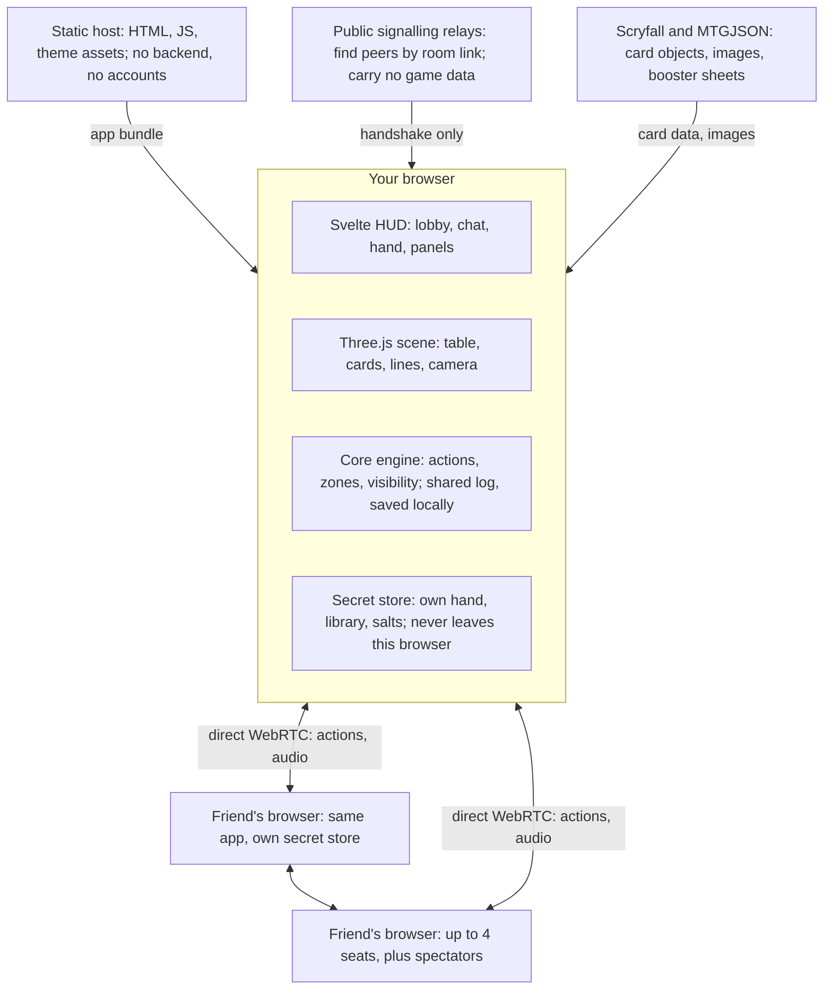
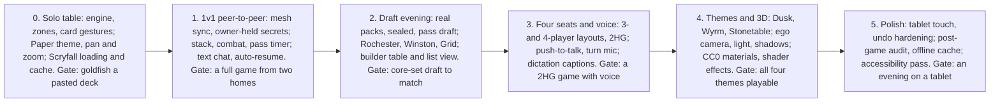

# Spellplane — Design Document

Nov 10, 2026 · @Philipp

## Vision, goals and non-goals

Spellplane is a single-page web app that gives two to four friends a shared, top-down card table on which they can play Magic: The Gathering exactly as they would on a physical desk. It manages cards, not rules: the players are the rules engine.

**Goals**

- Every physical gesture of a Magic game has a fast, legible digital equivalent: move, tap, pile, fan, flip, attach, mark, point, attack, block, stack, resolve.
- A whole evening runs inside one app: lobby, booster or Rochester draft, deck building, then the match, with text chat and push-to-talk voice.
- Formats: 1v1, 2v2 Two-Headed Giant, and three- or four-player free-for-all. Core-set booster draft is the primary use case.
- Navigation is smooth pan and zoom, with a bird's-eye view and an optional ego perspective from the player's seat.
- The look is swappable. A clean black-on-white minimal theme is the default; moody, dragon-themed and 3D-rendered stone-table themes are equal citizens, not afterthoughts.
- The table is universal: nothing in the core assumes Magic beyond a game-definition layer (zones, card back, card data source), so other card games can be added later.

**Non-goals**

- No rules enforcement, no automatic triggers, no legality checks during play. The app never stops a player from doing something a physical table would allow.
- No matchmaking, ranking or public lobbies. Play is by invitation among friends.
- No AI opponents. Draft bots, if any, exist only to fill seats.
- No card trading, collection economy or monetisation.

## Prior art

No existing tool combines a rules-free table, built-in drafting, real combat and stack gestures, and a designed look; each does one or two of these. Findings marked (unverified) could not be confirmed from primary sources.

| Tool | What it is | Worth copying | Avoid |
| --- | --- | --- | --- |
| [Cockatrice](https://github.com/Cockatrice/Cockatrice) | Desktop, rules-free, C++/Qt with its own server | Right-drag arrows with modifier colours; rich token and counter actions; action log; phase bar | Install and set-update friction; everything behind context menus; no priority or team mode |
| [Untap.in](https://draftsim.com/how-to-play-commander-online/) | Browser, rules-free | "Alert Response" and "No Response" buttons; double-click to tap or draw; built-in voice | No arrows (freehand scribbles instead); no phase tracker; manual tokens |
| [TableCommander](https://tablecommander.com/docs/gameplay/controls) | Browser, rules-free Commander table | Hover a card and press one key; table-wide "ping" on a card; declared-not-enforced attacker and blocker badges | Commander-only assumptions |
| [Playgroup Live](https://playgroup.gg/playgroup-live/features) | Browser, server-authoritative | Stack zone; undo; library menu (scry, surveil, reveal-until); reveal a face-down card to one player | Needs a server |
| [Maginet](https://github.com/reifocS/maginet) | Open source, peer-to-peer over PeerJS | Proof that a serverless mesh works for a card table | No zones, no stack, no hidden-information protection |
| [Draftmancer](https://github.com/Senryoku/Draftmancer) | Draft-only web app (Vue, socket.io) | Many pod formats incl. Rochester, Winston, Grid (unverified from the site); bots | Play happens elsewhere, so the evening is split across tools |
| [SpellTable](https://feedback.wizards.com/forums/938094-spelltable-bugs-product-suggestions) | Webcam play with paper cards | Proves voice matters more than text | Choppy voice pushes users to Discord |
| Tabletop Simulator mods | 3D physics sandbox | The feel of a real table | Clunky controls, paid, importers break |
| [XMage](https://github.com/magefree/mage), [Forge](https://github.com/Card-Forge/forge) | Full rules engines | Nothing; they are the opposite design | Mistakes are hard to undo |

**Conventions players already know.** Browser-era tables use hover plus a bare key: T tap, F flip, G graveyard, E exile, H hand, D draw, S shuffle, and ? for the cheat sheet. Cockatrice adds Ctrl+U untap all, Ctrl+T token, Ctrl+M mulligan, Ctrl+I roll die and F5–F10 for phases. Spellplane adopts the bare-key set as its default and never fires hotkeys while the chat input has focus, a reported Lackey annoyance.

## Players, seats and formats

A table seats two to four players plus any number of spectators, and every viewer sees their own seat at the bottom of the screen. Opponents' cards face their owners, as at a real table; inspecting any card shows it upright.

| Format | Seats | Layout from your view | Life | Turn marker |
| --- | --- | --- | --- | --- |
| 1v1 | 2 | You at the bottom, opponent across | 20 each | Per player |
| Three-player free-for-all | 3 | You at the bottom, opponents at top-left and top-right | 20 each | Per player, clockwise |
| Four-player free-for-all | 4 | One player per table side | 20 each | Per player, clockwise |
| Two-Headed Giant | 2 + 2 | Teammates side by side on one long edge, opposing team across | 30 per team | Per team |

**Seats.** The lobby shows the table from above with empty chairs; players click a chair, pick a seat colour and can shuffle seats randomly. Seat colour is used for lines, pings, cursors, captions and log attribution in every theme.

**Two-Headed Giant.** Teammates have adjoining territories with no gap, one shared life total and one shared turn and phase marker. Each teammate's hand is visible live to the other, shown as a second, smaller fan above the player's own. A team channel carries voice and text only between teammates. The first team's draw-skip and the team mulligan are left to the players.

**Spectators.** A spectator joins by the same link without taking a chair, sees only public zones, can chat and ping, and cannot move cards. A player may reveal their hand to a named spectator.

**Other players' cursors.** Each player's pointer and any card they are dragging are shown live in their seat colour, so intent is visible before an action lands.

**Identity.** There are no accounts. A player is a nickname plus a random key pair generated on first visit and kept in the browser; the key identifies the seat on reconnect.

## Table model

The table is one continuous plane divided into a territory per seat around a shared centre. Every card is in exactly one zone, and each zone has a fixed visibility rule that decides whose browser holds its contents.

| Zone | Per | Who sees faces | Where the data lives | Presentation |
| --- | --- | --- | --- | --- |
| Library | Player | Nobody (order hidden) | Owner's browser only; others get a count | Squared pile, count badge |
| Hand | Player | Owner (and teammate in Two-Headed Giant, if enabled) | Owner's browser only; others get a count | Screen-anchored fan for the owner; a row of card backs at the seat for others |
| Battlefield | Player territory | Everyone | Shared | Free placement with snapping |
| Graveyard | Player | Everyone | Shared | Squared pile, top card visible; opens as an ordered fan |
| Exile | Player | Everyone, except face-down cards | Shared; face-down identities stay with the exiling player | Pile beside the graveyard |
| Stack | Table | Everyone | Shared | Central cascade lane |
| Command / emblem area | Player | Everyone | Shared | Small area beside the avatar |
| Sideboard / pool | Player | Owner | Owner's browser only | Hidden during play; the builder table between games |
| Draft pack | Table or player | Current holder (everyone in Rochester) | Holder's browser, handed over on pass | Fan or grid |

**Card instance.** Each physical card in a game is an instance with a stable id, an owner, a controller (the territory it sits in), and public state: position, rotation, tapped, face-up or face-down, current face, counters, note, attachments, pile membership, home slot when displaced. Its identity (which Magic card it is) is a separate field that is only present in shared state while the card is public.

**Hidden cards.** A card in a hidden zone exists in shared state only as an opaque instance id; its identity lives in the owner's browser. When it becomes public (cast, played, revealed, discarded), the owner publishes the identity together with a proof against the deck commitment made at game start (see Multiplayer architecture). When a public card returns to a hidden zone, peers drop the identity and the owner re-shuffles opaque ids where the rules require it.

**Face-down on the battlefield.** The instance is public but its identity stays with its controller until turned up. *Reveal to…* sends the identity to chosen peers only.

**Game definition.** Zones, their visibility rules, the card back, the starting life total, the phase list and the card data source are declared in a game-definition object. Magic is the only definition shipped; the engine itself knows nothing about Magic.

## Card manipulation

Cards go anywhere in a player's territory, and the table helps by magnetic snapping rather than fixed lanes. The primary pattern is hover a card and press one key; everything is also reachable by drag, context menu and touch.

**Placement and piles**

- **Free drag** with pointer capture; the card lifts, casts a shadow (in lit themes) and follows with a light spring.
- **Magnetic snapping.** Dropping near a card aligns to its edges with the standard gap. Dropping on a card's lower edge starts or extends a cascade pile, each card offset so title bars stay readable (lands, Auras under a creature). Dropping squarely on a card makes a squared pile with a count badge (tokens, library-like piles). Holding Ctrl disables snapping.
- **Piles move as one** when dragged by their bottom card; any other card pulls out singly. Double-click a pile to fan it open in place.
- **Tidy (Y)** re-flows the player's own battlefield into neat rows, preserving piles and relative order. It is never automatic.
- **Multi-select** by marquee drag on empty table or Shift+click. All actions apply to the selection; the selection shows a card count and summed power/toughness.

**Card state and actions**

| Action | Default key | Notes |
| --- | --- | --- |
| Tap / untap | T, or double-click | 90° rotation; Ctrl+U untaps everything you control |
| Flip face-down / up | F | Face-down cards show the back to others; the owner sees the face dimmed |
| Transform (other face) | Shift+F | For double-faced cards |
| Rotate 180° | Shift+T | Flip cards, "inverted" markers |
| Counters | + / − | Generic +1/+1 by default; number keys pick a named counter type (loyalty, −1/−1, charge, custom) |
| Note | N | A short text label on the card, typed or dictated |
| Attach | Drop onto a card | Tucks under the host, moves with it, shows an attachment line when pulled apart |
| Clone / token copy | X | Creates a token copy next to the card |
| Create token | Ctrl+T | Search Scryfall tokens; "related tokens" of the hovered card listed first |
| Peek | Alt+F | Look at a face-down card you are allowed to see; logged |
| Reveal to… | W | Show a hidden card to one player, a team or everyone |
| Move to zone | G graveyard, E exile, H hand, L library top, Shift+L library bottom | Also by dragging onto the zone |
| Inspect | Hold Space on hover, or middle-click | Large upright image with Oracle text, both faces, rulings link |

**Library actions** (on the library pile): draw (D), draw N, shuffle (S), look at top N (scry and surveil are look-then-drag to top, bottom or graveyard), reveal top, mill N, search (opens the library as a private fan, shuffles on close by default), mulligan (Ctrl+M, London style: shuffle hand in, draw seven, then bottom cards by hand).

**Other table objects.** Dice (any size) and coin flips with shared, logged results; a generic counter object for emblems, monarch, initiative or day/night; token cards; text sticky notes.

**Who may touch what.** See Decision log; the default is that any player can manipulate any public card, as at a real table, and the log names who did it.

## Combat and annotation

Combat is built from one generic primitive, the temporary move, plus shortcuts that make the common case one keystroke. The table has no combat mode and enforces nothing.

**Temporary move.** Any card on the battlefield can be displaced temporarily. It remembers its home slot, leaves a faint ghost outline there, and is drawn with a displacement marker. *Settle* (default key: B, or the Settle button) animates every displaced card on the table back home and removes combat lines. Settle can also be applied to a selection only. A normal drag stays a permanent move; holding Alt while dragging, or using a combat shortcut, makes it temporary.

**Combat shortcuts**

1. **Attack (A).** Selected or hovered creatures slide forward across their controller's front line and tap. Shift+A attacks without tapping, for vigilance.
2. **Attack target.** In two-player games the target is implicit. With several opponents, or when attacking a planeswalker, the attacker drags an attack line from the creature to a player avatar or permanent; unassigned attackers show a dashed stub.
3. **Block.** A defender drags a creature onto an attacker. The blocker moves temporarily to sit in front of it and a block line joins the pair. Several blockers on one attacker fan out; their left-to-right order is the damage order and can be rearranged by dragging.
4. **Settle.** After damage, cards that died are moved to the graveyard by hand as usual; Settle returns the survivors home. Attackers stay tapped.

**Connection lines.** A line joins any two things: card to card, card to player, stack item to target. Right-drag from the source draws one (long-press drag on touch). Lines glow in the owner's seat colour, follow their endpoints as cards move, and carry an optional short label.

| Line kind | Created by | Removed by |
| --- | --- | --- |
| Target | Right-drag from a stack item or card | When the stack item resolves, or manually |
| Attack | Attack shortcut plus target drag | Settle |
| Block | Dragging a blocker onto an attacker | Settle |
| Attachment | Dropping an Aura or Equipment onto a card | Detaching; the cards also tuck together |
| Persistent mark | Shift+right-drag | Manually; survives Settle, for lasting effects such as "enchanted by" or "copy of" |

**Ping.** Double-tapping a key on a hovered card (default: I) flashes it for everyone, the digital finger-point. Pings fade after two seconds and leave no state.

## The effect stack

The stack is a shared lane in the centre of the table, between all players, where spells and abilities pile up as a cascade with the newest on top. It resolves last in, first out, one item at a time, by a player action.

**Putting things on the stack**

- **Spell.** Drag a card from hand onto the stack lane, or press C (cast) on a hovered hand card. The card leaves the hand, becomes public and lands on top of the cascade.
- **Ability.** Press Q on a hovered permanent. A small ability marker appears on the stack showing the source card's name and art thumbnail (with artist credit), joined to its source by a line. The source card does not move.
- **Trigger.** Same as an ability; the marker is labelled as a trigger. Any player can add one for any card, since the table does not know who controls what effect.
- **Copy.** Pressing X on a stack item puts a copy marker above it.
- **Targets.** Right-drag from the stack item to cards or players. Target lines live exactly as long as the item.
- **Note.** Each item takes an optional one-line note ("X = 3", "kicked"), typed or dictated.

**Reading it.** Items overlap downward so every title bar stays visible, each tinted with its controller's seat colour and numbered from the bottom. Hovering an item highlights its source and targets. The lane grows toward the viewer and never covers a battlefield; at far zoom it collapses to a count badge that expands on hover.

**Resolving**

1. The top item is the only one with a Resolve action (R, or its button). Any player may press it; by convention its controller does.
2. Resolve asks where the item goes, with a default from its card type: permanents to the controller's battlefield, instants and sorceries to the owner's graveyard, markers vanish. One key accepts the default.
3. **Counter** (Shift+R) sends the top spell to its owner's graveyard instead and removes a marker.
4. Any item can be dragged out of the stack or reordered by hand, because rules corner cases exist and the table trusts its players.

**Stack and confirmation.** Putting an item on the stack automatically opens a confirmation round (see Turn flow and confirmation): the other players see the item pulse and either let the pass timer run out or press Hold. Resolve is fully lit only once everyone has passed.

## Turn flow and confirmation

The table tracks whose turn it is and which phase the active player has announced, and it runs a light confirmation round with an implicit pass timer. All of it is informational: no action is ever blocked by turn, phase or a pending confirmation.

**Turn and phase strip.** A compact strip shows the turn number, the active player (or team) and seven steps: untap, upkeep, draw, main 1, combat, main 2, end. The active player advances with Tab and passes the turn with Ctrl+Enter. On *Next turn* the new active player is offered a single key that untaps everything they control and draws a card; it is never done for them. Any player can move the marker, with attribution, to fix mistakes.

**Confirmation rounds**

1. **Start.** A round starts automatically when an item is put on the stack. Any player can also start one manually with *Ask* (key: K) and an optional short label such as "attacks?" or "end of turn?".
2. **Prompt.** The item or the asker's avatar pulses. Every other player sees a prompt with two choices, OK (Enter) and Hold (H while the prompt is up), and a draining ring showing the pass timer.
3. **Implicit pass.** Silence counts as OK when the timer runs out. The default is 5 seconds and the table host can change it in the lobby or mid-game (2 to 30 seconds, or off).
4. **Hold.** Hold stops everyone's timers and gives that player the floor: their avatar is marked "responding". They add to the stack, which starts a new round on the new top item, or release the hold.
5. **All passed.** The item shows a full ring and Resolve is fully lit. Resolving while someone has not passed is possible but needs a second key press and is logged.
6. **Auto-pass.** Each player has a personal "pass until end of turn" toggle (F6), cleared automatically when the turn changes or when they press Hold.

**Connection loss during a round.** An away player is treated as passing after the timer, so a dropped friend never stalls the table.

**Life and player counters.** Each avatar carries a life total (click or scroll to change, typed value on double-click), poison, and free-form named counters (energy, experience, commander damage per opponent). Changes within two seconds merge into one log line ("Anna: 20 → 14").

**Undo.** Ctrl+Z reverts the player's own most recent actions, one at a time, and every undo is shown in the log. Undoing a draw puts the card back on top of the library and says so. Shuffles, reveals, dice and coin results cannot be undone. There is no table-wide rewind.

**Action log.** Every state change is one line with seat colour, actor and card names; hovering a card name previews it and highlights the card on the table. Dictated comments and chat interleave in the same timeline. The log is the shared source of truth and is what gets saved for resume.

## Pre-game: draft, sealed and deck building

An evening moves through four stages on one link: lobby, card acquisition (draft or sealed), deck building, match. The pod is humans only, so the draft formats are adapted to two to four players instead of padding the table with bots.

**Lobby settings.** Format (1v1, free-for-all, Two-Headed Giant), acquisition mode, set per pack (any set with MTGJSON booster data; core sets listed first; a different set per pack is allowed), packs per player, picks per pass, optional pick timer (off by default), pass timer length.

| Mode | Players | Procedure | Hidden information |
| --- | --- | --- | --- |
| Booster draft | 3–4 (works with 2) | Each player opens a pack, picks N cards, passes; direction alternates left, right, left. Defaults: 3 packs, pick 1. [Pick-Two](https://magic.wizards.com/en/formats/pick-two-draft) preset for four players: 3 packs, pick 2. | A pack is visible only to its current holder |
| Rochester draft | 2–4 | One pack at a time is laid face up on the shared table. Players pick one card each in snake order (the last player picks twice, then back); the opener rotates each pack. | None: packs and picks are public |
| Winston draft | 2 | A shared face-down stack and three piles; look at a pile and take it, or add a card and move on | Pile contents visible to whoever looks |
| Grid draft | 2 | A face-up 3×3 grid; first player takes a row or column, second takes from the remainder | None |
| Sealed | 2–4 | 6 packs each, no drafting | Own pool only |
| Two-Headed Giant draft | 4 | Teams pick two cards per pack into a shared team pool; 6 packs per team | Team sees its own packs and pool |
| Two-Headed Giant sealed | 4 | 8 packs per team, shared pool | Team pool only |

**Pack generation.** Packs follow the selected set's real composition from MTGJSON: sheet weights, rarity slots, foil replacement, land slot and colour balancing. That gives, for example, 10 commons, 3 uncommons, 1 rare or mythic (about 1 in 8) and 1 basic land for M10 through M21, and 14-card Play Boosters for Foundations. Foils are marked with a subtle sheen and a badge.

**Drafting interaction.** The current pack is a fan or grid on the player's private table. Click a card to mark it, click again or press Enter to confirm. Picks fly to the player's pool area, which auto-sorts by colour and stays visible while drafting. Waiting packs queue visibly behind each seat so everyone sees who is holding things up. Rochester picks happen on the shared table with cursors and voice, since table talk is the point.

**Deck building.** Two views of the same pool, switchable at any time:

- **Builder table** (default). The pool lies on a private table with the same gestures as play. One key sorts into solitaire columns by colour, mana value or type. A deck area and a sideboard area are marked on the table; a basic-land dispenser hands out unlimited basics of any chosen printing. A live readout shows card count, mana curve, colour split and land count.
- **List view.** A compact two-column list (pool and deck) with filters and counts, for quick edits and for tablets.

The limited minimum of 40 cards is shown as a hint, not enforced. *Ready* locks the deck and publishes its commitment (see Multiplayer architecture). Between games, players return to the builder to sideboard.

**Constructed decks.** Outside limited play, decks come from three sources:

- **Paste a decklist** in plain "4 Lightning Bolt", MTGA or MTGO format; cards resolve through Scryfall, with a printing chooser per card.
- **Search and build** from all cards with a Scryfall-backed search box on the builder table.
- **Local deck library.** Decks and drafted pools are saved in the browser, reusable across evenings, and exportable and importable as files.

Cube drafting from a custom list is out of scope for the first versions; the pack generator takes a card list per sheet, so it can be added without redesign.

## Card data and images

Spellplane ships no card data or images. Each browser fetches them at runtime from Scryfall (card objects, images, tokens) and MTGJSON (booster composition), both of which send open CORS headers, so a static site with no proxy is enough.

| Need | Source | Notes |
| --- | --- | --- |
| Card objects for a set or a deck list | [Scryfall API](https://scryfall.com/docs/api) `/cards/search` and `/cards/collection` | 2 requests/s on these endpoints; a 429 locks the client out for 30 s. Cache for at least 24 h. |
| Card images | `cards.scryfall.io` | No rate limit, `Access-Control-Allow-Origin: *`, one-year cache header. Usable as WebGL textures with `crossOrigin="anonymous"`. |
| Image tiers | [Scryfall image sizes](https://scryfall.com/docs/api/images) | 146×204 thumbnail for far zoom, 488×680 for normal play, 672×936 for the inspect view. WebP variants exist alongside JPG. |
| Double-faced cards | `card_faces[]` per [layout](https://scryfall.com/docs/api/layouts) | `transform`, `modal_dfc` and similar carry one image per face; the flip action swaps faces. |
| Tokens | Scryfall `all_parts` links and token sets | "Create related token" reads the links on the source card. |
| Realistic packs | [MTGJSON](https://mtgjson.com/data-models/booster/) per-set file, `booster` field | Sheets with weights, foil sheets and colour balancing. Present for every core set from Alpha to Foundations (checked on 22 sets). 0.8–5 MB per set, MIT licensed. |
| Card back | Spellplane's own neutral back | The official back carries Wizards trademarks; it is an opt-in setting loaded from `backs.scryfall.io`. |

**Caching.** Card JSON and set files go to IndexedDB. Images go through a service worker into the Cache API, cache-first. All caches are rebuildable; the app requests persistent storage but never depends on it.

**Scryfall's image rules.** Card images are never cropped, tinted, blurred or distorted, and the artist and copyright line stay visible. Themes therefore style the table, frames around cards, sleeves and backs, but never the card face itself. Art-crop usage (for example on stack markers) shows the artist name beside it.

**Legal position.** The [Wizards Fan Content Policy](https://company.wizards.com/en/legal/fancontentpolicy) permits free fan content and forbids paywalls and forced registration; it does not mention software. Past takedowns ([Cockatrice in 2013](https://old.starcitygames.com/news/75_Cockatrice+Shut+Down), [Card Conjurer in 2022](https://techraptor.net/tabletop/news/wizards-cds-card-conjurer-causing-closure)) involved rules automation, printable proxies or money. Spellplane stays free, account-less, rules-free and image-free in its own bundle, and shows the policy's disclaimer in its About panel. The generic game-definition layer means the app itself contains no Wizards material.

## Multiplayer architecture

Spellplane is a static site with no backend: browsers find each other through public signalling relays and then talk directly over a WebRTC mesh. Each player's hidden cards exist only in that player's browser, so no peer, including the table's creator, can read an opponent's hand or library.



Every browser loads the same bundle and fetches card data itself; the relays are used only for the connection handshake, and the accented secret store is the one part that is never replicated.

**Rooms and connection**

- A table is a link with a random room id and key in the URL fragment, for example `spellplane.app/#/t/amber-fox-93/k=…`. The fragment is never sent to the host. Anyone with the link can join.
- Peers discover each other with [Trystero](https://github.com/dmotz/trystero) over public Nostr relays, with BitTorrent trackers as a second strategy. The room key encrypts the signalling payloads.
- Each pair of browsers opens one WebRTC connection carrying a reliable ordered data channel (actions), an unreliable channel (cursors, drags in progress) and audio tracks.
- **No relay fallback.** By decision there is no TURN server. Two players whose networks block direct connections cannot play together; the lobby runs a connectivity check per pair and says so plainly, with the usual remedies (other network, phone hotspot, VPN). This is the main accepted risk of the design.

**Shared state: a sequenced action log**

- All public state changes are actions appended to one log. One peer acts as *sequencer* and stamps each action with a sequence number; every peer applies actions in that order through the same pure reducer, so all browsers converge.
- The sequencer holds no secrets and has no special view. If it disconnects, the connected peer with the lowest seat number takes over from the last sequence number everyone acknowledges.
- A player's own drags and taps apply optimistically and are reconciled when the sequenced action returns.
- Presence (pointer position, the card being dragged, who is typing or speaking) is sent on the unreliable channel and never logged.

**Hidden information: owner-held with commitments**

1. **Deck commitment.** When a player presses Ready, their browser gives every card instance a random salt and publishes `hash(instance id, card id, salt)` for each, in random order. Peers learn the deck size and nothing else.
2. **Reveal.** When a card becomes public, the owner publishes its card id and salt; every peer checks them against the commitment. A card that does not match is flagged to the whole table.
3. **Shuffle.** The shuffle seed mixes a secret nonce from the owner with fresh nonces from every other peer, exchanged by commit-then-reveal. The owner cannot choose the order and the others cannot learn it. The owner publishes a hash of the resulting order.
4. **Private looks.** Scry, search and peek happen locally; only the fact and the count are logged ("Ben looks at the top 2 cards of his library").
5. **Targeted reveal.** Showing a card to one player or to a teammate sends the card id and salt on that pair's channel only.
6. **Audit.** At game end each browser can publish its nonces and order history. Peers replay them and confirm that every draw came from the committed order. A player can still peek at their own library with developer tools mid-game; the audit cannot see that, and among friends it is accepted.

Dice and coin flips use the same commit-then-reveal exchange, so no single browser picks the result.

**Draft packs.** Each player's browser generates that player's packs from a jointly seeded generator and commits to their contents. Passing a pack sends its remaining cards to the next player on their direct channel. Rochester, Grid and sealed-pool reveals need no secrecy beyond that.

**Resume and failure handling**

- Every browser continuously saves the shared log (with periodic snapshots) and its own secret store to IndexedDB, keyed by room id.
- Reloading or reopening the link rejoins the same seat by key pair and catches up from any connected peer. If nobody is connected, the first browser back restores from its own save; later arrivals reconcile to the copy with the highest sequence number.
- A disconnected player's seat is marked away. Their public cards stay on the table; their hand and library are unavailable until they return.
- If a player loses their local save (cleared storage, different device), their hidden zones are gone. The recovery path is public and logged: the player re-imports the deck, the table subtracts every card of theirs that is currently public, and the remainder is committed and shuffled as a new library with a fresh hand count agreed by the table.
- A game can be continued days later, provided the players come back with the same browsers.

## Chat and voice

The table has live voice and dictated captions as two modes of the same talk key, plus a text chat that shares one timeline with the action log. Voice travels on the same peer connections as the game, so there is nothing extra to host.

**Talk modes** (per player, switchable at any time)

| Mode | What the others get | When the mic is open |
| --- | --- | --- |
| Push-to-talk voice | Live audio | While the talk key is held (default: hold V; configurable, including a mouse button) |
| Turn mic | Live audio | Automatically for the whole of the player's own turn, so they can narrate their plays; outside their turn they fall back to push-to-talk. In Two-Headed Giant the active team's mics open. |
| Open mic | Live audio | Always, with a mute toggle (M) |
| Dictation | Text captions, no audio | While the talk key is held, or for the whole own turn when combined with Turn mic |

Voice and dictation can run together: the others hear the player and also get the caption and a log entry.

**Live voice.** Audio is a WebRTC mesh, at most six connections for four players, Opus at speech bitrates. The microphone is acquired once on joining the table (a click, which also satisfies autoplay rules) and gated by enabling and disabling the track, so opening the mic is instant. The talk key is released on window blur and ignored while a text field has focus. Echo cancellation, noise suppression and automatic gain stay on. Each avatar shows a speaking ring, and each player has a personal volume and mute control per other player.

**Team channel.** In Two-Headed Giant, Shift plus the talk key sends audio only to the teammate. Team text chat is a tab in the chat panel.

**Dictation and captions.** Speech is transcribed in the speaker's browser and sent as text.

- **Engine.** The browser's built-in speech recognition is the default (Chrome, Edge, Safari). It is instant and multilingual, but audio is processed by the browser vendor and Firefox does not support it. A player can instead download an in-browser Whisper-class model through [transformers.js](https://huggingface.co/docs/transformers.js/guides/webgpu), which runs on WebGPU, keeps audio on the device and works in every browser. The settings panel states which engine is active and where audio goes.
- **Language** is a per-player setting, defaulting to the browser locale.
- **Placement.** A caption appears as a speech bubble anchored to the card or stack item the speaker last acted on or is hovering, in the speaker's seat colour, upright for every viewer. It grows as interim words arrive and fades a few seconds after the final result. With no card context it appears beside the speaker's avatar.
- **Record.** The final transcript is stored in the log attached to that action ("Anna casts Shock: 'two damage to your Elf'"), so the reasoning behind a play can be read back later.
- **Notes by voice.** Holding the talk key while a card note or stack note field is focused dictates into that field.

**Text chat.** A collapsible panel with table, team and spectator tabs. Enter focuses it, Escape returns to the table, and no table hotkey fires while it has focus. Card names typed in double brackets become hover previews. Chat lines and action-log lines share one timeline, filterable to chat only or actions only.

## Camera and navigation

The table is always a 3D scene, and the two views are two camera rigs over it: a bird's-eye rig looking straight down and an ego rig looking across the table from the player's chair. Switching between them is an animated camera move, not a mode change; every gesture works the same in both.

**Bird's-eye** (default in the flat themes). An orthographic camera straight above the table. Cards are undistorted and text is as sharp as the image allows. Pan and zoom only.

**Ego perspective** (default in Stonetable). A perspective camera at the player's seat, tilted roughly 35° below horizontal, so the player's own cards are large and near and the opponents' recede. The player can lean (pan), dolly (zoom) and pitch within limits; the camera never goes below the table edge or behind the seat.

**Switching.** One key (P) or a HUD button blends between the rigs in about 400 ms by interpolating position, tilt and field of view; the bird's-eye rig is implemented as a perspective camera with a very narrow field of view from far away, so the blend is continuous. The point under the cursor stays under the cursor.

**Navigation gestures**

| Gesture | Mouse and trackpad | Touch |
| --- | --- | --- |
| Pan | Drag on empty table, two-finger scroll, or hold middle button | One-finger drag on empty table |
| Zoom | Wheel or trackpad pinch, centred on the cursor | Two-finger pinch, centred between the fingers |
| Pitch (ego only) | Right-drag on empty table | Two-finger vertical drag |
| Fit whole table | 0 | Double-tap with two fingers |
| Go to own side | Home, or 1 | HUD button |
| Go to another seat | 2, 3, 4 (clockwise from you) | Tap an avatar |
| Zoom to a card or pile | Double-click empty space beside it, or Z on hover | Double-tap |

Motion uses critically damped springs with release inertia on pan, and all camera motion respects the system reduced-motion setting by cutting instead of animating. Zoom is clamped between the whole table with a margin and one card filling about 80% of the viewport height.

**Follow options.** Two personal toggles: follow the stack (the camera eases to include a new stack item if it is off screen) and follow the active player (ease to their territory on turn change). Both are off by default; nothing ever moves the camera while the player is dragging.

**Screen-anchored layer.** The hand fan, turn strip, avatars with life totals, confirmation prompt, chat and captions are drawn in screen space above the scene and keep a constant size at any zoom. Dragging a card from the hand crosses into the scene at the cursor's table position.

**Level of detail.** Card textures follow zoom: 146×204 thumbnails when cards are small, 488×680 for normal play and 672×936 for the card under inspection. Textures are loaded off the main thread, mip-mapped with anisotropic filtering for the tilted ego view, and released least-recently-used first. At far zoom, tapped state, counters and seat colour remain legible as simplified badges.

## Themes and rendering

One Three.js scene renders every theme; a theme is a data package that swaps materials, lighting, camera defaults, line style, motion, sound and HUD styling. The minimal theme is that scene with unlit materials and an overhead camera, so no feature can exist in one theme and be missing in another.

| Theme | Character | Table and light | Lines and effects | Default camera |
| --- | --- | --- | --- | --- |
| **Paper** (default) | Super clean, black on white | Flat white plane, no lighting, no shadows; zones are hairline outlines with small caps labels | Crisp 1.5 px strokes in seat colours; a line "glows" only by a brief thickness pulse | Bird's-eye |
| **Dusk** | Moody, low-key | Dark felt under a single warm lamp, soft contact shadows, vignette | Soft bloom on lines, slow light falloff, muted ambience | Bird's-eye, slightly tilted |
| **Wyrm** | Dragon-themed | Obsidian slab with a geometric scale relief and ember-lit seams | Fiery line glow, drifting ember particles, a heat shimmer on the stack | Ego |
| **Stonetable** | Physically rendered 3D | Carved stone slab with PBR materials, torch-like directional light, real shadows, cards with thickness and slight lift when held | Glowing runes for lines, dust motes in the light | Ego |

**What a theme package contains**

- **Tokens:** colours (including the eight seat colours, tuned per theme for contrast), type, radii, spacing. Exposed to the HUD as CSS custom properties.
- **Table:** surface geometry and materials, zone markings, environment and background.
- **Card dressing:** sleeve or border material, card thickness, the neutral card back, selection and hover treatment, tapped and displaced indicators, ghost outline style.
- **Lighting and post-processing:** light rig, shadow settings, bloom, vignette, tone mapping.
- **Lines:** geometry (flat stroke or ribbon), glow, animation, arrowhead style for each line kind.
- **Motion:** spring constants and durations for card moves, flips, taps and camera.
- **Sound:** an optional set (card slide, tap, shuffle, turn chime, prompt tick), off by default in Paper.
- **Defaults:** preferred camera rig and whether shadows are on.

Themes are chosen per viewer, loaded on demand as separate chunks and switchable mid-game without reloading; two players at the same table can use different themes. Functional signals (tapped, selected, attacking, whose card, who is speaking) are defined once in the engine and every theme must render all of them distinguishably; a theme checklist and a screenshot test per signal enforce this.

**Card faces are never restyled.** Scryfall's terms forbid tinting or distorting card images, so lit themes render card faces with a near-unlit material: the table and sleeves receive light and shadow, the printed face keeps its colours. Inspect always shows the original image.

**Assets.** Stone, felt, metal and wood come from CC0 physically based material libraries such as [Poly Haven](https://polyhaven.com) and [ambientCG](https://ambientcg.com); embers, fog, glow and rune effects are shaders. Ornament stays geometric (scales, knotwork, runes) so it can be generated procedurally. No Wizards artwork, logos or the official card back are bundled.

**Renderer.** Three.js with its WebGL renderer first, since it is the faster path for many small meshes today; the WebGPU renderer is an upgrade path once it is at parity. Cards are instanced quads (boxes in themes with thickness). Counters, badges and labels on the table use signed-distance-field text so they stay sharp at any zoom; the HUD is DOM. Target: 60 fps with 300 cards on a five-year-old laptop in Paper, and 60 fps on a current integrated GPU in Stonetable with shadows; a per-theme quality setting drops shadows and post-processing first.

## Input and interaction design

Desktop with mouse or trackpad and keyboard is the primary target, and tablets with touch are fully supported; phones can join but get no dedicated layout. Every action has three routes: a hover key, a drag or direct gesture, and a context menu.

**Principles**

- **Hover plus key.** A bare key acts on the card under the cursor or on the selection. No modifier is needed for the twenty most common actions.
- **Direct manipulation first.** Dragging onto a zone, a card, the stack or a player is always equivalent to the key.
- **Nothing modal.** No action opens a blocking dialog; prompts are inline and dismissible, and the table stays live under them.
- **Everything is attributed and reversible** through the log and personal undo.
- **Keys never fire while a text field has focus.**
- **Discoverable.** `?` opens a cheat sheet; context menus show the key beside each action; all keys are remappable.

**Canonical default keymap** (this table is authoritative where another section differs)

| Group | Keys |
| --- | --- |
| Card | T tap, F flip, Shift+F transform, Shift+T rotate 180°, + and − counters, N note, X copy, W reveal to, Alt+F peek, I ping, Z zoom to, hold Space inspect |
| Zones | G graveyard, E exile, H hand, L library top, Shift+L library bottom, C cast to stack |
| Library | D draw, Shift+D draw N, S shuffle, Ctrl+M mulligan |
| Combat | A attack, Shift+A attack without tapping, B settle (bring back) |
| Stack | Q add ability or trigger, R resolve top, Shift+R counter top |
| Turn | Tab next phase, Ctrl+Enter next turn, Ctrl+U untap all, F6 pass until end of turn |
| Confirm | K ask, Enter OK, Esc or H hold (only while a prompt is showing) |
| Table | Y tidy, Ctrl+T token, Ctrl+I roll die, Ctrl+Shift+I flip coin, Ctrl+Z undo |
| Talk | hold V talk, Shift+V team talk, M mute, Enter focus chat (when no prompt is showing) |
| View | P switch perspective, 0 fit table, 1–4 seats, Home own side, ? help |

**Mouse.** Left-drag moves; Alt+left-drag is a temporary move; right-drag from a card draws a line; Shift+right-drag draws a persistent mark; right-click opens the context menu; double-click taps a card, draws from a library and opens a pile; middle-click inspects.

**Touch.** Tap selects; drag moves; double-tap taps the card; long-press opens a radial menu with the eight most used actions; long-press then drag draws a line; two-finger gestures always drive the camera. A slim action bar above the hand exposes Attack, Settle, Resolve, Ask and the talk button, sized for thumbs. The hand fan scrolls horizontally and lifts cards on touch for reading.

**Accessibility.** Seat colours are paired with a shape or pattern (line dash, avatar glyph), so nothing depends on hue alone. Paper meets WCAG AA contrast throughout. Reduced-motion is honoured. The log is a live region, so screen readers announce actions, and every card action is reachable from the keyboard by cycling focus through cards in a zone. Captions make voice usable without sound.

## Technology stack and project structure

Spellplane is a TypeScript single-page app built with Vite, with Three.js for the table and Svelte 5 for everything around it, deployed as static files. The game engine is a pure library with no browser dependencies, which is what makes the peer-to-peer protocol testable.

| Concern | Choice | Why |
| --- | --- | --- |
| Language and build | TypeScript, [Vite 8](https://vite.dev/blog/announcing-vite8) | Standard, fast, static output |
| Table rendering | [Three.js](https://github.com/mrdoob/three.js/releases), WebGL renderer, imperative scene outside the UI framework | The one renderer that serves both a flat orthographic look and a lit perspective scene |
| HUD and screens | Svelte 5 with runes | Small runtime, fine-grained updates; only draws panels and overlays |
| Table text | Signed-distance-field text (troika-three-text) | Sharp counters and labels at any zoom |
| Peer transport | [Trystero](https://github.com/dmotz/trystero) (Nostr strategy, BitTorrent second) | Serverless WebRTC rooms with data channels and media streams |
| Hashing and randomness | Web Crypto (SHA-256, `getRandomValues`) | Commitments and joint seeds without a library |
| Local storage | IndexedDB for log, secrets, decks, card JSON; Cache API through a service worker for images | Resume and offline-tolerant caching |
| Speech | Web Speech API; optional transformers.js model | Dictation with a private fallback |
| Tests | Vitest for the engine, Playwright with several browser contexts for end-to-end | Multi-peer scenarios run in CI |
| Hosting | GitHub Pages, deployed from the public MIT repository izzardry/spellplane | No backend by decision |

**Modules** (folders in one package to start; split later only if needed)

- `core/` — state types, actions, the reducer, zone and visibility rules, commitments, shuffle and dice protocols, undo. No DOM, no network. Deterministic and fully unit-tested.
- `net/` — a transport interface with two implementations: Trystero for production and an in-memory loopback for tests. Sequencer election, catch-up, presence.
- `store/` — IndexedDB persistence for the log, snapshots, the secret store and the deck library.
- `data/` — Scryfall and MTGJSON clients, caches, decklist parsing, pack generation.
- `draft/` — the draft formats as small state machines built on core actions.
- `scene/` — Three.js scene graph, card meshes, texture level-of-detail, lines, camera rigs, picking and drag.
- `themes/` — one folder per theme package, lazily loaded.
- `ui/` — Svelte components: lobby, HUD, hand, chat and log, builder list view, settings.
- `voice/` — microphone gating, talk modes, speech-to-text engines, captions.
- `games/mtg/` — the Magic game definition.

**Engineering rules.** The reducer is the only code that changes shared state, and the scene and HUD are pure views of it plus local presence. Every protocol message is versioned. A simulated-network test suite (delay, reordering, drop, peer loss, sequencer handover) gates merges to `net/` and `core/`.

## Data model and protocol

Shared state is a plain object derived from an ordered list of actions; private state is a second object that only its owner has. The sketch below fixes names and shapes, not final code.

```ts
// Shared: identical in every browser
interface TableState {
  seq: number;                         // last applied action
  game: GameDefinitionId;              // 'mtg'
  stage: 'lobby' | 'draft' | 'build' | 'match';
  seats: Record<SeatId, Seat>;
  teams?: Record<TeamId, SeatId[]>;
  cards: Record<InstanceId, CardInstance>;
  zones: Record<ZoneId, Zone>;         // ordered instance ids, or a count for hidden zones
  stack: StackItem[];                  // bottom to top
  lines: Record<LineId, Line>;
  turn: { number: number; active: SeatId | TeamId; phase: PhaseId };
  confirm?: ConfirmRound;
  commitments: Record<SeatId, Commitment>;
}

interface CardInstance {
  id: InstanceId;
  owner: SeatId;
  zone: ZoneId;
  identity?: CardRef;                  // absent while hidden
  face: 'up' | 'down';
  faceIndex: 0 | 1;
  tapped: boolean;
  pose: { x: number; y: number; rot: number };   // table coordinates
  home?: { x: number; y: number; rot: number };  // set while temporarily moved
  pile?: { id: PileId; index: number; kind: 'cascade' | 'squared' };
  attachedTo?: InstanceId;
  counters: Record<string, number>;
  note?: string;
  isToken?: boolean;
}

interface StackItem {
  id: StackItemId;
  kind: 'spell' | 'ability' | 'trigger' | 'copy';
  controller: SeatId;
  card?: InstanceId;                   // the spell itself
  source?: InstanceId;                 // for abilities and triggers
  note?: string;
}

interface Line {
  id: LineId;
  kind: 'target' | 'attack' | 'block' | 'attach' | 'mark';
  from: Anchor; to: Anchor;            // card, stack item or seat
  by: SeatId; label?: string;
}

interface ConfirmRound {
  id: string; askedBy: SeatId; about?: StackItemId; label?: string;
  deadline: number;                    // sequencer clock
  responses: Record<SeatId, 'ok' | 'hold' | 'timeout'>;
}

// Private: only in the owner's browser
interface SecretStore {
  identities: Record<InstanceId, { card: CardRef; salt: string }>;
  libraryOrder: InstanceId[];
  hand: InstanceId[];
  nonces: ShuffleRecord[];             // for the post-game audit
  pool?: CardRef[];                    // draft picks, sideboard
}
```

**Action families.** Every action carries `by`, a client id for de-duplication and, once sequenced, `seq`.

| Family | Actions |
| --- | --- |
| Card | `move`, `moveTemp`, `settle`, `tap`, `flip`, `transform`, `rotate`, `counter`, `note`, `attach`, `detach`, `pile`, `tidy`, `createToken`, `copy`, `remove` |
| Zone and secrecy | `toZone`, `draw`, `reveal`, `revealTo`, `hide`, `shuffleCommit`, `lookAt`, `mulligan` |
| Stack | `stackPush`, `stackNote`, `stackResolve`, `stackCounter`, `stackReorder` |
| Lines | `lineAdd`, `lineRemove`, `ping` |
| Turn and confirm | `phaseSet`, `turnPass`, `ask`, `respond`, `autoPass` |
| Players | `life`, `playerCounter`, `seatTake`, `seatLeave`, `ready` |
| Randomness | `rngCommit`, `rngReveal` (dice, coins, shuffle seeds, pack seeds) |
| Draft | `packOpen`, `pick`, `packPass`, `pileLook`, `gridTake` |
| Social | `chat`, `caption` |
| Meta | `undo`, `snapshotHash`, `sequencerClaim` |

**Not actions.** Pointer positions, drags in progress, speaking indicators and interim caption text travel on the unreliable presence channel. Hidden-zone contents and targeted reveals travel on per-pair channels and never enter the shared log.

**Consistency check.** Peers exchange a hash of their state every 50 actions. A mismatch triggers a resync from the sequencer's snapshot and is reported in the log, since it means a reducer bug.

## Roadmap

Six milestones, each ending in something the group can actually play; no dates are set. Milestone 2 is accented because it delivers the main use case, a core-set booster draft played to a finish.



The theme interface exists from milestone 0, with Paper as its only implementation, so milestone 4 adds packages rather than retrofitting the renderer. The same holds for seats: the engine handles four seats and teams from the start, and milestone 3 adds the layouts and team features.

**Riskiest pieces, to prototype before committing**

- [ ] Trystero over public relays: time to connect and failure rate across the group's actual home networks, with no TURN
- [ ] Sequencer handover and resume from local saves under dropped connections
- [ ] Commit-and-reveal shuffle and draw flow: latency per shuffle with four peers
- [ ] Orthographic-to-perspective camera blend and texture level-of-detail with 300 cards
- [ ] Browser speech recognition quality in the group's language while a game is in progress

## Specification: geometry, layout and motion

This section and the three after it fix the numbers and algorithms an implementer needs; where an earlier section is looser, these values apply. All lengths are millimetres in table space, and shared state stores positions in one canonical frame that each viewer rotates so their own seat is at the bottom.

**Table space.** Origin at the table centre, x to the right and y away from seat 0, as seen by seat 0. A pose is `{x, y, rot}` with `rot` in degrees clockwise. A card owned by a seat at angle θ rests at `rot = θ` and is tapped at `rot = θ + 90`. The scene maps table (x, y) to the horizontal plane and uses height only for piles, lift and thickness.

| Constant | Value |
| --- | --- |
| Card | 63 × 88, corner radius 3; rendered thickness 0.6 in themes with thickness |
| Standard gap between snapped cards | 6 |
| Snap radius (edge alignment and pile capture) | 12 |
| Cascade offset (downward, toward the owner) | 14 per card |
| Attachment tuck offset | 10 sideways and 10 up, behind the host |
| Squared pile height step | 0.4 per card, capped at 20 |
| Attack displacement | 110 toward the table centre along the seat's forward axis |
| Blocker position | 96 in front of the attacker on the defender's side; further blockers offset 69 sideways |
| Lift while dragged | 12, with a 4° tilt toward the drag direction in lit themes |
| Stack lane | 200 wide × 320 deep at the table centre; cascade offset 22 |

**Drop resolution**, evaluated in this order on pointer release over a battlefield:

1. Over a zone pile (library, graveyard, exile), the stack lane or an avatar: the corresponding zone move.
2. Centre within 12 of another card's centre: join or create a squared pile.
3. Top edge within the lower third of another card and horizontally overlapping by at least half: join or create a cascade below it.
4. Any edge within 12 of a neighbour's edge plus gap: align to it.
5. Otherwise the free position, clamped to the table.

Holding Ctrl skips rules 2 to 4. A newly moved card takes the highest draw order in its territory.

**Tables and seats**

| Format | Table (w × d) | Seat angles | Territories |
| --- | --- | --- | --- |
| 1v1 | 1400 × 1100 | 0°, 180° | Near and far halves, each 1400 × 440, with a 220-deep centre band |
| Three players | 2000 × 1300 | 0°, 180°, 180° | Seat 0 has the near edge at full width; seats 1 and 2 share the far edge, 1000 wide each |
| Four players | 1800 × 1800 | 0°, 90°, 180°, 270° | One 1100 × 440 territory per side; 360 corners unused; centre 920 × 920 |
| Two-Headed Giant | 2200 × 1100 | 0°, 0°, 180°, 180° | Teammates side by side, 1100 × 440 each, no gap between them |

Within a territory, in the owner's own orientation: library, graveyard and exile piles stand in a column at the right edge, library nearest the owner, 12 apart. The command and emblem area is at the left edge. The avatar with life total sits outside the near edge, centred. The stack lane is at the table centre, rotated for each viewer so it cascades toward them.

**Camera rigs.** One perspective camera. Bird's-eye: field of view 6°, looking straight down, distance set by zoom. Ego: field of view 45°, positioned 260 behind the viewer's table edge and 620 above the table, pitched 35° below horizontal, pitch adjustable between 25° and 60°. The blend interpolates field of view, position and pitch together over 400 ms while solving distance so the cursor's table point stays fixed. Zoom range: from the whole table plus a 5% margin to one card at 80% of viewport height.

**Motion.** Card moves use a critically damped spring (stiffness 320, damping 36, mass 1). Tap 120 ms, flip 220 ms with a half-way texture swap, settle 260 ms with a 20 ms stagger per card, remote players' moves 180 ms ease-out. Pan inertia decays with a 325 ms time constant. With reduced motion, all of these are cuts.

**Screen layer.** The hand fan shows cards at 22% of viewport height, overlapping to fit 80% of the width, and raises the hovered card to 45% of viewport height. The inspect view is 85% of viewport height. The confirmation prompt sits above the hand, centred. Captions are at most 280 px wide and three lines.

**Texture tiers.** A card uses the 146×204 image when its on-screen height is under 160 px, the 488×680 image up to 560 px, and the 672×936 image above that and in inspect. The cache holds at most 400 MB of decoded textures and evicts least recently drawn first; thumbnails are never evicted during a game.

## Specification: network protocol and secrecy

Every message is a JSON object `{v: 1, t: <type>, ...}`; peers with a different `v` are refused with a visible version-mismatch notice. Peer identity is an ECDSA P-256 key pair created on first visit; the peer id is the first 16 hex characters of the SHA-256 of the public key.

**Room.** `joinRoom({appId: 'spellplane-v1', password: roomKey}, roomId)` with Trystero's Nostr strategy. The room id is three random words and a two-digit number; the room key is 16 random bytes, base64url. Link format: `<base>/#/t/<roomId>/<roomKey>`.

| Channel | Reliability | Messages |
| --- | --- | --- |
| `ctl` | Reliable, ordered | `hello`, `welcome`, `syncReq`, `syncRes`, `hb`, `claim`, `hash` |
| `act` | Reliable, ordered | `propose` (peer to sequencer), `seq` (sequencer to all), `nack` |
| `prv` | Reliable, ordered, one pair only | `reveal`, `pack`, `teamHand`, `nonce` |
| `pres` | Unreliable | `cursor`, `drag`, `speaking`, `typing`, `captionInterim` |

**Handshake.** On connect each side sends `hello {peerId, pubKey, nickname, seat?, lastSeq, sig}` where `sig` signs the other side's connection nonce. A returning key pair reclaims its seat. Individual actions are not signed; the encrypted peer connection authenticates the sender, and the sequencer rejects any `propose` whose `by` is not the sender's seat.

**Sequencing**

1. The sequencer is the connected seated peer with the lowest seat index. Spectators are never sequencer.
2. A peer applies its own action optimistically, then sends `propose {cid, action}`. `cid` is a client-unique id.
3. The sequencer checks structure only (referenced ids exist, the actor's role allows the action family, hidden-zone actions come from the zone's owner), assigns `seq = last + 1`, and broadcasts `seq {seq, cid, action}`. Invalid proposals get `nack {cid, reason}` and the proposer rolls back.
4. Every peer applies `seq` messages strictly in order. On a gap it buffers and sends `syncReq {haveSeq}`. On receiving its own `cid` it drops the optimistic copy; if other actions were sequenced first, it re-applies its pending optimistic actions on top.
5. Concurrent moves of one card resolve to the last sequenced one.

**Liveness.** `hb` every 2 s on `ctl`; a peer silent for 6 s is away. If the sequencer is away, each peer recomputes rule 1. The new sequencer sends `claim {fromSeq}`; peers answer with their `lastSeq`; whoever is ahead sends the missing `seq` messages; pending proposals are re-sent. Two claimants resolve by lowest seat index.

**Sync.** `syncRes` carries either the tail of actions after `haveSeq` or, if the gap exceeds 500, a snapshot plus tail. Snapshots are taken every 200 actions. Every 50 actions peers send `hash {seq, h}` with the SHA-256 of the canonical JSON of the state; on mismatch a peer resyncs from the sequencer's snapshot and logs it.

**Timers.** A confirmation round stores `durationMs` and the `seq` at which it started. Each client animates its own countdown from the moment it applies that action. Only the sequencer's clock decides: when it expires the sequencer emits `respond {seat, 'timeout'}` actions for silent seats. Hold and release are ordinary actions.

**Commitments.** `CardRef = {sid: <Scryfall id>, foil?: true}`. Salt: 16 random bytes, base64url. `commit = base64url(SHA-256(instanceId + '|' + sid + '|' + (foil ? 'f' : 'n') + '|' + salt))`. On Ready the owner publishes `ready {commits: string[]}` in random order together with the public list of opaque instance ids. A reveal carries `{instanceId, ref, salt}`; every peer recomputes the hash and, on mismatch, logs a table-wide integrity warning and keeps the card marked suspect.

**Public randomness** (dice, coins, first player, seat shuffle)

1. The initiator proposes `rngCommit {rid, purpose, n, h}` with `h = SHA-256(nonce)`.
2. Every other connected seated peer proposes its own `rngCommit` for `rid` within 3 s; peers that do not are excluded.
3. Once all commits are sequenced, each participant proposes `rngReveal {rid, nonce}`.
4. `seed = SHA-256(nonces concatenated in seat order)`. The result is drawn from the seed by rejection sampling to avoid modulo bias.

**Secret shuffle** (library, draft packs, sealed pools)

1. The owner proposes `shuffleCommit {sid, zone, h}` with `h = SHA-256(ownerNonce)`. The owner's nonce stays secret.
2. Every other connected seated peer proposes `shuffleNonce {sid, nonce}` in the clear within 3 s.
3. `seed = SHA-256(ownerNonce + peer nonces in seat order)`. Only the owner can compute it; the owner could not choose it, having committed first.
4. The owner sorts the zone's instance ids lexicographically and applies a Fisher–Yates shuffle driven by a deterministic byte stream `SHA-256(seed + counter)`.
5. The owner proposes `shuffleDone {sid, orderHash}` with `orderHash = SHA-256(order joined by ',' + '|' + ownerNonce)`, and appends `{sid, ownerNonce, peerNonces, order}` to its private audit records.

A private reorder (scry to bottom, putting a card on top) is recorded the same way: a public `reorder {zone, count, orderHash}` action and a private record. A draw is the public action `draw {instanceId}` naming the opaque id at the top of the owner's order. The audit replays every record against the public log and checks that each drawn id was on top.

**Draft packs.** Pack contents are generated with the secret-shuffle seed protocol (purpose `pack`), so only the generating player knows them. The generator publishes commitments for the pack's cards. Handing a pack on sends `pack {packId, cards: [{instanceId, ref, salt}]}` on the pair's `prv` channel together with the public action `packPass {packId, to, count}`. A pick is the public action `pick {packId, count}`; identities of picked cards stay with the picker.

**Local persistence** (IndexedDB database `spellplane`, or `spellplane-<profile>` in tests)

| Store | Key | Value |
| --- | --- | --- |
| `identity` | `'me'` | Key pair, nickname, preferred seat colour |
| `settings` | name | Theme, keymap, talk mode, speech engine, quality, follow toggles |
| `tables` | roomId | Room key, last seq, latest snapshot, own seat, stage |
| `log` | \[roomId, seq\] | Sequenced action |
| `secrets` | roomId | The `SecretStore`, including audit records |
| `decks` | deck id | Name, card refs, sideboard, source (pasted, built, drafted), timestamps |
| `cards` | Scryfall id | Trimmed card object, fetched-at time |
| `sets` | set code | Trimmed MTGJSON set with booster data, fetched-at time |

Writes to `log`, `tables` and `secrets` for one action happen in one transaction, so a crash never leaves secrets and log out of step.

## Specification: card data, packs and draft formats

**Scryfall access.** One shared limiter allows 2 requests per second across all API calls and backs off 30 s on a 429. A set is loaded with `GET /cards/search?q=e:<code>+game:paper&unique=prints&order=set`, following `next_page`. A decklist is resolved with `POST /cards/collection` in batches of 75 identifiers. Stored fields: `id`, `oracle_id`, `name`, `set`, `collector_number`, `rarity`, `layout`, `mana_cost`, `cmc`, `type_line`, `colors`, `color_identity`, `oracle_text`, `power`, `toughness`, `loyalty`, `image_uris` (small, normal, large), `card_faces` (with the same fields per face), `all_parts`, `artist`. Entries older than 30 days are refreshed in the background.

**Decklist grammar.** One card per line: `<count>[x] <name> [(<SET>) <collector number>]`. A line starting with `SB:` is a sideboard card. The headers `Deck`, `Sideboard`, `Commander` and `Companion` switch section; a blank line after the main deck also starts the sideboard. Lines starting with `//` or `#` are comments. Unresolved names are reported with line numbers and near matches, and never block the rest of the import.

**Booster data.** `https://mtgjson.com/api/v5/<CODE>.json`, trimmed to `data.booster` and a map from MTGJSON uuid to Scryfall id (`cards[].identifiers.scryfallId`). The booster type is `draft`, else `default`, else `play`.

**Pack generation**

1. Choose one entry of `boosters[]` with probability `weight / boostersTotalWeight`.
2. For each sheet in its `contents`, draw that many cards without replacement, each with probability proportional to its weight on the sheet. A sheet marked `foil` yields foil cards.
3. If the sheet has `balanceColors` and at least five cards are drawn from it, first draw one mono-coloured card of each colour, then fill the rest from the whole sheet, redrawing duplicates.
4. Order the pack rare first, then uncommons, commons, land, as in a real pack.

All draws use the byte stream of the pack's secret seed, so generation is reproducible in the audit. The lobby lists M10, M11, M12, M13, M14, M15, Magic Origins, M19, M20 and M21 first; every other set with booster data follows by release date.

**Draft formats.** `S` is the number of seats, direction "left" means to the next seat clockwise.

| Format | Setup | Turn procedure | End |
| --- | --- | --- | --- |
| Pass draft | `packs` per player (default 3), `picks` per pass (default 1) | Everyone holds a pack; each picks `picks` cards and passes the rest; packs queue at the receiver. Direction is left for odd rounds and right for even rounds. A new round starts when all packs of the round are empty. | After `packs` rounds |
| Pick-Two preset | Four seats, 3 packs, 2 picks per pass | As pass draft | After 3 rounds |
| Sealed | `packs` per player (default 6) | Pools are generated and shown to their owners | Immediately |
| Rochester | `packs` per player (default 3), `burn` (default 0) | One pack is opened face up. Picks go in snake order starting with the opener: 1, 2, …, S, S, …, 2, 1, repeating, one card each, until `burn` cards remain. The opener role then moves left. | When every player has opened `packs` packs |
| Winston | Two seats; 6 packs shuffled into one face-down stack; three piles of one card | The active player looks at pile 1 and takes it, or adds a stack card to it and looks at pile 2, then pile 3 likewise; declining pile 3 takes the top stack card. A taken pile is replaced by one stack card. | Stack and piles empty |
| Grid | Two seats; 18 grids of nine face-up cards from shuffled packs | First player takes a row or column; second takes a remaining row or column; the rest is discarded. First player alternates each grid. | After 18 grids |
| Two-Headed Giant draft | Four seats in two teams; 6 packs per team | A team shares each pack and pool; the team picks 2 cards per pass; passing goes team to team, alternating direction per round | After 3 rounds |
| Two-Headed Giant sealed | 8 packs per team | Shared team pool | Immediately |

Pick timer, when enabled: 45 s for the first pick of a pack, reduced by 3 s per pick to a floor of 10 s; on expiry the marked card, or else the first card, is taken.

**Evening stages.** `lobby → draft → build → match → build → match …`. The host advances from lobby; draft advances automatically; build advances when all seated players are Ready; from match any player proposes "next game" or "new draft" and the others confirm.

## Specification: code interfaces

These five interfaces are the seams between modules and are fixed by the contracts package of milestone 0.

```ts
interface GameDefinition {
  id: string;                                   // 'mtg'
  zones: ZoneSpec[];                            // id, scope: 'seat' | 'table', visibility, ordered, presentation
  phases: { id: string; label: string }[];
  startingLife(format: Format): number;         // 20, or 30 per team in Two-Headed Giant
  layout(format: Format): TableLayout;          // table size, seat angles, territories, zone anchors
  cardBack: TextureSource;
  defaultDestination(item: StackItem, card?: CardData): ZoneId;
  keymap: Keymap;
}

interface Theme {
  id: 'paper' | 'dusk' | 'wyrm' | 'stonetable';
  tokens: ThemeTokens;                          // colours incl. 8 seat colours, type, radii -> CSS variables
  camera: { defaultRig: 'birdseye' | 'ego' };
  build(ctx: SceneContext): ThemeInstance;      // creates table, lights, environment, post passes
  cardDressing: CardDressing;                   // sleeve, thickness, back, hover/selected/tapped/displaced/ghost styles
  lineStyle(kind: LineKind, seat: SeatColour): LineStyle;
  motion: MotionConstants;
  sounds?: SoundSet;
  quality: QualityLevel[];                      // ordered: what to drop first
}
interface ThemeInstance { update(dt: number): void; dispose(): void; }

interface Transport {
  join(roomId: string, roomKey: string): Promise<void>;
  leave(): void;
  peers(): PeerId[];
  send(channel: 'ctl' | 'act' | 'prv' | 'pres', msg: Message, to?: PeerId): void;
  on(channel: string, handler: (msg: Message, from: PeerId) => void): void;
  onPeer(handler: (event: 'join' | 'leave', peer: PeerId) => void): void;
  addStream?(stream: MediaStream, to?: PeerId): void;
  onStream?(handler: (stream: MediaStream, from: PeerId) => void): void;
}

interface SpeechEngine {
  id: 'webspeech' | 'local';
  available(): Promise<boolean>;
  start(lang: string, on: (text: string, final: boolean) => void): void;
  stop(): void;
}

// Test and gate hook, present in dev and test builds only
interface SpellplaneDebug {
  state(): TableState;
  secrets(): SecretStore;
  cards(): { id: InstanceId; pose: Pose; screen: DOMRect; visible: boolean }[];
  camera(): { rig: string; fov: number; position: Vec3; pitch: number };
  lines(): Line[];
  dispatch(action: Action): void;
  net: { messages(): { dir: 'in' | 'out'; channel: string; msg: Message }[]; sequencer(): PeerId };
  frameStats(): { drawCalls: number; textureBytes: number; frameMs: number };
}
```

**Reducer contract.** `reduce(state, action): TableState` is pure and total: an action that does not apply returns the state unchanged with a reason available through `explain(state, action)`. It never reads the clock, randomness or the secret store. Private effects (shuffling, drawing an identity, generating a pack) run in the owner's client around the reducer and enter shared state only as the public actions listed in the data model.

## Decision log and open questions

Twenty-eight decisions were settled in the interview on 10 November 2026; the three that carry real risk are peer-to-peer with no relay fallback, owner-held secrets, and one 3D scene for all themes.

| Area | Decision | Reasoning and consequence |
| --- | --- | --- |
| Trust model | Peer-to-peer among trusted friends | No server to run. Hidden information is protected between opponents by design, not by a referee. |
| Hosting | Static files only | Zero cost and zero operations. Rules out any server-side state, proxy or account system. |
| Connectivity | Public signalling relays, strictly no TURN relay | Keeps the project free of infrastructure. Some network pairs will fail to connect; the lobby must diagnose this clearly. |
| Secrets | Each owner's browser holds their own hand and library | Nobody can peek at an opponent, not even the table creator. Needs commitments, joint shuffle seeds and local saves. |
| Resilience | Auto-resume from local saves | Any browser can restore the table; the sequencer role migrates. A game survives days, on the same browsers. |
| Rendering | One true 3D scene | Flat themes are the same scene, unlit and seen from above. Ego view is a camera move. |
| Devices | Desktop and tablet first-class | Touch gestures and a thumb action bar are designed in; phones are not optimised. |
| Combat | Generic temporary move plus combat shortcuts | One primitive covers attacks, blocks and any "look here" moment; Settle snaps everything home. |
| Stack | Shared central lane | Order is readable by all seats; abilities are markers linked to their source. |
| Confirmation | Soft gate with implicit pass timer | Silence passes after 5 s by default; Hold stops the clock. Fast play, small risk of a missed response. |
| Confirmation trigger | Automatic on stack items, manual otherwise | Covers the common case without timers ticking on every phase change. |
| Turn structure | Turn and phase strip, manual advance | Informational only; untap-and-draw is offered as one key, never automatic. |
| Placement | Free with magnetic snapping | Solitaire-style cascades and squared piles by drop position; Tidy on demand. |
| Orientation | Realistic, with upright inspect | Opponents' cards face their owners; consistent with the 3D and ego views. |
| Hand | Screen-anchored fan | Always reachable at any zoom or camera. |
| Permissions | Anyone may touch any public card, with attribution | Matches a real table; the log and seat-colour flash keep it honest. |
| Undo | Personal undo of own actions only | No table-wide rewind, which would require every browser to roll back its secrets. |
| Small pods | Humans only, adapted formats | Configurable packs and picks per pass, Pick-Two, Winston and Grid for two players. No bots. |
| Card pools | Any real set with realistic packs, and sealed | Cube and physical-pack entry are out of scope for now. |
| Deck builder | Both a builder table and a list view | The table is the default; the list is for quick edits and tablets. |
| Deck sources | Pasted decklists, search-and-build, local deck library | Constructed play is supported alongside limited. |
| Voice | Live push-to-talk, a turn mic that opens on the player's own turn, and dictation | Voice and dictation are modes of one talk key and can run together. |
| Speech-to-text | Browser built-in by default, local model optional | Instant where supported; the opt-in model covers Firefox and privacy. |
| Captions | Speech bubble on the card just touched | Comments are tied to actions on the table and stored with them in the log. |
| Two-Headed Giant | Shared team view | Adjoining seats, shared life and turn, live view of the teammate's hand, private team channel. |
| Theme assets | Procedural effects plus CC0 material libraries | No licensing risk; ornament stays geometric. |
| Framework | Svelte 5 and TypeScript | HUD only; the Three.js scene stays imperative. |
| Build order | Draft and deck building right after the 1v1 table | The main use case works end to end before themes, voice and four seats. |

**Defaults chosen without asking** (change any of them freely): the theme names Paper, Dusk, Wyrm and Stonetable; the default keymap; a 5-second pass timer; spectators allowed; per-viewer themes; a neutral Spellplane card back with the official back as an opt-in; pick timers off; no accounts.

**Open questions**

- [x] **No relay fallback.** Confirmed: strictly no TURN, not even a user-supplied key. A connectivity spike opens milestone 1.
- [x] **Which sets first?** M10 to M15, Magic Origins and M19 to M21 are the test targets and head the lobby list.
- [x] **Language.** English everywhere: interface, cards and dictation default.
- [x] **Lost local save.** The public re-import and reshuffle is the only recovery; secrets are never exported.
- [x] **Rochester.** Classic snake for two to four players with configurable packs per player and burn count; no team horseshoe variant.
- [x] **Domain and licence.** Public repository `izzardry/spellplane`, MIT, GitHub Pages.
- [x] **Universal scope.** Magic only; the game-definition seam stays but no second definition is built.
- [ ] **Connectivity in practice.** Whether the group's home networks connect directly is unknown until the milestone 1 spike.
- [ ] **Custom domain.** The app is assumed to live at `izzardry.github.io/spellplane/`.

The [implementation plan](https://claude.ai/artifact/B47rkXo5Wsv5iUJuEtMyDG) turns this design into work packages, acceptance tests and gates.

## Sources

- Scryfall API documentation: [overview](https://scryfall.com/docs/api), [rate limits](https://scryfall.com/docs/api/rate-limits), [images](https://scryfall.com/docs/api/images), [layouts](https://scryfall.com/docs/api/layouts), [bulk data](https://scryfall.com/docs/api/bulk-data)
- MTGJSON: [booster data model](https://mtgjson.com/data-models/booster/), [licence](https://mtgjson.com/license/)
- Wizards of the Coast: [Fan Content Policy](https://company.wizards.com/en/legal/fancontentpolicy), [Play Boosters](https://magic.wizards.com/en/news/making-magic/what-are-play-boosters), [Foundations contents](https://magic.wizards.com/en/news/feature/collecting-foundations), [Pick-Two Draft](https://magic.wizards.com/en/formats/pick-two-draft), [Two-Headed Giant](https://magic.wizards.com/en/formats/two-headed-giant)
- Draft procedures: [Magic Tournament Rules, annotated](https://blogs.magicjudges.org/rules/mtr/), [Winston Draft](https://mtg.wiki/page/Winston_Draft)
- Prior art: [Cockatrice](https://github.com/Cockatrice/Cockatrice) and its [default shortcuts](https://raw.githubusercontent.com/Cockatrice/Cockatrice/master/cockatrice/src/client/settings/shortcuts_settings.h), [TableCommander controls](https://tablecommander.com/docs/gameplay/controls), [Playgroup Live](https://playgroup.gg/playgroup-live/features), [Maginet](https://github.com/reifocS/maginet), [Draftmancer](https://github.com/Senryoku/Draftmancer), [dr4ft](https://github.com/dr4fters/dr4ft)
- Technology: [Three.js releases](https://github.com/mrdoob/three.js/releases), [Trystero](https://github.com/dmotz/trystero), [Vite 8](https://vite.dev/blog/announcing-vite8), [WebGPU browser support](https://web.dev/blog/webgpu-supported-major-browsers), [transformers.js on WebGPU](https://huggingface.co/docs/transformers.js/guides/webgpu), [storage quotas](https://developer.mozilla.org/docs/Web/API/Storage_API/Storage_quotas_and_eviction_criteria)

Sources were read by research agents on 10 November 2026; figures marked unverified in the text were not confirmed from a primary page.
