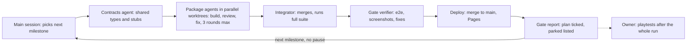

# Spellplane — Implementation Plan

Nov 10, 2026 · @Philipp

## How this plan works

Spellplane is built in a bootstrap step and six milestones, each split into work packages that agents implement in parallel and each ending in an automated gate. The run is unattended: all milestones are implemented continuously in one go, and the owner's playtests are deferred until the run has finished. The companion [design document](https://claude.ai/artifact/2zC6USXNUoSeHKvYDQYS8A) says what to build; this plan says in which order, in which files and how each piece is proven.

**Source of truth.** Both documents are exported once to `docs/DESIGN.md` and `docs/PLAN.md` in the repository. From then on the repository copies win: agents read only those files, scope changes are made there, and progress is ticked there. The Claude Docs remain as readable originals.

**Package ids.** `B0` is the bootstrap. `M2-C` is milestone 2's contracts package; `M2-P3` is its third work package; `M2-G` is its gate. Every package below has a checkbox line in `docs/PLAN.md` in the form `- [ ] M2-P3 Open draft formats`.

**Definition of done for a package**

1. Its acceptance tests exist, were written against the design, and pass.
2. `pnpm check` is green: type-check, lint (including module-boundary rules), unit tests.
3. A separate reviewer agent, given only the diff and the relevant design sections, reports nothing blocking. Engine, network and secrecy packages need a second reviewer for determinism and hidden-information leaks.
4. It is merged into the milestone branch by the integrator with the full suite green afterwards.
5. Its checkbox is ticked in `docs/PLAN.md` in the same commit.

**Definition of done for a milestone.** All packages done or explicitly parked, `pnpm e2e:gate -- M<n>` green, the screenshot review filed in `docs/gates/M<n>.md`, the milestone branch merged to `main`, and the Pages deploy live. Owner playtests are listed in the gate report and happen after the unattended run.

**Conventions**

- TypeScript strict; no `any` in `core/`, `net/` or `draft/`. `core/` imports nothing from the DOM, Three.js, Svelte or the network; a lint rule enforces the direction `ui → scene → core`, `net → core`, `draft → core`, `data → core` (types only).
- pnpm, the current Node LTS, Vite 8, Vitest, Playwright (Chromium and WebKit projects).
- Branches: `m<n>` per milestone, `m<n>/<package>` per work package in its own git worktree. Conventional commit messages. `main` is never force-pushed.
- English for the UI, code, logs and dictation default.
- Tests never touch the network. Card data comes from recorded fixtures and card faces from procedurally drawn placeholder textures.
- Anything the design does not specify is decided by the implementing agent, written into `docs/DECISIONS.md` in one line, and flagged in the gate report.

## Repository bootstrap (B0)

The main session does the bootstrap itself, without a workflow, because every later package depends on it. It ends with an empty app deployed to GitHub Pages and a green CI run.

- [x] **B0.1 Repository.** `git init`, remote `origin` = `git@github.com:izzardry/spellplane.git`, MIT `LICENSE`, `README.md` with the Fan Content notice, `.gitignore`, export of both docs into `docs/`.
- [x] **B0.2 Scaffold.** Vite 8 + Svelte 5 + TypeScript strict. `vite.config.ts` sets `base: '/spellplane/'`. Dependencies: `three`, `trystero`, `troika-three-text`, `idb`, `vite-plugin-pwa`; dev: `vitest`, `fast-check`, `@playwright/test`, `eslint` with `eslint-plugin-boundaries`, `svelte-check`, `fake-indexeddb`.
- [x] **B0.3 Layout.** Create the folders below with an `index.ts` each and the boundary lint rules.
- [x] **B0.4 Scripts.** `dev`, `build`, `preview`, `check` (tsc, svelte-check, eslint, vitest run), `test`, `e2e`, `e2e:gate` (runs the Playwright project tagged for the given milestone), `shots` (captures the gate screenshot matrix into `artifacts/shots/`).
- [x] **B0.5 Test harnesses.** See the table below.
- [x] **B0.6 CI and deploy.** *(CI green; Pages deploy blocked while the repository is private — owner check, see docs/DECISIONS.md)* `.github/workflows/ci.yml` runs `pnpm check` and `pnpm e2e` on every push; `deploy.yml` builds and publishes to GitHub Pages on every push to `main`. Pages is enabled through the `gh` CLI.
- [x] **B0.7 Smoke.** *(local and CI green; live URL pending the Pages blocker)* A page that renders one placeholder card on a white plane, a Playwright test that finds it through the debug hook, CI green, live URL reachable.

```text
src/
  core/        state, actions, reducer, selectors, visibility, commitments, rng, undo
  net/         transport interface, trystero / loopback / broadcast transports, sequencer, sync, presence
  store/       IndexedDB: identity, tables, log, secrets, decks, card cache, settings
  data/        scryfall client, mtgjson client, decklist parser, pack generator
  draft/       pass draft, sealed, rochester, winston, grid state machines
  scene/       three.js scene, cards, textures, picking, drag, snapping, lines, camera rigs
  themes/      paper/ dusk/ wyrm/ stonetable/  (one lazy chunk each)
  ui/          svelte: shell, lobby, hud, hand, chat+log, builder list, settings
  voice/       mic gating, talk modes, speech engines, captions
  games/mtg/   the Magic game definition and seat layouts
  debug/       window.__spellplane hook (dev and test builds only)
tests/
  fixtures/    recorded scryfall + mtgjson JSON (trimmed), decklists
  unit/  sim/  e2e/
docs/          DESIGN.md PLAN.md DECISIONS.md gates/
```

| Harness | What it provides | Used by |
| --- | --- | --- |
| Loopback transport | In-memory transport joining N engine instances in one process, with injectable delay, reordering, drop and peer loss | `tests/sim/`: protocol and secrecy tests in Vitest |
| Broadcast transport | A transport over `BroadcastChannel`, selected with `?transport=local`; several pages in one browser context form a room | Playwright multi-player tests |
| Profiles | `?profile=a` namespaces every IndexedDB database and cache, so several pages act as different people | Playwright multi-player tests |
| Fixtures | Trimmed Scryfall card JSON and MTGJSON booster data for M19 plus samples of M10–M15, ORI, M20, M21; three decklists | All data, draft and e2e tests |
| Placeholder faces | Card textures drawn on a canvas from name, cost and type when `?faces=placeholder` | All e2e tests and screenshots |
| Debug hook | `window.__spellplane`: `state()`, `secrets()`, `cards()` with screen rectangles, `camera()`, `lines()`, `dispatch(action)`, `net.messages()`, `frameStats()` | Playwright assertions, gate verifier, leak tests |
| Fake speech and media | An injectable speech engine; Chromium's fake media stream flags | Voice and dictation tests |

The real Trystero transport has one smoke test tagged `@network` that is excluded from gates, because public relays are not deterministic; it runs on demand and before each playtest.

## Milestone 0: Solo table

One player can paste a decklist and goldfish it on the Paper theme with every card gesture working, with no networking. This milestone fixes the engine, the scene and the HUD architecture that everything else extends.

| Package | Scope | Main files | Depends on |
| --- | --- | --- | --- |
| M0-C Contracts | `TableState`, `CardInstance`, `Zone`, `StackItem`, `Line`, all card, zone, stack, line, turn and player action types; `GameDefinition`; `Theme` interface v1; `Transport` interface; debug hook types. Stubs that compile. | `core/types.ts`, `core/actions.ts`, `games/types.ts`, `themes/types.ts`, `net/transport.ts`, `debug/types.ts` | B0 |
| M0-P1 Core engine | Pure reducer for every card, zone, pile, counter, note, attach, token, line, stack, turn and life action. Selectors. Personal undo as inverse actions. Invariants. | `core/reducer/*`, `core/selectors.ts`, `core/undo.ts` | M0-C |
| M0-P2 Card data | Scryfall client with a 2 requests/s limiter and 429 back-off, card model, image-tier URLs, token lookup through `all_parts`, IndexedDB card cache, decklist parser. | `data/scryfall.ts`, `data/cards.ts`, `data/decklist.ts`, `store/cards.ts` | M0-C |
| M0-P3 Scene | Three.js setup, table plane, instanced card quads, texture tiers with LRU, picking, drag with springs, magnetic snapping, cascade and squared piles, tap and flip animation, marquee select, bird's-eye pan and zoom with inertia, Paper theme, debug hook. | `scene/*`, `themes/paper/*`, `debug/hook.ts` | M0-C |
| M0-P4 HUD | App shell and routing, hand fan, pile viewers (library, graveyard, exile), context menu, keymap with remapping and `?` cheat sheet, inspect overlay, avatar with life and counters, turn strip, log panel, deck import dialog, token search. | `ui/*` | M0-C |
| M0-P5 Local store | IndexedDB schema v1 (identity, settings, decks, solo table snapshot), service worker image cache, storage persistence request. | `store/*`, `sw.ts` | M0-C |
| M0-P6 Magic definition | Zones and visibility rules, phases, starting life, neutral card back, one- and two-seat layouts with territory and zone geometry. | `games/mtg/*` | M0-C |
| M0-P7 Solo session | *(added 11 Nov 2026)* The local game client that glues the modules: holds the table state and applies actions through the reducer, owns the local player's secret store (library order, hand identities), runs private effects (shuffle, draw, mulligan) around the reducer, personal undo stack, persistence through the store, app wiring in `main.ts`, debug-hook assembly. Milestone 1 plugs the sequencer and sync into it. | `session/*`, `main.ts`, `debug/*` | M0-P1, M0-P5 |

**Acceptance tests**

- **M0-P1.** Property tests with fast-check: any action sequence keeps every card in exactly one zone, keeps pile indices contiguous, and gives the same state hash when replayed. Undo after any undoable action restores the previous hash. A table of unit tests covers each action family once.
- **M0-P2.** Parser accepts plain, MTGA and MTGO lists, sideboard separators and set-and-number suffixes; rejects with line numbers. The limiter never exceeds 2 requests per second under a burst of 50 calls (fake timers). A double-faced fixture card yields two face images.
- **M0-P3.** Through the debug hook: a drag ends at the snapped position within 0.5 mm; dropping on a lower edge creates a cascade with 14 mm offsets; dropping squarely creates a squared pile; tap sets rotation to 90°; zooming keeps the world point under the cursor fixed within 1 px; 300 cards render in at most 12 draw calls.
- **M0-P4.** Every action in the canonical keymap dispatches the right action on the hovered card; no key fires while the chat or a note field has focus; the cheat sheet lists every bound key.
- **M0-P5.** Snapshot and settings round-trip through IndexedDB (fake-indexeddb); schema v1 has every store of the design's persistence table.
- **M0-P7.** Importing the fixture deck creates 60 hidden library cards whose identities exist only in the secret store; shuffle permutes the private order; draw moves the top card to the hand; undo restores the previous hash; reloading the page restores the solo table to the same state hash (moved here from M0-P5, which has no app).

**Gate M0-G** (`tests/e2e/m0.gate.spec.ts`): paste the 60-card fixture decklist; shuffle; draw seven; mulligan once; play a land; tap it; cast a creature through the stack and resolve it to the battlefield; add two +1/+1 counters; create a related token; attack and settle; move a card to the graveyard and exile; undo the last move; reload and find the same state. Screenshot set: empty table, opening hand, mid-game board, pile fan, inspect, cheat sheet.

**Owner playtest:** goldfish a real pasted deck with live Scryfall images and judge the feel of drag, snap, tap and zoom.

## Milestone 1: 1v1 peer-to-peer

Two players in different homes play a complete game from a shared link, with hands and libraries that the other browser provably never receives. This is the highest-risk milestone and starts with a real-network spike.

**Connectivity check (owner, after the run).** A real two-machine test over Trystero and Nostr cannot be done unattended. The main session builds the `@network` smoke test and a `/#/diag` page that joins a room and reports time to connect, and lists the two-home test under "Owner checks" in the gate report. There is no TURN fallback by decision.

| Package | Scope | Main files | Depends on |
| --- | --- | --- | --- |
| M1-C Contracts | Wire message envelope and all message types, `SecretStore`, commitment and joint-randomness function signatures, sequencer and sync interfaces, presence payloads. | `net/messages.ts`, `core/secrets.ts`, `core/commit.ts`, `core/rng.ts` | M0 |
| M1-P1 Transport and sequencer | Trystero, loopback and broadcast transports; hello handshake with key-pair identity; sequencer election, sequencing, nack and rollback of optimistic actions; gap detection and resend; catch-up sync with snapshots; heartbeat and handover; state-hash exchange every 50 actions; presence channel. | `net/*` | M1-C |
| M1-P2 Secrecy | Deck commitments, reveal and verification, shuffle protocol with owner commitment and peer nonces, private looks (scry, search, peek), targeted reveal on the pair channel, face-down cards, dice and coins by commit-and-reveal, audit records. | `core/commit.ts`, `core/rng.ts`, `core/secrets.ts`, `net/private.ts` | M1-C |
| M1-P3 Stack and confirmation | Stack lane in the scene, spell items and ability markers, notes, resolve with default destinations, counter, reorder; confirmation rounds with duration-based timers driven by the sequencer, hold, auto-pass, manual ask. | `core/reducer/stack.ts`, `core/reducer/confirm.ts`, `scene/stack.ts`, `ui/confirm/*` | M1-C |
| M1-P4 Combat and lines | Temporary move with home slot and ghost, settle, attack and block shortcuts with blocker fan and ordering, all five line kinds rendered and following their endpoints, ping. | `core/reducer/temp.ts`, `scene/lines.ts`, `scene/ghost.ts` | M1-C |
| M1-P5 Lobby and seats | Create table, share link, nickname, chair selection and seat colour, deck selection and Ready with commitment, pairwise connectivity check with a plain failure message, two-seat layout with the opponent's hand as card backs, live cursors and drags. | `ui/lobby/*`, `scene/presence.ts`, `games/mtg/layout.ts` | M1-C |
| M1-P6 Chat and log | Text chat, double-bracket card previews, one timeline with action lines, filters, attribution flash when someone touches another player's card. | `ui/chat/*`, `core/log.ts` | M1-C |
| M1-P7 Resume | Persist the sequenced log, snapshots every 200 actions and the secret store; rejoin a seat by key pair; restore with no peers present and reconcile to the highest sequence number; away seats; the logged lost-save recovery (re-import, subtract public cards, recommit, reshuffle). | `store/tables.ts`, `net/sync.ts`, `core/recovery.ts`, `core/reducer/recovery.ts`, `ui/recovery/*` | M1-P1, M1-P2, M1-P8 |
| M1-P8 Networked session | *(added 11 Nov 2026 by M1-C)* The networked game client that glues the modules: `TableSession` over a transport, the `NetEngine` (sequencer, sync, presence), the pair channel for hidden information and the sequencer's confirmation and commit-window timers, with the owner's secret store and persistence as in the solo session; routes `#/t/<room>/<key>` to the networked session in `main.ts`; debug-hook `net` part. | `session/*`, `main.ts`, `debug/*` | M1-P1, M1-P2, M1-P5 |

**Ownership within `net/`** *(M1-C)*: M1-P1 owns `net/*` except `net/private.ts` (M1-P2) and `net/sync.ts` (M1-P7). M1-P5 also owns the `/#/diag` page (`ui/diag/*`). M1-P3 owns `core/reducer/confirm.ts` (stub created by M1-C) and the confirmation-timer deadline in it; M1-P2 owns the commit-window deadlines in `core/rng.ts`.

**Acceptance tests**

- **M1-P1 (simulated network, Vitest).** With 2, 3 and 4 engines on the loopback transport under random delay up to 400 ms, 5% drop and reordering, 2,000 random actions converge to one state hash. Killing the sequencer mid-stream hands over within the timeout and loses no acknowledged action. A late joiner reaches the same hash. Two players dragging the same card resolve to the last sequenced move on all peers.
- **M1-P2.** A revealed card that does not match its commitment is flagged on every peer. The shuffle order cannot be reproduced from public messages alone, and can be reproduced from public messages plus the owner's nonce. The owner cannot change its nonce after peers' nonces arrive (test attempts it and expects rejection). **Leak test:** after a scripted game, no message received by peer B and no field in B's state or stores contains the card id of any card that stayed in A's hand or library.
- **M1-P3.** A stack item starts a round; silence passes after the configured duration on all peers at the same sequence number; hold stops the timer; an away peer times out; resolve before all-pass requires the second press and logs it.
- **M1-P4.** Attack moves 110 mm forward and taps; settle returns every displaced card to its home pose and removes attack and block lines but not persistent marks; lines follow moved endpoints.
- **M1-P7.** Reloading either page mid-game rejoins the same seat with the same hand; closing both pages and reopening either restores the table; the recovery flow yields a library whose size equals deck size minus public cards minus the agreed hand.
- **M1-P8.** Two `LoopbackNetwork` sessions converge on the same hash for a scripted game and the leak scan (`tests/leak/scan.ts`) finds nothing.

**Gate M1-G:** two pages on the broadcast transport play a scripted game: both ready with fixture decks, mulligans, eight turns with lands, spells through the stack with targets and a counterspell, a hold in response, combat with a double block, a face-down card revealed to the opponent only, dice roll, life changes to zero. During the game each page is reloaded once and the sequencer page is closed and reopened. The leak test runs on the captured messages. Screenshot set: lobby, connectivity failure message, opponent view, stack with three items and targets, confirmation prompt, combat with blocks, away seat.

**Owner playtest:** a full game against a friend from two homes on the live URL, after running the `@network` smoke test.

## Milestone 2: Draft evening

Two players draft or open sealed packs of a real core set, build decks and play, all on one link. The acceptance targets for pack generation are M10 through M15, Magic Origins and M19 through M21; those ten sets head the lobby's set list.

| Package | Scope | Main files | Depends on |
| --- | --- | --- | --- |
| M2-C Contracts | `DraftState`, pack and pick types, draft actions, stage machine (`lobby`, `draft`, `build`, `match`), lobby settings type. | `draft/types.ts`, `core/stage.ts` | M1 |
| M2-P1 Pack generation | MTGJSON per-set client and cache, uuid to Scryfall id mapping, booster configuration choice by weight, weighted draws without replacement per sheet, foil sheets, colour balancing, featured set list, set picker data. | `data/mtgjson.ts`, `data/packs.ts` | M2-C |
| M2-P2 Pass draft and sealed | Secret pack generation (owner nonce plus peer nonces), pack commitments, pick, private hand-over of the remaining pack to the next seat, alternating direction, configurable packs and picks per pass, Pick-Two preset, sealed pools, pick timer, queue counts per seat. | `draft/pass.ts`, `draft/sealed.ts`, `net/private.ts` | M2-C |
| M2-P3 Open formats | Rochester (public pack, snake order, rotating opener, configurable packs per player and burn count), Winston (stack, three piles, private looks), Grid (3×3, row or column, refill). | `draft/rochester.ts`, `draft/winston.ts`, `draft/grid.ts` | M2-C |
| M2-P4 Draft UI | Lobby settings panel, pack fan and grid on the private table, mark and confirm pick, pool area sorted by colour, waiting-pack indicators, Rochester and Grid on the shared table, timers. | `ui/draft/*`, `scene/draft.ts` | M2-C |
| M2-P5 Builder table | Private builder table with play gestures, auto-sort by colour, mana value and type into cascade columns, deck and sideboard areas, basic-land dispenser with printing choice, live count, curve, colour split, land count, 40-card hint, Ready with commitment. | `scene/builder.ts`, `ui/builder/stats.svelte` | M2-C |
| M2-P6 List view and deck library | Two-column list view with filters, switch between views without losing state, Scryfall search-and-add, local deck and pool library, export and import as JSON files. | `ui/builder/list/*`, `store/decks.ts` | M2-C |
| M2-P7 Evening flow | Stage transitions for everyone at once, return to builder between games for sideboarding, rematch, new draft on the same link, resume in any stage. | `core/stage.ts`, `ui/flow/*` | M2-C |

**Acceptance tests**

- **M2-P1.** For each of the ten target sets, 10,000 generated packs from fixtures match the sheet model: pack size, slot counts, mythic rate within ±0.5 percentage points of the sheet weights (about 1 in 8 for M10–M15, M20, M21), foil rate within ±1 point, no duplicate non-foil card in a pack, every colour present among commons when the sheet has colour balancing. Generation is deterministic for a given seed.
- **M2-P2.** In a simulated four-seat draft, every card of every pack ends in exactly one pool; no peer's messages contain a pack it did not hold at that pick (leak test); pass direction is left, right, left; Pick-Two takes two per pass; a reload mid-pick restores the held pack.
- **M2-P3.** Rochester pick order for 2, 3 and 4 seats matches the snake with a rotating opener; burn count leaves that many cards unpicked; Winston and Grid end states account for every card.
- **M2-P5 and P6.** Sorting is stable and reversible; the stats readout matches a hand-computed fixture pool; a deck built in the table view appears identically in the list view and back; export then import reproduces the deck.
- **M2-P7.** A reload in each stage returns to that stage with the same pool, deck and table.

**Gate M2-G:** two pages run a full evening on fixtures: M19 booster draft with three packs each, both build 40-card decks using the dispenser, play a short scripted game, return to the builder, swap a sideboard card, start game two. Then a sealed start with six packs each and a two-seat Rochester of one pack each. Screenshot set: lobby settings, pick in progress, waiting indicator, Rochester table, builder table sorted three ways, list view, stats readout.

**Owner playtest:** a real core-set draft with a friend, start to finish.

## Milestone 3: Four seats and voice

Three and four players, Two-Headed Giant, spectators, live voice and dictated captions. The engine already supports four seats and teams; this milestone adds layouts, team features and the talk system.

| Package | Scope | Main files | Depends on |
| --- | --- | --- | --- |
| M3-C Contracts | Team and spectator types, talk-mode and caption types, speech-engine interface, layout descriptors for 3 and 4 seats and Two-Headed Giant. | `core/teams.ts`, `voice/types.ts`, `games/mtg/layout.ts` | M2 |
| M3-P1 Multi-seat layouts | Table sizes and territories for three seats, four seats and teams; per-viewer rotation; seat keys 1–4 and avatar taps for the camera; attack-target lines to players and permanents; unassigned-attacker stub; turn order. | `games/mtg/layout.ts`, `scene/table.ts`, `scene/lines.ts` | M3-C |
| M3-P2 Two-Headed Giant | Team creation in the lobby, adjoining territories, shared life and turn marker, live teammate hand as a second fan through the pair channel, team reveal target, Two-Headed Giant draft (two picks per pack into a shared pool, six packs per team) and sealed (eight packs per team). | `core/teams.ts`, `draft/team.ts`, `ui/hand/TeamHand.svelte` | M3-C |
| M3-P3 Voice | Microphone acquired once on join, audio tracks on the mesh, push-to-talk, turn mic, open mic and mute, team talk routed to the teammate only, speaking indicator, per-peer volume and mute, key release on blur, device picker. | `voice/mic.ts`, `voice/modes.ts`, `ui/voice/*` | M3-C |
| M3-P4 Dictation and captions | Web Speech engine, optional transformers.js engine loaded on demand, engine and language settings with a plain statement of where audio goes, interim and final captions anchored to the last-touched card or the avatar, caption stored on the action in the log, dictation into note fields. | `voice/speech/*`, `scene/captions.ts`, `ui/settings/Speech.svelte` | M3-C |
| M3-P5 Spectators | Join without a chair, public-only view, chat and ping, no card manipulation, hand reveal to a named spectator. | `net/roles.ts`, `ui/lobby/*` | M3-C |

**Acceptance tests**

- **M3-P1.** For each format, every seat's territory and zone piles lie inside the table and do not overlap; each viewer sees their own seat at the bottom; an attack line to each opponent can be drawn and survives a camera move.
- **M3-P2.** A teammate's page shows the partner's hand identities and an opponent's page never receives them (leak test); a life change by either teammate updates one shared total; the team draft pool is shared and complete.
- **M3-P3 (Chromium fake media).** In push-to-talk the local track is enabled only while the key is held and is disabled on window blur; turn mic enables the track exactly for the player's own turn; team talk enables the track only on the teammate's connection; no key event leaks into chat while typing.
- **M3-P4 (fake engine).** A final transcript produces a caption anchored to the last-touched card on every page and a log entry attached to that action; with no card context the caption sits at the avatar; the local-model engine is not downloaded unless chosen.
- **M3-P5.** A spectator's dispatches of card actions are rejected by the sequencer.

**Gate M3-G:** four pages play a scripted Two-Headed Giant game with a three-way stack, attacks against both opponents, a team reveal, and fake-engine captions; then a three-player free-for-all opening; a fifth page joins as spectator. Screenshot set: each layout from seat 1 and seat 3, team hands, captions on cards, talk-mode indicator states.

**Owner playtest:** a Two-Headed Giant or free-for-all evening with real voice, plus dictation on the owner's own turn.

## Milestone 4: Themes and 3D

Dusk, Wyrm and Stonetable join Paper, and the ego camera arrives. Because Paper already runs on the theme interface, the three theme packages are independent and are built in parallel after the lit pipeline lands.

| Package | Scope | Main files | Depends on |
| --- | --- | --- | --- |
| M4-C Contracts | Theme interface v2: light rig, shadow and post-processing settings, card dressing, line style per kind, motion constants, sound set, camera default, quality levels. The list of functional signals every theme must render. | `themes/types.ts`, `themes/signals.ts` | M3 |
| M4-P1 Camera rigs | Ego rig with lean, dolly and pitch limits; continuous blend to and from bird's-eye in 400 ms with the cursor point fixed; follow-stack and follow-active-player toggles; reduced-motion cuts. | `scene/camera/*` | M4-C |
| M4-P2 Lit pipeline | Card boxes with thickness, lift while held, shadows, near-unlit card-face material that keeps printed colours, bloom and vignette passes, anisotropic filtering, quality levels that drop shadows and post-processing first, theme hot-swap without reload. | `scene/materials.ts`, `scene/post.ts`, `scene/quality.ts` | M4-C |
| M4-P3 Dusk | Dark felt, single warm lamp, contact shadows, vignette, soft bloom on lines, muted sound set. | `themes/dusk/*` | M4-P2 |
| M4-P4 Wyrm | Obsidian slab with procedural scale relief, ember seams, fiery line glow, ember particles, heat shimmer over the stack. | `themes/wyrm/*` | M4-P2 |
| M4-P5 Stonetable | Carved stone slab with CC0 physically based materials, torch-like key light, real shadows, rune lines, dust motes, ego camera by default. | `themes/stonetable/*` | M4-P2 |
| M4-P6 Theme switcher and conformance | Per-viewer theme picker, lazy chunk loading, HUD token mapping to CSS custom properties, per-theme seat-colour tuning, automated signal conformance checks, asset licence manifest. | `ui/settings/Theme.svelte`, `tests/e2e/signals.spec.ts`, `docs/ASSETS.md` | M4-C |

**Acceptance tests**

- **M4-P1.** During a blend the world point under the cursor moves less than 2 px; the ego camera never passes below the table edge; with reduced motion the switch is a cut.
- **M4-P2.** The average colour of a rendered card face differs from the source texture by less than 3% in every lit theme (the Scryfall no-recolour rule); switching themes mid-game preserves the state hash and leaks no GPU textures after ten switches.
- **M4-P3 to P5.** Each theme renders the twelve gate states without console errors; every asset is listed in `docs/ASSETS.md` with a CC0 source or is procedural.
- **M4-P6.** For each theme and each functional signal (tapped, selected, hovered, displaced, attacking, blocking, face-down, foil, each seat colour, speaking, pending confirmation, away), the signalled card or element differs from its neutral version by a measured contrast threshold in a controlled screenshot pair.
- **Performance.** With 300 cards: at most 20 draw calls in Paper and 60 in Stonetable, texture memory under 400 MB, and main-thread frame work under 6 ms on CI hardware. Real frame rate is judged at the playtest.

**Gate M4-G:** the two-player scripted game from M1 runs once per theme with a mid-game theme switch and a perspective switch. Screenshot matrix: four themes × twelve states × both camera rigs, reviewed by the gate verifier against the theme table in the design.

**Owner playtest:** play in each theme; judge mood, legibility and frame rate on the owner's own machines.

## Milestone 5: Polish

Tablet touch, the post-game audit, offline tolerance and accessibility, plus fixes accumulated from earlier playtests.

| Package | Scope | Main files | Depends on |
| --- | --- | --- | --- |
| M5-P1 Touch | Tap, drag, double-tap, long-press radial menu, long-press-drag lines, two-finger camera gestures, thumb action bar, scrolling hand fan. | `scene/input/touch.ts`, `ui/touch/*` | M4 |
| M5-P2 Audit | End-of-game audit: publish nonces and order history, replay every shuffle and draw, show a per-player verdict and any mismatch. | `core/audit.ts`, `ui/audit/*` | M4 |
| M5-P3 Offline and storage | Precache of the app shell, image cache limits with LRU eviction, storage-persistence prompt, graceful behaviour when Scryfall or MTGJSON is unreachable. | `sw.ts`, `store/quota.ts` | M4 |
| M5-P4 Accessibility | Keyboard focus cycling through cards in a zone, log as a live region, seat patterns beside colours, AA contrast in Paper, reduced-motion audit. | `ui/a11y/*` | M4 |
| M5-P5 Finish | Settings consolidation, key remapping UI, About panel with the Fan Content notice and Scryfall and MTGJSON credits, first-run hints, opt-in official card back, error and empty states everywhere. | `ui/settings/*`, `ui/about/*` | M4 |
| M5-P6 Hardening | Undo edge cases, protocol version check with a clear mismatch message, long-session soak test, performance pass on texture eviction. | `core/undo.ts`, `net/version.ts`, `tests/sim/soak.test.ts` | M4 |

**Acceptance tests.** Touch gestures pass under Playwright's iPad emulation; the audit detects a tampered library order in a simulated game and passes an honest one; the app loads and resumes a saved table with the network disabled; axe reports no serious violations on lobby, table HUD and builder list; a 5,000-action soak on four simulated peers ends with equal hashes and bounded memory.

**Gate M5-G:** the full evening from M2 on an emulated tablet using touch only, followed by the audit. **Owner playtest:** an evening on a real tablet.

## Quality gates

Four layers of checking stand between an agent's code and the owner's playtest, each catching what the one before cannot.

| Layer | Runs | Catches | Tooling |
| --- | --- | --- | --- |
| Package acceptance | In the package's worktree, by its implementer | The package does what its section of the design says | Vitest unit and property tests, simulated-network tests, focused Playwright specs |
| Adversarial review | After acceptance passes, by a separate agent that sees only the diff and the design sections | Spec gaps, bugs the author's own tests share, hidden-information leaks, nondeterminism in the reducer | Reviewer returns structured findings; a fixer addresses blocking ones; at most three rounds |
| Integration | After each merge into the milestone branch | Packages that work alone but not together | `pnpm check` and `pnpm e2e` after every merge; the integrator fixes conflicts or parks the package |
| Milestone gate | Once per milestone on the merged branch | End-to-end behaviour and how it looks | `pnpm e2e:gate`, the screenshot matrix judged against the design by a verifier agent, one round of fixes |

**Standing rules for tests**

- Engine behaviour is asserted on state hashes and on the debug hook, never on pixels.
- Every package that touches hidden information adds its scenario to the shared leak test, which scans all messages received by a peer and all of that peer's stores for card ids it should not know.
- Every protocol feature gets a simulated-network test with delay, drop, reordering and peer loss before it gets a browser test.
- Screenshots are evidence for review, not pixel baselines; they are written to `artifacts/shots/` and summarised in `docs/gates/M<n>.md`.
- A flaky test is a failing test. It is fixed or deleted with a note, never retried into green.

**Parked packages.** A package that exceeds three review rounds or breaks integration is left unmerged on its branch with `docs/gates/M<n>-parked-<package>.md` describing what fails and why. Independent packages continue. After the workflow returns, the main session attempts each parked package once more with full context, then lists whatever remains in the gate report.

**The gate report** (`docs/gates/M<n>.md`) contains the live URL, the commit, test counts, the screenshot review with findings and their fixes, decisions agents made beyond the design, parked packages, and a playtest checklist for the owner taken from this plan's gate description.

## Agent orchestration

Each milestone is executed by one workflow of up to about 50 agents, started by the main session; when it ends, the main session deploys, writes the gate report and starts the next milestone without waiting. Contracts land first so that package agents can work in parallel worktrees without colliding on shared types.



The top row is the workflow's build path; the bottom row runs right to left through verification, deployment and the report, and the owner's feedback starts the next run.

**Roles**

| Role | Count per milestone | Works in | Input | Output |
| --- | --- | --- | --- | --- |
| Main session | 1 | Repository root | `docs/PLAN.md`, owner feedback | Chooses the milestone, runs the spike or bootstrap, launches the workflow, retries parked packages, writes the gate report, continues with the next milestone |
| Contracts agent | 1 | Milestone branch | The `M<n>-C` row and the design's specification sections | Shared types and compiling stubs, committed before any package starts |
| Implementer | 1 per package (5 to 7) | Own worktree, branch `m<n>/<package>` | Its package row, acceptance tests, named design sections, the contracts | Code plus acceptance tests, `pnpm check` green |
| Reviewer | 1 per package; 2 for `core/`, `net/`, `draft/` and secrecy | Read-only on the package branch | The diff and the design sections, not the implementer's reasoning | Structured findings, each marked blocking or not |
| Fixer | Up to 3 rounds per package | The package worktree | Blocking findings | Fixes with tests; then the reviewer runs again |
| Integrator | 1 | Milestone branch | Finished package branches, in dependency order | Sequential merges with the full suite after each; parks what breaks |
| Gate verifier | 1, plus up to 3 fixers | Milestone branch | The gate description and the theme and layout sections of the design | Gate run, screenshot review, fix tasks, second gate run |

**Workflow shape.** The contracts agent runs alone. Packages then go through a pipeline, each independently: implement, review, fix loop, done or parked. A barrier follows, because integration needs every finished branch. The integrator and the gate verifier run in sequence. Packages inside a milestone that depend on another package (for example the three themes on the lit pipeline) form a second wave after their dependency is merged.

**What makes parallel work safe**

- Contracts first: no package edits `*/types.ts`, `core/actions.ts` or `net/messages.ts` after the contracts commit; a needed change goes through the integrator as a contracts amendment.
- One owner per folder within a milestone, as listed in each package's main files.
- Worktree isolation, so no agent sees another's half-finished files.
- Reviewers never see the implementer's explanation, only the diff and the design, so they do not inherit its blind spots.

**Prompts to agents** name the package id, the exact sections of `docs/DESIGN.md` and `docs/PLAN.md` to read, the files the agent owns, the commands that must pass, and the return schema. They do not paste the documents.

**Cost control.** No model or effort overrides by default. Reviewer rounds stop at three. The gate fix round runs once. Anything cut short is logged by the workflow and listed in the gate report, never dropped silently.

## The execution prompt

One resumable prompt runs the whole plan: paste it once into Claude Code in the `spellplane` working directory and it implements every milestone without pausing; paste it again only if the session ends early or to hand over playtest feedback. It reads the checkboxes in `docs/PLAN.md` to find where to pick up, so a fresh session loses nothing.

```text
Implement Spellplane by executing its implementation plan. Run the bootstrap and all six milestones (B0, then M0 to M5) continuously in this one session, unattended, without waiting for me between milestones. The prompt is also resumable: if the session ends for any reason, I paste it again and you continue from the first unticked item.

SOURCES OF TRUTH
- docs/DESIGN.md (what to build) and docs/PLAN.md (order, packages, acceptance tests, gates) in this repository. The repo copies win.
- If either file is missing, export both as Markdown through the Claude Docs connector from
  https://claude.ai/artifact/2zC6USXNUoSeHKvYDQYS8A (design) and
  https://claude.ai/artifact/B47rkXo5Wsv5iUJuEtMyDG (plan),
  save them under docs/, and commit. If you cannot read them, stop and tell me.

STANDING AUTHORISATIONS (they hold for every run of this prompt)
- Use a workflow: orchestrate each milestone with one multi-agent workflow of up to about 50 agents, as described in the plan's "Agent orchestration" section. Use subagents in isolated git worktrees for parallel packages.
- Git and deploy: the remote is git@github.com:izzardry/spellplane.git (public, MIT). You may commit, create and push branches, merge milestone branches into main, enable and deploy GitHub Pages, and run CI, all without asking. Never force-push, never rewrite pushed history, never touch any other repository.
- Dependencies: install what the plan names. If another runtime dependency is clearly needed, add it and record why in docs/DECISIONS.md.
- Unattended: I am away. Never wait for my input, never ask me a question, never stop for confirmation. Every decision is yours; record it.

HARD CONSTRAINTS
- Static site only: no backend, no serverless function, no TURN server, no accounts, no analytics.
- No rules enforcement in the game. No bundled card data, card images, Wizards logos or official card back.
- Card faces are never recoloured, cropped or distorted.
- Hidden information never leaves its owner's browser except through the reveal paths in the design. The leak tests are not optional.
- Tests never use the network.

PROCEDURE FOR EACH RUN
1. Read docs/PLAN.md and docs/DECISIONS.md. Find the first unticked item.
   - If bootstrap B0 is unfinished, do it yourself inline, then continue.
   - If I gave playtest feedback in this message, turn it into fix tasks, do them first (inline or with a few subagents), and record them in the previous gate report.
   - If the next milestone has a spike or check that needs a second machine or a human (for example the real-network connectivity test), skip it and list it under "Owner checks" in that milestone's gate report.
2. Run the milestone workflow on branch m<n>:
   a. Contracts agent lands the M<n>-C types and stubs and commits them.
   b. Each package runs as an independent pipeline in its own worktree (branch m<n>/<package>): implement with its acceptance tests until `pnpm check` is green; then a reviewer that sees only the diff and the named design sections returns structured findings; a fixer resolves blocking findings; repeat review at most 3 times. core/, net/, draft/ and any secrecy code get a second reviewer focused on determinism and hidden-information leaks. A package that does not converge is parked with a written note, not merged.
   c. Packages that depend on another package of the same milestone start after that package is merged.
   d. An integrator merges finished packages one at a time in dependency order, running `pnpm check` and `pnpm e2e` after each merge, and parks any package that breaks the branch.
   e. A gate verifier runs `pnpm e2e:gate -- M<n>`, captures the screenshot matrix, judges it against the design, files findings, gets them fixed in one round, and reruns the gate.
   Give every agent its package id, the exact sections to read, the files it owns, the commands that must pass and a return schema. Do not paste the documents into prompts. Log anything the workflow skips or truncates.
3. When the workflow returns, read its result. Retry each parked package once yourself with full context.
4. Tick the finished items in docs/PLAN.md, append agent decisions to docs/DECISIONS.md, write docs/gates/M<n>.md (live URL, commit, test counts, screenshot review, decisions made beyond the design, parked packages, my playtest checklist), merge m<n> into main, push, and confirm the Pages deploy is live and CI is green.
5. Go straight back to step 1 for the next milestone. Do not pause for a playtest; owner playtests are deferred and listed in each gate report.
   - If a gate is still failing after its fix round and your own retry, record exactly what fails in the gate report, leave the affected items unticked, and continue with the next milestone on a best-effort basis.
   - If a blocker makes a whole milestone impossible (for example credentials or the remote are unavailable), keep working locally on everything that does not need it and record the blocker.
6. When M5 is done, or nothing further can be done, write docs/gates/SUMMARY.md and tell me in a few lines: the live URL, what is finished per milestone, what is parked or failing, the owner checks and playtests waiting for me, and the decisions you made that I should review.

QUALITY BAR
- A package is done only as the plan's "Definition of done" says. Passing tests that do not test the design's behaviour do not count.
- When the design does not specify something, choose the simplest behaviour consistent with it, write one line in docs/DECISIONS.md, and move on. Where a choice would contradict the design, follow the design; where it cannot be undone, take the reversible alternative and flag it in the gate report.
- Report failures plainly. Never mark a gate green that is not.

Start now with step 1.
```

**Using it.** Before the first paste, make sure `gh auth status` and `ssh -T git@github.com` work in the terminal, since the prompt authorises pushing and enabling Pages. Run Claude Code in a permission mode that does not prompt for file edits and shell commands, otherwise the unattended run stalls at the first prompt. Afterwards, read `docs/gates/SUMMARY.md`, playtest on the live URL, and paste the prompt again with your feedback written above it.

## Decisions and open questions

Sixteen decisions from the second interview on 10 November 2026 shape this plan; none of the earlier design decisions changed.

| Area | Decision | Consequence in the plan |
| --- | --- | --- |
| TURN relay | Still strictly nothing | No ICE configuration beyond public STUN. Milestone 1 starts with a real-network spike; the lobby explains a failed pair plainly. |
| Target sets | M10–M15, Magic Origins, M19–M21 | Ten sets head the lobby list and are the statistical test targets for pack generation. Other sets with booster data are selectable but untested. |
| Language | English everywhere | No translation layer; dictation defaults to English. |
| Lost secrets | Recovery path only | No export or escrow of secrets; the logged re-import and reshuffle is the only recovery. |
| Rochester | Classic snake with configurable packs and burn count | One state machine for 2 to 4 seats; no team horseshoe variant. |
| Publishing | Public repository, MIT, GitHub Pages | Remote `git@github.com:izzardry/spellplane.git`; Vite base `/spellplane/`; deploy on every push to `main`. |
| Second game | Magic only | The game-definition seam stays, protected only by the lint rule that keeps Magic imports out of `core/`. |
| Gates | Automated gates only, run straight through (changed 10 November 2026: unattended overnight run) | No pauses. Owner playtests and the two-home connectivity test are deferred and listed in each gate report and in `docs/gates/SUMMARY.md`; feedback becomes fix tasks in a later run. |
| Spec home | Exported to the repository; the repository wins | `docs/DESIGN.md` and `docs/PLAN.md`; the Claude Docs are not synced back. |
| Parallelism | Contracts first, then parallel worktrees | A contracts package opens every milestone; folders have one owner per milestone. |
| Review depth | Tests, one adversarial reviewer and a fix loop | Three rounds at most; a second reviewer for engine, network, draft and secrecy code. |
| Scale | One workflow per milestone, up to about 50 agents | Stated explicitly in the prompt, since it exceeds the default guideline. |
| Visual checks | Debug-hook assertions plus screenshot review at gates | `window.__spellplane` is part of the bootstrap; screenshots are evidence, not baselines. |
| Git authority | Full authority from the start | Agents push, merge to `main` and deploy without asking; no force-push. |
| Failing packages | Park, finish the rest, report at the gate | The main session retries each parked package once. |
| Prompt shape | One resumable master prompt | Progress lives in the plan's checkboxes. |

**Open questions**

- [ ] **Connectivity spike result.** If the owner's and a friend's networks cannot connect directly, the no-relay decision has to be revisited before milestone 1 proceeds.
- [ ] **Pages URL or custom domain.** The plan assumes `https://izzardry.github.io/spellplane/`. A custom domain changes the Vite base path and the room link format.
- [ ] **Speech model choice.** Which in-browser model backs the optional private dictation engine is left to the M3-P4 implementer; size and accuracy should be reported at the M3 gate.
- [ ] **Performance on real hardware.** Frame-rate targets can only be confirmed at the M4 playtest; CI measures draw calls and frame work instead.
- [ ] **Sets outside the ten targets.** Foundations and pre-M10 core sets will generate packs from MTGJSON but are not verified; say if any should be promoted to a test target.

## Progress

Ticked by the main session as packages are merged and gates pass.

- [x] B0 Repository bootstrap (items B0.1 to B0.7 above; Pages live since 11 Nov 2026 after the owner made the repo public)
- [x] M0-C Contracts
- [x] M0-P1 Core engine
- [x] M0-P2 Card data
- [x] M0-P3 Scene
- [x] M0-P4 HUD
- [x] M0-P5 Local store
- [x] M0-P6 Magic definition
- [x] M0-P7 Solo session
- [x] M0-G Gate (owner playtest pending)
- [x] M1-C Contracts
- [ ] M1-P1 Transport and sequencer
- [ ] M1-P2 Secrecy
- [x] M1-P3 Stack and confirmation
- [x] M1-P4 Combat and lines
- [x] M1-P5 Lobby and seats
- [x] M1-P6 Chat and log
- [ ] M1-P7 Resume
- [ ] M1-P8 Networked session
- [ ] M1-G Gate and owner playtest
- [ ] M2-C Contracts
- [ ] M2-P1 Pack generation
- [ ] M2-P2 Pass draft and sealed
- [ ] M2-P3 Open formats
- [ ] M2-P4 Draft UI
- [ ] M2-P5 Builder table
- [ ] M2-P6 List view and deck library
- [ ] M2-P7 Evening flow
- [ ] M2-G Gate and owner playtest
- [ ] M3-C Contracts
- [ ] M3-P1 Multi-seat layouts
- [ ] M3-P2 Two-Headed Giant
- [ ] M3-P3 Voice
- [ ] M3-P4 Dictation and captions
- [ ] M3-P5 Spectators
- [ ] M3-G Gate and owner playtest
- [ ] M4-C Contracts
- [ ] M4-P1 Camera rigs
- [ ] M4-P2 Lit pipeline
- [ ] M4-P3 Dusk
- [ ] M4-P4 Wyrm
- [ ] M4-P5 Stonetable
- [ ] M4-P6 Theme switcher and conformance
- [ ] M4-G Gate and owner playtest
- [ ] M5-P1 Touch
- [ ] M5-P2 Audit
- [ ] M5-P3 Offline and storage
- [ ] M5-P4 Accessibility
- [ ] M5-P5 Finish
- [ ] M5-P6 Hardening
- [ ] M5-G Gate and owner playtest
