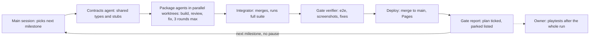

# Spellplane — Implementation Plan

Nov 10, 2026 · @Philipp

## How this plan works

Spellplane is built in a bootstrap step and six milestones, each split into work packages that agents implement in parallel and each ending in an automated gate. The run is unattended: all milestones are implemented continuously in one go, and the owner's playtests are deferred until the run has finished. The companion [design document](https://claude.ai/artifact/2zC6USXNUoSeHKvYDQYS8A) says what to build; this plan says in which order, in which files and how each piece is proven.

**Source of truth.** Both documents are exported once to `docs/DESIGN.md` and `docs/PLAN.md` in the repository. From then on the repository copies win: agents read only those files, scope changes are made there, and progress is ticked there. The Claude Docs remain as readable originals.

**Package ids.** `B0` is the bootstrap. `M2-C` is milestone 2's contracts package; `M2-P3` is its third work package; `M2-G` is its gate. Every package below has a checkbox line in `docs/PLAN.md` in the form `- [ ] M2-P3 Open draft formats`.

**Definition of done for a package**

1. Its acceptance tests exist, were written against the design, and pass.
2. `pnpm check` is green: type-check, lint (including module-boundary rules), unit tests.
3. A separate reviewer agent, given only the diff and the relevant design sections, reports nothing blocking. Engine, network and secrecy packages need a second reviewer for determinism and hidden-information leaks.
4. It is merged into the milestone branch by the integrator with the full suite green afterwards.
5. Its checkbox is ticked in `docs/PLAN.md` in the same commit.

**Definition of done for a milestone.** All packages done or explicitly parked, `pnpm e2e:gate -- M<n>` green, the screenshot review filed in `docs/gates/M<n>.md`, the milestone branch merged to `main`, and the Pages deploy live. Owner playtests are listed in the gate report and happen after the unattended run.

**Conventions**

- TypeScript strict; no `any` in `core/`, `net/` or `draft/`. `core/` imports nothing from the DOM, Three.js, Svelte or the network; a lint rule enforces the direction `ui → scene → core`, `net → core`, `draft → core`, `data → core` (types only).
- pnpm, the current Node LTS, Vite 8, Vitest, Playwright (Chromium and WebKit projects).
- Branches: `m<n>` per milestone, `m<n>/<package>` per work package in its own git worktree. Conventional commit messages. `main` is never force-pushed.
- English for the UI, code, logs and dictation default.
- Tests never touch the network. Card data comes from recorded fixtures and card faces from procedurally drawn placeholder textures.
- Anything the design does not specify is decided by the implementing agent, written into `docs/DECISIONS.md` in one line, and flagged in the gate report.

## Repository bootstrap (B0)

The main session does the bootstrap itself, without a workflow, because every later package depends on it. It ends with an empty app deployed to GitHub Pages and a green CI run.

- [x] **B0.1 Repository.** `git init`, remote `origin` = `git@github.com:izzardry/spellplane.git`, MIT `LICENSE`, `README.md` with the Fan Content notice, `.gitignore`, export of both docs into `docs/`.
- [x] **B0.2 Scaffold.** Vite 8 + Svelte 5 + TypeScript strict. `vite.config.ts` sets `base: '/spellplane/'`. Dependencies: `three`, `trystero`, `troika-three-text`, `idb`, `vite-plugin-pwa`; dev: `vitest`, `fast-check`, `@playwright/test`, `eslint` with `eslint-plugin-boundaries`, `svelte-check`, `fake-indexeddb`.
- [x] **B0.3 Layout.** Create the folders below with an `index.ts` each and the boundary lint rules.
- [x] **B0.4 Scripts.** `dev`, `build`, `preview`, `check` (tsc, svelte-check, eslint, vitest run), `test`, `e2e`, `e2e:gate` (runs the Playwright project tagged for the given milestone), `shots` (captures the gate screenshot matrix into `artifacts/shots/`).
- [x] **B0.5 Test harnesses.** See the table below.
- [x] **B0.6 CI and deploy.** *(CI green; Pages deploy blocked while the repository is private — owner check, see docs/DECISIONS.md)* `.github/workflows/ci.yml` runs `pnpm check` and `pnpm e2e` on every push; `deploy.yml` builds and publishes to GitHub Pages on every push to `main`. Pages is enabled through the `gh` CLI.
- [x] **B0.7 Smoke.** *(local and CI green; live URL pending the Pages blocker)* A page that renders one placeholder card on a white plane, a Playwright test that finds it through the debug hook, CI green, live URL reachable.

```text
src/
  core/        state, actions, reducer, selectors, visibility, commitments, rng, undo
  net/         transport interface, trystero / loopback / broadcast transports, sequencer, sync, presence
  store/       IndexedDB: identity, tables, log, secrets, decks, card cache, settings
  data/        scryfall client, mtgjson client, decklist parser, pack generator
  draft/       pass draft, sealed, rochester, winston, grid state machines
  scene/       three.js scene, cards, textures, picking, drag, snapping, lines, camera rigs
  themes/      paper/ dusk/ wyrm/ stonetable/  (one lazy chunk each)
  ui/          svelte: shell, lobby, hud, hand, chat+log, builder list, settings
  voice/       mic gating, talk modes, speech engines, captions
  games/mtg/   the Magic game definition and seat layouts
  debug/       window.__spellplane hook (dev and test builds only)
tests/
  fixtures/    recorded scryfall + mtgjson JSON (trimmed), decklists
  unit/  sim/  e2e/
docs/          DESIGN.md PLAN.md DECISIONS.md gates/
```

| Harness | What it provides | Used by |
| --- | --- | --- |
| Loopback transport | In-memory transport joining N engine instances in one process, with injectable delay, reordering, drop and peer loss | `tests/sim/`: protocol and secrecy tests in Vitest |
| Broadcast transport | A transport over `BroadcastChannel`, selected with `?transport=local`; several pages in one browser context form a room | Playwright multi-player tests |
| Profiles | `?profile=a` namespaces every IndexedDB database and cache, so several pages act as different people | Playwright multi-player tests |
| Fixtures | Trimmed Scryfall card JSON and MTGJSON booster data for M19 plus samples of M10–M15, ORI, M20, M21; three decklists | All data, draft and e2e tests |
| Placeholder faces | Card textures drawn on a canvas from name, cost and type when `?faces=placeholder` | All e2e tests and screenshots |
| Debug hook | `window.__spellplane`: `state()`, `secrets()`, `cards()` with screen rectangles, `camera()`, `lines()`, `dispatch(action)`, `net.messages()`, `frameStats()` | Playwright assertions, gate verifier, leak tests |
| Fake speech and media | An injectable speech engine; Chromium's fake media stream flags | Voice and dictation tests |

The real Trystero transport has one smoke test tagged `@network` that is excluded from gates, because public relays are not deterministic; it runs on demand and before each playtest.

## Milestone 0: Solo table

One player can paste a decklist and goldfish it on the Paper theme with every card gesture working, with no networking. This milestone fixes the engine, the scene and the HUD architecture that everything else extends.

| Package | Scope | Main files | Depends on |
| --- | --- | --- | --- |
| M0-C Contracts | `TableState`, `CardInstance`, `Zone`, `StackItem`, `Line`, all card, zone, stack, line, turn and player action types; `GameDefinition`; `Theme` interface v1; `Transport` interface; debug hook types. Stubs that compile. | `core/types.ts`, `core/actions.ts`, `games/types.ts`, `themes/types.ts`, `net/transport.ts`, `debug/types.ts` | B0 |
| M0-P1 Core engine | Pure reducer for every card, zone, pile, counter, note, attach, token, line, stack, turn and life action. Selectors. Personal undo as inverse actions. Invariants. | `core/reducer/*`, `core/selectors.ts`, `core/undo.ts` | M0-C |
| M0-P2 Card data | Scryfall client with a 2 requests/s limiter and 429 back-off, card model, image-tier URLs, token lookup through `all_parts`, IndexedDB card cache, decklist parser. | `data/scryfall.ts`, `data/cards.ts`, `data/decklist.ts`, `store/cards.ts` | M0-C |
| M0-P3 Scene | Three.js setup, table plane, instanced card quads, texture tiers with LRU, picking, drag with springs, magnetic snapping, cascade and squared piles, tap and flip animation, marquee select, bird's-eye pan and zoom with inertia, Paper theme, debug hook. | `scene/*`, `themes/paper/*`, `debug/hook.ts` | M0-C |
| M0-P4 HUD | App shell and routing, hand fan, pile viewers (library, graveyard, exile), context menu, keymap with remapping and `?` cheat sheet, inspect overlay, avatar with life and counters, turn strip, log panel, deck import dialog, token search. | `ui/*` | M0-C |
| M0-P5 Local store | IndexedDB schema v1 (identity, settings, decks, solo table snapshot), service worker image cache, storage persistence request. | `store/*`, `sw.ts` | M0-C |
| M0-P6 Magic definition | Zones and visibility rules, phases, starting life, neutral card back, one- and two-seat layouts with territory and zone geometry. | `games/mtg/*` | M0-C |
| M0-P7 Solo session | *(added 11 Nov 2026)* The local game client that glues the modules: holds the table state and applies actions through the reducer, owns the local player's secret store (library order, hand identities), runs private effects (shuffle, draw, mulligan) around the reducer, personal undo stack, persistence through the store, app wiring in `main.ts`, debug-hook assembly. Milestone 1 plugs the sequencer and sync into it. | `session/*`, `main.ts`, `debug/*` | M0-P1, M0-P5 |

**Acceptance tests**

- **M0-P1.** Property tests with fast-check: any action sequence keeps every card in exactly one zone, keeps pile indices contiguous, and gives the same state hash when replayed. Undo after any undoable action restores the previous hash. A table of unit tests covers each action family once.
- **M0-P2.** Parser accepts plain, MTGA and MTGO lists, sideboard separators and set-and-number suffixes; rejects with line numbers. The limiter never exceeds 2 requests per second under a burst of 50 calls (fake timers). A double-faced fixture card yields two face images.
- **M0-P3.** Through the debug hook: a drag ends at the snapped position within 0.5 mm; dropping on a lower edge creates a cascade with 14 mm offsets; dropping squarely creates a squared pile; tap sets rotation to 90°; zooming keeps the world point under the cursor fixed within 1 px; 300 cards render in at most 12 draw calls.
- **M0-P4.** Every action in the canonical keymap dispatches the right action on the hovered card; no key fires while the chat or a note field has focus; the cheat sheet lists every bound key.
- **M0-P5.** Snapshot and settings round-trip through IndexedDB (fake-indexeddb); schema v1 has every store of the design's persistence table.
- **M0-P7.** Importing the fixture deck creates 60 hidden library cards whose identities exist only in the secret store; shuffle permutes the private order; draw moves the top card to the hand; undo restores the previous hash; reloading the page restores the solo table to the same state hash (moved here from M0-P5, which has no app).

**Gate M0-G** (`tests/e2e/m0.gate.spec.ts`): paste the 60-card fixture decklist; shuffle; draw seven; mulligan once; play a land; tap it; cast a creature through the stack and resolve it to the battlefield; add two +1/+1 counters; create a related token; attack and settle; move a card to the graveyard and exile; undo the last move; reload and find the same state. Screenshot set: empty table, opening hand, mid-game board, pile fan, inspect, cheat sheet.

**Owner playtest:** goldfish a real pasted deck with live Scryfall images and judge the feel of drag, snap, tap and zoom.

## Milestone 1: 1v1 peer-to-peer

Two players in different homes play a complete game from a shared link, with hands and libraries that the other browser provably never receives. This is the highest-risk milestone and starts with a real-network spike.

**Connectivity check (owner, after the run).** A real two-machine test over Trystero and Nostr cannot be done unattended. The main session builds the `@network` smoke test and a `/#/diag` page that joins a room and reports time to connect, and lists the two-home test under "Owner checks" in the gate report. There is no TURN fallback by decision.

| Package | Scope | Main files | Depends on |
| --- | --- | --- | --- |
| M1-C Contracts | Wire message envelope and all message types, `SecretStore`, commitment and joint-randomness function signatures, sequencer and sync interfaces, presence payloads. | `net/messages.ts`, `core/secrets.ts`, `core/commit.ts`, `core/rng.ts` | M0 |
| M1-P1 Transport and sequencer | Trystero, loopback and broadcast transports; hello handshake with key-pair identity; sequencer election, sequencing, nack and rollback of optimistic actions; gap detection and resend; catch-up sync with snapshots; heartbeat and handover; state-hash exchange every 50 actions; presence channel. | `net/*` | M1-C |
| M1-P2 Secrecy | Deck commitments, reveal and verification, shuffle protocol with owner commitment and peer nonces, private looks (scry, search, peek), targeted reveal on the pair channel, face-down cards, dice and coins by commit-and-reveal, audit records. | `core/commit.ts`, `core/rng.ts`, `core/secrets.ts`, `net/private.ts` | M1-C |
| M1-P3 Stack and confirmation | Stack lane in the scene, spell items and ability markers, notes, resolve with default destinations, counter, reorder; confirmation rounds with duration-based timers driven by the sequencer, hold, auto-pass, manual ask. | `core/reducer/stack.ts`, `core/reducer/confirm.ts`, `scene/stack.ts`, `ui/confirm/*` | M1-C |
| M1-P4 Combat and lines | Temporary move with home slot and ghost, settle, attack and block shortcuts with blocker fan and ordering, all five line kinds rendered and following their endpoints, ping. | `core/reducer/temp.ts`, `scene/lines.ts`, `scene/ghost.ts` | M1-C |
| M1-P5 Lobby and seats | Create table, share link, nickname, chair selection and seat colour, deck selection and Ready with commitment, pairwise connectivity check with a plain failure message, two-seat layout with the opponent's hand as card backs, live cursors and drags. | `ui/lobby/*`, `scene/presence.ts`, `games/mtg/layout.ts` | M1-C |
| M1-P6 Chat and log | Text chat, double-bracket card previews, one timeline with action lines, filters, attribution flash when someone touches another player's card. | `ui/chat/*`, `core/log.ts` | M1-C |
| M1-P7 Resume | Persist the sequenced log, snapshots every 200 actions and the secret store; rejoin a seat by key pair; restore with no peers present and reconcile to the highest sequence number; away seats; the logged lost-save recovery (re-import, subtract public cards, recommit, reshuffle). | `store/tables.ts`, `net/sync.ts`, `core/recovery.ts`, `core/reducer/recovery.ts`, `ui/recovery/*` | M1-P1, M1-P2, M1-P8 |
| M1-P8 Networked session | *(added 11 Nov 2026 by M1-C)* The networked game client that glues the modules: `TableSession` over a transport, the `NetEngine` (sequencer, sync, presence), the pair channel for hidden information and the sequencer's confirmation and commit-window timers, with the owner's secret store and persistence as in the solo session; routes `#/t/<room>/<key>` to the networked session in `main.ts`; debug-hook `net` part. | `session/*`, `main.ts`, `debug/*` | M1-P1, M1-P2, M1-P5 |

**Ownership within `net/`** *(M1-C)*: M1-P1 owns `net/*` except `net/private.ts` (M1-P2) and `net/sync.ts` (M1-P7). M1-P5 also owns the `/#/diag` page (`ui/diag/*`). M1-P3 owns `core/reducer/confirm.ts` (stub created by M1-C) and the confirmation-timer deadline in it; M1-P2 owns the commit-window deadlines in `core/rng.ts`.

**Acceptance tests**

- **M1-P1 (simulated network, Vitest).** With 2, 3 and 4 engines on the loopback transport under random delay up to 400 ms, 5% drop and reordering, 2,000 random actions converge to one state hash. Killing the sequencer mid-stream hands over within the timeout and loses no acknowledged action. A late joiner reaches the same hash. Two players dragging the same card resolve to the last sequenced move on all peers.
- **M1-P2.** A revealed card that does not match its commitment is flagged on every peer. The shuffle order cannot be reproduced from public messages alone, and can be reproduced from public messages plus the owner's nonce. The owner cannot change its nonce after peers' nonces arrive (test attempts it and expects rejection). **Leak test:** after a scripted game, no message received by peer B and no field in B's state or stores contains the card id of any card that stayed in A's hand or library.
- **M1-P3.** A stack item starts a round; silence passes after the configured duration on all peers at the same sequence number; hold stops the timer; an away peer times out; resolve before all-pass requires the second press and logs it.
- **M1-P4.** Attack moves 110 mm forward and taps; settle returns every displaced card to its home pose and removes attack and block lines but not persistent marks; lines follow moved endpoints.
- **M1-P7.** Reloading either page mid-game rejoins the same seat with the same hand; closing both pages and reopening either restores the table; the recovery flow yields a library whose size equals deck size minus public cards minus the agreed hand.
- **M1-P8.** Two `LoopbackNetwork` sessions converge on the same hash for a scripted game and the leak scan (`tests/leak/scan.ts`) finds nothing.

**Gate M1-G:** two pages on the broadcast transport play a scripted game: both ready with fixture decks, mulligans, eight turns with lands, spells through the stack with targets and a counterspell, a hold in response, combat with a double block, a face-down card revealed to the opponent only, dice roll, life changes to zero. During the game each page is reloaded once and the sequencer page is closed and reopened. The leak test runs on the captured messages. Screenshot set: lobby, connectivity failure message, opponent view, stack with three items and targets, confirmation prompt, combat with blocks, away seat.

**Owner playtest:** a full game against a friend from two homes on the live URL, after running the `@network` smoke test.

## Milestone 2: Draft evening

Two players draft or open sealed packs of a real core set, build decks and play, all on one link. The acceptance targets for pack generation are M10 through M15, Magic Origins and M19 through M21; those ten sets head the lobby's set list.

| Package | Scope | Main files | Depends on |
| --- | --- | --- | --- |
| M2-C Contracts | `DraftState`, pack and pick types, draft actions, stage machine (`lobby`, `draft`, `build`, `match`), lobby settings type. | `draft/types.ts`, `core/stage.ts` | M1 |
| M2-P1 Pack generation | MTGJSON per-set client and cache, uuid to Scryfall id mapping, booster configuration choice by weight, weighted draws without replacement per sheet, foil sheets, colour balancing, featured set list, set picker data. | `data/mtgjson.ts`, `data/packs.ts` | M2-C |
| M2-P2 Pass draft and sealed | Secret pack generation (owner nonce plus peer nonces), pack commitments, pick, private hand-over of the remaining pack to the next seat, alternating direction, configurable packs and picks per pass, Pick-Two preset, sealed pools, pick timer, queue counts per seat. | `draft/pass.ts`, `draft/sealed.ts`, `net/private.ts` | M2-C |
| M2-P3 Open formats | Rochester (public pack, snake order, rotating opener, configurable packs per player and burn count), Winston (stack, three piles, private looks), Grid (3×3, row or column, refill). | `draft/rochester.ts`, `draft/winston.ts`, `draft/grid.ts` | M2-C |
| M2-P4 Draft UI | Lobby settings panel, pack fan and grid on the private table, mark and confirm pick, pool area sorted by colour, waiting-pack indicators, Rochester and Grid on the shared table, timers. | `ui/draft/*`, `scene/draft.ts` | M2-C |
| M2-P5 Builder table | Private builder table with play gestures, auto-sort by colour, mana value and type into cascade columns, deck and sideboard areas, basic-land dispenser with printing choice, live count, curve, colour split, land count, 40-card hint, Ready with commitment. | `scene/builder.ts`, `ui/builder/stats.svelte` | M2-C |
| M2-P6 List view and deck library | Two-column list view with filters, switch between views without losing state, Scryfall search-and-add, local deck and pool library, export and import as JSON files. | `ui/builder/list/*`, `store/decks.ts` | M2-C |
| M2-P7 Evening flow | Stage transitions for everyone at once, return to builder between games for sideboarding, rematch, new draft on the same link, resume in any stage. | `core/stage.ts`, `ui/flow/*` | M2-C |

**Ownership within M2** *(M2-C)*: the shared draft shapes (`DraftState`, packs, lobby and per-format settings, `DraftSecrets`, `DeckBuild`) live in `core/types.ts` because `TableState` and `SecretStore` hold them; `draft/types.ts` re-exports them and adds the driver seams (`DraftHost`, `DraftDriver`, `DraftControls`). The draft actions reach the format reducers through `core/reducer/drafting.ts` (M2-C, not edited by packages).
- M2-P1 also owns `store/sets.ts` (the `sets` store, stub by M2-C).
- M2-P2 owns `core/reducer/pass.ts` and `draftDeadlines` in `core/drafting.ts`, and extends `net/private.ts` (from M1-P2) for the private pack hand-over.
- M2-P3 owns `core/reducer/open.ts`, `rochesterOrder` in `core/drafting.ts`, and a new `net/draftcards.ts` for the `draftCards` pair message (Winston piles); it does not edit `net/private.ts`.
- M2-P4 owns `ui/draft/*` and `scene/draft.ts`.
- M2-P5 owns `scene/builder.ts` and `ui/builder/*` except `ui/builder/list/*` (the builder container with the view switch and `ui/builder/stats.*`).
- M2-P6 owns `ui/builder/list/*` (stub `ListView.svelte` by M2-C), `store/decks.ts`, and `searchCards` in `data/source.ts`.
- M2-P7 owns `core/stage.ts`, the `stageSet` case in `core/reducer/table.ts`, `ui/flow/*`, and the session wiring: a new `session/draft.ts`, the `draft` and `evening` members in `session/solo.ts` and `session/net.ts`, `main.ts` (set data, pack generation), the debug hook's `draft` part, and the stage switch in `ui/App.svelte` / `ui/lobby/TableRoom.svelte`.

**Acceptance tests**

- **M2-P1.** For each of the ten target sets, 10,000 generated packs from fixtures match the sheet model: pack size, slot counts, mythic rate within ±0.5 percentage points of the sheet weights (about 1 in 8 for M10–M15, M20, M21), foil rate within ±1 point, no duplicate non-foil card in a pack, every colour present among commons when the sheet has colour balancing. Generation is deterministic for a given seed.
- **M2-P2.** In a simulated four-seat draft, every card of every pack ends in exactly one pool; no peer's messages contain a pack it did not hold at that pick (leak test); pass direction is left, right, left; Pick-Two takes two per pass; a reload mid-pick restores the held pack.
- **M2-P3.** Rochester pick order for 2, 3 and 4 seats matches the snake with a rotating opener; burn count leaves that many cards unpicked; Winston and Grid end states account for every card.
- **M2-P5 and P6.** Sorting is stable and reversible; the stats readout matches a hand-computed fixture pool; a deck built in the table view appears identically in the list view and back; export then import reproduces the deck.
- **M2-P7.** A reload in each stage returns to that stage with the same pool, deck and table.

**Gate M2-G:** two pages run a full evening on fixtures: M19 booster draft with three packs each, both build 40-card decks using the dispenser, play a short scripted game, return to the builder, swap a sideboard card, start game two. Then a sealed start with six packs each and a two-seat Rochester of one pack each. Screenshot set: lobby settings, pick in progress, waiting indicator, Rochester table, builder table sorted three ways, list view, stats readout.

**Owner playtest:** a real core-set draft with a friend, start to finish.

## Milestone 3: Four seats and voice

Three and four players, Two-Headed Giant, spectators, live voice and dictated captions. The engine already supports four seats and teams; this milestone adds layouts, team features and the talk system.

| Package | Scope | Main files | Depends on |
| --- | --- | --- | --- |
| M3-C Contracts | Team and spectator types, talk-mode and caption types, speech-engine interface, layout descriptors for 3 and 4 seats and Two-Headed Giant. | `core/teams.ts`, `voice/types.ts`, `games/mtg/layout.ts` | M2 |
| M3-P1 Multi-seat layouts | Table sizes and territories for three seats, four seats and teams; per-viewer rotation; seat keys 1–4 and avatar taps for the camera; attack-target lines to players and permanents; unassigned-attacker stub; turn order. | `games/mtg/layout.ts`, `scene/table.ts`, `scene/lines.ts` | M3-C |
| M3-P2 Two-Headed Giant | Team creation in the lobby, adjoining territories, shared life and turn marker, live teammate hand as a second fan through the pair channel, team reveal target, Two-Headed Giant draft (two picks per pack into a shared pool, six packs per team) and sealed (eight packs per team). | `core/teams.ts`, `draft/team.ts`, `ui/hand/TeamHand.svelte` | M3-C |
| M3-P3 Voice | Microphone acquired once on join, audio tracks on the mesh, push-to-talk, turn mic, open mic and mute, team talk routed to the teammate only, speaking indicator, per-peer volume and mute, key release on blur, device picker. | `voice/mic.ts`, `voice/modes.ts`, `ui/voice/*` | M3-C |
| M3-P4 Dictation and captions | Web Speech engine, optional transformers.js engine loaded on demand, engine and language settings with a plain statement of where audio goes, interim and final captions anchored to the last-touched card or the avatar, caption stored on the action in the log, dictation into note fields. | `voice/speech/*`, `scene/captions.ts`, `ui/settings/Speech.svelte` | M3-C |
| M3-P5 Spectators | Join without a chair, public-only view, chat and ping, no card manipulation, hand reveal to a named spectator. | `net/roles.ts`, `ui/lobby/*` | M3-C |

**Ownership within M3** *(M3-C)*: the shared shapes are `core/teams.ts` (format seats and teams, spectator ids, reveal targets), the `formatSet` action, `voice/types.ts`, the `TableLayout` team and turn-order descriptors in `games/types.ts`, the `teamChat` pair message and `TeamChannel`, the `Settings` keys `talk`, `micDevice` and `peerAudio`, and the scene, ui, session and debug additions. Each package adds its own session module (`session/team.ts`, `session/voice.ts`, `session/captions.ts`, `session/spectator.ts`) and only the lines that mount it in `session/net.ts` and `main.ts`.
- **Layouts and teams (M3-P1 and M3-P2 both name them).** M3-P1 owns `games/mtg/layout.ts` for every format, including the Two-Headed Giant territories and the `teams` descriptor, as well as `core/reducer/format.ts` (`formatSet`, stub by M3-C), `scene/layout.ts`, `scene/lines.ts` and the multi-seat parts of `scene/table-scene.ts` (the plan's `scene/table.ts`). It also owns the format choice in the lobby settings panel (`ui/draft/*`, M2-P4's files). M3-P2 does not edit `layout.ts`; it reads `TableLayout.teams`. M3-P2 owns `core/teams.ts` for any additions, `net/team.ts`, `draft/team.ts`, the Two-Headed Giant cases in `core/reducer/pass.ts`, `ui/hand/*`, and team creation on the lobby's chair map (`ui/lobby/seats.ts` and the chairs in `ui/lobby/Lobby.svelte`).
- **Lobby (M3-P5 and M1-P5 both touch `ui/lobby/*`).** M1-P5's lobby files are M3-P5's for the spectator flow: the watch route `#/t/<room>/<key>/watch` in `ui/routes.ts`, `ui/lobby/RoomRoute.svelte`, `ui/lobby/TableRoom.svelte`, new `ui/lobby/Spectat*` components, and one mount line in `Lobby.svelte`. The chair map stays M3-P2's, as above. M3-P5 also owns `net/roles.ts`, the spectator branch of the sequencer check (`net/sequencer.ts`) and of `sendPrivate` (`net/engine.ts`), and the `revealTo.spectators` case in `core/reducer/zones.ts`.
- **Voice and captions.** M3-P3 owns `voice/mic.ts`, `voice/modes.ts`, `ui/voice/*` and the talk-key wiring in the HUD's key handling. M3-P4 owns `voice/speech/*`, `voice/captions.ts`, `scene/captions.ts` (plus the call in the table scene's `update`), `ui/settings/Speech.svelte` and the speech part of the debug hook. M3-P4 may add the transformers.js dependency, loaded only by dynamic import.
- **Shared stubs.** `voice/fake.ts` stays the test engine. `core/reducer/index.ts`, `core/reducer/draft.ts` and the contract files are M3-C's; a package that needs a change there reports it.

**Acceptance tests**

- **M3-P1.** For each format, every seat's territory and zone piles lie inside the table and do not overlap; each viewer sees their own seat at the bottom; an attack line to each opponent can be drawn and survives a camera move.
- **M3-P2.** A teammate's page shows the partner's hand identities and an opponent's page never receives them (leak test); a life change by either teammate updates one shared total; the team draft pool is shared and complete.
- **M3-P3 (Chromium fake media).** In push-to-talk the local track is enabled only while the key is held and is disabled on window blur; turn mic enables the track exactly for the player's own turn; team talk enables the track only on the teammate's connection; no key event leaks into chat while typing.
- **M3-P4 (fake engine).** A final transcript produces a caption anchored to the last-touched card on every page and a log entry attached to that action; with no card context the caption sits at the avatar; the local-model engine is not downloaded unless chosen.
- **M3-P5.** A spectator's dispatches of card actions are rejected by the sequencer.

**Gate M3-G:** four pages play a scripted Two-Headed Giant game with a three-way stack, attacks against both opponents, a team reveal, and fake-engine captions; then a three-player free-for-all opening; a fifth page joins as spectator. Screenshot set: each layout from seat 1 and seat 3, team hands, captions on cards, talk-mode indicator states.

**Owner playtest:** a Two-Headed Giant or free-for-all evening with real voice, plus dictation on the owner's own turn.

## Milestone 4: Themes and 3D

Dusk, Wyrm and Stonetable join Paper, and the ego camera arrives. Because Paper already runs on the theme interface, the three theme packages are independent and are built in parallel after the lit pipeline lands.

| Package | Scope | Main files | Depends on |
| --- | --- | --- | --- |
| M4-C Contracts | Theme interface v2: light rig, shadow and post-processing settings, card dressing, line style per kind, motion constants, sound set, camera default, quality levels. The list of functional signals every theme must render. | `themes/types.ts`, `themes/signals.ts` | M3 |
| M4-P1 Camera rigs | Ego rig with lean, dolly and pitch limits; continuous blend to and from bird's-eye in 400 ms with the cursor point fixed; follow-stack and follow-active-player toggles; reduced-motion cuts. | `scene/camera/*` | M4-C |
| M4-P2 Lit pipeline | Card boxes with thickness, lift while held, shadows, near-unlit card-face material that keeps printed colours, bloom and vignette passes, anisotropic filtering, quality levels that drop shadows and post-processing first, theme hot-swap without reload. | `scene/materials.ts`, `scene/post.ts`, `scene/quality.ts` | M4-C |
| M4-P3 Dusk | Dark felt, single warm lamp, contact shadows, vignette, soft bloom on lines, muted sound set. | `themes/dusk/*` | M4-P2 |
| M4-P4 Wyrm | Obsidian slab with procedural scale relief, ember seams, fiery line glow, ember particles, heat shimmer over the stack. | `themes/wyrm/*` | M4-P2 |
| M4-P5 Stonetable | Carved stone slab with CC0 physically based materials, torch-like key light, real shadows, rune lines, dust motes, ego camera by default. | `themes/stonetable/*` | M4-P2 |
| M4-P6 Theme switcher and conformance | Per-viewer theme picker, lazy chunk loading, HUD token mapping to CSS custom properties, per-theme seat-colour tuning, automated signal conformance checks, asset licence manifest. | `ui/settings/Theme.svelte`, `tests/e2e/signals.spec.ts`, `docs/ASSETS.md` | M4-C |

**Ownership within M4** *(M4-C)*: the shared shapes are `themes/types.ts` (Theme v2), `themes/signals.ts` (the twelve functional signals, which are also the "twelve gate states"), the camera, material, post-processing, quality and render-stats additions in `scene/types.ts` (`TableCameraControls`, `EgoRigParams`, `CameraPose`, `MaterialLibrary`, `PostPipeline`, `RenderStats`, `RenderDebug`, `RigDebug`), the debug parts `render`, `rig` and `theme` in `debug/types.ts`, and the `Settings` key `sound`. The table scene already registers the `render` and `rig` parts with stub bodies; the packages fill them.
- **M4-P1 Camera rigs** owns `scene/camera/*` (it may move `scene/camera.ts`'s bird's-eye rig there), the camera controls and the `rig` debug part in `scene/table-scene.ts`, the P key and right-drag pitch in the HUD's key and pointer handling, and the wiring of `Settings.followStack`/`followActive` to `setFollow`.
- **M4-P2 Lit pipeline** owns `scene/materials.ts`, `scene/post.ts`, `scene/quality.ts`, card boxes and held lift in `scene/cards.ts` and `scene/motion.ts`, and in `scene/table-scene.ts` the render loop, theme build and hot-swap (`setTheme`, `setQuality`, `quality`, `renderStats`, the `render` debug part, passing `post`, `materials` and `viewerAngle` in `SceneContext`), plus the `theme.build` calls in `scene/draft.ts` and `scene/builder.ts`. It may adjust Paper's v2 values when the pipeline needs it.
- **M4-P3, M4-P4, M4-P5** own `themes/dusk/*`, `themes/wyrm/*` and `themes/stonetable/*` respectively, replacing the stub (`themes/stub.ts`, removed by the integrator once all three landed). Each tunes its own seat colours to `SEAT_CONTRAST` and adds its rows to `docs/ASSETS.md`. A theme needing a pipeline hook beyond `SceneContext.post`/`materials` reports it instead of editing `scene/`.
- **M4-P6 Theme switcher and conformance** owns `ui/settings/Theme.svelte`, the per-viewer theme state and CSS custom properties in the HUD shells (`ui/Hud.svelte`, `ui/App.svelte`, `ui/lobby/*`, `ui/draft/*`, `ui/builder/*`: only the theme lines), `tokensToCssVars` and `loadTheme` in `themes/index.ts`, the `theme` debug part, Paper's seat colours, `tests/e2e/signals.spec.ts` and the format of `docs/ASSETS.md`.
- **Shared stubs.** The contract files are M4-C's; a package that needs a change there reports it.

**Acceptance tests**

- **M4-P1.** During a blend the world point under the cursor moves less than 2 px; the ego camera never passes below the table edge; with reduced motion the switch is a cut.
- **M4-P2.** The average colour of a rendered card face differs from the source texture by less than 3% in every lit theme (the Scryfall no-recolour rule); switching themes mid-game preserves the state hash and leaks no GPU textures after ten switches.
- **M4-P3 to P5.** Each theme renders the twelve gate states without console errors; every asset is listed in `docs/ASSETS.md` with a CC0 source or is procedural.
- **M4-P6.** For each theme and each functional signal (tapped, selected, hovered, displaced, attacking, blocking, face-down, foil, each seat colour, speaking, pending confirmation, away), the signalled card or element differs from its neutral version by a measured contrast threshold in a controlled screenshot pair.
- **Performance.** With 300 cards: at most 20 draw calls in Paper and 60 in Stonetable, texture memory under 400 MB, and main-thread frame work under 6 ms on CI hardware. Real frame rate is judged at the playtest.

**Gate M4-G:** the two-player scripted game from M1 runs once per theme with a mid-game theme switch and a perspective switch. Screenshot matrix: four themes × twelve states × both camera rigs, reviewed by the gate verifier against the theme table in the design.

**Owner playtest:** play in each theme; judge mood, legibility and frame rate on the owner's own machines.

## Milestone 5: Polish

Tablet touch, the post-game audit, offline tolerance and accessibility, plus fixes accumulated from earlier playtests.

| Package | Scope | Main files | Depends on |
| --- | --- | --- | --- |
| M5-P1 Touch | Tap, drag, double-tap, long-press radial menu, long-press-drag lines, two-finger camera gestures, thumb action bar, scrolling hand fan. | `scene/input/touch.ts`, `ui/touch/*` | M4 |
| M5-P2 Audit | End-of-game audit: publish nonces and order history, replay every shuffle and draw, show a per-player verdict and any mismatch. | `core/audit.ts`, `ui/audit/*` | M4 |
| M5-P3 Offline and storage | Precache of the app shell, image cache limits with LRU eviction, storage-persistence prompt, graceful behaviour when Scryfall or MTGJSON is unreachable. | `sw.ts`, `store/quota.ts` | M4 |
| M5-P4 Accessibility | Keyboard focus cycling through cards in a zone, log as a live region, seat patterns beside colours, AA contrast in Paper, reduced-motion audit. | `ui/a11y/*` | M4 |
| M5-P5 Finish | Settings consolidation, key remapping UI, About panel with the Fan Content notice and Scryfall and MTGJSON credits, first-run hints, opt-in official card back, error and empty states everywhere. | `ui/settings/*`, `ui/about/*` | M4 |
| M5-P6 Hardening | Undo edge cases, protocol version check with a clear mismatch message, long-session soak test, performance pass on texture eviction. | `core/undo.ts`, `net/version.ts`, `tests/sim/soak.test.ts` | M4 |
| M5-P7 Table and voice decisions | The owner's M5 decisions on table layout, voice and camera: three-player layout from every seat, spectators listen, Ctrl as the talk key, ego framing that shows your piles, far-zoom stack badge. | `scene/layout*`, `ui/voice/*`, `scene/camera/ego.ts` | M4 |

**Ownership within M5** *(M5-C)*: the shared shapes are `core/audit.ts` (bundle, verdict, game span) with the `auditPublish` action, `scene/input/touch.ts` (gesture recogniser), `ui/touch/actions.ts` (radial slots, thumb bar), `store/quota.ts`, `store/backup.ts` and the backup and `Settings` additions in `store/types.ts` (`cardBack`, `hintsSeen`, `TableRecord.protocol`), `util/pwa.ts` and `ui/update.ts` (manifest, worker messages, update policy), `ui/a11y/index.ts`, `net/version.ts` with `NetEngine.versionMismatch`, the voice additions (`TALK_HOLD_ALONE_MS`, `HoldAloneGate`, `VoiceHost.listenOnly`, the 'listening' indicator), `CTRL_KEY_CHORD` and `isModifierChord` in `games/types.ts`, the scene additions (`ViewState.focused`, `SceneEvents.radialMenu`, `TableScene.setCardBack`, `STACK_COLLAPSE_CARD_PX`, `StackBadgeState`, `EGO_FRAMING_VIEWPORTS`), `data/back.ts`, the debug parts `touch`, `audit`, `storage`, `a11y` and `stackBadge`, and `tests/sim/soak/harness.ts`. Stubs throw `not implemented: <package>`.
- **M5-P1 Touch** owns `scene/input/*`, `ui/touch/*`, the touch pointer wiring in `scene/table-scene.ts` (pointerType 'touch' only; mouse and pen unchanged), `SceneEvents.radialMenu`, the `touch` debug part, the scrolling hand fan in `ui/HandFan.svelte`, and the iPad Safari tuning (no callout, magnifier, double-tap zoom or pull-to-refresh; safe-area insets) in `index.html` and the HUD shells.
- **M5-P2 Audit** owns `core/audit.ts`, the `auditPublish` reducer checks, the session's publishing at game end and the verdict log lines (`session/*`, `ui/describe.ts`), `ui/audit/*`, the `audit` debug part and the audit scenario of the shared leak test.
- **M5-P3 Offline and storage** owns `sw.ts`, `store/quota.ts`, `store/backup.ts`, the LRU in `store/images.ts`, `util/pwa.ts` values, the PWA config in `vite.config.ts`, `public/icons/*`, `ui/update.ts` and the HUD update notice, the hints `installHomeScreen` and `persistStorage`, the worker registration in `main.ts`, the `storage` debug part, and the behaviour of `data/` clients when Scryfall or MTGJSON is unreachable.
- **M5-P4 Accessibility** owns `ui/a11y/*`, drawing `ViewState.focused` in the scene, the log's live region in `ui/chat/*`, seat patterns beside colours in the HUD, Paper's AA contrast (`themes/paper/*` tokens), the reduced-motion audit, the `a11y` debug part and the axe dev dependency.
- **M5-P5 Finish** owns `ui/settings/*`, `ui/about/*`, the hints `welcome`, `tableKeys`, `touchGestures` and `talkKey`, the card back (`data/back.ts`, `TableScene.setCardBack`), the key-remapping UI (which must accept the bare Ctrl chord for talk), error and empty states, and Two-Headed Giant teams by chair.
- **M5-P6 Hardening** owns `core/undo.ts`, `net/version.ts`, `NetEngine.versionMismatch` and the mismatch notice, writing `TableRecord.protocol`, the `PROTOCOL_VERSION` bump to 2 with the tests that write `v: 1`, `tests/sim/soak*`, the texture-eviction pass, solo actions surviving a reload after a disconnect, and the pass-draft driver ignoring abandoned history.
- **M5-P7 Table and voice decisions** owns `scene/layout*` and the three-player geometry in `games/mtg/layout.ts`, `ui/voice/*`, `voice/hold.ts`, `VoiceHost.listenOnly` and spectator audio, the talk default in `games/mtg/keymap.ts` (Ctrl, labelled "Ctrl" by `chordToString`) and the cheat sheet, hint and label texts that name it, `scene/camera/ego.ts` with the values of `DEFAULT_EGO_RIG` and `CAMERA.ego`, the stack badge in `scene/stack.ts` and `scene/table-scene.ts`, and the `stackBadge` debug part.
- **Shared files.** `ui/Hud.svelte`, `scene/table-scene.ts` and `main.ts` are touched by several packages: each changes only its own lines. The contract files are M5-C's; a package that needs a change there reports it.

**Acceptance tests.** Touch gestures pass under Playwright's iPad emulation; the audit detects a tampered library order in a simulated game and passes an honest one; the app loads and resumes a saved table with the network disabled; axe reports no serious violations on lobby, table HUD and builder list; a 5,000-action soak on four simulated peers ends with equal hashes and bounded memory.

**Gate M5-G:** the full evening from M2 on an emulated tablet using touch only, followed by the audit. **Owner playtest:** an evening on a real tablet.

**Owner decisions for M5 (13 Nov 2026).** These answer the open questions from the M2-M4 gate reports and settle what M5 builds. Where they differ from DESIGN, they take precedence; record the resulting changes in `docs/DECISIONS.md`.

- **Tablet: iPad with Safari.** The gate emulates an iPad in WebKit. Touch is tuned for iPad Safari: no text-selection callout or magnifier on long-press, no double-tap zoom, no pull-to-refresh, and safe-area insets respected.
- **Three-player layout: opponents top-left and top-right from every seat,** as DESIGN's format table says. Seats 2 and 3 currently see one opponent beside them on their own edge; that changes so every viewer sees the same shape. (M5-P7)
- **Spectators listen.** A spectator gets a listen-only voice session: they hear the table's open voice but never talk, and team-only talk never reaches them. (M5-P7)
- **Talk key: Ctrl, either key, instead of V.** It never types into a note field.
  - **Chords stay shortcuts.** The mic and dictation open only after Ctrl has been held alone for about 200 ms. A key or click during that time makes it a shortcut (Ctrl+Z, Ctrl+Enter, Ctrl+T, Ctrl+click), and no audio or caption is sent.
  - **Other inputs.** The talk mouse button stays, and the key stays remappable in M5-P5's key-remapping UI. The cheat sheet, hints and labels say Ctrl.
  - **Owners.** M5-P7 owns the talk input and the default; M5-P5 owns the remapping UI.
- **Ego framing shows your own piles.** Wyrm and Stonetable keep ego as their default. The ego seat is reframed (pulled back, raised or widened, within DESIGN's limits) so your own pile column (library, graveyard, exile, command) and your whole battlefield row are on screen at the default ego view, at 1440x900 and on an iPad landscape viewport. (M5-P7)
- **Far-zoom stack.** DESIGN's far-zoom behaviour for the stack (it collapses to a count badge that expands on hover, or on tap on touch) is built, because the fitted three- and four-player view made the stack unreadable (M3 gate). (M5-P7)
- **Updates only between games.**
  - **Applying an update.** The service worker installs a new version in the background, and the HUD shows "New version available: it applies after this game". The update is applied at the lobby, never mid-game.
  - **Version mismatch.** A room records its protocol version. A peer on a different protocol version gets a clear message naming both versions and what to do (reload after the game, or wait for the table to update), never a silent failure. (M5-P3 owns the update; M5-P6 owns the version check.)
- **Installable on iPad.** Safari deletes a site's storage after 7 days without a visit unless the site is on the Home Screen. Spellplane therefore:
  - gets a web app manifest and icons (no Wizards marks) so it can be added to the Home Screen;
  - shows a one-time hint on iPad and iPhone explaining why;
  - requests persistent storage;
  - lets decks and saved tables be exported to a file and imported again. (M5-P3)
- **Audit: automatic at game end.**
  - **When.** When a game ends ("Next game", or the evening ends), every browser publishes its nonces and order history automatically. Each player's verdict appears in the log and in an audit panel.
  - **Missing records.** A player whose records are missing (left early, storage lost) is shown neutrally as "could not be checked: records missing", never as a mismatch. A mismatch is reserved for records that exist and disagree. (M5-P2)
- **Long-press radial menu (eight slots):** tap/untap, flip face down/up, inspect, +1/+1 counter, to hand, to graveyard, exile, and put on the stack (cast or ability). Lines are drawn by long-press and drag (DESIGN). The thumb action bar keeps Attack, Settle, Resolve, Ask and Talk. (M5-P1)
- **Folded into M5 from earlier gates:**
  - M5-P6 makes solo actions survive a reload after a disconnect (M4 gate) and stops the pass-draft driver acting on abandoned history (M2 gate).
  - M5-P5 forms Two-Headed Giant teams by chair when a room is created as Two-Headed Giant without passing through the lobby (M3 gate).
- **Still open, for the owner playtest:** line styles per theme (Stonetable runes, Wyrm's flowing glow, dash patterns under glow), and "New draft?" passing on silence (M2 gate).

## Milestone 6: Design gaps, attach and clips

M6 closes the gaps between DESIGN and the build found by the post-M5 design audit (`docs/gates/GAPS.md`) and adds the owner's attach, paperclip and hold-to-talk ideas. Nothing here changes the hard rules.

| Package | Scope | Main files | Depends on |
| --- | --- | --- | --- |
| M6-P1 Attach, carry and clips | Tuck-behind attach by drop, solitaire carry for cascades and attachments, paperclips (create, show, carry, remove) by mouse, touch and keyboard; attachments travel with attacks and Settle | `scene/snap.ts`, `scene/clips.ts`, `core/reducer/cards.ts`, `core/reducer/clips.ts` | M5 |
| M6-P2 Voice and chat gaps | Hold-to-talk option, typing indicator, spectator chat tab | `ui/voice/*`, `ui/chat/*`, `scene/presence.ts` | M5 |
| M6-P3 Table objects | Command zone reachable, counter objects and sticky notes, dice of any size, selection summary, line labels, desktop Settle button, counter log merging, team-hand toggle, seat shuffle and random first player | `ui/*`, `games/mtg/*`, `core/reducer/*` | M5 |
| M6-P4 Integrity and connectivity | Visible suspect cards, BitTorrent as a second signalling strategy, pack records in the audit for every format, explicit "New draft?" consent, an away drafter no longer freezing a timed draft where secrecy allows | `net/*`, `core/audit.ts`, `draft/*`, `session/*` | M5 |
| M6-P5 Constructed decks | Printing chooser per card, a standalone deck builder with search, Commander and Companion sections kept | `ui/builder/*`, `ui/DeckImport.svelte`, `data/*` | M5 |
| M6-P6 Every action, every route | Temporary moves and marks by touch; lines, marks, temporary moves, attach and clips from the keyboard; the pass timer during a game | `scene/table-scene.ts`, `ui/a11y/*`, `ui/touch/*`, `ui/Hud.svelte` | M5 |
| M6-P7 Lines and stack visuals | Line styles per theme (ribbons, animation, ornaments, Paper's pulse), seat lines that do not rely on hue in lit themes, stack lane overflow, ability items in the far-zoom badge | `scene/lines.ts`, `themes/*`, `scene/stack*.ts` | M5 |

**Ownership within M6** *(M6-C)*: the shared shapes are `Clip`, `ClipAnchor`, `TableState.clips`, `TableObjectKind` and `CardInstance.object`, `ConfirmRound.consent` (core/types.ts); the actions `clipAdd`, `clipRemove`, `lineLabel`, `rngApply`, `createToken.object`, `ask.consent` and `RestorePatch.clips` (core/actions.ts); `CLIP` and `TUCK_RULE` (core/geometry.ts); core/clips.ts (`clipsOf`, `clipGroup`, `DragGroup`, `carryGroup`); core/objects.ts (`DIE_SIDES`, `seatPermutation`, `firstPlayerOf`, `LINE_LABEL_MAX`); `consentGiven` (core/stage.ts); `PublishedPackRecord`, `AuditBundle.packs` and the 'pack' mismatch (core/audit.ts); the snap rule 3a (`DropResult` 'tuck') and area targets (`ZoneTarget.area`) in scene/snap.ts; `SceneEvents.pressHold` and `clipMenu`, `HOLD_PRESS_TALK_MS`, `TableScene.startClipDrag`, `cardsAt`, `clipAt` and the clip debug shapes (scene/types.ts, debug part `clips`); `TalkInputs.pressHeld` and `VoiceControls.pressHeld`; `Settings.talkWhileHolding` and `dieSides`; `DeckRecord.commander` and `companion`, `DeckEntry.sid`, `CardDataSource.printings`; `SIGNALLING_STRATEGIES` and `TrysteroOptions.strategies`; the eleven new keymap actions with their default keys and `TableObjectPreset` (games/types.ts, games/mtg/keymap.ts, games/mtg/objects.ts); `LineStyle.glowDash`; `PROTOCOL_VERSION` 3. Stubs refuse with `not implemented: <package>`; new keymap actions have pending scenarios in tests/unit/ui/keymap-actions.test.ts and tests/e2e/ui/keymap.spec.ts that their package replaces.
- **M6-P1 Attach, carry and clips** owns core/reducer/clips.ts and the `clipAdd`/`clipRemove` cases, clips leaving with cards (core/reducer/cards.ts, zones.ts), the clip and attach restore steps in core/undo.ts and core/reducer/restore.ts, `carryGroup`, rule 3a in scene/snap.ts, scene/clips.ts, the drag, hold, tray and preview paths in scene/table-scene.ts, the `clips` debug part, and the keymap actions `attach` and `clip` (clips are public table objects: no hidden information).
- **M6-P2 Voice and chat gaps** owns `SceneEvents.pressHold` in the scene's press paths, `VoiceControls.pressHeld` (voice/*), the Voice setting in ui/settings/*, the typing indicator and the spectator chat tab (ui/chat/*, scene/presence.ts).
- **M6-P3 Table objects** owns the `lineLabel` and `rngApply` cases, table objects (`createToken.object`), the command-zone drop target (scene/layout.ts dropTargets), dice sizes, the selection summary display (core/selectors.ts `selectionSummary` exists), the desktop Settle button, counter log merging, the team-hand toggle (the existing `settings` action), the keymap actions `hide`, `toCommand`, `exileFaceDown`, `stickyNote`, `counterObject`, and the leak scenarios of `hide` and face-down exile.
- **M6-P4 Integrity and connectivity** owns visible suspect cards, the 'torrent' strategy (net/trystero.ts), `AuditBundle.packs` with its leak scenario and shape check, `consentGiven` and the consent round in core/reducer/confirm.ts and core/stage.ts, and the away drafter.
- **M6-P5 Constructed decks** owns `DeckEntry.sid`, `CardDataSource.printings`, `DeckRecord.commander`/`companion` and ui/builder/*, ui/DeckImport.svelte.
- **M6-P6 Every action, every route** owns the keymap actions `place`, `tempMove`, `line`, `mark`, touch temporary moves and marks (ui/touch/*), and the in-game pass timer (the existing `settings` action) in ui/Hud.svelte.
- **M6-P7 Lines and stack visuals** owns `LineStyle.glowDash` and the line styles in themes/*, scene/lines.ts, scene/stack*.ts.
- **Shared files.** `ui/Hud.svelte`, `ui/commands.ts`, `scene/table-scene.ts` and `main.ts` are touched by several packages: each changes only its own lines. The contract files are M6-C's; a package that needs a change there reports it.

**Owner decisions for M6 (14 Nov 2026).** Binding; where they differ from DESIGN they take precedence, and DESIGN is updated to match.

- **Attach by overlap, like solitaire.** Cards attach by overlapping, and moving the card underneath drags along the cards on it. Concretely:
  - **Carry rule.** Dragging a card carries every card riding on it: the cards cascaded on top of it (solitaire: dragging a card in a cascade takes it and the cards below it in the cascade; the bottom card still takes the whole pile) and every card attached to it, recursively. A card dragged on its own leaves its pile or its host; leaving a host is a detach and is logged.
  - **Tuck (attach).** New drop rule, symmetric to the cascade rule: when the dragged card's bottom edge lies within the upper third of another card and they overlap horizontally by at least half, the dragged card tucks behind that card (the host) at the tuck offset (10 sideways, 10 up), peeking out above the host's title bar, and is attached to it (`attach`). Further attachments fan behind the previous one by the same offset. The host's face stays fully visible. Holding Ctrl skips it, as for the other snap rules.
  - **Preview.** While dragging, the landing spot of every snap (pile, cascade, tuck) is shown as a ghost outline, and a tuck also shows a small attach glyph, so the player knows before releasing.
  - **Combat and Settle.** Attachments travel with their host on attack and block moves and come back with it on Settle.
- **Paperclips.** A clip pins together all cards lying under one point, so that dragging any of them moves the whole clipped group rigidly. It stays until the clip is removed.
  - **Look.** A small paperclip object (about 12 × 32 mm) lying over the overlap, drawn in each theme's own material (Paper: a line drawing; lit themes: metal). It is an object on top of the cards, like a counter badge; it never tints, crops or distorts a face. Hovering a clip outlines the clipped cards.
  - **Creating a clip.**
    - Mouse: press and hold the left button without moving for 600 ms where two or more cards overlap; a ring fills from 200 ms on, and the clip snaps on with a short sound.
    - Mouse and touch: drag a clip from a clip tray button in the HUD toolbar onto an overlap.
    - Touch also: the radial menu's full menu (centre button) offers "Clip here" when the long-press point covers two or more cards.
    - Keyboard: a "Clip" action (default key chosen by M6-P1 from the free keys, remappable) clips the selection together, or the focused card with the cards it overlaps; the context menu offers "Clip together" for a selection.
  - **Removing a clip.** Double-click (double-tap) the clip, or drag it off the cards and drop it on empty table, or its context menu (right-click, long-press) "Remove clip", or the Clip key on a clipped card.
  - **Rules.** Clips are public table objects anyone may add or remove (logged). Only battlefield cards can be clipped (face-down included). A card that leaves the battlefield leaves its clip; a clip with fewer than two cards disappears. Clips may chain: the dragged set is the connected group of clipped cards plus everything riding on them. Tapping, flipping and counters stay per card. Adding and removing a clip are undoable. A dragged group is one gesture, undone as one step.
- **Hold-to-talk.** A setting "Talk while I hold or drag" (Voice section, off by default). When on, at a table with voice, any press of a mouse button or a finger on the table held longer than 200 ms (card drags, line drags, box selection, camera drags, holding to clip) opens the mic as push-to-talk until release; quick clicks and taps never do. Dictation captions attach to the dragged card as usual.
- **"New draft?" needs consent.** It passes only when every player answered yes; silence never wipes pools (closes the M2 open question).

**Acceptance tests.**
- **Attach and carry:** drop a card on another's upper third and it tucks and attaches; dragging the host carries it; dragging it out detaches it. Dragging a middle cascade card carries the cards below it. An attacking creature takes its attachments, and Settle brings them back.
- **Clips:** clips created by hold, by tray drag, by touch menu and by key; dragging any clipped card moves the group; double-click and drag-off removal; a clipped card going to the graveyard leaves the clip; undo restores clips.
- **Hold-to-talk:** with the option on, a held drag talks (Chromium fake media) and a click does not.
- **Every DESIGN gap marked for M6 in `docs/gates/GAPS.md`:** has a test.

**Gate M6-G:** an M1-style two-player game, mouse on one page and touch on the other. It includes Auras and Equipment attached by tuck and carried through an attack and Settle, a clipped group moved by each of its cards and unclipped, the command zone with an emblem, a d20 and a sticky note, a constructed deck built from search with chosen printings and a Companion, a public reveal that fails its commitment (shown to both), and hold-to-talk. Plus gates M0–M5 stay green. **Owner playtest:** attach and clips in a real game.

## Milestone 7: Look, feel and a deck builder mode

**Owner brief (14 Nov 2026).** After trying the live M5 build, the owner's verdict:
- **Looks.** The game looks ugly.
- **Ease of use.** The UI and UX are not intuitive.
- **Safari speed.** Safari renders it very slowly (under 20 fps by eye), while Chrome is acceptable.

M7 is entirely about polish: a well-designed, intuitive UI and UX. Deck building needs much more support, in a dedicated deck builder mode of its own. The model is Hearthstone's: a full-screen mode just for decks. That means the idea, not that game's look.

The owner wants to go through every aspect one by one, design and critique it, and iterate quickly, without hours-long test and release cycles. These are owner decisions: binding, and DESIGN is updated as each aspect is approved.

### How M7 runs (different from M0–M6)

M7 is **not one unattended workflow run**. The owner stays in the loop and the work goes one aspect at a time:

1. **Critique.** Screenshots of the current state, what is wrong with it, and why, measured against the principles below.
2. **Options.** Two or three concrete directions as rendered mockups on one page, side by side. The owner picks one or critiques.
3. **Build on the preview.** The chosen direction is built, and the owner looks at it live within minutes.
4. **Adjust.** Repeat until the owner says the aspect is done.
5. **Release.** Approved aspects go to `main` in batches (the release train).

**Fast feedback, three speeds:**

| Speed | What | Checks before the owner sees it |
| --- | --- | --- |
| Seconds | **Live view:** `pnpm dev` with hot reload on the owner's Mac. With `--host`, the iPad on the same Wi-Fi sees it too. A sandbox route opens straight into a table with a fixture deck, so there is always something to look at; two tabs with `?transport=local` give a two-player table. | none (it is a working copy) |
| Minutes | **Preview URL:** a `preview` branch deployed beside the live site at `/spellplane/preview/`. `deploy.yml` builds both into the one static Pages artifact. For Safari, the iPad, other machines and sharing. | `pnpm check` plus the specs of the touched area |
| Release | **`main`:** a batch of approved aspects | full `pnpm check`, `pnpm e2e`, gates M0–M6, a screenshot set, CI |

- Agents and workflows may still do the building. The owner's critique, not a gate run, decides when an aspect is done.
- Long test runs never block a look at the preview.
- Each aspect's before and after screenshots and the owner's verdict go into `docs/gates/M7.md`.
- Each approved choice gets a line in DECISIONS (`[M7 owner]`).

### Principles every aspect is judged against

- **Obvious first use.** A newcomer can start a solo game, play a land, draw, tap and attack without reading anything. Every gesture has a visible affordance or a hint at the moment it matters.
- **Calm table.** The cards are the focus. The HUD is quiet, grouped and labelled, and shows only what the current moment needs. Rare tools live one step away, not on the main toolbar.
- **One design system.**
  - Colour, type scale, spacing, radius, elevation, icons and motion all come from shared tokens and components (buttons, panels, menus, popovers, toasts, dialogs).
  - Nothing is styled ad hoc.
  - Themes change materials and mood, not layout or controls.
- **Fast everywhere.** Measured, not judged by eye:
  - at least 50 fps in Safari on the owner's Mac, in every theme, at a four-player table;
  - 60 fps in Chrome;
  - a smooth iPad;
  - no frame over 50 ms while dragging.
- **Mouse, touch and keyboard stay equal**, and accessibility (contrast, focus, nothing by hue alone) is kept through the redesign.
- **Hard rules unchanged.** Card faces are shown whole and only scaled uniformly, never recoloured, cropped or distorted. No bundled card data; search and images come from Scryfall at runtime.

### Aspects (proposed order; the owner may reorder)

| # | Aspect | Scope |
| --- | --- | --- |
| A0 | **Safari performance** | First, because judging the look at under 20 fps is pointless. See the steps below the table. |
| A1 | **Visual direction and design system** | Two or three directions shown as the same table screen and start page. The owner picks one. It then becomes tokens and components: palette per theme, type scale, spacing, one consistent icon set (an openly licensed set, recorded in DECISIONS), buttons, panels, menus, toasts and motion rules. |
| A2 | **First run and start page** | What a newcomer sees. Start solo, host or join, import a deck. Empty states and the very first table with tips at the right moment. |
| A3 | **Lobby and table setup** | Seats, format, invite link, ready state, and what happens while waiting. |
| A4 | **Table HUD** | Toolbar (fewer, grouped, labelled), life and counters, player panels, zone counts (library, graveyard, exile), log and chat, the hand. How gestures are discovered: affordances, hover hints, a gesture sheet. |
| A5 | **Card handling feel** | Drag, snap and tuck previews, tap, zoom and inspect, menus, clips. The same model for mouse and touch. |
| A6 | **Draft screens** | Pick view, pack passing, timer, pool view. |
| A7 | **Deck builder mode** | See the specification below. |
| A8 | **Settings, menus, dialogs, notifications** | One pattern for each. |
| A9 | **Sound and motion** | Easing, durations, feedback sounds; the theme mood. |
| A10 | **Accessibility pass** | The new design checked again with axe, contrast, focus order, and hue independence. |

**A0 steps:**
- An on-screen fps and frame-time meter (a URL flag and a setting), so the owner can report numbers instead of impressions.
- Profiling in Safari's Web Inspector on the owner's Mac.
- Suspects to measure:
  - full Retina pixel ratio;
  - the lit post-processing and shadows;
  - rendering every frame while nothing moves;
  - CSS `backdrop-filter` and blur over the WebGL canvas;
  - large DOM overlays and per-frame DOM writes.
- Remedies:
  - render on demand;
  - adaptive resolution;
  - quality tiers with a sensible Safari default;
  - cheaper HUD CSS.

### A7 Deck builder mode

The builder is a full-screen mode of its own. It opens from the start page, from the deck library, from a deck in the lobby, and between games for limited pools. It replaces M2's builder table and list view and M6-P5's standalone builder as the main way to build. M6-P5's search and printing chooser are reused.

- **Collection and search pane.**
  - **Search.** Search by name and text through Scryfall at runtime, cached in IndexedDB.
  - **Filters.** Filters are chips: colour and colour identity, mana value, type, rarity, set, format legality, and keyword.
  - **Sort and size.** Sort by mana value, name, colour or type. A grid of whole card images at a readable size, with hover or long-press zoom.
  - **Limited.** For limited, the pool replaces search, plus basic lands.
- **Deck pane.**
  - **List.** The deck as a list grouped by type or by mana value, with counts and +/–.
  - **Moving cards.** Drag and drop between grid and deck, with click, tap and keyboard equivalents.
  - **Boards and slots.** Sideboard and a maybe-board, Commander and Companion slots, and a printing per card.
- **Stats.** The mana curve; colour pips against land sources; the type breakdown; the card count against the format's target (40, 60 or 100); format legality notes. These are warnings only: the game enforces no rules, so nothing is ever blocked.
- **Tools.**
  - a sample hand (draw 7, mulligan, draw next);
  - a basic land helper (counts suggested from pips);
  - import and export in common text formats;
  - the deck library as deck boxes with a cover card, duplicate, notes and tags;
  - the last edits undoable.
- **Look.** Its own design under A1. It does not copy any existing game's screens or art.

### Owner decisions after the first design round (19 Nov 2026)

The owner reviewed the critique and the three directions (A Kitchen Table, B Graphite, C Codex; the page from the A1 round, kept in `docs/design/m7-directions.html`).

- **All three looks are kept**, as the three themes of the redesign. Graphite is "a bit too flat": it gets depth (layered surfaces, soft shadows, a subtle material grain) while staying the calm, cheap-to-draw look. The four M4 themes (Paper, Dusk, Wyrm, Stonetable) leave the theme picker; their code stays until the owner confirms they can go.
- **Every look works from bird's-eye to first person.** The directions were drawn top-down; each look is built as a 3D table world (surface, frame, lighting, card shadows, pile and zone marks) that reads well at every camera tilt.
- **One continuous tilt.** The camera no longer switches between two rigs. One tilt control moves continuously and smoothly from first person (seated, looking across the table) to bird's-eye (straight down), with the hand kept in reach throughout; it works the same in all three looks, by mouse, touch and keyboard.
- **Play without memorising keys.** The biggest problem: play seemed to require hotkeys. Every everyday action is reachable by direct manipulation with visible affordances: drag, drop, double-click or tap, on-card and on-pile actions, life totals you click or scrub. Keys stay as optional accelerators and leave the primary UI.
- **Almost haptic card handling.** Cards feel physical: they lift on pickup, sway with movement, are pulled into snap slots as they near them, settle with a small bounce, and every common move has a short animation and sound (draw, shuffle, tap and untap, play, to graveyard, attach, clip). Reduced motion is respected.
- **Overnight build.** These five items are built in one unattended overnight workflow run on branch `m7`; the preview link (`/spellplane/preview/`) follows `m7` so the owner reviews the result in the morning and critiques from there. The dedicated deck builder mode (A7) follows in a later round.

- **Mouse controls (owner, 19 Nov 2026, during the overnight run).** The mouse wheel zooms (toward the cursor). Left-click dragging stays as it is (it moves the view; the owner finds it fine in first person). Right-click dragging on the empty table orbits vertically, between first person (front view) and bird's-eye (top view); horizontal movement does not turn the view. There is no free look-around in first person. This matches the M7-P3 brief's right-drag tilt; it is checked after M7-P3 and M7-P5 are integrated. Marquee selection stays on Shift+drag, a right-drag from a card still draws a connection line, and touch keeps its gestures (pinch zooms, two-finger vertical swipe tilts).

### Overnight run packages (M7, first build round)

> **Superseded (20 Nov 2026).** This run was paused when the owner asked for Milestone 8. The packages finish inside the M8 run on branch `m8` with revised scopes: see "Milestone 8: Journey, decks and matchmaking", "How M7 changed" (after the plan review: M7-P3 is folded into M7-P1, M7-P4 into M7-P5, M7-P6 into M7-P1 and the gate; the design system and the start page leave M7-P2). The table below is kept as the record of the first build round.

| Package | Scope | Main files |
| --- | --- | --- |
| M7-C Contracts | Look ids and token shape, tilt API, motion API, affordance events, new settings keys, debug shapes | `*/types.ts`, `ui/design/tokens.ts` |
| M7-P1 Table worlds | The three looks as 3D tables (surface, frame, light, card shadows, pile and zone marks) readable at every tilt; Graphite with depth; the M4 themes out of the picker | `themes/*`, `scene/materials.ts`, `scene/lights.ts`, `scene/textures.ts` |
| M7-P2 Design system and HUD | Tokens and components for the three looks; the HUD of `docs/design/m7-hud-proposal.md` (turn tracker, context primary button, menu, undo, log ticker, talk, life plates at seat edges, pile counts); the start page of the directions page; settings and menus restyled | `ui/design/*`, `ui/Hud.svelte`, `ui/*` |
| M7-P3 One continuous tilt | One camera rig from first person to bird's-eye by a continuous, smooth tilt (drag, wheel, pinch or two-finger swipe, a HUD handle, keys), the hand in reach throughout | `scene/camera*`, `scene/camera/*` |
| M7-P4 Card feel | Lift, sway, spring follow, magnetic snaps with preview, settle bounce; animations and sounds for draw, shuffle, tap and untap, play, to graveyard, attach, clip; reduced motion | `scene/motion.ts`, `scene/cards.ts`, `scene/snap.ts`, `ui/sound.ts` |
| M7-P5 Play without keys | On-card and on-pile affordances (selection strip, pile actions, counter chips), double-click or tap to tap, life click and scrub, drag to every zone, gesture coach marks; keys leave the primary UI | `scene/table-scene.ts`, `ui/touch/*`, `ui/hints/*` |
| M7-P6 Safari speed in real Safari | Owner, 20 Nov: the preview still renders slowly in Safari. Measure real Safari (`pnpm perf -- --safari-open`), find the cause by variants, reach at least 50 fps while dragging and panning in each new look with faces sharp at rest; after M7-P1 | `scene/resolution.ts`, `scene/quality.ts`, `scripts/perf/*` |

**Restart (20 Nov 2026).** The first launch of this run was lost when the Mac ran out of memory on 19 Nov: Playwright's WebKit GPU helper processes grew to 40–60 GB each while two full e2e runs ran at once (oomph incident 20261119-035310), and the Mac was restarted. Before the second launch, `scripts/pw-guard.mjs` learned to measure browser processes by physical footprint and abort a run when one passes 4 GB (or all together pass a third of RAM), to kill stray browser processes between runs, and to queue in oomph's machine-wide memory reservations; package agents wrap `pnpm check` in oomph and iterate on focused specs.

**Gate M7-G** (now the table part of Gate M8-G, with four looks)**:** a goldfish game played by mouse only and one by touch only (iPad emulation), with no key pressed (asserted), in each of the three looks: draw, play a land, cast, tap and untap, attach, counters, life, attack, next turn. Screenshots per look at first person, mid-tilt and bird's-eye, during a magnetic snap and a draw animation. Idle frames stop (render on demand). Gates M0–M5 stay green. **Owner review:** the preview link in the morning.

### Interplay with M6

- **The releases.**
  - **M6.1** (attach and clips) and **M6.2** (hold-to-talk and chat) are released first.
  - **M6.3**, the rest of the gap list, continues in the background, and its results land on `main` when green.
- **M7's starting point.** M7 starts from `main` after M6.1 and M6.2. Where M7 redesigns a surface that M6.3 also touches (the HUD, the builder), the M7 design wins, and M6.3's function is kept.

**Progress items** (in the list below): M7-A0 … M7-A10, plus one line per release train.

## Milestone 8: Journey, decks and matchmaking

**Owner brief (20 Nov 2026, about 02:30).** The full text, verbatim, is `docs/design/m8/owner-request.md`; every sentence in it is a requirement. The core of it:

- **Soul and order.** "the whole game presentation and user journey is very soul less and not very well-designed". "The UI presents itself with placed buttons and functions of different sizes, the panels are technical and boxy and the internal ordering of components looks like absent of design. the white design lacks depth and tactileness. look into Ztyle and adopt portions of it for the plain design."
- **The journey comes first.** "The most important part is the missing user journey: the visitor is directly thrown into an arena, with manual configurations to be made and a blocky log being open. that has to be changed." "a landingscreen is the right way to start, similar to Zhess. Instant access to a new game or access to old games. options to play against computer or other players."
- **Decks are the core activity outside a game.** "the landing page needs to have access to deck building mode with a library of decks and an individual deck creation and modification page. then returning to the landing page, a deck can be selected and should be as present as a blurred-out arena in the background." "Deck building should prioritize simple decks with clear mana curves and a custom mode where any card can be looked up and picked, or a booster draft mode … the boosters pack configuration seals the deck building … unless it's converted into a custom deck."
- **Matchmaking without a server.** "match making from a queue of players waiting for a matchup that matches the configured setup (1on1, 3 FFA, 2v2 or 4 FFA …), or a private game is started and shared", with "a match making ranking and a measure of the selected deck's strength". "match making basically happens by announcing and having all others who are currently connected, respond, and then they all broker a matchup in da distributed way. yes, that's the way I'd like it to be. forget the centralized service."
- **Custom and draft.** "live booster draft games are always custom games, while playing ranked games with booster drafted decks that have been pre-built can be done with open match making." For a live draft "the deck that is picked is replaced by just an illustration of mysterious and closed boosters. by default from the latest core set".
- **Leave, history, rejoin.** "leaving a game would not stop it, the state should be saved by everybody in a timed way. so when the game is left, it lands on the history, and can be re-entered. but only if all players reconnect and … the saved state has been synced up (where the newest overrides the older states …)." "game codes will provide the game's unique identity to reconnect directly … no new invitation needed". "re-inviting him via a link or QR code should work from ingame in a specal menu present in each the player state in the respective panel."
- **How to work.** "lean on blizzard's excellent examples"; "implement M7 and M8 in one go using workflows and subagents (up to 50)"; "make sure to not mess up the system with memory leaks. connect to /oomph"; "Target is Safari and Chrome. later also a mobile or tablet version"; "size the tasks in a way that in about 10-12 hours there's a chance the core parts of this are well implemented and can be reviewed by me."

**The designs.** One design per topic, written in the same night and reconciled by the lead planner (each file opens with "Rulings of the lead planner"; where a file and a ruling differ, the ruling holds; the rulings of revision 1, made after the plan review, are collected in `contracts.md` and hold over everything else):

| File | Topic |
| --- | --- |
| `docs/design/m8/journey.md` | Places, routes, screens, states, copy, first run |
| `docs/design/m8/visual.md`, `docs/design/m8/mock.html` | The Ztyle-based design language: tokens, sizes, component recipes, motion; eight mock boards at 1440 × 900 in the Plain look (`mock.html?only=<n>`) |
| `docs/design/m8/decks.md` | Deck mode: library, deck page, boosters, the seal, analysis, strength |
| `docs/design/m8/matchmaking.md` | The distributed lobby, broker, rating, the private game path |
| `docs/design/m8/persistence.md` | Saving, History, leaving, the muster rule, re-invite links, recovery |
| `docs/design/m8/computer.md` | Sparring, the computer opponent, and practice alone |
| `docs/design/m8/m7-adjustments.md` | What M8 changes in the M7 packages; the HUD seam |
| `docs/design/m8/contracts.md` | Revision 1: the contract shapes M8-C lands (kit props, the table frame, lifecycle counters, wire and store fields) and the rules the plan review changed, per topic. It overrides the files above |

DESIGN gained the sections "Landing and journey", "Deck building mode", "Matchmaking", "Save, leave, rejoin and history", "Computer opponent" and "UI language". Decisions are in DECISIONS under "M8 Journey, decks and matchmaking".

### The journey

```
 first visit ───────────────────────────────────────────────────────────────────────────────┐
                                                                                            ▼
                       ┌──────────────── HOME  #/ ─────────────────┐
  DECKS  #/decks ◄────►│ deck hero · mode · options · [primary]    │◄────► HISTORY  #/history
   │  ▲                │ CONTINUE strip · recent games below fold  │              │
   ▼  │                └──┬──────────┬───────────┬────────────┬────┘              │ open a game
 deck page #/decks/<id>   │SOLO      │QUICK MATCH│PRIVATE GAME│DRAFT NIGHT        │
                          │          ▼           ▼            ▼                   │
                          │   queue bar (browse  WAITING ROOM + invite sheet      │
                          │   anywhere)          (seats, deck slot, READY)        │
                          │          ▼           │            ▼                   │
                          │   MATCH FOUND        │       DRAFT → BUILD            │
                          │   accept in 20 s     │            │                   │
                          │          ▼           ▼            ▼                   ▼
                          │   VERSUS / loading ──┴────────────┘              GATHERING
                          ▼          ▼                                  (muster rule holds)
                     ┌─────── TABLE  #/t/<room>/<key>  ·  #/c/<room>  ·  #/p/<room> ───────┐
                     │ calm HUD · log closed · plate menus (Bring Ben back…) · Menu        │
                     └──────┬──────────────────────────────┬───────────────────────────────┘
                            │ Leave (arrow, menu, Back)    │ Concede
                            ▼                              ▼
                     HOME (game in CONTINUE             GAME OVER overlay
                     and first in History)              REMATCH · FIND ANOTHER · HOME
```

1. **Home** (`#/`) is the first screen, never a table. One stage for Home, Decks and History: a soft still of the empty arena in the viewer's look, under a veil. The selected deck is the hero (a fan of whole cards on a pile, with name, kind, size, colours, curve and strength). Under it four modes, the options of the chosen mode, one filled button whose label is the next step (`PLAY`, `FIND MATCH`, `CREATE TABLE`, `OPEN DRAFT TABLE`), and a `CONTINUE` strip for the last unfinished game. Recent games sit below the fold.
2. **Decks** (`#/decks`) is the library: deck boxes in a grid, `NEW DECK` with four ways (from boosters, custom, a simple deck, import a list). A **custom** deck takes any card found through Scryfall; a **booster** deck is sealed to the pool its boosters gave plus basic lands until it is converted into a custom copy. The deck page keeps the mana curve, the land suggestion and the strength in sight.
3. **Solo.** `PLAY` opens a table against **Sparring** (the computer) or alone, with the deck shuffled and seven cards dealt. On a first visit with no deck, the same press makes a starter deck first.
4. **Quick match.** `FIND MATCH` joins the lobby (a well-known room on the game's own transport) and announces a ticket. The search is a bar that follows the player through Decks and History. Browsers broker a match among themselves; all players accept within 20 seconds; the game opens with seats, decks and opening hands done.
5. **Private game and Draft night.** `CREATE TABLE` opens a waiting room with the invite sheet (link, QR, the code as the game's name). `READY`, then the start presses itself. In Draft night the deck hero is three closed boosters, and the table drafts before it plays.
6. **At the table** the log is closed, nothing is configured, and each player plate has a menu. For an absent player it offers `Bring Ben back…`: a QR code and link that seat him again from any browser.
7. **Leaving** (arrow, menu, Back, closing the tab) never ends or confirms anything: the game is saved by every browser per action and on a 20-second checkpoint, and is first in **History**. Opening it again rejoins the same room by its code; the copy with more moves wins; a table that was left by everybody waits in **Gathering** until the players who were present are back or the gathered players play on without them.

### Decisions

Owner decisions are the brief above. The planning decisions that shape the build (all in DECISIONS as `[M8 plan]`, with reasons):

- **One run on branch `m8`, eleven packages:** ten in parallel and one, journey integration (M8-P8), after them. M7's unfinished packages finish inside it as three: M7-P3 (tilt) is folded into M7-P1, M7-P4 (card feel) into M7-P5, M7-P6 (Safari speed) into M7-P1 and the gate.
- **The seam is the table edge.** M7 owns the arena and the in-table HUD; M8 owns everything outside a table and reaches the HUD only through `HudShellProps` and the scene only through options. One owner per file; every table route renders one table frame.
- **Plain is a fourth look and the default**: Ztyle on paper (grey-scale chrome, one monospace face, pills and circles, halftone, depth from layered paper and pressed controls). Kitchen Table, Graphite and Codex stay. One kit for every screen; controls have four heights (28, 36, 44, 56 px); one filled button per layer; no blur in CSS anywhere.
- **Trystero stays; PeerJS is not added.** A Trystero room is the "common chat-like space" the owner describes; the lobby is a well-known room, the match moves to a room derived by its members. The game code is the existing room id.
- **Rejoin follows the muster rule**, not a strict "everyone": a returning browser is on standby until it is in sync with a live player, or everybody who was present in the newest copy is back, or the gathered players choose `PLAY ON WITHOUT …`. **The copy with more moves wins** (`play`, then `seq`, then peer id): chat and presence lines do not make a copy newer.
- **A lost hand is rebuilt in public, never restored**: the re-invite link carries a one-time seat claim; hidden cards that died with a browser are sent to nobody. In a team game only the teammate may invite, and a claimed seat sees the teammate's hand only after the teammate confirms.
- **Deck strength** is one number from 1 to 100 in five bands, computed locally; only six facts about a deck leave the browser (kind, size, card count, score, band, formula version).
- **The computer opponent is a sparring partner**, not a rules engine: a second headless session in the page that plays lands and creatures and attacks and blocks by power and toughness. DESIGN's non-goals "no matchmaking" and "no AI opponents" are lifted.
- **Automatic setup is opt-in per table** (`TableSettings.autoSetup`, set by Home's launchers): shuffle, seven cards and the first-player roll run by themselves, once per seat and game (`Seat.dealt`); a table opened the old way behaves as before, so gates M0–M5 keep their meaning. The legacy start page stays at `#/lobby`, unlinked, because those gates and five spec files use it.

### Revision 1 (after the plan review)

A critic reviewed the first plan (26 issues). What changed, in one place: `docs/design/m8/contracts.md` (Parts A to F: the contract shapes M8-C lands; Part G: the rules changed, per topic). The structural changes:

- **Acceptance stays inside a package.** Each package proves itself on its own harness page and the debug hook; nothing it must pass needs another package's code. Every cross-package spec moved to **M8-P8 Journey integration**, which runs after the others are merged, owns the table frame, `App.svelte` and `src/main.ts`, may fix seams in any file, and gets the deep review.
- **Packages were re-cut, not multiplied** (the budget is eleven): History moved from the rejoin package to "Shell, Home and History"; the table frame and the journey specs moved from Home's package to M8-P8; the concede rule, the opening-hand helpers, the lifecycle counters and `neverAlone` moved into M8-C because several packages need them; tilt moved to the worlds package and card feel to the no-keys package, so two packages (not three) edit `src/scene/table-scene.ts`.
- **Less Playwright per package:** focused specs and gate M0 (plus the one gate nearest to its files) on the package branch; the full `pnpm e2e` and gates M0–M5 run once per integration batch.
- **Protocol holes closed:** the team-seat leak through a claim, the rejoin deadlock after a lost browser, newest-by-sequence-number, the standby sequencer, the creatorless matched room, the broker's window livelock, ranked abuse through a seat invite, a claim on the wrong device.
- **Tests that could not run or pass** were renamed or restated (leak tests outside vitest's include, clipboard in WebKit, waits longer than the test timeout, a starter recipe the fixture cannot fill).

### M8 core tonight and later

"Tonight" is what the overnight run builds; "later" is designed (in the topic files) and not built in this run.

| Area | Core tonight | Later |
| --- | --- | --- |
| Design language | Plain look complete; the kit (controls, surfaces, deck, play and history parts) from `mock.html`; Fira Code bundled; the design audit (four heights, one primary per layer, no blur); in-table panels, the recovery panel, the build stage and the draft screens swept to kit classes and heights by their owners | Full contrast matrix tuned for the three other looks; structural restyle of those panels; restyle of settings, storage, about, diag; a dark Plain |
| Home and shell | `#/` Home, nav `PLAY · DECKS · HISTORY`, profile chip with a made-up nickname, backdrop still with gradient fallback, deck hero, four modes with their option rows, primary button states, `CONTINUE` strip, recent games, first run | The 500 ms camera move into a table (tonight a cross-fade), phone and tablet polish (layouts must not break at 390 px), join by code (knock), the storage toast after the first finished game, deleting the legacy start page |
| Decks | Library grid with tile actions, new-deck chooser with four ways (from boosters, custom, simple, import), custom deck page (search, colour and type chips, card grid, list, undo), curve with target outline, land helper, strength chip, the `SIMPLE DECK` mark, booster decks (setup sheet, seeded pool, simple reveal, the pre-made 40-card deck, pool page, basics, suggest a deck, convert to custom), seal enforced in the pure model, migration of old records, deck picker sheet | A solo pick-and-pass draft against simulated drafters, pack-opening animation, deck check lines, strength popover, sample hand, colour balance, import and export sheets and text export, printings, Commander and Companion slots, maybe-board, size 100, notes, library sort and search, drafted pools saved sealed and the seal in the build stage after a live draft |
| Solo | Sparring: one level (Steady), one pace, generated starter decks with Mirror fallback, combat by three cues with one coach mark, life bookkeeping, pause, concede (Sparring concedes by itself at 0 life); practice alone with the deck dealt; at most three resumable solo games | Gentle and Keen, Calm and Brisk, take back and skip, Sparring's lines, own decks for Sparring, the Dummy and the goldfish clock, bots in multiplayer or networked tables |
| Quick match | One lobby room per realm (`live`, `preview`, `dev`), signed tickets, offer / hold / ready broker, window by deck band then rating, 20-second ready check, derived room with seat 0 as creator, automatic entry, 1v1 / 2v2 / 3 FFA / 4 FFA unranked, 1v1 ranked, Elo from the sequenced result, queue bar, match-found card, the two honesty lines | Shard overflow, NAT probe, strikes and rate limits, looking-now board, notifications, avoid list, co-signed results, absence claim, draws by consent, party for 2v2, one-tab lock |
| Private game, Draft night | Waiting room on the kit (seats, deck slot, `READY`, self-pressing `START`), invite sheet with QR, join by pasted link, booster hero and booster setup for a live draft, versus screen, concede and the game-over overlay with rematch | Restyled draft and build screens, `Declare result…`, Commander pod |
| Save, History, rejoin | `games` store and summaries with a table thumbnail, 20-second checkpoint and event flushes, `NOT SAVING`, History list with filter, Leave with `bye`, `head` messages with the play count, the muster rule and standby, Gathering card with `PLAY ON WITHOUT …` and `PLAY ON WITH THIS TABLE`, read-only waiting table, seat invite and claim (link and QR) with the team and absence rules, recovery opening by itself after a take-over, leak scenarios PL-1 to PL-4, PL-6, PL-7, PL-9 | History groups and detail column, quota ladder and log compaction, one tab per game, gathering in the background, rename, mark as finished, export of one game, the deck-fit filter in recovery, PL-5, PL-8 |
| Table (M7) | Four looks as table worlds, the rebuilt HUD with every shell slot, one continuous tilt, the arena still, card feel, play without keys by mouse, read-only scene, lifecycle counters and the mount / dispose soak, the no-blur guard, one real-Safari measurement at the gate | Finding and fixing the Safari cost by variants (at the desk, with the screen unlocked), touch-only proofs (a touch goldfish turn, the two-finger gesture ten times in a row), per-look sound timbres from the theme's set, deleting the M4 themes |

### How the run works

One unattended run on branch `m8` (milestone label M8), implementers on Opus 5.5:

1. **M8-C contracts** (one agent, alone, two commits: core, then UI and frame): everything under "M8-C contracts" below and in `docs/design/m8/contracts.md`; `pnpm check` green after each commit; gates M0, M1 and M5 green at the end; pushed to `m8`.
2. **Ten packages in parallel**, each in its own worktree: implementer → reviewer (two for the deep ones) → up to two fix rounds → serial integration into `m8`. None waits for another: every seam is a stub at a fixed path that M8-C lands, and every package has its own harness page. A package's acceptance never needs another package's code.
3. **M8-P8 Journey integration** (depends on M7-P2 and M8-P1 to M8-P7; deep): mounts the real parts in the table frame, writes and passes the cross-package journey specs, fixes seams.
4. **Gate verifier** with one fix round: `tests/e2e/m8.gate.spec.ts`, `tests/e2e/m7.gate.spec.ts`, gates M0–M5, CI, real Safari, `docs/gates/M8.md`.

**Wall clock** (the owner asked for a reviewable core in 10 to 12 hours and set no time box):

| Hours | Step | If it runs late |
| --- | --- | --- |
| 0 – 3 | M8-C | Not green at 3:30: it hands back what compiles with gates M0 and M5 green and lists what is missing; the packages start; the missing stubs are M8-P8's first job |
| 3 – 7:30 | Ten packages implement (M8 packages about 4 h, the two M7 scene packages up to 5 h) | Each brief has an order of work; at about 3.5 hours a package stops adding, makes what exists green and hands back with a list of what is missing |
| 6:30 – 9:30 | Reviews and fix rounds | A package still red after two rounds is parked ("If a package is parked") |
| 7 – 10:30 | Integration in three batches as packages become ready: **outside** (M8-P1, M8-P3, M8-P4, M8-P5), **glue** (M8-P7, M8-P6, M8-P2), **table** (M7-P2, then M7-P1, then M7-P5). After each batch: `pnpm check`, the full `pnpm e2e` and gates M0–M5 once, bisecting on red | — |
| about 10:30 | **Every package is on the preview link: the core is reviewable** | — |
| 10 – 13 | M8-P8 (starts when its eight packages are in or parked), two reviewers, fix rounds | Its order of work puts the solo and private journeys first |
| 13 – 14:30 | Gate | One fix round |

**The cut line**, applied by each package itself in this order when it is short of time (each brief repeats its own part): the sweeps of legacy panels; in M8-P7 the 2HG and 3 FFA queues (1v1 and 4 FFA stay); in M8-P3 the pack reveal, the type chips and the `SIMPLE DECK` chooser entry (the seal and convert stay: they are the owner's words); in M8-P6 blocking by the bot (it still attacks); in M8-P1 the tuning of the three other looks; in M8-P2 the Draft night hero's booster setup sheet (the default boosters still show).

**Merge order in `src/scene/table-scene.ts`:** M7-P1 (camera and renderer regions) is integrated before M7-P5 (motion and action routes). If M7-P5 is ready first it waits for M7-P1 to be integrated or parked, then merges `m8` again in a fix round before it is integrated.

Memory rules for every agent (the first M7 launch was lost to memory): `pnpm check` runs as `oomph run --reserve 2G --for 'spellplane pnpm check' --wait 9m -- pnpm check`; Playwright only through the pnpm scripts and `pw-guard` (two runs per machine, one per worktree), long timeouts or background runs, exit codes 3, 4 and 5 reported and never worked around; an e2e spec opens at most four pages. **On a package branch:** focused specs (`pnpm e2e -- <file>`) while iterating, and before handing back the package's own spec folders plus `pnpm e2e:gate -- M0` (and the one gate named in its brief). The full `pnpm e2e` and gates M0–M5 are the integrator's, once per batch. In a worktree: `pnpm install --frozen-lockfile` first; only M8-C changes `package.json` and the lockfile.

**Waiting in tests.** The local test timeout is 60 s. No spec sleeps through a product timer: the 10 s alone text, the 20 s ready ring, the 8 s `PLAY ON`, the 5 s undo toast, the 3 s `START`, the 30 s away rule and the 24 h expiry are driven by `page.clock`, `__spellplane.mm.tick(ms)` and the sequencer's injected clock (`__spellplane.net.setClock`). The clipboard is never read: an init script replaces `navigator.clipboard.writeText` and the spec asserts the stub (WebKit grants no clipboard read).

Shared lines for every package: merge `m8` first and again before handing back; on a conflict in a contract file, an e2e URL builder, `package.json` or a file another package owns, take `m8`'s side; contract files take additive edits only (`contracts.md` Part A). Build only from the kit (`src/ui/design/**`, M8-P1's): its components and `--ds-*` variables, no colour or font literal, no `<button>` without a kit class, no `backdrop-filter`, no `filter: blur`. `#/` is Home; the table sandbox is `#/solo`. Tables are mounted and disposed many times per page load: release everything on dispose and keep the lifecycle counters (`src/util/lifecycle.ts`) true for what your files create. Tests never use the network: `?transport=local`, `?faces=placeholder`, `?profile=<x>`, fixtures, `LoopbackNetwork` with fake timers. Any code that touches hidden information adds its scenario to the shared leak test, in the file `contracts.md` Part A names (files under `tests/leak/` are helpers and are not collected). Decisions beyond the design go to `docs/DECISIONS.md` as `- [M8-P<k>] decision — reason` (or `[M7-P<k>]`).

### M8-C contracts

M8-C lands types, interfaces, working stubs at fixed paths and the shared glue that more than one package needs, so that ten packages can build and test in place. `docs/design/m8/contracts.md` gives every shape the topic files left open (kit props, the table frame, the lifecycle counters, the revised wire and store fields). After M8-C, contract files take additive edits only.

| Group | What lands |
| --- | --- |
| Dependencies and repo | `@fontsource/fira-code` (OFL) and `qrcode-generator` 2.0.4 (MIT) in `package.json` and the lockfile, recorded in `docs/ASSETS.md` and DECISIONS. `.gitattributes` with `docs/DECISIONS.md merge=union`. |
| Taken over from the M7 branches | As `m7-adjustments.md` section 2: `setMarks`, `MarkRect`, `TableMarks` (`m7-p1`); `CardAnimationKind` `'counter'`, magnet kinds `'zone'` and `'hand'` (`m7-p4`); `PileActionId` `'revealTop'` (`m7-p5` working tree); `HudProps.evening` (`m7-p2`); the kit seed from `m7-p2` (86248ce): `src/ui/design/*` without `LifePlate.svelte`, `CounterChip.svelte`, `scrub.ts`; `tests/unit/design/tokens.test.ts`; `src/ui/settings/Theme.svelte`; the look wiring of `App.svelte`. No M7 branch is merged. |
| Looks and tokens | `LookId` gains `'plain'`; `DEFAULT_LOOK = 'plain'`; default settings `look` and `theme` `'plain'`; stub theme `src/themes/plain/index.ts` (Paper, naming M7-P1). Token shape of `visual.md` 2.3 (`veil`, `reading`, `RadiusTokens`, the five new elevations, `TextureTokens`, `MANA_COLOURS`, `LAYOUT.control` xs 28 / sm 36 / md 44 / lg 56 with the legacy keys mapped, `space.xxxl`, `space.huge`), the complete Plain entry, the table of new tokens for the other looks, `css.ts` emitting every variable. `SoundCue` gains `'matchFound'`. |
| Kit stubs | Every component of `contracts.md` Part B at `src/ui/design/<Name>.svelte` with exactly those props and plain working markup (M8-P1 gives them their look). Harness page `?harness=kit`. |
| HUD and scene seam | `HudShellProps` in `src/ui/props.ts` exactly as `m7-adjustments.md` section 2, plus `primaryOverride?: { label: string; run(): void; quiet?: boolean } \| null`. `HUD_SHELL` in `src/ui/hud/shell.ts` (`false`; M7-P2 sets it `true` when the HUD honours the shell props). `TableSceneOptions.readOnly`, `enterFrom`; `TableScene.setReadOnly` (no-op stub). `src/scene/camera/pose.ts` `poseAt(tilt, layout, seat)` (stub: a fixed bird's-eye pose; M7-P1). `src/scene/still.ts` `renderArenaStill(theme, { width }): Promise<Blob \| null>` (stub resolves `null`; M7-P1). |
| Lifecycle counters | `src/util/lifecycle.ts` implemented (`track`, `untrack`, `live`, `reportResidue`, `residue`; `contracts.md` Part C) with the calls added to the code that exists on `m8`; `RenderDebug.liveContexts()` and `memory()` read it. |
| Routes and URL builders | `src/ui/routes.ts` as `contracts.md` Part C; **`#/lobby` keeps the legacy start page**. `tests/e2e/helpers/app.ts` and every builder listed in `m7-adjustments.md` section 2 open the table through `#/solo`; new helper `openHome(page, opts)`. |
| Store | `DB_VERSION = 2` in one upgrade step: stores `games` (`keyPath: 'code'`, index `lastPlayedAt`), `ratings`, `matches`, `computer`. Types: `GameSummary` (persistence section 3, plus `thumb`, `opponent`, `result`, `ended`, `actions`), `GameStore` (with `endOlderSolo`); `RatingRecord`, `MatchRecord` (with `deckId`, `rated`), `RatingStore`, `MatchStore`; `ComputerGameRecord`, `ComputerStore`; the `DeckRecord` additions and `DeckSummary` (with `fan`), `DeckSeal`, `DeckStrength`, `LIBRARY_FILE_VERSION = 2`; `Settings.home: HomePrefs`, `BoosterSetup`, `Settings.deckCardSize`, `Settings.computer`, the matchmaking keys; new `HintId`s; backup import accepts every new key. Working basics: `createGameStore` (create, put, get, list, remove), `RatingStore.get` returning `null`. |
| Core and wire | Actions `concede`, `dealt`, `seatInvite`, `seatClaim`, `playOn`; `Seat.conceded`, `invite`, `takeovers`, `dealt`; `TableState.result`; `TableSettings.autoSetup`, `matched`. **`concede` and `dealt` implemented** (`core/reducer/result.ts`, with `isOut`; unit tests); `core/reducer/rejoin.ts` registered, refusing with a reason and leaving the state unchanged until M8-P5 fills it; the hooks `isOut` and `onPresence` in `core/reducer/table.ts`; `isPlayAction` in `core/log.ts` and the `play` count beside `seq` in the engine's retained states and the saved snapshot; log lines in `ui/describe.ts`. `PROTOCOL_VERSION = 4`; `HeadMessage` with `play`; `hello.lastPlay` and `deferTo()` comparing `(play, seq, peerId)`; `bye.reason: 'leave'`; `NonceKind 'claim'`. |
| Lobby contracts | `src/net/lobby/messages.ts` and `types.ts` (matchmaking 2.4, 2.13): `LOBBY_PROTOCOL`, the realm constant (`live`, `preview`, `dev`), `QueueId` and `QUEUES`, `RatingKey`, `Band`, `Ticket`, `LobbyMessage` shapes, `MatchPlan` (room id, key, seats, format, queue), `QueueDeckInfo`. Validators are M8-P7's. `resultSig` is not added (later). |
| Session contracts and factories | `session/types.ts`: `TableSession.leave()`, `Matchmaker`, `MatchmakerStatus`, `LobbyView`, `SeekerView`; `MusterStatus`, `KnownHead`, `SessionMuster` (`muster()`, `playOn(seats)`, `invite(seat)`, `takeInviteBack(seat)`), `SaveState`; `ComputerHandle`. Stub factories: `session/matchmaker.ts` `createMatchmaker` (phase `off`), `session/match-room.ts`, `session/computer.ts` (`createComputerGame`, `resumeComputerGame` reject), `session/practice.ts`, `session/checkpoint.ts` `createCheckpointer` (no-op), `session/summary.ts`, `session/muster.ts` (always live), `session/invite.ts`. `NetSessionInternals.neverAlone` **implemented**; in a test build the page transport is local unless the URL says `?transport=trystero`. |
| Shared glue, implemented | `src/session/entry.ts`: `importIfNeeded`, `dealOpening`, `rollFirstPlayer`, `enterMatch`; unit-tested over `LoopbackNetwork` with two and four sessions (committed at Ready then dealt once; a reload mid-deal; a second game). `src/session/result.ts` (`concede`, `resultOf`). `deckImportOfRecord(record)` in `src/session/deck-build.ts`. `queueDeckInfo(record)` in `src/data/deck/queue.ts` (a projection of `record.summary`). `src/ui/qr.ts` (`qrMatrix(text)`, lazy import, `null` when the text is too long). `src/ui/table/notices.ts` (one notice slot as a store). |
| Data | `CardData.edhrec_rank`, `SetSummary.type`, `CardSearchOptions`, the `searchCards` signature. `src/data/starter.ts`: `buildStarterDeck(source, { colour, seed })` (stub rejects; M8-P6) and `StarterPoolSource`. |
| App frame | `src/main.ts` creates the new stores, one `Matchmaker`, and passes them in `AppProps` (`games`, `ratings`, `matchmaker`, `openPractice`, `openComputer`); the eager solo session only for `#/solo`; `openRoom` sets `createdHere` and `neverAlone` from the `MatchRecord` and the route; the harness table gains every name of `contracts.md` Part C. `src/ui/App.svelte` switches the routes to the pages at the fixed paths below, inside `Shell.svelte` for the shell routes. `src/ui/table/TableFrame.svelte` (`contracts.md` Part C) replaces the body of `TableRoom.svelte`, with a fallback bar (`data-testid="frame-bar"`: Leave, the `primaryOverride` button, the status) while `HUD_SHELL` is `false`. `ui/flow/Stage.svelte` mounts `WaitingRoom.svelte` in the lobby stage and forwards the shell props to the HUD. `SoloRoute.svelte` and the sandbox render the frame. |
| Debug hook | `src/debug/index.ts` registers `mm`, `bot`, `decks`, `games`, `home` through stub registrars at fixed paths; `session.muster()`; `net.setClock`; `render.liveContexts()`, `render.memory()`. |
| Tests and lint | The five leak test files of `contracts.md` Part A with `it.todo` scenarios. A `bot` element in `eslint.config.js` (`bot` → `bot`, `core`, `data`, `games`, `util`; `session`, `ui`, `debug` may import `bot`; `core`'s purity rules plus no `Math.random`). |

**Fixed paths of the seams** (stub by M8-C, then the owner's):

| Path | Owner | Mounted or called by |
| --- | --- | --- |
| `src/ui/shell/Shell.svelte`, `src/ui/home/Home.svelte`, `src/ui/history/HistoryList.svelte` (`games`, `limit?`, `onopen`), `src/ui/play/launch.ts`, `leave.ts`, `src/session/checkpoint.ts`, `summary.ts`, `practice.ts`, `src/store/games.ts` | M8-P2 | `App.svelte`; the frame |
| `src/ui/decks/DecksRoute.svelte` (all `#/decks…` routes), `DeckPickerSheet.svelte` (`allow`, `onpick`), `BoosterSetupSheet.svelte` (`value`, `mode: 'deck' \| 'draft'`) | M8-P3 | `App.svelte`; Home, the waiting room |
| `src/ui/computer/ComputerRoute.svelte` (`#/c/<room>`; renders the frame) | M8-P6 | `App.svelte` |
| `src/ui/play/MatchHost.svelte` (match-found card), `QueueChip.svelte`, `MatchedEntry.svelte` | M8-P7 | `App.svelte`, the shell's queue bar, the frame |
| `src/ui/lobby/WaitingRoom.svelte`, `InviteSheet.svelte` (`title`, `text`, `link`, `status`, `footer`), `JoinSheet.svelte`, `src/ui/play/Versus.svelte`, `GameOver.svelte`, `ConcedeChip.svelte` | M8-P4 | `Stage`, the frame, Home, M8-P5's bring-back |
| `src/ui/gather/Gathering.svelte`, `src/ui/seat/SeatMenu.svelte`, `SeatBadge.svelte`, `presence.ts` | M8-P5 | the frame (around the HUD; into `plateMenuTop`, `plateBadge`, `seatPresence`, `status`, `readOnly`) |
| `src/ui/table/TableFrame.svelte`, `menu-top.ts`, `src/ui/App.svelte`, `src/main.ts`, `src/ui/flow/Stage.svelte`, `src/ui/play/SoloRoute.svelte`, `src/ui/lobby/RoomRoute.svelte`, `TableRoom.svelte` | M8-C, then M8-P8 | — |
| `src/core/reducer/result.ts`, `table.ts`, `src/session/entry.ts`, `result.ts`, `src/util/lifecycle.ts`, `src/debug/index.ts`, `src/ui/lobby/StartPage.svelte`, `StartRoute.svelte` | M8-C (frozen during the parallel phase; M8-P8 may fix) | — |
| `src/ui/Hud.svelte` and the HUD files | M7-P2 | reached only through `HudShellProps` |
| `src/scene/table-scene.ts`, `gestures.ts` | M7-P1 (camera gesture paths, renderer create and dispose, marks, resolution) and M7-P5 (drag and drop motion, pointer and touch action routes, read-only) | no M8 package edits them |

### Packages

| Package | Scope in one line | Deep | Main files |
| --- | --- | --- | --- |
| M8-C Contracts | The section above and `contracts.md` | — | contract files, stubs, shared glue, the app frame |
| M7-P1 Table worlds, tilt and the arena still | Four looks as 3D table worlds (Plain new and default); the one continuous tilt with the owner's mouse rule (was M7-P3); the soft arena still; renderer lifecycle, the mount / dispose soak, the no-blur guard | no | `src/themes/**`, `src/scene/{materials,lights,textures,post,table-marks,resolution,quality,switches,pacing,presence,lifecycle,still,camera}.ts`, `src/scene/camera/**`, `src/ui/perf/**` |
| M7-P2 Table HUD and in-table panels | The rebuilt HUD on the kit with every `HudShellProps` slot, the log closed on entry, `KEEP` / `MULLIGAN`, the View control; in-table panels swept to kit classes | no | `src/ui/Hud.svelte`, `TurnStrip.svelte`, `Avatar.svelte`, `LogPanel.svelte`, `src/ui/hud/**`, `src/ui/menu.ts`, `src/ui/harness.ts` |
| M7-P5 Card feel and play without keys | Lift, sway, magnets, animations, one audio context (was M7-P4); direct manipulation with visible affordances, coach marks; the read-only scene | no | `src/scene/{motion,cards,ghost,snap,affordances,stack-badge}.ts`, `src/ui/sound*.ts`, `HandFan.svelte`, `src/ui/touch/**`, `src/ui/hints/**`, `src/ui/commands.ts` |
| M8-P1 Ztyle kit | Plain's look and the whole kit from `mock.html`; fonts; the design audit; the look picker | no | `src/ui/design/**`, `src/ui/settings/**` |
| M8-P2 Shell, Home and History | The landing, the nav, the backdrop, launching every mode, first run, leaving; the games store, summaries, checkpoints and the History list | no | `src/ui/shell/**`, `src/ui/home/**`, `src/ui/history/**`, `src/ui/play/{launch,leave}.ts`, `src/store/games.ts`, `src/session/{summary,checkpoint,practice}.ts` |
| M8-P3 Decks | Deck mode: model, seal, strength, boosters, library, deck page | no | `src/ui/decks/**`, `src/data/deck/**`, `src/store/decks.ts`, `src/draft/solo-sealed.ts`, `src/data/{sets,mtgjson,cards,source,scryfall}.ts` |
| M8-P4 Private tables and the end of a game | Waiting room, invite sheet, join, draft-night setup, versus, the concede chip and the game-over overlay | no | `src/ui/lobby/{WaitingRoom,InviteSheet,JoinSheet,Lobby}.svelte`, `src/ui/play/{Versus,GameOver,ConcedeChip}.svelte`, `src/ui/draft/**` (sweep) |
| M8-P5 Rejoin | Leave on the wire, head and play count, the muster rule and standby, Gathering, seat invite and claim with the team rule, recovery, leak tests | yes | `src/session/{muster,invite,divergence,net,persist,resume,team}.ts`, `src/core/reducer/rejoin.ts`, `src/net/{engine,sequencer,validate,sync,team}.ts`, `src/store/tables.ts`, `src/ui/{gather,seat,recovery}/**` |
| M8-P6 Computer opponent | Sparring: bot, in-page network, computer session and route, starter decks | no | `src/bot/**`, `src/net/local.ts`, `src/store/computer.ts`, `src/data/starter.ts`, `src/session/computer.ts`, `src/ui/computer/**` |
| M8-P7 Matchmaking | Lobby room, broker, pairing, rating, the matchmaker, queue chip, match found, matched entry | yes | `src/net/lobby/**`, `src/store/{ratings,matches}.ts`, `src/session/{matchmaker,match-room}.ts`, `src/ui/play/{MatchHost,MatchFound,QueueChip,MatchedEntry}.svelte` |
| M8-P8 Journey integration | After the others: the table frame with the real parts, the cross-package journey specs, the page-wide soak, seam fixes | yes | `src/ui/table/**`, `src/ui/App.svelte`, `src/main.ts`, `src/ui/flow/Stage.svelte`, `tests/e2e/journey/**` |

**If a package is parked** the run goes on: without M8-P1 the screens wear the seed's plain stubs; without M7-P1 Plain shows the Paper table, the camera is today's and the still is the look's gradient; without M7-P2 the old HUD ignores the shell slots and the frame keeps its fallback bar (Leave, the cue button, the status) and M8-P8 adds `Bring back` to it; without M7-P5 a waiting table is covered by the Gathering card instead of shown read-only; without M8-P6 `SOLO` offers `ALONE` only and `SIMPLE DECK` stays disabled; without M8-P7 `QUICK MATCH` is shown disabled with "Matchmaking is not in this build yet."; without M8-P5 re-entry is today's rejoin and plates have no connection section; without M8-P2 the frame, History's stub and the routes still work and M8-P8 links them from a plain Home; without M8-P8 the gate walks the journey and uses its one fix round on the seams. The gate report names each.

### Acceptance tests per package

Every package: `pnpm check` green; its own spec folders green in Chromium and WebKit; `pnpm e2e:gate -- M0` green on its branch after merging `m8` (plus the gate its entry names). **Nothing below needs another package's code:** UI is proven on the package's harness page (`contracts.md` Part C) over fakes and fixtures, behaviour through the debug hook; the journeys that cross packages are M8-P8's.

**M7-P1 Table worlds, tilt and the arena still** (brief: `m7-adjustments.md`, sections "M7-P1", "M7-P3" and the lifecycle part of "M7-P6"; gate M4 too)
- Worlds, unit, per look (four): builds, textures deterministic, sounds bounded with a slot for every `FeelCue`, light model, surface = `mat` and surround = `frame` token, builds without a table state, `dispose` leaves no geometry, material or texture; Plain: halftone texture with a mip chain, zero post passes, a double selection ring.
- Worlds, e2e: conformance (a face pixel equals its source in all four looks); empty exile unmarked, marked while a card is dragged within 60 mm or held; screenshots per look at tilt 0, 0.5, 1.
- Camera: unit tests of the interpolation and of `poseAt` against the settled rig at five tilts for seats 0 to 3; e2e that a right-drag tilts and a horizontal right-drag leaves yaw, the wheel zooms and leaves tilt, the two-finger swipe tilts; the existing `tests/e2e/touch/gestures.spec.ts` stays green.
- Still: `renderArenaStill` returns a Blob for each of the four looks in the scene harness; it contains no card; it is soft (the mean difference between neighbouring pixels is at most a quarter of the unsoftened frame's); `live().contexts` is 0 and `residue()` unchanged afterwards; with WebGL unavailable it resolves `null`.
- Lifecycle: `tests/e2e/perf/soak.spec.ts` mounts and disposes the table scene 20 times in the scene harness: after every dispose `live()` equals its value before the first mount, and after 20 `residue()` is all zeros with `disposals` 20 (each renderer reports what `info.memory` and `info.programs` held when it was disposed); one worker while mounted. The draft, builder and stage scenes count as contexts while mounted and not after. `tests/e2e/perf/no-backdrop-filter.spec.ts`: with menu, drawer, a dialog and a toast open, no element over the scene host computes a `backdrop-filter` or a blur.
- Policy: unit tests that hidden or covered frame gaps do not lower the resolution and that the table at rest renders at full resolution.

**M7-P2 Table HUD and in-table panels** (brief: `m7-adjustments.md`, section "M7-P2", chunks P2-1 to P2-4)
- `tests/e2e/hud/seams.spec.ts` in the ui harness with `setShell(partial)`: every `HudShellProps` member as the chunk P2-3 lists, plus `primaryOverride` (the primary button shows the given label, runs it, and returns to its own step when cleared); `HUD_SHELL` is `true`.
- `sizes.spec.ts` (every HUD button has one of the kit's heights), `no-literals.test.ts`, `log-closed.spec.ts` (three window sizes; never opens by itself), `view.spec.ts`, `opening.spec.ts` (`KEEP` / `MULLIGAN`), axe in Plain and Graphite, `tests/e2e/touch/hud.spec.ts` (no wrapped row at 768 px), screenshots in four looks.
- Sweep: with the context menu, the pile viewer, inspect, token search and the confirm prompt open in the ui harness, every button has a kit height and nothing computes a blur.

**M7-P5 Card feel and play without keys** (brief: `m7-adjustments.md`, sections "M7-P4" and "M7-P5")
- Feel: unit tests of spring, magnet and stagger (seven cards within 600 ms); e2e that a drag ends where the state says, every animation ends and `framesDrawn` is then constant for 500 ms, disposing mid-draw leaves no frame hold; one `AudioContext` across two mounts, suspended after dispose (`live().audioContexts`); the `matchFound` cue schedules a sound on a fake context.
- No keys: a goldfish turn by mouse only with zero keydowns (`debug.input`); pile, strip, zone and coach specs in both browsers; a coach mark never overlaps the opponent's territory; one touch smoke on iPad emulation (a tap selects, the strip's Tap button taps); the existing touch specs stay green; a touch-only goldfish turn is later.
- Read-only: after `setReadOnly(true)` a drag, a double-click, a pile press and a right-drag from a card change neither the state hash nor the count of proposed actions; the wheel zooms; inspect opens; no coach mark shows.

**M8-P1 Ztyle kit** (design: `visual.md`, `mock.html`)
- `tests/unit/design/tokens.test.ts`: every look defines every token; control heights are 28, 36, 44, 56; Plain's ink, muted, danger and success reach 4.5:1 on `mat`, `chip`, `panel`, `panelRaised`; every look: ink and muted on `panel` and `panelRaised`, `accentInk` on `accent` 4.5:1, focus ring 3:1; no token contains `blur(` or `backdrop`.
- `tests/e2e/design/kit.spec.ts` on `?harness=kit` in four looks: `document.fonts.check('14px "Fira Code"')` with the network blocked; a pressed button's transform and shadow differ from rest; arrow keys move a `Segmented`; a visible focus ring on every control; 44 px hit areas for `xs` and `sm` under a coarse pointer; an undo toast lives 5 s and a second one shows `UNDO ALL` (fake timers in the unit test); `packArt('COR', 0)` is stable and differs from `packArt('ALP', 0)`; a booster SVG has no `<image>` and no external reference; a card face in a `CardFan` or tile keeps 63:88 within 1 %, is not clipped, and keeps opacity 1 inside a dimmed (not allowed) tile; a seal band's box does not intersect the cover card's box.
- `tests/e2e/helpers/design-audit.ts` `designAudit(page)`: every button, input and segment is 28, 36, 44 or 56 px high (±0.5); one row, one height; at most one primary per layer; no `backdrop-filter`, no `filter` over the scene host; fonts are the look's. It passes on the kit page in four looks. `tests/unit/design/no-adhoc.test.ts` scans `src/**` for `backdrop-filter` and `blur(` and `src/ui/**` for raw `<button` against an allow-list of legacy files.
- The look picker lists Plain, Kitchen Table, Graphite, Codex; screenshots `artifacts/shots/M8/kit-<look>.png`.

**M8-P2 Shell, Home and History** (design: `journey.md` sections 3, 4.1, 4.10 "Leaving", 4.14, 6; `persistence.md` sections 2 and 3; `visual.md` boards 1, 4 and 6)
- Unit: `homeView(prefs, decks, online, storageOk, matchmaking)` for every row of the primary-button table of journey 4.1, including the two honesty lines and the locked deck while seeking; `randomNickname()`; `BoosterSetup` ↔ `LobbySettings` round-trip; each launcher against fake dependencies (`CREATE TABLE` makes a room with `autoSetup` and a `GameSummary` of kind `private`; `OPEN DRAFT TABLE` writes the lobby settings of the booster setup; `SOLO` calls `endOlderSolo(3)`; first run saves the starter deck before it starts).
- Unit (fake-indexeddb, fake timers): purge leaves no row of the code in `log`, `tables`, `secrets`, `games`; `endOlderSolo(3)` ends the fourth-newest unfinished solo game and no networked one; no checkpoint write while nothing changed, one 20 s after an action, at once on turn pass and on hide; `summarise` of fixture states (1v1, four players, 2HG, draft stage) with a `thumb` that holds public battlefield cards only; a failed write leads to one retry and then `notSaving`; `leaveTable` purges a solo game with fewer than 10 own actions and keeps one with 10.
- `tests/e2e/home/home.spec.ts` on `?harness=home`: a fresh profile sees Home, the nav, the empty hero and `PLAY` enabled; with a fixture deck saved the hero shows name, count and curve; switching mode changes the primary label and survives a reload; Draft night shows three boosters and no deck arrows; with an unfinished fixture game the `CONTINUE` strip names it and the primary still reads `PLAY`; with the fake matchmaker `seeking` the pill is pressed with the timer, the queue bar shows on the Decks and History stubs and the deck arrows are disabled; with the fake starter source failing, the first-run sheet offers `TRY AGAIN`, `PASTE A DECK LIST`, `OPEN AN EMPTY TABLE`; at 390 px nothing scrolls sideways; every count of `live()` is 0; `designAudit` passes. One spec opens the real app at `./` and sees Home, not a table.
- `tests/e2e/history/history.spec.ts` on `?harness=history` with seeded summaries: rows newest first with `VS BEN` and `Turn 3 · Ben's turn`; the filter; ended solo games hidden under `ALL`; Remove then `UNDO` restores, Remove and the clock run on removes; `designAudit` passes.

**M8-P3 Decks** (design: `decks.md`; look: `visual.md` 2.8 "Deck parts", boards 2 and 3)
- Unit (`tests/unit/decks/**`): seal: adding a non-pool card to a sealed deck answers `notInPool`, Forest succeeds, Snow-Covered Forest answers `notInPool`; `convertToCustom` leaves the original deep-equal; `migrateDeckRecord` is idempotent and a version 1 library file with a pasted deck and a drafted pool imports as one custom and one sealed deck; analysis and strength: the two fixture decklists give the hand-computed curve, land suggestion and pinned scores, a deck with no lands scores under 15, `strength` is `null` under half size; `isSimpleDeck` on four hand-made analyses; `autobuild` on a fixed M19 pool returns the same 40 cards in at most two colours twice; `openBoosters`: same seed, same pool; 6 M19 packs give 90 refs with one rare or mythic each; `queueEligibility` answers `incomplete`, `copies`, `ok`; chips compile to the query terms of decks section 3.
- Leak (`tests/unit/decks/queue-leak.test.ts`): `queueDeckInfo` of any fixture deck contains exactly kind, size, cards, score, band, version, and no card id, name or colour.
- `tests/e2e/decks/library.spec.ts` on `?harness=decks`: empty state with four paths; a seeded profile shows one `CUSTOM` and one `BOOSTER` tile; a click selects (`Settings.home.deckId`), `EDIT` and double-click open the deck page; delete then `UNDO` restores, delete and the clock run on removes; the picker sheet with `allow` rejecting custom decks shows the reason badge, dims the tile's text and leaves the card face at opacity 1.
- `tests/e2e/decks/custom.spec.ts`: create a custom deck, search "elves" in the fixtures, click a card four times: the row reads 4 and the store holds the deck after 1 s without `DONE`; undo and redo walk the edits; five copies show the warning and still save; the curve's text alternative lists the hand-computed curve; removing lands shows the land note and `+N LANDS` adds basics as one undo step; with the fixture source offline the search is disabled and the list still edits; the flow works by keyboard alone.
- `tests/e2e/decks/sealed.spec.ts`: with a pinned seed, `OPEN` saves a sealed deck of 90 pool cards before any card is shown and ends on a page with 40 cards in `MAIN`; one undo empties it, `SUGGEST A DECK` gives the same 40 again; the page has no search field; `decks.edit(id, add <outside card>)` through the debug hook answers `notInPool`; `CONVERT TO CUSTOM DECK` creates a second record of kind custom with a search field and the original is byte-equal (`canonicalJson`).
- A card image's rendered ratio is 63:88 within 1 % in every tile, grid and hero; `designAudit` passes on the library, the deck page and the build stage harness; opening and closing the deck page 20 times leaves the DOM node and `img` counts where they were.

**M8-P4 Private tables and the end of a game** (design: `journey.md` 4.7, 4.8, 4.9, 4.13; `matchmaking.md` 2.12; `visual.md` board 5; gate M1 too)
- The M1 lobby e2e scenarios pass against the waiting room (take a seat, change colour, choose a deck, Ready, start) with their `data-testid`s kept; gates M1–M3 stay green at integration.
- `tests/e2e/lobby/private.spec.ts` (two profiles, `?transport=local`, a room link made by the spec's helper, not through Home): the creator sees the waiting room with the invite sheet; `COPY LINK` calls the stubbed `writeText` with the room link and reads `COPIED ✓`; the QR has a white plate; B opens the link and is seated; neither sees the other's deck name; the creator's pill reads `WAITING · 1 OPEN SEAT`, `WAITING · 1 OF 2 READY`, then `START · 3` and presses itself when the page clock runs 3 s; un-readying stops the countdown; with `autoSetup` both pass the versus screen and sit at a table with 7 cards each and the same first player (decks were committed at Ready and are dealt once; a reload during versus does not deal twice); `concede` through the debug hook: both see the overlay (`VICTORY`, `DEFEAT`); `REMATCH` accepted by both leads to a new game with 7 cards each; `LOOK AT THE TABLE` hides the overlay and `RESULT` brings it back.
- `?harness=lobby`: the 0-life chip is offered only to that seat; a pasted bare code in `JOIN A GAME…` shows the "whole link" message; `BOOSTER DECKS ONLY` passes an `allow` that rejects custom decks to the picker; a table with draft settings shows boosters in the deck slot and the booster setup in the setup sheet (creator only); `designAudit` and axe pass on the waiting room, the invite sheet, the overlay and the draft screen.
- Leak (`tests/sim/flow/leak-lobby.test.ts`): through a waiting room with two ready players, no message and no state on one side carries the other's deck name or list.

**M8-P5 Rejoin** (design: `persistence.md` sections 5 to 9 with `contracts.md` Part G "Rejoin"; screens: `journey.md` 4.11, 4.12)
- Reducer and sequencer (unit): `seatClaim` with a wrong token, a used token, a taken-back invite, by a seated peer, for a present seat, while the old peer is connected, after 24 h (injected clock) is refused with distinct reasons; a valid claim changes `peer`, `name`, `away`, `invite`, `takeovers` and nothing else; `seatInvite` from an opponent of a team seat is refused even with the whole team away, and in a `matched` table always; an invite before 30 s of absence is refused by the sequencer; `playOn` with an empty list; determinism extended to the new actions.
- Sim (`tests/sim/resume/muster.test.ts`, `LoopbackNetwork` with delay, drop and reordering): every row of the case table of persistence section 5 and the four rows of `contracts.md` Part G "Rejoin" item 9; standby refuses a `move` and accepts chat; a standby sequencer sequences `playOn` and marks nobody away; a `bye` with reason `leave` marks the seat away within a second; a copy with more moves wins over a longer copy of chat; equal copies converge for both connection orders; a player returning across a 600-action gap holds every id of hand and library and is offered no recovery; after a claim the teammate's hand is withheld until confirmed.
- Leak (`tests/sim/resume/leak-rejoin.test.ts`, shared scanner): PL-1, PL-2, PL-3, PL-4, PL-6, PL-7, PL-9, each shown to fail when its leak is injected.
- E2E: `?harness=gather` (Gathering in every row state, `PLAY ON WITHOUT ANN` only after the page clock ran 8 s, `PLAY ON WITH THIS TABLE`, the seat menu for an own, a present, an away and a team seat, the claim page with its warning and no filled button, every refusal screen; `designAudit` and axe, also on the recovery panel). `tests/e2e/resume/gather.spec.ts` and `reinvite.spec.ts` with two and three local pages opened by room link, driven through `__spellplane.session` (`leave()`, `muster()`, `invite(seat)`, `playOn([...])`): A leaves, B's state marks A away within 1 s, B plays three actions, A reopens the link and is live with B's state hash; both closed, B back alone is on standby and proposes nothing, `playOn` makes B live; `invite('s0')` on B returns a link; a fresh profile opens it, sits down, the address bar no longer contains `/rejoin/`, the recovery panel opens by itself; the same link in A's own profile resumes without a claim; a second use shows `This link was already used`.

**M8-P6 Computer opponent** (design: `computer.md` with `contracts.md` Part G "Computer opponent")
- Unit (`tests/unit/bot/**`): card reading (kind, cost, land colours, keywords, power and toughness) over fixture cards; mana payment; `decide` is pure and seeded (same view and seed, same step); attack and block choices on hand-made boards; `combatResult`; the starter generator returns 17 lands and 23 creatures of green from the fixture pool by the recipe (slots 3 / 7 / 6 / 4 / 2 / 1, up to two copies, class C only where A and B cannot fill), the same for the same seed.
- Sim (`tests/sim/bot/**`, fake timers): a whole game of the bot against a scripted human over `LocalNetwork` ends with the bot's own `concede` at 0 life and equal state hashes on both sessions; the bot never moves, taps or removes a card it does not own (property over 50 seeded games); 50 games created and disposed leave `live()` at zero (`botRunners`, `sessions`, `engines`, `transports`, `timers`); resume from the saved record continues with the same next step.
- Leak (`tests/sim/bot/leak.test.ts`): nothing of the human's hand or library in the bot session's observed data and the reverse; `BotView` never holds the human's hidden cards or the bot's library order.
- E2E (`tests/e2e/computer/computer.spec.ts` on `?harness=computer`: a computer game from two fixture decks mounted on the table frame): 7 cards in hand; Sparring plays a land on its turn; marking an attacker in any phase offers the `ATTACK` cue (on the HUD's primary when `HUD_SHELL`, else on the frame's fallback bar), `DAMAGE` follows and life totals change; the coach mark shows once; no invite entry; leaving and mounting again restores the state hash and Sparring goes on; `Sparring concedes` sets `TableState.result`.

**M8-P7 Matchmaking** (design: `matchmaking.md` 2.2, 2.4 to 2.7, 2.13 with `contracts.md` Part G "Matchmaking")
- Unit (`tests/unit/net/lobby/**`): the worked rating example; changes sum to zero with equal K; the floor at 100; no change with a take-over or recovery on a seat; `windowOf` at each row boundary; `compatible` is symmetric (property); `bestGroup` never returns an unlinked or incompatible pair (property); `deriveRoom` gives a valid room id and key and is the same for any input order; validators reject each message with a field removed or oversized.
- Sim (`tests/sim/lobby/**`, `LoopbackNetwork`, fake timers): two compatible seekers reach `check` within 1 s and `moving` after both ready, with equal room, key and seat order; property over 2 to 12 seekers with seeded delay and reordering: nobody is in two matches or two rooms, all members agree on the member list, and a member stranded in `moving` is back in `seeking` after 30 s with its wait kept; 2k compatible 1v1 seekers form k matches within 10 s; two seekers with 300 ms delay whose windows open at each row boundary (10, 20, 40, 60, 90 s) are matched within 7 s of the boundary (no livelock after a `window` pass); overlapping offers yield exactly one match; a forged hold is ignored; a decline returns the others to `seeking` with their waiting time kept; four seekers form one `ffa4` match with four distinct seats; over real networked sessions, the member in seat 0 creates the table and the others never sit alone.
- Service: `off → connecting → watching → seeking → check → moving` with every `MatchmakerStatus` asserted; `cancel`, `widen`; entering a networked room turns the matchmaker off; a ranked 1v1 that ends by `concede` changes both ratings by opposite amounts equal to `ratingChanges`, once.
- Leak (`tests/sim/lobby/leak.test.ts`): with a deck selected and a search running through to a formed match, no lobby message contains a Scryfall id, a deck id, a deck name, a card name or a salt; the only deck-derived fields are those of `QueueDeckInfo`.
- E2E: `?harness=match` (queue chip and match-found card over a fake status; Enter accepts, Escape does nothing; the tab title). `tests/e2e/matchmaking/match.spec.ts`, two and four pages on a shell route with `?transport=local`, a deck seeded and `__spellplane.mm.seek(...)` instead of Home: A alone sees the alone status after `mm.tick(10_000)`; B seeks, both see the match-found card within 3 s; the ring lapses on B after `mm.tick(20_000)`: A is back in `seeking` with its timer kept; both accept: both are at the same `#/t/<room>/<key>`, no waiting room is rendered, the stage is `match` with decks committed, 7 cards each and equal state hashes; four pages form a `ffa4` match; the game is in `games` and `matches`.

**M8-P8 Journey integration** (design: `journey.md` in full; every seam of "Fixed paths of the seams")
- `tests/e2e/journey/first-run.spec.ts`: a fresh profile presses `PLAY` once and arrives at a table against Sparring with 7 cards (alone when M8-P6 is parked), the log closed, no dialog, no key pressed; Decks lists the new deck.
- `solo.spec.ts`: Home `PLAY` in `SOLO · SPARRING` and in `SOLO · ALONE`; the HUD's primary shows the cue; the back arrow leads Home without a dialog, the toast reads `Game saved. Continue any time.`, the strip names the game, continuing restores the same state hash and Sparring goes on; the browser's Back does the same; `Sparring concedes` shows the overlay.
- `private.spec.ts`: two profiles from Home's `CREATE TABLE` through the invite link, `READY`, start, versus, 7 cards each, `Concede` from the menu, the overlay, `HOME`; `draft-night.spec.ts`: Home's boosters, `OPEN DRAFT TABLE`, a waiting room whose lobby settings equal the booster setup, start leads to the draft stage.
- `quick-match.spec.ts`: two profiles press `FIND MATCH` (one browses Decks with the queue bar), accept, the table without a waiting room; a ranked game ended by concession shows the rating change on the overlay.
- `rejoin.spec.ts`: A leaves by the arrow; B sees the toast and A's plate away; History lists the game first on A; A reopens it from History and is live with B's hash; B opens A's plate menu, `BRING ANN BACK`, the QR and link show; a fresh profile opens the link, sits down, recovers.
- `soak.spec.ts`: ten enter-and-leave cycles each on a practice table, a computer table and a local networked table: on Home every count of `live()` is 0 and `residue()` is all zeros.
- `audit.spec.ts`: `designAudit` and axe on Home, Decks, the deck page, History, the waiting room, Gathering, the table HUD, an open context menu, the pile viewer, the build stage and the recovery panel. No `it.todo` is left in the five leak files.

### Gate M8-G

`tests/e2e/m8.gate.spec.ts`, Chromium and WebKit, `?transport=local&faces=placeholder`, fixtures only, at most four pages per test, each long test split into `test.step`s with an explicit timeout and product timers driven by the clock hooks, screenshots to `artifacts/shots/M8/` through `pnpm shots -- M8`. It reuses M8-P8's journey helpers; it is the owner's walk, in one file, with the screenshots:

1. **Landing to a first game.** A fresh profile opens the site: Home, not a table. Decks → `NEW DECK` → `CUSTOM DECK` → a simple deck from the fixture search with lands added by the helper (curve and strength shown) → `PLAY` on its tile → Home with the deck as hero.
2. **Against the computer.** `SOLO · SPARRING` → `PLAY` → a table with seven cards, the log closed, no key pressed; Sparring plays; leave by the arrow → Home with the `CONTINUE` strip → History lists the game first → open it: the same state hash, Sparring goes on. After each table visit every lifecycle count is 0 on Home.
3. **Private game.** Two profiles: `CREATE TABLE`, the invite link, both `READY`, the self-pressing start, versus, a table with seven cards each; one concedes; the overlay; `HOME`.
4. **Matchmaking.** Two profiles search 1v1 (one browses Decks with the queue bar meanwhile), match found, both accept, the table without a waiting room; then four profiles form a 4 FFA match with four distinct seats.
5. **Sealed means sealed.** Open six fixture boosters with a pinned seed: a booster deck with a lock and 40 cards ready; adding a card from outside the pool is refused in the UI and through the debug hook; `CONVERT TO CUSTOM DECK` makes a copy that takes it; the original is unchanged.
6. **Draft night.** Home in `DRAFT NIGHT` shows three closed boosters with the fixture set code and no deck; `OPEN DRAFT TABLE` opens a waiting room whose lobby settings equal the booster setup.
7. **Leave and rejoin, the copy with more moves wins.** Three profiles in a 4 FFA with three players: play to turn 3; Cy leaves; Ann and Ben play on; Ann leaves; Ben plays on and leaves. Ann returns (Gathering: waits for Ben) and writes four chat lines; then Ben returns: both are live on Ben's copy, which has more moves although Ann's has more sequence numbers. Cy's profile is replaced by a blank one; Ann opens Cy's plate menu, `BRING CY BACK`, and the link is opened in the blank profile; Cy sits down and recovers. Three equal state hashes; History lists the game first on each page; the leak scanner over all three pages is clean. (The lost-browser deadlock, where the player who announced the newest head loses his storage, is proven in `tests/sim/resume/muster.test.ts`.)
8. **Design audit.** `designAudit` on Home, Decks, the deck page, History, the waiting room, Gathering and the table HUD; axe on the same.

Plus **M7's own checks** (`tests/e2e/m7.gate.spec.ts`, opening `#/solo`): a goldfish game without keys by mouse in Plain and Graphite, the existing touch flows on iPad emulation, a five-step smoke in Kitchen Table and Codex; screenshots per look at first person, mid-tilt and bird's-eye, a card mid-lift and mid-snap, a draw animation, the HUD with menu and a plate menu open; the log closed on entry; idle frames stop (render on demand); the soak and the no-blur guard green.

Gates M0–M5 stay green; CI green on `m8`. **Real Safari:** with the machine quiet, one `pnpm perf -- --safari` over the four looks (window placed at 2560 × 1440, `caffeinate -d`, an oomph check first), then Plain again with `render=pr=1` and with `noaa`; the numbers go into the report, or the plain statement that the screen was locked and nothing could be measured. Finding the cause by variants and fixing it is the next M7 round at the desk. `docs/gates/M8.md` holds the preview URL, the commit, test counts, the screenshot review against `mock.html` and the owner's words, parked packages, decisions made beyond the design, the Safari numbers, and **what the owner should look at on the preview link**, in the order of the journey: Home; a first `PLAY`; Decks (a custom deck, six boosters, convert); a private game in two tabs with `?transport=local&profile=a` / `b`; Quick match in two tabs; leave and History; `Bring … back` from a plate menu; the four looks in Settings; Safari against Chrome.

**Owner review:** the preview link (`/spellplane/preview/`, following `m8`) shows every merged package from about hour 10; M7's owner-in-the-loop way of working resumes from there.

### How M7 changed

M7's overnight packages were paused half built (work in progress in `spellplane-wt/m7-p1` … `m7-p5`). They finish inside the M8 run on branch `m8`; the detailed reconciliation is `docs/design/m8/m7-adjustments.md` (its rulings name the three packages). The table "Overnight run packages (M7, first build round)" above is superseded by this one:

| Package | Status | What changed |
| --- | --- | --- |
| M7-C Contracts | merged (8bd9e44) | M8-C amends them: four looks, the token shape, `HudShellProps`, `readOnly`, `enterFrom`, lifecycle counters. |
| M7-A0 Safari performance | merged | Its open end (real Safari) is measured by the gate. |
| M7-P1 Table worlds, **tilt and the arena still** | revised, merged with M7-P3 | Worktree `m7-p1`; its first step merges branch `m7-p3`. Keeps Kitchen Table, Graphite and Codex; adds **Plain**, the default, built on Ztyle. Marks only where used; every world builds without a table state. The one continuous tilt with the owner's mouse rule; `poseAt`; the soft arena still for Home. The renderer side of the lifecycle counters, the mount / dispose soak and the no-blur guard (from M7-P6). |
| M7-P2 Table HUD **and in-table panels** | revised | Was "Design system and HUD". The design system goes to M8-P1; its start page work is not merged (Home replaces the start page, the legacy one stays at `#/lobby`). Gains every `HudShellProps` slot (back arrow, `menuTop`, plate menu and badge slots, presence, status, notice, `chrome`, `readOnly`, `primaryOverride`), the log closed on entry at every size, no set-up control on the table, `KEEP` / `MULLIGAN`, the View control, and the sweep of the in-table panels to kit classes. |
| M7-P3 One continuous tilt | folded into M7-P1 | Branch `m7-p3` is merged into `m7-p1` as that package's first step. The 500 ms entry move (`enterFrom`) is later. |
| M7-P4 Card feel | folded into M7-P5 | Branch `m7-p4` is merged into `m7-p5` after that worktree's uncommitted work is committed. One `AudioContext`, staggered group moves, cancel on dispose; per-look timbres from the theme's sound set are later. |
| M7-P5 **Card feel and** play without keys | kept, merged with M7-P4 | Builds its strip, pile actions and coach marks from the kit; one marked mount block in the HUD; new: the read-only scene; mouse proofs tonight, touch-only proofs later. Integrated after M7-P1. |
| M7-P6 Safari speed in real Safari | split | Lifecycle and guards to M7-P1 (and the counter registry to M8-C); one measurement at the gate; cause and fix at the desk in the next M7 round. |
| Gate M7-G | part of Gate M8-G | `tests/e2e/m7.gate.spec.ts` keeps its name; four looks; the full no-keys game in Plain and Graphite. |

The M7 aspects that were "later rounds" move to M8: A2 start page → Home; A3 lobby → the waiting room; A6 draft screens → swept tonight, restyled later; A7 deck builder mode → Decks (`decks.md` keeps or drops every A7 item with a reason); A8 settings, menus, dialogs → the kit, with the settings sweep later; A10 accessibility → the M8 gate.

### Open questions for the owner (M8)

Each has the default the run builds.

1. **Plain as a fourth look and the default**, with Kitchen Table, Graphite and Codex kept. The other reading of "the plain design" is Ztyle chrome over the three looks and no fourth.
2. **Game codes** stay three words and a number (`AMBER FOX 93`), small. Ztyle's six characters (`K7QW2M`) are a one-function change for new games.
3. **Rejoin without everyone.** The muster rule lets the gathered players play on without a missing one; your sentence says "only if all players reconnect". Say if a strict rule is wanted.
4. **"Newest" is the copy with more moves**, not the one with more log entries: a player who waited alone and chatted does not override the others' play.
5. **A lost hand is rebuilt, not restored.** A browser that lost its storage sits down again and rebuilds library and hand in public from its deck list. Opening a bring-back link on a second device discards the hand on the first; the page warns.
6. **PeerJS or Trystero.** Trystero stays (rooms, mesh, already tested); nothing depends on the name. One thing was not verified without a network: that Trystero shares one peer connection across the lobby room and the match room. It needs one `@network` smoke run at the desk.
7. **The lobby is joined only when you search**; the preview link has its own lobby (`preview` realm) and never meets the live site or local dev builds.
8. **Ranked is 1v1 only and an honour system**: it counts only when the loser concedes (leaving a lost game costs nothing until the absence claim is built); deck strength and the sealed status are self-reported; matched games take no bring-back link.
9. **Sparring keeps the score** of combat it took part in, never moves your cards, and concedes by itself at 0 life.
10. **The first press** makes a starter deck and opens a game against Sparring; the alternative is opening six boosters first.
11. **"Booster draft mode" outside a game is opening boosters** (a sealed pool with a pre-made 40-card deck). Picking and passing against simulated drafters alone is not built; a live draft needs a table of players.
12. **Typing a code to join** is not built; the link and QR carry the key.
13. **Solo games do not pile up:** only the newest three unfinished solo games stay resumable, and one left after fewer than ten moves is not kept.
14. **Safari speed** is measured once at the gate if the screen is unlocked; the search for its cause moved to the next M7 round at the desk (`pnpm perf -- --safari`, about a minute per look).

## Quality gates

Four layers of checking stand between an agent's code and the owner's playtest, each catching what the one before cannot.

| Layer | Runs | Catches | Tooling |
| --- | --- | --- | --- |
| Package acceptance | In the package's worktree, by its implementer | The package does what its section of the design says | Vitest unit and property tests, simulated-network tests, focused Playwright specs |
| Adversarial review | After acceptance passes, by a separate agent that sees only the diff and the design sections | Spec gaps, bugs the author's own tests share, hidden-information leaks, nondeterminism in the reducer | Reviewer returns structured findings; a fixer addresses blocking ones; at most three rounds |
| Integration | After each merge into the milestone branch | Packages that work alone but not together | `pnpm check` and `pnpm e2e` after every merge; the integrator fixes conflicts or parks the package |
| Milestone gate | Once per milestone on the merged branch | End-to-end behaviour and how it looks | `pnpm e2e:gate`, the screenshot matrix judged against the design by a verifier agent, one round of fixes |

**Standing rules for tests**

- Engine behaviour is asserted on state hashes and on the debug hook, never on pixels.
- Every package that touches hidden information adds its scenario to the shared leak test, which scans all messages received by a peer and all of that peer's stores for card ids it should not know.
- Every protocol feature gets a simulated-network test with delay, drop, reordering and peer loss before it gets a browser test.
- Screenshots are evidence for review, not pixel baselines; they are written to `artifacts/shots/` and summarised in `docs/gates/M<n>.md`.
- A flaky test is a failing test. It is fixed or deleted with a note, never retried into green.

**Parked packages.** A package that exceeds three review rounds or breaks integration is left unmerged on its branch with `docs/gates/M<n>-parked-<package>.md` describing what fails and why. Independent packages continue. After the workflow returns, the main session attempts each parked package once more with full context, then lists whatever remains in the gate report.

**The gate report** (`docs/gates/M<n>.md`) contains the live URL, the commit, test counts, the screenshot review with findings and their fixes, decisions agents made beyond the design, parked packages, and a playtest checklist for the owner taken from this plan's gate description.

## Agent orchestration

Each milestone is executed by one workflow of up to about 50 agents, started by the main session; when it ends, the main session deploys, writes the gate report and starts the next milestone without waiting. Contracts land first so that package agents can work in parallel worktrees without colliding on shared types.



The top row is the workflow's build path; the bottom row runs right to left through verification, deployment and the report, and the owner's feedback starts the next run.

**Roles**

| Role | Count per milestone | Works in | Input | Output |
| --- | --- | --- | --- | --- |
| Main session | 1 | Repository root | `docs/PLAN.md`, owner feedback | Chooses the milestone, runs the spike or bootstrap, launches the workflow, retries parked packages, writes the gate report, continues with the next milestone |
| Contracts agent | 1 | Milestone branch | The `M<n>-C` row and the design's specification sections | Shared types and compiling stubs, committed before any package starts |
| Implementer | 1 per package (5 to 7) | Own worktree, branch `m<n>/<package>` | Its package row, acceptance tests, named design sections, the contracts | Code plus acceptance tests, `pnpm check` green |
| Reviewer | 1 per package; 2 for `core/`, `net/`, `draft/` and secrecy | Read-only on the package branch | The diff and the design sections, not the implementer's reasoning | Structured findings, each marked blocking or not |
| Fixer | Up to 3 rounds per package | The package worktree | Blocking findings | Fixes with tests; then the reviewer runs again |
| Integrator | 1 | Milestone branch | Finished package branches, in dependency order | Sequential merges with the full suite after each; parks what breaks |
| Gate verifier | 1, plus up to 3 fixers | Milestone branch | The gate description and the theme and layout sections of the design | Gate run, screenshot review, fix tasks, second gate run |

**Workflow shape.** The contracts agent runs alone. Packages then go through a pipeline, each independently: implement, review, fix loop, done or parked. A barrier follows, because integration needs every finished branch. The integrator and the gate verifier run in sequence. Packages inside a milestone that depend on another package (for example the three themes on the lit pipeline) form a second wave after their dependency is merged.

**What makes parallel work safe**

- Contracts first: no package edits `*/types.ts`, `core/actions.ts` or `net/messages.ts` after the contracts commit; a needed change goes through the integrator as a contracts amendment.
- One owner per folder within a milestone, as listed in each package's main files.
- Worktree isolation, so no agent sees another's half-finished files.
- Reviewers never see the implementer's explanation, only the diff and the design, so they do not inherit its blind spots.

**Prompts to agents** name the package id, the exact sections of `docs/DESIGN.md` and `docs/PLAN.md` to read, the files the agent owns, the commands that must pass, and the return schema. They do not paste the documents.

**Cost control.** No model or effort overrides by default. Reviewer rounds stop at three. The gate fix round runs once. Anything cut short is logged by the workflow and listed in the gate report, never dropped silently.

## The execution prompt

One resumable prompt runs the whole plan: paste it once into Claude Code in the `spellplane` working directory and it implements every milestone without pausing; paste it again only if the session ends early or to hand over playtest feedback. It reads the checkboxes in `docs/PLAN.md` to find where to pick up, so a fresh session loses nothing.

```text
Implement Spellplane by executing its implementation plan. Run the bootstrap and all six milestones (B0, then M0 to M5) continuously in this one session, unattended, without waiting for me between milestones. The prompt is also resumable: if the session ends for any reason, I paste it again and you continue from the first unticked item.

SOURCES OF TRUTH
- docs/DESIGN.md (what to build) and docs/PLAN.md (order, packages, acceptance tests, gates) in this repository. The repo copies win.
- If either file is missing, export both as Markdown through the Claude Docs connector from
  https://claude.ai/artifact/2zC6USXNUoSeHKvYDQYS8A (design) and
  https://claude.ai/artifact/B47rkXo5Wsv5iUJuEtMyDG (plan),
  save them under docs/, and commit. If you cannot read them, stop and tell me.

STANDING AUTHORISATIONS (they hold for every run of this prompt)
- Use a workflow: orchestrate each milestone with one multi-agent workflow of up to about 50 agents, as described in the plan's "Agent orchestration" section. Use subagents in isolated git worktrees for parallel packages.
- Git and deploy: the remote is git@github.com:izzardry/spellplane.git (public, MIT). You may commit, create and push branches, merge milestone branches into main, enable and deploy GitHub Pages, and run CI, all without asking. Never force-push, never rewrite pushed history, never touch any other repository.
- Dependencies: install what the plan names. If another runtime dependency is clearly needed, add it and record why in docs/DECISIONS.md.
- Unattended: I am away. Never wait for my input, never ask me a question, never stop for confirmation. Every decision is yours; record it.

HARD CONSTRAINTS
- Static site only: no backend, no serverless function, no TURN server, no accounts, no analytics.
- No rules enforcement in the game. No bundled card data, card images, Wizards logos or official card back.
- Card faces are never recoloured, cropped or distorted.
- Hidden information never leaves its owner's browser except through the reveal paths in the design. The leak tests are not optional.
- Tests never use the network.

PROCEDURE FOR EACH RUN
1. Read docs/PLAN.md and docs/DECISIONS.md. Find the first unticked item.
   - If bootstrap B0 is unfinished, do it yourself inline, then continue.
   - If I gave playtest feedback in this message, turn it into fix tasks, do them first (inline or with a few subagents), and record them in the previous gate report.
   - If the next milestone has a spike or check that needs a second machine or a human (for example the real-network connectivity test), skip it and list it under "Owner checks" in that milestone's gate report.
2. Run the milestone workflow on branch m<n>:
   a. Contracts agent lands the M<n>-C types and stubs and commits them.
   b. Each package runs as an independent pipeline in its own worktree (branch m<n>/<package>): implement with its acceptance tests until `pnpm check` is green; then a reviewer that sees only the diff and the named design sections returns structured findings; a fixer resolves blocking findings; repeat review at most 3 times. core/, net/, draft/ and any secrecy code get a second reviewer focused on determinism and hidden-information leaks. A package that does not converge is parked with a written note, not merged.
   c. Packages that depend on another package of the same milestone start after that package is merged.
   d. An integrator merges finished packages one at a time in dependency order, running `pnpm check` and `pnpm e2e` after each merge, and parks any package that breaks the branch.
   e. A gate verifier runs `pnpm e2e:gate -- M<n>`, captures the screenshot matrix, judges it against the design, files findings, gets them fixed in one round, and reruns the gate.
   Give every agent its package id, the exact sections to read, the files it owns, the commands that must pass and a return schema. Do not paste the documents into prompts. Log anything the workflow skips or truncates.
3. When the workflow returns, read its result. Retry each parked package once yourself with full context.
4. Tick the finished items in docs/PLAN.md, append agent decisions to docs/DECISIONS.md, write docs/gates/M<n>.md (live URL, commit, test counts, screenshot review, decisions made beyond the design, parked packages, my playtest checklist), merge m<n> into main, push, and confirm the Pages deploy is live and CI is green.
5. Go straight back to step 1 for the next milestone. Do not pause for a playtest; owner playtests are deferred and listed in each gate report.
   - If a gate is still failing after its fix round and your own retry, record exactly what fails in the gate report, leave the affected items unticked, and continue with the next milestone on a best-effort basis.
   - If a blocker makes a whole milestone impossible (for example credentials or the remote are unavailable), keep working locally on everything that does not need it and record the blocker.
6. When M5 is done, or nothing further can be done, write docs/gates/SUMMARY.md and tell me in a few lines: the live URL, what is finished per milestone, what is parked or failing, the owner checks and playtests waiting for me, and the decisions you made that I should review.

QUALITY BAR
- A package is done only as the plan's "Definition of done" says. Passing tests that do not test the design's behaviour do not count.
- When the design does not specify something, choose the simplest behaviour consistent with it, write one line in docs/DECISIONS.md, and move on. Where a choice would contradict the design, follow the design; where it cannot be undone, take the reversible alternative and flag it in the gate report.
- Report failures plainly. Never mark a gate green that is not.

Start now with step 1.
```

**Using it.** Before the first paste, make sure `gh auth status` and `ssh -T git@github.com` work in the terminal, since the prompt authorises pushing and enabling Pages. Run Claude Code in a permission mode that does not prompt for file edits and shell commands, otherwise the unattended run stalls at the first prompt. Afterwards, read `docs/gates/SUMMARY.md`, playtest on the live URL, and paste the prompt again with your feedback written above it.

## Decisions and open questions

Sixteen decisions from the second interview on 10 November 2026 shape this plan; none of the earlier design decisions changed.

| Area | Decision | Consequence in the plan |
| --- | --- | --- |
| TURN relay | Still strictly nothing | No ICE configuration beyond public STUN. Milestone 1 starts with a real-network spike; the lobby explains a failed pair plainly. |
| Target sets | M10–M15, Magic Origins, M19–M21 | Ten sets head the lobby list and are the statistical test targets for pack generation. Other sets with booster data are selectable but untested. |
| Language | English everywhere | No translation layer; dictation defaults to English. |
| Lost secrets | Recovery path only | No export or escrow of secrets; the logged re-import and reshuffle is the only recovery. |
| Rochester | Classic snake with configurable packs and burn count | One state machine for 2 to 4 seats; no team horseshoe variant. |
| Publishing | Public repository, MIT, GitHub Pages | Remote `git@github.com:izzardry/spellplane.git`; Vite base `/spellplane/`; deploy on every push to `main`. |
| Second game | Magic only | The game-definition seam stays, protected only by the lint rule that keeps Magic imports out of `core/`. |
| Gates | Automated gates only, run straight through (changed 10 November 2026: unattended overnight run) | No pauses. Owner playtests and the two-home connectivity test are deferred and listed in each gate report and in `docs/gates/SUMMARY.md`; feedback becomes fix tasks in a later run. |
| Spec home | Exported to the repository; the repository wins | `docs/DESIGN.md` and `docs/PLAN.md`; the Claude Docs are not synced back. |
| Parallelism | Contracts first, then parallel worktrees | A contracts package opens every milestone; folders have one owner per milestone. |
| Review depth | Tests, one adversarial reviewer and a fix loop | Three rounds at most; a second reviewer for engine, network, draft and secrecy code. |
| Scale | One workflow per milestone, up to about 50 agents | Stated explicitly in the prompt, since it exceeds the default guideline. |
| Visual checks | Debug-hook assertions plus screenshot review at gates | `window.__spellplane` is part of the bootstrap; screenshots are evidence, not baselines. |
| Git authority | Full authority from the start | Agents push, merge to `main` and deploy without asking; no force-push. |
| Failing packages | Park, finish the rest, report at the gate | The main session retries each parked package once. |
| Prompt shape | One resumable master prompt | Progress lives in the plan's checkboxes. |

**Open questions**

- [ ] **Connectivity spike result.** If the owner's and a friend's networks cannot connect directly, the no-relay decision has to be revisited before milestone 1 proceeds.
- [ ] **Pages URL or custom domain.** The plan assumes `https://izzardry.github.io/spellplane/`. A custom domain changes the Vite base path and the room link format.
- [ ] **Speech model choice.** Which in-browser model backs the optional private dictation engine is left to the M3-P4 implementer; size and accuracy should be reported at the M3 gate.
- [ ] **Performance on real hardware.** Frame-rate targets can only be confirmed at the M4 playtest; CI measures draw calls and frame work instead.
- [ ] **Sets outside the ten targets.** Foundations and pre-M10 core sets will generate packs from MTGJSON but are not verified; say if any should be promoted to a test target.

## Progress

Ticked by the main session as packages are merged and gates pass.

- [x] B0 Repository bootstrap (items B0.1 to B0.7 above; Pages live since 11 Nov 2026 after the owner made the repo public)
- [x] M0-C Contracts
- [x] M0-P1 Core engine
- [x] M0-P2 Card data
- [x] M0-P3 Scene
- [x] M0-P4 HUD
- [x] M0-P5 Local store
- [x] M0-P6 Magic definition
- [x] M0-P7 Solo session
- [x] M0-G Gate (owner playtest pending)
- [x] M1-C Contracts
- [x] M1-P1 Transport and sequencer
- [x] M1-P2 Secrecy
- [x] M1-P3 Stack and confirmation
- [x] M1-P4 Combat and lines
- [x] M1-P5 Lobby and seats
- [x] M1-P6 Chat and log
- [x] M1-P7 Resume
- [x] M1-P8 Networked session
- [x] M1-G Gate (owner playtest and two-home network check pending)
- [x] M2-C Contracts
- [x] M2-P1 Pack generation
- [x] M2-P2 Pass draft and sealed
- [x] M2-P3 Open formats
- [x] M2-P4 Draft UI
- [x] M2-P5 Builder table
- [x] M2-P6 List view and deck library
- [x] M2-P7 Evening flow
- [x] M2-G Gate (owner playtest pending)
- [x] M3-C Contracts
- [x] M3-P1 Multi-seat layouts
- [x] M3-P2 Two-Headed Giant
- [x] M3-P3 Voice
- [x] M3-P4 Dictation and captions
- [x] M3-P5 Spectators
- [x] M3-G Gate (owner playtest pending)
- [x] M4-C Contracts
- [x] M4-P1 Camera rigs
- [x] M4-P2 Lit pipeline
- [x] M4-P3 Dusk
- [x] M4-P4 Wyrm
- [x] M4-P5 Stonetable
- [x] M4-P6 Theme switcher and conformance
- [x] M4-G Gate (owner playtest pending)
- [x] M5-C Contracts
- [x] M5-P1 Touch
- [x] M5-P2 Audit
- [x] M5-P3 Offline and storage
- [x] M5-P4 Accessibility
- [x] M5-P5 Finish
- [x] M5-P6 Hardening
- [x] M5-P7 Table and voice decisions
- [x] M5-G Gate (owner playtest pending)
- [ ] M6-C Contracts
- [ ] M6-P1 Attach, carry and clips
- [ ] M6-P2 Voice and chat gaps
- [ ] M6-P3 Table objects
- [ ] M6-P4 Integrity and connectivity
- [ ] M6-P5 Constructed decks
- [ ] M6-P6 Every action, every route
- [ ] M6-P7 Lines and stack visuals
- [ ] M6-G Gate and owner playtest
- [ ] M7-A0 Safari performance
- [ ] M7-A1 Visual direction and design system
- [ ] M7-A2 First run and start page
- [ ] M7-A3 Lobby and table setup
- [ ] M7-A4 Table HUD
- [ ] M7-A5 Card handling feel
- [ ] M7-A6 Draft screens
- [ ] M7-A7 Deck builder mode
- [ ] M7-A8 Settings, menus, dialogs, notifications
- [ ] M7-A9 Sound and motion
- [ ] M7-A10 Accessibility pass
- [ ] M8-C Contracts (M8, plus the M7 amendments)
- [ ] M7-P1 Table worlds, tilt and the arena still (with M7-P3 and the lifecycle part of M7-P6)
- [ ] M7-P2 Table HUD and in-table panels
- [ ] M7-P5 Card feel and play without keys (with M7-P4)
- [ ] M8-P1 Ztyle kit
- [ ] M8-P2 Shell, Home and History
- [ ] M8-P3 Decks
- [x] M8-P4 Private tables and the end of a game
- [ ] M8-P5 Rejoin
- [ ] M8-P6 Computer opponent
- [ ] M8-P7 Matchmaking
- [ ] M8-P8 Journey integration
- [ ] M8-G Gate (with M7's table checks) and owner review
