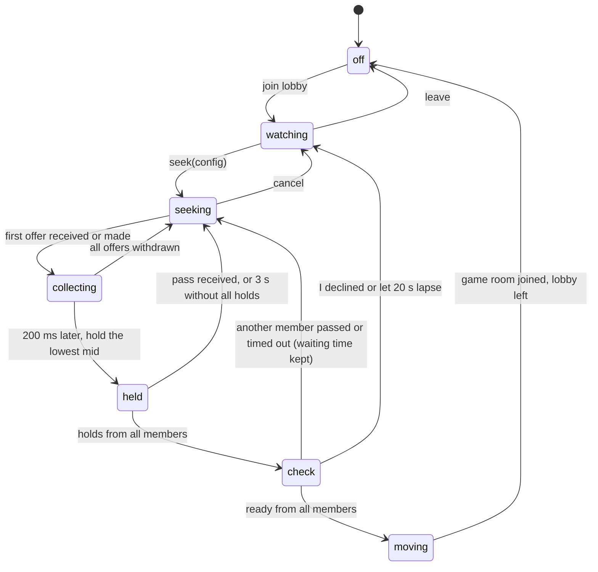

# M8 design: distributed matchmaking and the private game path

Topic owner: matchmaking designer (overnight run, 20 Nov 2026). Scope: the public lobby where players who are looking for a game find each other with no central service, the rating and the deck-strength pairing, the hand-over from a formed match to its own game room, and the private game path (code, link, QR, waiting room, ready). It also defines the deck-strength measure, because the journey topic (`journey.md`) expects it from here. Out of scope and owned by other M8 topics: the landing page layout, the deck picker, the computer opponent, history, the re-invite token and the rejoin sync. Where this design needs something from them, the interface is named, and section 2.17 lists where this document and `journey.md` meet.

Everything here was checked against the code on branch `m8`: `src/net/trystero.ts` (Trystero 0.26 over Nostr), `src/net/transport.ts`, `src/net/hello.ts`, `src/net/identity.ts`, `src/session/transports.ts`, `src/ui/lobby/*`, `src/store/*`, `eslint.config.js`, and against Trystero's own sources in `node_modules`.

## Rulings of the lead planner (20 Nov 2026)

Where this file and a sibling differed, the lead planner decided. These rulings override the text below; the decisions are recorded in `docs/DECISIONS.md` (`[M8 plan]`).

- **Who builds what** is decided by `docs/PLAN.md`, "Milestone 8: Journey, decks and matchmaking" (eleven packages M7-P1, P2, P3, P5 and M8-P1 … M8-P7 after one contracts agent M8-C). The chunk ids in this file (J…, MM-…, PS-…, DK-…, C…, DS-…) name pieces of work, not packages; its build plan is a checklist for the package that PLAN names, and whatever PLAN lists under "later" is not built in the overnight run.
- **Game code:** the existing room id, three words and a number (`amber-fox-93`, shown as `AMBER FOX 93`). No six-character code in M8; no stored id changes.
- **No blur in CSS anywhere:** no `backdrop-filter` and no `filter: blur()` in the shell or over a table. The arena behind Home is a still that `src/scene/still.ts` delivers already soft; a saved table behind the Gathering card is dimmed by the flat `overlay` scrim, never blurred (card faces are on it).
- **Control heights** are the kit's four: 28, 36, 44, 56 px (`visual.md` V4).
- **Deck strength** is the one formula of `decks.md` section 5, in `src/data/deck/strength.ts`; the lobby's `Band` 1 to 5 is its five bands in order.
- **Leaving** has no confirmation and no first-time dialog; the table shows a back arrow top left.
- **The primary button** always starts the selected mode; it never reads `RESUME` or `CONTINUE`. The `CONTINUE` strip under it reopens the last unfinished game.
- **Deck strength:** section 2.7's formula and chunk MM-S are withdrawn; the lobby reads `QueueDeckInfo` (kind, size, cards, score, band, version) from `queueDeckInfo(record)`. Window and rating rules are unchanged.
- **Core tonight** (M8-P7): one lobby room per realm (`lobby-1-<realm>-all-0`) with a soft cap of 16, signed tickets, the offer / hold / ready broker with the smallest-match-id rule, the pairing window by band then rating, the 20-second ready check, the derived room and the automatic entry, Elo per rating key computed locally from the sequenced `TableState.result` of a ranked matched game, the `Matchmaker` service, the queue chip and the match-found card. **Later:** shard overflow and re-homing, the NAT probe and its copy, strikes and rate limits, the looking-now board, "tell me when someone is looking" and notifications, the two first-time notices, the avoid list, co-signed results (`resultSig`, `SignedMatchResult`), `claimAbsence`, draws by consent, the party for 2v2 (solo players queue for 2v2 and get a random teammate), the one-tab Web Lock.
- **The private path** (MM-9, MM-10: invite sheet, QR, waiting room) is built by M8-P4, not by the matchmaking package; `src/ui/qr.ts` and the `qrcode-generator` dependency are landed by M8-C. MM-10's planned edit of `src/ui/Hud.svelte` is replaced by `HudShellProps` (`chrome: 'plates'`, `menuTop`).
- **Results tonight:** `concede` is the only way a game ends (M8-P4 builds the reducer rule and the overlay); a ranked matched game's rating change is computed by each browser from the same sequenced result.

## 1. Decisions

Each decision names its reason and the owner sentence it serves. Owner sentences are quoted from `owner-request.md`.

### Transport and topology

**MM-1. The lobby is a well-known Trystero room on the transport the game already uses. PeerJS is not added.**
Serves: "peerJS could create a common chat-like space where match making basically happens by announcing and having all others who are currently connected, respond, and then they all broker a matchup in da distributed way. yes, that's the way I'd like it to be. forget the centralized service."
Reason: a Trystero room is exactly that space: everyone who joins the same room name is connected to everyone else and can broadcast. PeerJS's public broker has no rooms and no peer listing; a lobby on it needs one peer to hold a well-known id and relay for the others, which is a small central service that moves from browser to browser and fails when its tab closes. The comparison is in section 2.1. What the owner calls "via PeerJS" (a code is the room, reconnect by code) is what Trystero rooms already do here.

**MM-2. Lobby messages travel over the WebRTC mesh, not over the relays.**
Serves: "forget the centralized service".
Reason: the public Nostr relays only introduce browsers (as today). Announcements, offers and answers go browser to browser, so relay rate limits and relay operators never see them, and, more important, **two players can only be matched if their browsers are already connected**. With no TURN server this is the property that matters most: a match is never formed between two networks that cannot reach each other.

**MM-3. One mixed lobby, capped at 16 members per room, overflowing into numbered rooms.**
Serves: "match making from a queue of players waiting for a matchup that matches the configured setup".
Reason: a full mesh costs one peer connection per other member. 16 members (15 connections each) keeps joining fast on an iPad and stays far inside browser limits. All queues share one room because the expected population is small and seeing "1 player wants another mode" is worth more than isolation. The room name reserves a field so the lobby can later be split by queue with a constant change.

**MM-4. The lobby is joined only on intent: opening Find match, or switching on "Tell me when someone is looking".**
Serves: "Instant access to a new game"; hard rule: no analytics, nothing personal.
Reason: opening the site must not connect a visitor to strangers or reveal an IP address. The honest count "n players looking" appears as soon as the player shows interest.

### Protocol

**MM-5. Matches are brokered with signed tickets, offer, hold, ready; one lock per player; lowest match id wins a collision.**
Serves: "they all broker a matchup in da distributed way".
Reason: a player holds at most one offer at a time and refuses all others while holding, so two groups can never both claim the same player. When offers overlap, every browser orders them the same way (smallest match id first), so overlapping groups resolve to the same winner instead of cancelling each other. Section 2.5.

**MM-6. A formed match needs a human Accept within 20 seconds (ready check).**
Serves: "the game itself is something that can be played as a game between waiting in the landing page"; Heroes of the Storm's queue you can browse during.
Reason: the player may be building a deck or playing a practice game while queued. Nobody is pulled out of that without a tap.

**MM-7. The match derives its own game code and room key from nonces all members contributed, then moves to that room; everybody leaves the lobby.**
Serves: "game codes will provide the game's unique identity to reconnect directly via PeerJS to it. no new invitation needed to be sent around."
Reason: no single member chooses the room, nobody else in the lobby learns it, and the game lands in history under a code like any private game. Trystero 0.26 shares one peer connection across rooms, so the players who were connected in the lobby reuse that connection in the game room.

**MM-8. A matched game needs no setup: seats, format, deck and Ready are applied automatically.**
Serves: "the visitor is directly thrown into an arena, with manual configurations to be made … that has to be changed."
Reason: the queue already fixed the mode and the deck. The first thing a matched player sees after Accept is the opening hand.

### Queues, rating, deck strength

**MM-9. Queues are table × deck kind × ranked or casual. In M8 ranked exists for 1v1 only; 2v2 and free-for-all are casual.**
Serves: "1on1, 3 FFA, 2v2 or 4 FFA"; "playing ranked games with booster drafted decks that have been pre-built can be done with open match making"; "live booster draft games are always custom games".
Reason: a free-for-all result depends on table politics, and a rating built on it means little; Blizzard ranks only 1v1 and team modes. Ranked 2v2 is specified here (team rating maths, rating keys) but switched off in M8, in line with the journey topic's J10: it needs a population first. Live draft never enters a queue. A ticket may list several queues, so a small population is not split ten ways.

**MM-10. Rating is Elo, per rating key (`1v1.constructed`, `1v1.limited`; `2hg.constructed` and `2hg.limited` reserved), start 1500, K = 40 for the first 10 games and 24 after, computed locally from results both sides signed.**
Serves: "requires also a match making ranking".
Reason: the rating is self-reported and cannot be verified without accounts; Glicko-2's extra precision would be precision about an honour-system number. Elo is explainable in one line and deterministic, so every browser computes the same change from the same signed result.

**MM-11. Pairing prefers comparable decks first, comparable ratings second, inside a window that widens with the player's own waiting time; "Play anyone now" opens it at once.**
Serves: "a measure of the selected deck's strength to preferably match against other players of comparable decks".
Reason: each player's own patience decides how far the match may stray, so nobody is put into a lopsided game without having waited or agreed. The widening guarantees a game whenever two reachable players want the same mode.

**MM-12. The rating change is adjusted for deck strength: each band step counts as 50 rating points in the expected score.**
Serves: same sentence.
Reason: when the window has widened and a strong deck meets a weak one, winning with the strong deck earns less and losing with the weak one costs less. The deck matters to the result, so it must matter to the rating.

### Honesty, abuse, privacy

**MM-13. No accounts: the existing local ECDSA key pair is the identity. Tickets and results are signed. The limits are stated in the UI.**
Serves: "forget the centralized service"; hard rule: no accounts.
Reason: signatures stop one player from speaking as another and keep two honest browsers in agreement on a result. They cannot stop a modified client from inventing a rating or a fresh identity, and the product says so in plain words instead of pretending.

**MM-14. The public lobby has no free-text chat. The only free text is the display name.**
Serves: "a common chat-like space" (chat-like in mechanism, not a chat room).
Reason: an unmoderated public chat with no accounts cannot be kept clean. Structured announcements cannot carry abuse. "Avoid this player" is a local list.

**MM-15. What leaves the browser in the lobby: display name, pseudonymous player id and public key, rating for the queued keys, deck strength band and score, queues, network class. Never the deck list, deck name or any card.**
Serves: hard rule: hidden information never leaves its owner's browser.
Reason: this is the minimum to pair. The band is a designed, coarse disclosure. As in every peer-to-peer game, connected peers also see each other's IP address; a one-time notice says so before the first join.

### Empty lobby and failure

**MM-16. With nobody to play, the search continues in the background and the screen offers a practice game, a private game, and a notification when someone arrives. Counts are real.**
Serves: "options to play against computer or other players"; "the game itself is something that can be played as a game between waiting".
Reason: most searches on a young site meet an empty lobby. A spinner that never ends is the failure; an honest "you are the only one looking" with something to do is the product.

**MM-17. Strict networks are detected up front with a STUN probe and named in the UI; unreachable players are counted, not hidden.**
Serves: hard rule: no TURN server; Ztyle rooms: "Say failure plainly."
Reason: without a relay some network pairs never connect. The player must learn that it is the network, once, with the remedy.

### Private games

**MM-18. A private game is created instantly, keeps the existing three-words-and-a-number game code as its name (`AMBER FOX 93`), and is shared as a link or QR that carries the code and the room key.**
Serves: "creating a game with multiple players requires first connection and sharing"; "a private game is started and shared"; "re-inviting him via a link or QR code should work from ingame".
Reason: the code is the game's identity in the waiting room, the HUD and history, as the journey topic decided (J21); the existing generator already makes it unique and speakable, and matched games get one from the same generator. The 128-bit key stays in the link because it encrypts signalling and keeps strangers out; a code alone could be found by anyone watching the relays (open question 1 covers joining by code, open question 9 the Ztyle six-character code).

**MM-19. The waiting room is a calm sheet over the blurred arena: seat plates, invite, deck, Ready; the host starts when all are ready.**
Serves: "The UI presents itself with placed buttons and functions of different sizes, the panels are technical and boxy"; "similar to Zhess".
Reason: it reuses the tested lobby rules (`ui/lobby/seats.ts`: chairs, host, `startProblem`) and replaces only their presentation and the order of things.

**MM-20. A 2v2 party is a two-person private room that queues as one unit.**
Serves: "2v2"; Heroes of the Storm party invites.
Reason: with no accounts there is no friends list; the invite link is the friend request. Solo players can queue for 2v2 and get a random teammate.

## 2. Detailed design

### 2.1 Transport comparison

| | A. Lobby room on Trystero (chosen) | B. PeerJS public broker | C. Raw Nostr events as the lobby |
| --- | --- | --- | --- |
| Discovery | Join the same room name; everyone meets everyone | None. Peer listing is off on the public broker. Needs a well-known hub id that one browser holds | Subscribe to a topic; relays fan out |
| Topology | Full mesh, direct | Star through the hub (or hub hands out ids, then mesh) | No peer connections at all |
| Single points of failure | None: 5 of Trystero's default relays in parallel | The one free broker; and the hub browser (re-election when its tab closes, the id stays "taken" for a while) | Relay rate limits and event filters on kinds the relay did not agree to carry |
| Proves two players can connect | Yes, before the match is formed | Only hub to each; pairs unknown | No |
| Already in the project | Yes: `Transport`, `TrysteroTransport`, `BroadcastTransport` and `LoopbackNetwork` for tests | No: new dependency (about 80 kB), second signalling path, second test harness | Partly: needs secp256k1 event signing outside Trystero |
| Scale | 16 per room, rooms chained | Hub limited by its tab | Thousands |
| Static site, no TURN | Yes | Yes if PeerJS's default TURN is overridden (Zhess does) | Yes |

C is the escape hatch if the game ever outgrows meshes: the ticket and offer messages of section 2.4 are transport-neutral and could be published as relay events. It is not built now because it cannot tell whether two matched players can connect.

The owner also asked to explore gists or a free messaging service. The public Nostr relays are that free messaging service, and Trystero already uses them for introductions; nothing else is needed.

Facts from Trystero 0.26 that the design relies on (read in `node_modules/@trystero-p2p/core/dist`):

- ICE servers default to Google and Cloudflare STUN only. There is no TURN unless `turnConfig` is passed, and the project passes none.
- The relay topic is `SHA-1("Trystero@<appId>@<roomId>")`; relays never see the room name.
- Session descriptions are AES-GCM encrypted with the room password.
- A peer connection is shared between rooms (`shared-peer.mjs`, idle timeout about 123 s): two browsers that are in the lobby and then both join a game room keep their existing connection.
- `onPeerJoin` fires only once a data channel is open. A peer whose network cannot be reached simply never appears.

### 2.2 Lobby rooms

**Name.** `roomId = "lobby-" + LOBBY_PROTOCOL + "-" + realm + "-" + family + "-" + shard`, for example `lobby-1-live-all-0`.

- `LOBBY_PROTOCOL = 1`. Bumped on any incompatible lobby message change, so old and new pages never meet in one room.
- `realm`: `live` for production builds, `dev` for builds with `__SPELLPLANE_DEBUG__` (previews and tests never mix with real players).
- `family`: `all` today. Reserved for splitting by queue (`1v1`, `multi`) later.
- `shard`: 0 to 7.
- `roomKey`: the public constant `LOBBY_KEY` (22 base64url characters). It is not a secret; it only satisfies `Transport.join(roomId, roomKey)`.

The lobby uses the existing `Transport` interface and only its `ctl` channel. `createPageTransport()` (`session/transports.ts`) therefore gives Trystero in production and `BroadcastTransport` with `?transport=local`, and tests get a working lobby with no network.

**Cap and overflow.**

- `LOBBY_CAP = 16` members per room, so each member has at most 15 connections.
- A newcomer joins shard 0. Every member's `beat` carries `n`, its number of connected peers. After `SETTLE_MS = 6000` (or as soon as it is connected to 16 peers), the newcomer moves to the next shard if it is connected to 16 or more peers (it would be the 17th member), or if any peer reports `n >= 16`. It leaves the full room first. At shard 7 it stays regardless.
- Two newcomers arriving together may both stay and make 17. That is harmless; the cap is soft.
- Re-home: a seeker in a shard above 0 that is still unmatched and not holding an offer after 90 s leaves and starts again at shard 0. Its waiting time travels with its ticket, so it loses nothing. Matched players leave the lobby, so lower shards drain and refill naturally.
- Watchers (peers that are not seeking) yield: a watcher that sees `n >= 14` leaves the lobby and shows `LOBBY BUSY · WATCHING PAUSED`.

**Scale, honestly.** 8 shards × 16 = 128 people searching at the same moment. A search with a compatible partner present takes about 10 to 30 seconds, so 128 concurrent seekers corresponds to several thousand players online. A player sees only their own shard; a count in a full room reads with a plus, `15+ LOOKING`. Past that the lobby is split by `family`. None of this needs a server.

**Liveness.** `beat` every 4 s. A peer silent for 15 s, or reported gone by the transport, is removed with its ticket. When the tab becomes visible again a beat goes out at once. Chrome does not apply its heavy timer throttling to a hidden tab that holds an open WebRTC connection, so beats keep flowing there. Safari may suspend a hidden tab; that player then drops out of the lobby after 15 s, and on return the chip says `SEARCH PAUSED WHILE THE TAB WAS HIDDEN · RESUMING` and the search rejoins with its waiting time kept. To verify on real devices before release.

**Rate limits (each peer enforces them on what it receives).** A message over 2 kB, a message that fails the schema, or a signature that fails counts as a strike. More than 30 messages in 10 s from one peer is a strike. At three strikes the peer is ignored for the rest of the session (its messages are dropped, it is never offered or accepted).

### 2.3 Network class and what fails without TURN

`net/lobby/nat.ts` runs one probe when the lobby is first joined and again on the `online` event: an `RTCPeerConnection` with two STUN servers on different hosts, one data channel, `createOffer`, and up to 3 s of candidate gathering.

| Class | Evidence | Meaning |
| --- | --- | --- |
| `open` | One server-reflexive mapping (same public port from both servers) | Connects to most players |
| `strict` | Two different public ports for one local socket (symmetric NAT) | Connects only to players on fully open networks; never to another strict network |
| `blocked` | No server-reflexive candidate at all | UDP or STUN is blocked; online play will not work |
| `unknown` | The probe could not decide (privacy settings hide the local side) | Treated as `open`, no message |

The class is carried in the ticket (`nat`) and in the status line of the Find match screen:

| State | Where | Copy |
| --- | --- | --- |
| `open` | Status line, faint | `✓ DIRECT CONNECTIONS OK` |
| `strict` | Status line with an info button | `STRICT NETWORK · SOME PLAYERS UNREACHABLE` |
| `strict`, info popover | Popover | "Your network gives every connection a new address (a strict NAT, common on mobile data and in offices). Spellplane connects browsers directly and has no relay server, so you can only play people on open networks. Another network or a phone hotspot usually fixes this." |
| `blocked` | Banner over the stage, one action `RETRY` | "This network blocks direct connections, so online play cannot work here. You can still play against the computer and build decks. Try another network or a phone hotspot." |
| Relays unreachable (join not complete after 15 s) | Banner, one action `RETRY` | "Cannot reach the public relays that introduce players to each other. Check your internet connection." |

**Unreachable players are counted.** Every `beat` lists the transport ids the sender is connected to (`links`). If a peer I am connected to lists a seeker I have had no connection to for 15 s, that seeker is unreachable from my network. The board says `5 LOOKING · 2 YOU CANNOT REACH`. Only ids are gossiped, never tickets, so nothing can be forged through a third party.

**Groups are cliques.** A three- or four-player match is only offered when every pair in it is linked according to the gossiped `links`, and each member checks its own links again before holding.

The Find match button stays enabled in every class: the probe can be wrong, and a strict network still reaches open ones.

### 2.4 Data shapes

All shapes are plain JSON. New contract files: `src/net/lobby/messages.ts` and `src/net/lobby/types.ts`.

```ts
/** Lobby wire protocol version; part of the lobby room name. */
export const LOBBY_PROTOCOL = 1;

export type DeckKind = 'constructed' | 'limited';
export type QueueMode = 'ranked' | 'casual';
/** '<core Format>.<DeckKind>.<QueueMode>', e.g. '1v1.constructed.ranked'. */
export type QueueId = `${Format}.${DeckKind}.${QueueMode}`;
/** '<Format>.<DeckKind>' for the four rated combinations. */
export type RatingKey = '1v1.constructed' | '1v1.limited' | '2hg.constructed' | '2hg.limited';
export type NatClass = 'open' | 'strict' | 'blocked' | 'unknown';
export type Band = 1 | 2 | 3 | 4 | 5;

/** The ten valid queues in M8: ranked for 1v1, casual for all four tables, each for both deck kinds. `2hg.*.ranked` is reserved. */
export const QUEUES: readonly QueueId[];

/** What a seeker announces. Signed by the identity key; bound to the lobby connection by `tid`. */
export interface Ticket {
  v: 1;
  /** The sender's transport id in this lobby room. A ticket is accepted only from the connection with this id. */
  tid: string;
  /** Identity: first 16 hex of SHA-256 of the public key (as `hello.peerId`). */
  peerId: string;
  /** base64url SPKI. */
  pubKey: string;
  /** Display name, 1..24 characters after normaliseNickname. */
  name: string;
  /** The game PROTOCOL_VERSION of this page; tickets with another value are shown but never matched. */
  proto: number;
  /** 1..4 queues this player accepts, most wanted first. All share one DeckKind (the selected deck's). */
  queues: QueueId[];
  /** Rating and games played for each RatingKey among `queues`. Self-reported. */
  ratings: Partial<Record<RatingKey, { r: number; g: number }>>;
  /** Deck strength of the selected deck: band 1..5 and score 0..100 (from the deck topic's measure). */
  band: Band;
  score: number;
  /** True after "Play anyone now": this player's window is unlimited. */
  open: boolean;
  /** 2v2 party: the teammate's tid. Valid only if the teammate's ticket names this tid back. */
  mate?: string;
  nat: NatClass;
  /** Increases whenever the player changes the ticket. */
  rev: number;
  /** ECDSA P-256 over canonicalJson(ticket without sig). */
  sig: string;
}

export type LobbyMessage =
  /** Full ticket: on starting to seek, to every newly connected peer, and on every change. */
  | { v: 1; t: 'seek'; ticket: Ticket; waitedMs: number }
  /** Every 4 s. `state` is the sender's broker state; `n` its peer count; `links` the tids it is connected to. */
  | { v: 1; t: 'beat'; state: 'watching' | 'seeking' | 'held' | 'check'; waitedMs: number; n: number; links: string[] }
  /** Stopped seeking (still in the lobby as a watcher). */
  | { v: 1; t: 'unseek' }
  /** Anchor to each member: a proposed match. `members` in seat order; `team` 0 or 1 for 2hg. */
  | { v: 1; t: 'offer'; mid: string; queue: QueueId; members: { tid: string; rev: number; team?: 0 | 1 }[] }
  /** Member to all members: locked to `mid`. `sig` signs `holdText(mid, tid, peerId)`; `nonce` is 16 random bytes. */
  | { v: 1; t: 'hold'; mid: string; nonce: string; sig: string }
  /** Member to all members: not (or no longer) taking part. */
  | { v: 1; t: 'pass'; mid: string; reason: 'busy' | 'window' | 'unreachable' | 'stale' | 'declined' }
  /** Member to all members: the human pressed Accept. */
  | { v: 1; t: 'ready'; mid: string };
```

`offer`, `hold`, `pass` and `ready` are sent with `Transport.send('ctl', msg, to)` to each member, never broadcast. The rest of the lobby sees only, in the next `beat`, that those peers are `held`.

`mid = hex(SHA-256("mm|" + queue + "|" + sorted member tids joined by "," + "|" + anchorTid + "|" + anchorOfferCounter))[0..16]`.

`holdText(mid, tid, peerId) = "spellplane-v1|hold|" + mid + "|" + tid + "|" + peerId`. The signature over a fresh `mid` proves the holder owns the ticket's key at that moment; a replayed ticket cannot produce it.

Local records (new stores, section 2.10):

```ts
/** One player of a formed match, copied from the signed ticket. */
export interface MatchPlayer { peerId: string; pubKey: string; name: string; rating: number; games: number; band: Band; score: number; team?: 0 | 1 }

/** A match formed in the lobby. Key: roomId. Written before entering the room. */
export interface MatchRecord {
  matchId: string;
  roomId: string;          // the game code
  roomKey: string;
  queue: QueueId;
  /** Seat order: players[i] takes the seat with index i. */
  players: MatchPlayer[];
  formedAt: number;
  state: 'formed' | 'playing' | 'finished' | 'void';
  result?: SignedMatchResult;
  /** Own rating change once applied (ranked only). Presence makes the application idempotent. */
  delta?: number;
}

export interface RatingRecord {
  key: RatingKey;
  rating: number;   // starts at 1500
  games: number; wins: number; losses: number; draws: number;
  peak: number;
  updatedAt: number;
}
```

### 2.5 Brokering: the state machine

One pure state machine per browser, `net/lobby/broker.ts`: `step(state, event) -> { state, send: Outgoing[], effects: Effect[] }`. It has no clock and no randomness: `now` arrives in every event, nonces arrive with the command, and retry jitter is derived from `SHA-256(tid + counter)`. The session drives it with a 250 ms tick.



**Constants.** `COLLECT_MS = 200`, `HOLD_TTL_MS = 3000`, `CHECK_MS = 20000` (+ 2000 grace for late `ready`), `BEAT_MS = 4000`, `PEER_TIMEOUT_MS = 15000`, `RETRY_MS = 300..1500` (jittered), `ARRIVE_MS = 30000`.

**Waiting time.** A ticket arrives with `waitedMs`; the receiver stores `since = now - waitedMs` on its own clock. No wall clocks are compared.

**Rules.**

1. **Who offers (anchor rule).** A browser offers only groups in which its own tid is the smallest. For a pair that can match, exactly one side offers. This is an optimisation for liveness; safety comes from rule 3.
2. **What is offered.** On every tick and every change, a seeking anchor that is not holding and whose retry delay has passed builds the best group for its first queue that has enough candidates (then its next queue): all members seeking, same game `proto`, sharing that queue, pairwise linked, pairwise inside both windows (section 2.7), nobody on the anchor's avoid list. Among valid groups it takes the lowest cost, `cost = max over pairs of (100 × band gap + rating gap)`, ties to the longest-waiting candidates. It sends `offer` to every member and treats the offer as received by itself.
3. **One lock.** A browser holds at most one `mid`. From the first offer it sees while free, it collects offers for 200 ms, drops those it cannot take (not seeking, window, a member unreachable, a ticket `rev` it does not have; it answers these with `pass` and the reason; a member on its avoid list is answered with `window`, so the avoided player is not told), then sends `hold` for the **smallest `mid`** and `pass busy` for the others. Every later offer gets `pass busy` until it is free again.
4. **Same order everywhere.** Because all browsers pick the smallest `mid`, two overlapping offers that reach their shared members inside the collect window produce one match, not zero. An anchor whose own offer loses to a smaller one it received withdraws its own (`pass stale`) and holds the other.
5. **Hold completes or expires.** A holder that has valid `hold`s from all members (signature checked against the ticket's key) enters `check`. A `pass` for its `mid`, or 3 s without all holds, frees it; on the timeout it sends `pass stale` so the others free themselves at once.
6. **Ready check.** In `check` the UI shows the match (section 2.8). Accept sends `ready`. Decline, or 20 s without an answer, sends `pass declined`; that browser goes to `watching` and must press Find match again. The others return to `seeking` with their waiting time intact and a toast.
7. **Go.** With `ready` from all members, each browser derives the room (below) and enters `moving`. No further message is needed.
8. **Never the same failure twice.** After a `pass` with reason `window` or `unreachable`, the anchor does not offer that member set again until one of the tickets or links changes. After `busy` or `stale` it retries after the jittered delay.
9. **Strikes.** A peer that fails the ready check twice with me within 10 minutes is ignored by my broker for 5 minutes. My own honest client adds a 30 s pause before I can queue again after two declines in 10 minutes. (A modified client can skip its own pause; the first half still protects me.)

**Why two groups never claim one player.** A browser sends at most one `hold` at a time (rule 3), a match needs a `hold` from every member (rule 5), and `hold`s are signed over the `mid`. So any two matches that reach `check` have disjoint members. This is the invariant the property tests assert.

**Room derivation.**

```
secret  = SHA-256("spellplane-match|" + mid + "|" + hold nonces in ascending tid order, joined by "|")
roomKey = base64url(secret[0..16])                              // 22 characters, like every room key
roomId  = randomRoomId(bytes drawn from the stream SHA-256(secret + "|code|" + counter))   // the existing generator: three words and a number
seats   = members ordered by SHA-256(secret + "|" + tid); for 2hg team 0 takes the first team's chairs
```

Every member contributed a nonce over a direct encrypted channel, so nobody outside the match can compute the room and no member could choose it.

**2v2 units.** Two tickets that name each other as `mate` are one unit; neither is matched alone. A unit's rating is the mean of its members' ratings, its band the higher of the two. Valid 2v2 groups: two units, one unit and two solos (the solos are team-mates), or four solos, split so the team means are closest (highest and lowest rated together). The offer lists all four tids with their `team`.

### 2.6 From match to game room

On entering `moving`, the session (`session/match-room.ts`):

1. Writes the `MatchRecord` (state `formed`) to the `matches` store.
2. Navigates to the room route `#/t/<roomId>/<roomKey>` (the existing networked table). The lobby transport stays joined.
3. In the room, because a `MatchRecord` exists for this `roomId`, the waiting room is not shown. A full-screen transition shows the pairing (names, seat colours, ratings, deck bands) over the blurred arena: `AMBER FOX 93 · RANKED 1V1` and under it `CONNECTING…`.
4. Each browser takes the seat with its index in `players` (`seatTake`), using its stored seat colour or the next free one. The lowest seat dispatches `formatSet` for the queue's table. Each browser imports the deck it queued with and presses Ready (the existing commitment). When all are ready the host's browser starts the game without a button. The first player is chosen by the existing public randomness.
5. A seat taken by a `peerId` that is not in the `MatchRecord` is refused by the UI with a table-wide warning (the room hello already proved the key).
6. The lobby is left once every member's game hello has verified, or after 10 s. From then on the matchmaker is `off`.

**Arrival timeout.** If a member has not completed the hello within 30 s, the others see a banner: "Mira did not arrive. Back to the queue; you keep your place." with `BACK TO QUEUE` as the one action. The `MatchRecord` becomes `void`, the room record is deleted, and the search resumes with the old waiting time. No rating changes.

**The game code afterwards.** A matched game is an ordinary room. It is saved, listed in history under its code and can be left and re-entered like a private game. Ranked status comes from the `MatchRecord`, not from the shared state.

### 2.7 Queues, rating and the pairing window

**Queues.** The table stepper offers `1V1`, `3 FREE-FOR-ALL`, `4 FREE-FOR-ALL`, `2V2`. A `RANKED | CASUAL` pill pair sits next to it; on every table but 1v1 `RANKED` is dimmed in place with the hint "Ranked is 1v1 only for now". The deck kind is not chosen: a custom deck queues as `constructed`, a sealed or pre-drafted booster deck as `limited` (the deck topic marks decks as sealed; a sealed deck that was "converted into a custom deck" queues as constructed). Live draft has no queue.

A ticket lists the chosen queue first. `ALSO ACCEPT CASUAL` (a small pill, off by default, remembered) adds the casual queue of the same table and deck kind.

**Rating.** One `RatingRecord` per `RatingKey`, created at 1500 on the first ranked game. Only the two 1v1 keys are used in M8; the 2v2 line below is specified and unit-tested so that switching ranked 2v2 on later is a change to `QUEUES` alone.

```
band-adjusted rating   R' = R + 50 × (band − 3)
expected score         E_a = 1 / (1 + 10^((R'_b − R'_a) / 400))
change                 Δ_a = round(K_a × (S_a − E_a)),   S = 1 win, 0.5 draw, 0 loss
K                      40 while games < 10, else 24
floor                  a rating never drops below 100
2v2                    R' of a team = mean of its members' R'; each member is updated with their own K against the other team's mean
```

Inputs are the values frozen in the `MatchRecord` (from the signed tickets), so every browser computes every player's change identically and the result screen can show both: `YOU 1512 → 1527 (+15)`.

Worked example, both past placement (K = 24): A (1500, band 3) meets B (1500, band 5) after the window widened. `R'_A = 1500`, `R'_B = 1600`, `E_A = 0.36`. A wins: A +15, B −15. B wins: B +9, A −9.

**Display.** During the first 10 ranked games of a key the landing page shows `PLACEMENT 4 / 10` instead of a number; pairing already uses the number. After that it shows the rating and a tier word: Novice below 1350, Adept to 1549, Expert to 1749, Master to 1949, Archmage from 1950. There is no leaderboard, because nothing could verify one.

**Casual games** never change a rating. They pair on the same key's rating with a doubled rating window.

**Deck strength.** There is no rules engine, so strength is a transparent estimate from data the browser already has. `deckStrength(cards, kind)` in `src/data/strength.ts` (pure) returns `{ score: 0..100, band: 1..5, parts }`, with bands at 20-point steps (0–19 band 1 … 80–100 band 5). The deck hero's five pips show the band.

| Part | Weight | How it is computed (main deck only; every copy counts; basic lands are left out of the first and third part) |
| --- | --- | --- |
| Card quality | 60 % | Mean of each card's quality `q`. `q = (rarity + reach) / 2` when the card has a reach value, else `rarity`. `rarity`: common 0.25, uncommon 0.45, rare 0.70, mythic 0.85. `reach = 1 − min(edhrec_rank, 20000) / 20000` (how widely the card is played, from Scryfall's `edhrec_rank`) |
| Curve and lands | 25 % | Half: `1 − min(1, abs(meanManaValue − 2.5) / 2)` over non-land cards. Half: the land share, 1.0 between 36 % and 44 %, falling linearly to 0 at 20 % and 60 % |
| Consistency | 15 % | Constructed: share of non-land cards that are in the deck three or four times. Limited: share of non-land cards with mana value 3 or less |

`score = round(100 × (0.60 × quality + 0.25 × curve + 0.15 × consistency))`. The trimmed card object gains `edhrec_rank?: number` (a contract change in `data/types.ts` and the trimming in `data/scryfall.ts`); cards without it use rarity alone, so fixtures and offline decks still get a score. The measure does not understand combos or synergy, and the deck editor says so in the pips' tooltip: "A rough guide from card rarity, how widely the cards are played and the mana curve. Used to find opponents with comparable decks." The weights are constants in one file, to be tuned against a set of fixture lists (a starter deck must land in band 1 or 2, a tournament list in band 4 or 5).

If card data for a deck is not loaded yet, the ticket carries band 3, score 50, and the search screen says `DECK STRENGTH UNKNOWN · MATCHING AS AVERAGE`.

**Window.** Each ticket has its own window from its own waiting time `w`:

| Own wait | Rating gap allowed | Band gap allowed |
| --- | --- | --- |
| under 10 s | 100 | 0 |
| 10 to 20 s | 200 | 1 |
| 20 to 40 s | 300 | 1 |
| 40 to 60 s | 400 | 2 |
| 60 to 90 s | 600 | 2 |
| 90 s and more, or `open` | any | any |

Two tickets are compatible when the pair's gaps fit **both** windows. In a group every pair must be compatible; for 2v2 the gaps are measured between the two teams. The function is `compatible(a, b, waitA, waitB)` in `net/lobby/pairing.ts`, pure and symmetric.

When a seeker who shares my queue is outside my window, the search panel says so and offers the shortcut: `1 PLAYER OUTSIDE YOUR RANGE` with the ghost button `PLAY ANYONE NOW`, which sets `open` and re-sends the ticket. The other side sees the same prompt, or simply waits its 90 s.

### 2.8 What the player sees

Component names are Ztyle's (`docs/10-components.md`): primary pill `.btn-primary`, ghost `.btn-ghost`, option pills `.pill-sm`, stepper, status line, presence dot, banner over the stage, request toast, sheet. The landing topic places these; this section fixes their content and states.

**Find match controls** (on the landing page, under the selected deck):

```
            ‹   ONLINE · RANKED   ›           opponent stepper: COMPUTER · FRIENDS · ONLINE
                  1v1
        [ 1v1 ] [ ranked ] [ also casual ]    option pills (table cycles 1v1, 3 ffa, 4 ffa, 2v2)

               (  FIND MATCH  )               the one primary pill, centre of the blurred arena

          ● 3 LOOKING NOW · 1 IN YOUR QUEUE   status line; tap opens the board
```

The lobby is joined when the stepper first rests on `ONLINE` for 600 ms (so stepping past it does not connect). Until the count is known the status line reads `CONNECTING TO THE LOBBY…`.

**Searching.** The primary pill becomes `◌ SEARCHING 0:42` and a tap cancels (Ztyle: the pill carries the wait and a tap cancels). The stepper and pills dim. The status line cycles the honest facts: `3 LOOKING NOW · 1 IN YOUR QUEUE`, `RANGE ±300 · DECKS ±1`, and after 90 s `RANGE: ANYONE`.

**Queue chip.** While searching, a chip sits in the top chrome on every screen (deck library, deck editor, settings, practice game): `◌ 1V1 RANKED 0:42 ✕`. Tap returns to the landing page; ✕ cancels. Editing the queued deck cancels the search with the toast "Search stopped: you changed the deck."

**Board** (a sheet from the status line): one row per seeker in my shard, grouped by queue with the count in the group head.

```
LOOKING NOW                                         5
RANKED 1V1 · CUSTOM DECKS                           2
  ● Mira        1540   deck ●●●○○   0:42   in range
  ● Tobias      1890   deck ●●●●●   2:10   outside your range      [ PLAY ANYONE NOW ]
CASUAL 4 FREE-FOR-ALL · CUSTOM DECKS                1 / 4
  ● Jo          —      deck ●●○○○   5:31                           [ JOIN THIS QUEUE ]
2 MORE YOU CANNOT REACH FROM THIS NETWORK           ⓘ
```

`JOIN THIS QUEUE` changes my stepper and pills to that queue and starts the search (if my selected deck is of the other deck kind the button reads `NEEDS A SEALED DECK` or `NEEDS A CUSTOM DECK` and is disabled). A row's menu has `AVOID THIS PLAYER` (adds the `peerId` to the local avoid list; my broker never offers or holds a match with them). A player I have met before shows the record: `played 3 · you won 2`.

**Match found** (state `check`): a card centred over whatever is on screen, with a 20 s ring around the primary pill. Sound, and with permission a system notification; the tab title flashes `Match found`.

```
                MATCH FOUND
              RANKED 1V1 · CUSTOM DECKS

      You  1512  ●●●○○        vs        Mira  1540  ●●●○○
                                         played 3 · you won 2

            (  ACCEPT  )   [ decline ]
```

After my Accept the pill reads `WAITING FOR MIRA…`. If another member declines or times out: toast "Mira did not accept. Back in the queue." and the chip continues from its old time. If I let it lapse: toast "You missed the match. Search stopped." In a practice game the card appears over the table; Accept saves the practice game to history first.

**Alone.** After 10 s with no other seeker in my queue the area under the pill shows three quiet actions, and the search goes on:

- "You are the only one looking right now." (or "Nobody else is looking for Ranked 1v1. 2 players want Casual 1v1." with `ALSO ACCEPT CASUAL`)
- `PRACTISE WHILE YOU WAIT` starts the practice game (the solo table; against the computer once the journey topic ships one). The chip stays.
- `INVITE A FRIEND` opens a private game (cancels the search).
- `NOTIFY ME` asks for notification permission once; with it, a match found while the tab is hidden raises a notification.

**Tell me when someone is looking** (landing page option pill, off by default, stored in settings as `lobbyNotify`). While it is on and the app is open, the browser sits in the lobby as a watcher. When a seeker appears whose queue my selected deck fits, a request toast shows `Mira is looking for Casual 1v1` with `Ignore` and `Play`; `Play` queues me for that queue with `open` set. Watching pauses after 10 minutes with the tab hidden.

**First-time notices** (one sheet each, shown once, ids `lobbyPrivacy` and `rankedHonour` in `hintsSeen`):

- Before the first lobby join: "Finding a match connects your browser directly to the other players who are looking. They see your display name, rating, deck strength level and the mode you want and, as in every peer-to-peer game, your IP address. Nothing is stored on a server." `GOT IT`
- Before the first ranked search: "Ranked is an honour system. There are no accounts and no server: your rating lives in this browser, and nobody can verify anyone's number. Both players sign each result, which keeps honest browsers in agreement; it cannot stop a modified one. Clearing site data resets your rating unless you exported a backup." `GOT IT`

**Version.** A seeker on another game protocol is listed dimmed as `ON ANOTHER VERSION` and never matched. If mine is the older one the board shows `A NEWER SPELLPLANE IS OUT · RELOAD` and the update check runs.

**Another tab.** The search is guarded by a Web Lock (`spellplane:<profile>:matchmaker`). A second tab shows `SEARCHING IN ANOTHER TAB` with `USE HERE`. Without Web Locks every tab may search; a ticket with my own `peerId` is ignored by my broker so I never match myself.

### 2.9 Results, signing and what a rating is worth

There is no rules engine, so a result is what the players declare.

- **Concede.** The game menu's flag (hold to confirm, as in Zhess) dispatches `concede`. The seat is marked conceded and the log says "Mira concedes". When one seat or one team is left, the shared state gets `result`.
- **Draw.** `OFFER DRAW` opens a consent round (`ask {consent: true}`, already in M6-C: silence is no). All OK sets `result` to a draw.
- **Absence.** If a seat has been away for 5 minutes in a row in a matched game, the present players' flag menu gains `CLAIM WIN · MIRA IS AWAY`. The sequencer's clock decides, as for every timer. The away seat is marked conceded with reason `absence`. The game is over for rating purposes but the room stays in history.

When `result` appears at sequence number `endSeq`, every participant's browser builds the same `MatchResult`, signs it, and sends the signature on `ctl`:

```ts
export interface MatchResult {
  v: 1;
  matchId: string;
  roomId: string;
  queue: QueueId;
  /** As in MatchRecord, seat order. */
  players: MatchPlayer[];
  outcome: { kind: 'win'; winners: number[] } | { kind: 'draw' };   // indexes into players
  reason: 'concede' | 'agreed' | 'absence';
  /** Ties the result to the game: the sequence number and state hash at which `result` was set. */
  endSeq: number;
  endHash: string;
}
/** `sigs[peerId]` is that player's ECDSA signature over canonicalJson(result). */
export interface SignedMatchResult { result: MatchResult; sigs: Record<string, string> }
```

A browser applies its rating change once it holds signatures from every player, or, for `absence`, from every present player. It stores the `SignedMatchResult` in the `MatchRecord`, sets `delta`, and shows the result card (`VICTORY · 1512 → 1527 (+15)`). Applying is idempotent on `matchId`.

The absent player's honest browser applies the loss when it next syncs the room and sees the result. If it never returns: 24 hours after `formedAt`, a `MatchRecord` without a result is closed locally. If this browser was the one that left (the other players were connected at its last save), it records a loss; otherwise the record becomes `void`.

A casual game uses the same result flow for history ("won", "lost", "draw") and changes no rating.

**What can and cannot be prevented.**

| Abuse | Outcome |
| --- | --- |
| Speaking as another player (their name, id, rating) | Prevented: tickets are signed, bound to the connection, and `hold` signs the fresh match id |
| Two groups claiming one player; a third party forging an offer answer | Prevented: one signed `hold` at a time |
| Claiming a result the other side did not agree to | No effect on an honest opponent: without their signature their rating does not move |
| Inventing a rating, editing IndexedDB, starting over with a new identity after losing | Not preventable without accounts. Stated in the ranked notice. Ratings shown for other players are their own claim |
| Minting fake opponents to sign fake wins | Not preventable; this is why result chains are not used as proof of rating |
| Under-reporting deck strength to gain more points | Not preventable (the band is computed in the player's own browser). Open question 4 |
| Closing the tab to dodge a loss | The present player can claim the win after 5 minutes; an honest absent client records the loss; a modified one does not |
| Declining after seeing the opponent | Allowed; costs the place in the queue, and a 30 s pause after two declines |
| Flooding the lobby | Per-peer rate limit and three strikes, enforced by every receiver |
| Offensive display names | Rendered as plain text, 24 characters, control characters stripped. `AVOID THIS PLAYER` hides them from my matches. No moderation exists and the product does not claim any |
| Collecting IP addresses by sitting in the lobby | Inherent to peer-to-peer; stated before the first join. The lobby is joined only on intent |

### 2.10 Storage

`DB_VERSION` goes from 1 to 2 with two new stores (the first schema change; the upgrade only creates stores):

| Store | Key | Value |
| --- | --- | --- |
| `ratings` | `RatingKey` | `RatingRecord` |
| `matches` | `roomId` (index `formedAt`) | `MatchRecord` |

New settings keys: `lobbyNotify: boolean` (default false), `alsoCasual: boolean` (default false), `lastQueue: QueueId` (default `1v1.constructed.casual`), `avoid: { peerId: string; name: string; at: number }[]` (capped at 200, oldest dropped). `hintsSeen` gains `lobbyPrivacy` and `rankedHonour`.

The backup file (`store/backup.ts`) includes `ratings`, `matches` and the new settings, so a rating survives a browser change when the player exports and imports.

### 2.11 Party for 2v2

- With the table stepper on `2V2`, a teammate slot appears next to my deck: `TEAMMATE · RANDOM` with the ghost button `INVITE`.
- `INVITE` creates a party: code (from the room-id generator) and key, link `#/party/<code>/<key>`, and opens the invite sheet (section 2.12) titled "Invite your teammate". The party is a Trystero room `party-<code>` with that key; only the two browsers are in it.
- 2v2 is casual in M8, so a party queues for `2hg.<deck kind>.casual`.
- The friend who opens the link lands on the landing page with a party chip `IN A PARTY WITH MIRA · 2V2` and the stepper locked to the leader's queue. They pick their own deck and press `READY`. The leader's primary pill reads `WAITING FOR JO` until then, after that `FIND MATCH`.
- Party messages on `ctl` of the party room: `party.hello` (identity and signature, as the room hello), `party.state { queue, deckKind, band, ready }` from each side, `party.seek { on, shard }` from the leader. On `seek` both join the lobby shard the leader settled in and announce tickets that name each other as `mate`.
- Both see the same search state and the same Match found card; both must accept. After the game both return to the landing page still in the party.
- A party whose two decks are of different kinds cannot queue: `BOTH DECKS MUST BE CUSTOM OR BOTH SEALED`.
- Leaving: either side's ✕ on the party chip. If the connection drops, the chip shows a hollow pulsing dot and the search is cancelled.

A party has exactly two members. Filling a private three- or four-player table from the queue is not part of M8.

### 2.12 The private game path

**Create.** With the opponent stepper on `FRIENDS · Private game`, the primary pill reads `CREATE GAME`. One press creates the room (code and key), stores it, and opens the waiting room at `#/t/<code>/<key>` with the invite sheet already open. There is no form before it.

**Game code.** The room id from the existing generator (`randomRoomId` in `ui/lobby/room.ts`), shown in upper case with spaces: `AMBER FOX 93`. It is set in `.code-display` type, is the row title in history, and sits in the HUD's info pill with the presence dot. The key is unchanged: 16 random bytes, 22 characters. Nothing about room ids or links changes, so every saved table and old link keeps working.

**Invite sheet** (a bottom sheet on phones, a centred sheet on desktop, after Zhess's):

```
[icon]  Invite players                                   ✕
        Send this link or let them scan the code.

                   A M B E R   F O X   9 3

                     ┌──────────┐
                     │  QR code │        dark modules on a white plate in every look
                     └──────────┘

              [ https://…/#/t/amber-fox-93/… ]
              (       COPY LINK       )   [ share ]     share = navigator.share where it exists
                 ○ Waiting for players · 1 of 2 seated
```

The QR encodes the full link (85 to 110 characters depending on the host: version 6 or 7, at most 45 × 45 modules, error correction M). It is drawn by the app with `qrcode-generator` (MIT, the library Zhess uses), loaded only when the sheet opens; scanning uses the phone's camera app. `COPY LINK` turns into `COPIED ✓` for 2 s.

**Join.** Opening the link goes straight to the waiting room and takes the lowest free seat. The landing page's `JOIN` field (under `FRIENDS`) accepts a pasted link; `parseRoomLink` already finds it inside a sentence. A bare code is answered with "Paste the whole link: the code alone does not carry the key." unless the journey topic's stretch path, join by code with a knock (`#/g/<code>`), is built (open question 1).

**Waiting room** (stage `lobby`, no `MatchRecord`): a sheet over the blurred arena, one column, in this order:

1. **Head.** The code with its presence dot, and `INVITE` as a ghost button (reopens the sheet).
2. **Setup pills** (host can change, everyone sees; others see them dimmed with "Mira chooses the setup"): table (`1v1`, `3 ffa`, `4 ffa`, `2v2`), decks (`own decks`, `sealed decks`, `live draft`), pass timer. Changing the table dispatches `formatSet`; decks and draft settings dispatch `lobbySet` as today.
3. **Seats.** Two to four seat plates arranged as the players will sit, mine at the bottom. A plate shows the seat colour dot, the name, a connection dot (solid connected, hollow pulsing connecting, with `CANNOT CONNECT` after 15 s from the existing connectivity check), the deck state (`CHOOSING A DECK`, `DECK READY`; never the deck's name or size before Ready, after Ready the committed card count as today) and a check mark when ready. An empty seat is a dashed plate `OPEN SEAT` with `INVITE`. Tapping my own plate opens colour and seat choice. In 2v2 the plates are grouped by team.
4. **My deck.** The deck selected on the landing page, as a small hero tile with `CHANGE`. With `live draft` it is replaced by the closed boosters illustration and there is nothing to pick.
5. **Primary pill.** `READY` for me; after that `READY ✓` (tap to take it back). For the host, once every chair is taken and everyone is ready: `START`. Before that the host's pill shows the reason from `startProblem` in short form: `WAITING · 1 OPEN SEAT`, `WAITING · 2 OF 3 READY`.
6. **Status line.** Spectator count and the connectivity text from `ui/lobby/connectivity.ts`.

The log, chat panel and table tools are not shown in the waiting room; chat is one collapsed line at the foot of the sheet.

**Failure texts** (existing constants in `connectivity.ts`, kept): alone after 15 s, the neutral hint; a pair that cannot connect, "You and Jo cannot connect directly. Try another network, a phone hotspot or a VPN on one side. Spellplane has no relay server."; relays unreachable; version mismatch.

**Re-invite from inside a game.** The journey topic owns this (J22: a present player mints a one-time seat link, `#/t/<room>/<key>/rejoin/<seat>/<token>`). This design supplies the component: `InviteSheet` takes a title, a link and a status line, so `Re-invite…` on a seat plate opens the same sheet titled "Bring Mira back" with the minted link and its QR. A returning browser with the same identity needs no link at all; it reclaims its seat by key as today.

### 2.13 Module layout and interfaces

| File | Layer | Contents |
| --- | --- | --- |
| `src/net/lobby/messages.ts` | net, contract | `LOBBY_PROTOCOL`, `LobbyMessage`, `Ticket`, `holdText`, `ticketText`, shape validators |
| `src/net/lobby/types.ts` | net, contract | `QueueId`, `RatingKey`, `Band`, `NatClass`, `MatchPlayer`, `MatchResult`, `SignedMatchResult`, `BrokerState`, `BrokerEvent`, `LobbyView`, constants |
| `src/net/lobby/rating.ts` | net, pure | `expected`, `kFactor`, `ratingChanges(result)`, `tierOf` |
| `src/data/deck/strength.ts` | data, pure | The strength measure of `decks.md` section 5 (ruling: one formula; the simpler one of 2.7 here is withdrawn), exported for the lobby as `queueDeckInfo(record)` in `src/data/deck/queue.ts` |
| `src/net/lobby/pairing.ts` | net, pure | `windowOf(waitMs, open)`, `compatible`, `bestGroup`, `splitTeams`, `midOf`, `deriveRoom` |
| `src/net/lobby/broker.ts` | net, pure | The state machine of 2.5 |
| `src/net/lobby/room.ts` | net | `LobbyRoom`: a `Transport`, beats, links, rate limits, shard settling; feeds events to the broker |
| `src/net/lobby/nat.ts` | net | `probeNat(factory)`, with the `RTCPeerConnection` constructor injected |
| `src/net/lobby/result.ts` | net | Build, sign and verify `MatchResult` |
| `src/store/ratings.ts`, `src/store/matches.ts` | store | The two new stores |
| `src/session/matchmaker.ts` | session | The app-level service: owns the `LobbyRoom`, broker, tick, Web Lock, notifications, stores |
| `src/session/match-room.ts` | session | The hand-over of 2.6 and the result flow of 2.9 |
| `src/session/party.ts` | session | The party room of 2.11 |
| `src/ui/play/*` | ui | `FindMatch.svelte`, `QueueChip.svelte`, `LookingBoard.svelte`, `MatchFound.svelte`, `Pairing.svelte`, `ResultCard.svelte`, `PartyChip.svelte`, `Notices.svelte` |
| `src/ui/lobby/WaitingRoom.svelte`, `InviteSheet.svelte`, `src/ui/qr.ts` | ui | The private path of 2.12; `Lobby.svelte`'s logic moves, its helpers stay |

`net/lobby/*` imports only `net`, `core` and `util`, so no boundary rule changes. `store` cannot import `net`; the record types that both need (`RatingKey`, `MatchRecord`, `RatingRecord`, `MatchPlayer`, `SignedMatchResult`) are therefore declared in `core/types.ts` by the contracts package and re-exported from `net/lobby/types.ts`.

```ts
/** session/types.ts. One per page, created in main.ts, alive across routes. */
export interface Matchmaker {
  status(): MatchmakerStatus;
  subscribe(listener: (s: MatchmakerStatus) => void): Unsubscribe;
  /** Join or leave the lobby as a watcher (Find match screen open, or lobbyNotify on). */
  watch(on: boolean): void;
  /** Start searching. `deck` is the selected deck's id; its kind, band and score are read here. */
  seek(config: { queues: QueueId[]; deckId: string }): void;
  /** "Play anyone now". */
  widen(): void;
  cancel(): void;
  /** Answer the ready check. */
  answer(accept: boolean): void;
  avoid(peerId: string, name: string): Promise<void>;
}

export type MatchmakerStatus =
  | { phase: 'off' }
  | { phase: 'connecting' }
  | { phase: 'watching'; lobby: LobbyView }
  | { phase: 'seeking'; lobby: LobbyView; since: number; window: { rating: number | null; band: number | null }; alone: boolean }
  | { phase: 'check'; lobby: LobbyView; match: MatchView; deadline: number; accepted: string[]; mine: boolean }
  | { phase: 'moving'; link: RoomLink; match: MatchView }
  | { phase: 'failed'; problem: 'relays' | 'blocked' | 'otherTab'; text: string };

export interface LobbyView {
  shard: number;
  nat: NatClass;
  /** Seekers in this shard that this browser is connected to, longest waiting first. */
  seekers: SeekerView[];
  /** Seekers per queue, for the status line and board heads. */
  byQueue: Partial<Record<QueueId, number>>;
  unreachable: number;
  otherVersion: number;
  /** True when this room is at the cap; counts are then shown with a plus. */
  full: boolean;
}
export interface SeekerView {
  tid: string; peerId: string; name: string; queues: QueueId[];
  rating: number | null; band: Band; waitedMs: number;
  inRange: boolean; avoided: boolean;
  met: { games: number; won: number } | null;
}
```

**Debug hook** (dev and test builds): `window.__spellplane.mm = { status(), tickets(), messages(), broker(), setNat(c), tick(ms) }`. E2E tests assert on these, never on pixels. A test init script can set `window.__spellplaneNat = 'strict' | 'blocked'` (like `__spellplaneTransport`), so the probe never touches the network in tests.

**Contract additions outside the lobby** (for the M8 contracts package; shared with the history topic, which may already define the first two):

- `core/actions.ts`: `concede {}` (family `players`), `claimAbsence { seat }` (sequencer rule: the seat has been away for `ABSENCE_MS = 300000` on the sequencer's clock).
- `core/types.ts`: `Seat.conceded?: 'concede' | 'absence'`, `TableState.result?: { winners: SeatId[] } | { draw: true }` with the seq it was set at; plus the shared record types above.
- `net/messages.ts`: `resultSig { matchId, peerId, sig }` on `ctl`.
- `store/types.ts`: the two stores, the settings keys, the hint ids; `DB_VERSION = 2`.
- `data/types.ts`: `CardData.edhrec_rank?: number`.
- `ui/routes.ts`: `{ name: 'party'; code: string; key: string }` for `#/party/<code>/<key>` (`#/p/<id>` is the journey topic's practice table).

### 2.14 Failure behaviour, in one place

| Situation | Behaviour |
| --- | --- |
| Relays unreachable for 15 s | Phase `failed`, banner with `RETRY`; nothing spins |
| Probe says `blocked` | Banner as in 2.3; search still allowed |
| Nobody else in the lobby | "You are the only one looking right now." and the three offers; the search continues |
| Seekers present but none reachable | `2 LOOKING · 2 YOU CANNOT REACH` and the strict-network explanation |
| Seekers present, none in my queue | Board shows their queues with `JOIN THIS QUEUE` |
| Offer collision | Smallest `mid` wins; losers retry after 0.3 to 1.5 s; invisible to the player |
| A member vanishes between hold and check | Others free themselves within 3 s; invisible |
| A member declines or misses the ready check | Others: toast and back to searching with their time; that member: search stopped |
| A member does not arrive in the game room in 30 s | Banner, `BACK TO QUEUE`, match void |
| Lobby connection lost while searching | Chip shows a hollow pulsing dot and `RECONNECTING`; rejoin with backoff 1, 2, 4 … 30 s and at once on `online`, `focus`, `visibilitychange`; the waiting time is kept |
| Tab closed while searching | The search ends. Others drop the ticket within 15 s. It is not resumed on reload |
| Result signatures incomplete | No rating change; history shows the game as unfinished until it is synced |
| IndexedDB write fails | The search is refused with "Your browser storage is full or blocked, so a match could not be saved." |

### 2.15 Tests and the leak rule

- No test uses the network. Unit and simulation tests run N brokers over `LoopbackNetwork` with fake timers and seeded delay, drop and reordering. E2E tests run two to four pages with `?transport=local&profile=<x>&faces=placeholder`; the lobby then lives on a `BroadcastChannel`.
- One `@network` smoke test (never in CI) joins the real `dev` lobby from two contexts and forms a match.
- Leak scenario added to the shared leak test (`tests/leak/`): with a deck selected and a search running through to a formed match, no lobby message contains a Scryfall id, a deck id, a deck name, a card name or a commitment salt; the only deck-derived fields are `band` and `score`.

### 2.16 Lines for `docs/DECISIONS.md`

The integrator appends these (this role writes only this file):

```
- [M8-MM] The public lobby is a well-known Trystero room (`lobby-<proto>-<realm>-all-<shard>`) on the existing transport; PeerJS is not added — its public broker has no rooms or peer listing, so a lobby on it needs a hub browser; Trystero rooms are the "chat-like space" and are already tested.
- [M8-MM] Lobby messages go over the WebRTC mesh, 16 peers per room, rooms chained 0..7 — a match is only formed between browsers that are already connected, which is what matters without TURN.
- [M8-MM] Brokering is signed ticket, offer, hold, ready; one hold per player, smallest match id wins overlapping offers — two groups can never claim one player and overlapping offers yield one match.
- [M8-MM] Matched games derive code and key from all members' nonces and need no setup (auto seat, deck, Ready, start).
- [M8-MM] Rating: Elo per `<format>.<deckKind>`, start 1500, K 40 then 24, band-adjusted by 50 per band, applied only from results signed by all players; ranked is 1v1 only in M8 — ratings are self-reported without accounts, so the system is simple and its limits are stated in the UI.
- [M8-MM] (withdrawn by the lead planner: deck strength is `decks.md` section 5's measure, one formula for the deck page and the lobby.)
- [M8-MM] Pairing window grows with the player's own wait (100/0 → any after 90 s); both players' windows must admit the pair; "Play anyone now" opens it.
- [M8-MM] The lobby is joined only on intent (Find match, or the notify option); no free-text chat in the lobby; tickets carry band and score, never deck contents.
- [M8-MM] Room ids and links are unchanged; the room id is shown as the game code; the invite link and QR carry code and key; matched games draw their code from the same generator — the key encrypts signalling and a bare code could be found by relay observers.
- [M8-MM] `qrcode-generator` 2.0.4 added as a dependency, loaded with the invite sheet — the library Zhess uses; a QR encoder is not worth hand-writing.
```

### 2.17 Where this meets the journey topic

`journey.md` was written in the same night. The two documents agree on the flow (search as a bar you can browse under, a 20-second accept by all, no setup lobby for matched games, results declared by the players, private tables with a lobby). The points below differ or interlock; the right-hand column is what the integrator should build.

| Point | `journey.md` | This document | Build |
| --- | --- | --- | --- |
| `Matchmaker` interface | `QueueState` with `idle`, `connecting`, `searching`, `found`, `starting`, `failed`; `search`, `accept`, `decline` | `MatchmakerStatus` with `off`, `connecting`, `watching`, `seeking`, `check`, `moving`, `failed`; `watch`, `seek`, `widen`, `answer`, `avoid` | This one is the superset (it adds watching, the board, the window and "play anyone now"). Contract: `MatchmakerStatus`; the journey's names map one to one: `idle` = `off` or `watching`, `searching` = `seeking`, `found` = `check`, `starting` = `moving` |
| Test flag | `?mm=fake` | The lobby runs on `createPageTransport()`, so `?transport=local` already gives a `BroadcastChannel` lobby | No new flag |
| Widening copy | "30 s: any deck strength" | The window table of 2.7 | The status line is rendered from `status.window`; the table here decides |
| "Nobody yet" offers | After 90 s | After 10 s (`ALONE_AFTER_MS`) | 10 s: an empty lobby is the common case and the player should not stare at a timer for 90 s first. One constant |
| Ranked | 1v1 only (J10) | Adopted: 1v1 only in M8; 2v2 maths reserved | 1v1 only |
| Game code | Three words and a number (J21) | Adopted; matched games draw theirs from the same generator | Unchanged room ids |
| Join by code | Stretch: `#/g/<code>` with a knock | Not built by this plan; open question 1 | Stretch stays with the journey plan |
| Re-invite | One-time seat link minted by a present player (J22) | Adopted; this plan supplies `InviteSheet` and the QR | J22 |
| Practice route | `#/p/<id>` | Party route is `#/party/<code>/<key>` | Both |
| Deck strength | Expects five pips from this topic | `deckStrength` of 2.7 in `data/strength.ts` | MM-S; `ui/decks/model.ts` calls it |
| Concede and result | J23: `Concede`, `Declare result`, the others confirm | 2.9: `concede`, draw by consent, absence claim, signed `MatchResult` | One set of actions (contracts package); the signing and rating of 2.9 sit on top and only run when a `MatchRecord` exists |
| Second tab | Web Locks later | Web Lock now (MM-5) | MM-5 |
| Queue chip or bar | 44 px bar under the nav | A chip in the top chrome | The journey's bar; `QueueChip.svelte` is its content |

## 3. Build plan

Chunks are sized for 2 to 4 hours of one implementer. Each lists files and acceptance tests. `pnpm check` green is implied for all. Order: MM-C first; MM-1, MM-S, MM-3, MM-4 and MM-9 in parallel; MM-2 after MM-1; MM-5 after MM-2 to MM-4; MM-6 and MM-7 after MM-5; MM-8 after MM-7; MM-10 after MM-9; MM-11 after MM-6 and MM-9; MM-12 last. If the night runs short, the core cut is MM-C, MM-S, MM-1 to MM-7, MM-9 and MM-10; MM-8 (results and rating) and MM-11 (party) can follow, and MM-12 then covers what exists.

| # | Chunk | Hours | Depends on |
| --- | --- | --- | --- |
| MM-C | Contracts | 2 | — |
| MM-1 | Rating and pairing (pure) | 3 | C |
| MM-S | Deck strength (pure) | 2 | C |
| MM-2 | Broker state machine | 4 | C, 1 |
| MM-3 | Lobby room, shards, NAT probe | 4 | C |
| MM-4 | Stores and backup | 2 | C |
| MM-5 | Matchmaker service | 4 | 2, 3, 4 |
| MM-6 | Find match UI | 4 | 5 |
| MM-7 | Match to game room | 4 | 5 |
| MM-8 | Results and rating | 4 | 7 |
| MM-9 | Invite sheet and QR | 2 | C |
| MM-10 | Waiting room | 4 | 9 |
| MM-11 | Party for 2v2 | 4 | 6, 9 |
| MM-12 | Gate tests | 3 | all |

**MM-C Contracts.** Files: `net/lobby/messages.ts`, `net/lobby/types.ts`, `core/types.ts` (shared record types, `Seat.conceded`, `TableState.result`), `core/actions.ts` (`concede`, `claimAbsence`, reducer stubs that refuse), `net/messages.ts` (`resultSig`), `store/types.ts` (`ratings`, `matches`, settings keys, hint ids), `store/db.ts` (`DB_VERSION = 2`, upgrade), `session/types.ts` (`Matchmaker`, `MatchmakerStatus`, `LobbyView`), `ui/routes.ts` (`party`), `ui/types.ts` (props for `ui/play/*`), `debug/types.ts` (`mm`). Stubs throw `later('MM-n')`.
Acceptance: `pnpm check` green; `QUEUES` has exactly the ten M8 queues; a unit test opens a version 1 database fixture and finds both new stores after the upgrade with all old data intact; route round trip for `#/party/amber-fox-93/<key>`; validators reject each message with one field removed or oversized.

**MM-1 Rating and pairing.** Files: `net/lobby/rating.ts`, `net/lobby/pairing.ts`; tests in `tests/unit/net/lobby/`.
Acceptance: the worked example of 2.7 (+15/−15, +9/−9); rating changes of a 1v1 sum to zero when both K are equal; the floor at 100; 2v2 uses team means; `windowOf` at each row boundary of the table; `compatible` is symmetric (property test over random tickets and waits); `bestGroup` never returns a group with an unlinked or incompatible pair (property test); `splitTeams` keeps mates together and minimises the mean gap; `deriveRoom` returns a key matching `ROOM_KEY_RE` and a room id matching the generator's `word-word-word-NN` form, and is identical for any order of its inputs.

**MM-S Deck strength.** Files: `data/strength.ts`, `data/scryfall.ts` (keep `edhrec_rank` when trimming), fixtures under `tests/fixtures/` (three lists: a starter-level deck, a mid deck, a tournament-level deck, with `edhrec_rank` values).
Acceptance: the three fixture decks land in ascending bands, the starter deck in band 1 or 2 and the tournament deck in band 4 or 5; a deck of cards without `edhrec_rank` still gets a score from rarity; the score is unchanged by the order of the list and by the sideboard; an empty main deck returns band 1, score 0; a 40-card limited list uses the limited consistency rule; the function is pure (same input, same output, no clock, no network).

**MM-2 Broker.** Files: `net/lobby/broker.ts`; tests in `tests/sim/lobby/`.
Acceptance, with N brokers on `LoopbackNetwork` and fake timers: two compatible seekers reach `check` within 1 s of connecting and `moving` after both `ready`, with equal `roomId`, `roomKey` and seat order; property test over 2 to 12 seekers, random queues, seeded delay and reordering: no broker is ever a member of two matches in `check` or `moving`, and all members of a match agree on its member list; with reliable delivery and 2k compatible 1v1 seekers, k matches form within 10 s (liveness); the overlapping case (A offers {A,B,C}, D offers {D,B,C} in the same tick) yields exactly one match; a forged `hold` (bad signature) and a ticket arriving from the wrong `tid` are ignored and count a strike; decline returns the others to `seeking` with unchanged `since`; mates are never matched apart; a ticket with another `proto` is never offered.

**MM-3 Lobby room.** Files: `net/lobby/room.ts`, `net/lobby/nat.ts`, `session/transports.ts` (lobby realm, `__spellplaneNat`).
Acceptance: 18 loopback peers joining one after another, each settled before the next, end with 16 in shard 0 and 2 in shard 1; a seeker alone in shard 1 for 90 s re-homes to shard 0 with its waiting time kept; a peer silent for 15 s is dropped; `links` gossip marks a seeker unreachable after 15 s and `LobbyView.unreachable` counts it; rate limit: 31 messages in 10 s and a 3 kB message each count a strike, three strikes mute; `probeNat` with a fake `RTCPeerConnection` returns `open`, `strict`, `blocked` and `unknown` for the four candidate patterns; the lobby room name differs between debug and production builds.

**MM-4 Stores.** Files: `store/ratings.ts`, `store/matches.ts`, `store/stores.ts`, `store/backup.ts`, `store/settings.ts`.
Acceptance (fake-indexeddb): put and get of both records; `matches` listed newest first; a backup exported with ratings and matches imports into an empty profile with equal records; a version 1 backup file still imports; the avoid list is capped at 200.

**MM-5 Matchmaker service.** Files: `session/matchmaker.ts`, `main.ts` (one instance per page), `debug` registration.
Acceptance: unit tests with a loopback transport and fake timers walk `off → connecting → watching → seeking → check → moving` and assert every `MatchmakerStatus`; `cancel` sends `unseek` and keeps watching; `widen` re-sends the ticket with `open` and a higher `rev`; a second matchmaker in the same profile reports `failed otherTab` while the first holds the Web Lock (lock injected); transport loss reconnects with backoff and keeps `since`; entering a networked room turns the matchmaker off; the leak scenario of 2.15 passes.

**MM-6 Find match UI.** Files: `ui/play/FindMatch.svelte`, `QueueChip.svelte`, `LookingBoard.svelte`, `MatchFound.svelte`, `Notices.svelte`; mounted by the landing page (journey topic) and the app shell (`App.svelte`) for the chip and the match card.
Acceptance (Playwright, two pages, `?transport=local`, asserted through `__spellplane.mm` and roles): page A searches alone and after 10 s shows the alone text and three actions; page B opens Find match and both status lines read 1 other looking; B searches, both show Match found within 3 s; the 20 s ring lapses on B: A is back in `seeking` with its timer not reset, B is `watching`; the queue chip is present on the deck library route while searching and cancels from there; with `__spellplaneNat = 'strict'` the status line shows the strict text, with `'blocked'` the banner; both first-time notices show once per profile; axe finds no violations on the search panel and the match card; on every table but 1v1 the ranked pill is disabled with its reason.

**MM-7 Match to game room.** Files: `session/match-room.ts`, `ui/lobby/RoomRoute.svelte`, `ui/play/Pairing.svelte`.
Acceptance (Playwright, two pages with fixture decks, `?faces=placeholder`): after both accept, both pages are at the same `#/t/<code>/<key>`, no waiting room is rendered, and within 10 s the stage is `match` with both seats taken by the `peerId`s of the `MatchRecord`, both decks committed, and equal state hashes; `__spellplane.mm.status().phase` is `off` on both; with page B closed right after accept, A shows the arrival banner after 30 s and `BACK TO QUEUE` returns it to `seeking` with the match `void`; a 4-page run forms a `ffa4` casual match with four distinct seats; the game appears in `tables` and `matches` under its code.

**MM-8 Results and rating.** Files: `core/reducer/*` (`concede`, `claimAbsence`, `result`), `net/sequencer.ts` (the absence rule), `net/lobby/result.ts`, `session/match-room.ts`, `ui/play/ResultCard.svelte`, `ui/describe.ts` (log lines).
Acceptance: reducer tests: concede in 1v1 sets the result; in `ffa3` only after the second concession; in `2hg` when both of a team conceded; a draw needs every OK; `claimAbsence` is nacked before 5 minutes of away and accepted after (sequencer clock, fake timers); two loopback sessions end a ranked game by concession and both `MatchRecord`s hold the same `SignedMatchResult` with two valid signatures and opposite `delta`s equal to `ratingChanges`; a result with one signature changes no rating; applying twice changes nothing; a casual game stores the result and no `delta`; e2e: the result card shows the old and new rating.

**MM-9 Invite sheet and QR.** Files: `ui/qr.ts` (port of Zhess's `lib/qr.ts`), `ui/lobby/InviteSheet.svelte` (props: title, link, status line), `ui/lobby/room.ts` (`codeLabel(roomId)`: upper case with spaces), `package.json` (`qrcode-generator` 2.0.4; needs the integrator's approval and a lockfile change).
Acceptance: `codeLabel('amber-fox-93')` is `AMBER FOX 93`; `qrMatrix` of a 110-character link is version 7 or lower, and its modules equal a stored fixture matrix for a fixed link; a 3,000-character text returns null and the sheet then shows the link without a QR; e2e: `CREATE GAME` lands in a room with the sheet open, `COPY LINK` puts the room's link on the clipboard and the button reads `COPIED ✓`, the QR has a white plate in all three looks; a pasted bare code shows the "whole link" message; axe finds no violations in the sheet.

**MM-10 Waiting room.** Files: `ui/lobby/WaitingRoom.svelte` (replaces the presentation of `Lobby.svelte`; `seats.ts`, `ready.ts`, `connectivity.ts` unchanged), `ui/Hud.svelte` (hide log and tools while the stage is `lobby`; the game menu's `Invite…` opens `InviteSheet` with the room link).
Acceptance (Playwright, two and four pages): the M1 lobby e2e scenarios pass against the new markup (take a seat, change colour, choose a deck, Ready, host starts); the host's pill shows `WAITING · 1 OPEN SEAT`, then `WAITING · 1 OF 2 READY`, then `START`; a non-host cannot change the setup pills; the log panel is not in the DOM in stage `lobby`; `Invite…` in the game menu in stage `match` opens the sheet with the room's own link; with `__spellplaneTransport = 'silent'` the pair failure text appears after 15 s; axe finds no violations.

**MM-11 Party for 2v2.** Files: `session/party.ts`, `ui/play/PartyChip.svelte`, `ui/play/FindMatch.svelte` (teammate slot), `App.svelte` (route `party`).
Acceptance: two pages form a party through `#/party/<code>/<key>`; the mate's stepper is locked to the leader's queue; the leader cannot search until the mate is ready; four pages (one party, two solos) form a `2hg` match in which the party members share a team and all four land in one room; two parties of two form a match; decks of different kinds block the search with the stated text; closing the mate's page cancels the search within 15 s.

**MM-12 Gate tests.** Files: `tests/e2e/m8.matchmaking.gate.spec.ts`, `tests/e2e/network.smoke.spec.ts` (one `@network` case), `tests/leak/`.
Acceptance: one run, Chromium and WebKit, `?transport=local`: two fresh profiles each pick a fixture deck, search ranked 1v1, accept, play three actions, one concedes, both see the result card with opposite rating changes, both find the game in history under its code; then one creates a private game, the other joins by the pasted link, both ready, host starts. Screenshots (evidence only) of the search panel, the board, the match card, the pairing transition, the waiting room and the invite sheet in each look go to `artifacts/shots/M8/`. The memory guard rules of `scripts/pw-guard.mjs` apply; this spec opens at most four pages.

## 4. Open questions for the owner

Each has a default that the build follows until the owner says otherwise.

1. **Join by typing the code alone?** Default: no; the link and QR carry code and key. The Zhess way (the code is the whole address, the room locks to its devices after joining, a stranger is asked in by a toast) is friendlier at a shared table but lets anyone who watches the public relays find open waiting rooms. Switching later means deriving the key from the code and adding the join-approval toast for every unknown browser.
2. **Names on the public board.** Default: display names are shown to everyone in the lobby. The alternative is to show only rating and deck band until a match is found.
3. **Ranked beyond 1v1.** Default: ranked is 1v1 only in M8. Ranked 2v2 is specified and can be switched on once there are players; a placement-based rating for free-for-all is possible if wanted.
4. **Verifying deck strength.** Default: the band is self-reported. A ranked game could end with both decks disclosed so each side can recompute the other's band; that makes deck lists public to opponents after every ranked game.
5. **A second way to find the lobby.** Default: Nostr relays only (five in parallel). If the relays prove unreliable in real use, Trystero's BitTorrent or MQTT strategy can be added for the lobby and game rooms alike; each is a new dependency.
6. **"Tell me when someone is looking."** Default: off. Turning it on by default would fill the lobby faster but connects every visitor to strangers on arrival.
7. **Absence claim after 5 minutes** in a matched game. Default: 5 minutes continuous absence, sequencer's clock. Shorter is harsher on a dropped Wi-Fi; longer keeps the present player waiting.
8. **Preview builds and the live lobby.** Default: previews use the `dev` realm and never meet real players. For the owner's own testing with friends on a preview link this is what is wanted; say so if previews should join the live lobby.
9. **Ztyle game codes.** Default: the existing three words and a number (`AMBER FOX 93`), which the journey topic also chose and which changes no stored data. Ztyle's own standard is six characters (`K7QW2M`); switching new rooms to it is a one-function change in `randomRoomId` if the owner wants the house format.
