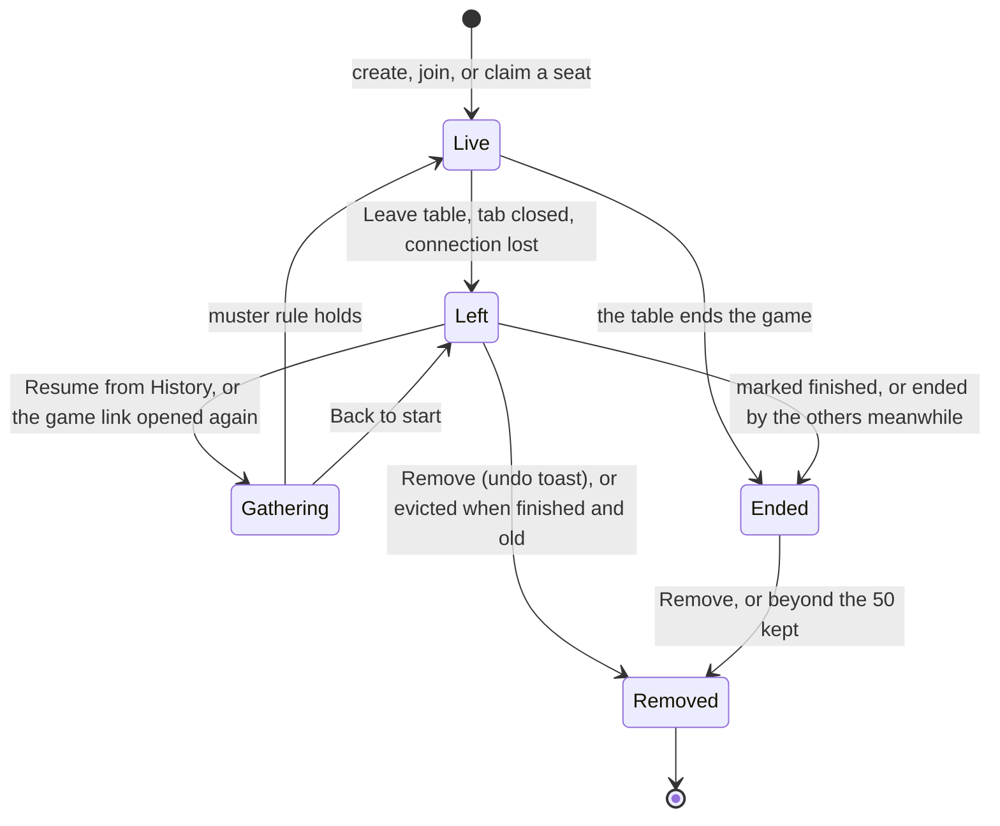
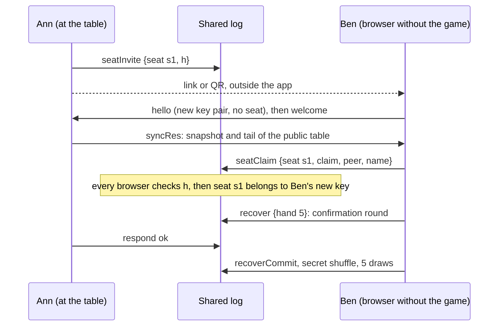

# M8 design: save, leave, history and rejoin

Topic "persistence" of Milestone 8. Source: `docs/design/m8/owner-request.md`. Written against the code on branch `m8` (20 Nov 2026).

Words used here:

- **Game**: one table with its players, from creation until the players stop. What DESIGN calls a table or a room.
- **Game code**: the game's identity. *Ruling: the existing room id, three words and a number (`amber-fox-93`, shown as `AMBER FOX 93`); the six-character form this file proposed is not built in M8.* It is the room id on the transport and the key of every local record of the game.
- **Room key**: the 128-bit secret that already travels in the invite link and encrypts signalling. Unchanged.
- **Seat**: one player's place in the game (`s0`…`s3`). A seat belongs to one browser identity (an ECDSA key pair) at a time.
- **Head**: the newest point of a browser's copy of the game: its last sequence number `seq` and the hash of the public state at that `seq`.
- **Live** and **standby**: a browser that may act in the game, and one that only looks while it waits for the others.

## Rulings of the lead planner (20 Nov 2026)

Where this file and a sibling differed, the lead planner decided. These rulings override the text below; the decisions are recorded in `docs/DECISIONS.md` (`[M8 plan]`).

- **Who builds what** is decided by `docs/PLAN.md`, "Milestone 8: Journey, decks and matchmaking" (eleven packages M7-P1, P2, P3, P5 and M8-P1 … M8-P7 after one contracts agent M8-C). The chunk ids in this file (J…, MM-…, PS-…, DK-…, C…, DS-…) name pieces of work, not packages; its build plan is a checklist for the package that PLAN names, and whatever PLAN lists under "later" is not built in the overnight run.
- **Game code:** the existing room id, three words and a number (`amber-fox-93`, shown as `AMBER FOX 93`). No six-character code in M8; no stored id changes.
- **No blur in CSS anywhere:** no `backdrop-filter` and no `filter: blur()` in the shell or over a table. The arena behind Home is a still that `src/scene/still.ts` delivers already soft; a saved table behind the Gathering card is dimmed by the flat `overlay` scrim, never blurred (card faces are on it).
- **Control heights** are the kit's four: 28, 36, 44, 56 px (`visual.md` V4).
- **Deck strength** is the one formula of `decks.md` section 5, in `src/data/deck/strength.ts`; the lobby's `Band` 1 to 5 is its five bands in order.
- **Leaving** has no confirmation and no first-time dialog; the table shows a back arrow top left.
- **The primary button** always starts the selected mode; it never reads `RESUME` or `CONTINUE`. The `CONTINUE` strip under it reopens the last unfinished game.
- **Game code:** D3's six-character code and PS-1's `randomGameCode()` are not built; every "K7QW2M" below reads as an existing room id.
- **`GameSummary` gains** `thumb` (outlines of the public battlefield cards: `{ w, h, cards: [x, y, tapped, seatIndex][] }`, at most 80, computed by `session/summary.ts`), `opponent?: 'sparring' | 'dummy'` for solo games, and `result` (copied from `TableState.result`).
- **Seams to the table** are `HudShellProps` and the table frame (`src/ui/table/TableFrame.svelte`): this topic fills `src/ui/gather/Gathering.svelte`, `src/ui/seat/SeatMenu.svelte`, `src/ui/seat/SeatBadge.svelte` and `src/ui/seat/presence.ts`; it edits no HUD file, no `ui/menu.ts` and no `scene/table-scene.ts` (the read-only table is M7-P5's `setReadOnly`).
- **Bringing a player back:** the seat menu's top shows the away line and the button `BRING BEN BACK`; pressing it sequences `seatInvite` and shows the QR code and link in place (popover on a wide window, sheet otherwise). The invite sheet and the QR helper are shared with the private waiting room (`src/ui/lobby/InviteSheet.svelte`, M8-P4; `src/ui/qr.ts`, M8-C).
- **Core tonight** (M8-P5): PS-1 without the code generator and the per-game export, PS-2, PS-4 (list, card with thumbnail, resume, remove with undo), PS-5, PS-6, PS-7 through the seams above, PS-8, PS-9's automatic opening of the recovery panel, leak scenarios PL-1 to PL-4 and PL-6. **Later:** PS-3 (quota ladder, compaction; the `NOT SAVING` state itself is core), PS-11 (one tab per game), PS-12 (gathering in the background), rename, mark as finished, export of one game, the deck-fit filter and badges of PS-9, PL-5, PL-7, PL-8.

## What already exists, and what M8 adds

Much of the owner's request is already built and tested (M1-P7, M1-P8, M5-P3, M5-P6). M8 must build on it, not beside it.

| Area | Exists today | M8 adds |
| --- | --- | --- |
| Saving | Every sequenced action is written with the table record and the player's own `SecretStore` in one IndexedDB transaction (`session/persist.ts`, `store/tables.ts`). A snapshot every 200 actions. | A 20-second checkpoint timer, a History summary record, flushes on hide and leave, a visible save state, quota handling. |
| Leaving | Closing the tab keeps the seat; the sequencer marks it away after 6 s; the others play on. | An explicit **Leave table** action, an immediate away mark, the game appears in History. |
| Re-entry | Opening the same link rejoins the seat by key pair and catches up from the peer with the highest `seq` (`net/engine.ts deferTo`, `net/sync.ts`). Forks are found and repaired (`adopt`, rewind, own actions proposed again). | History as the way back in (no link needed), a Gathering screen, the rule for when a returning browser may act, a head announcement, plain notices after a fork. |
| Seat proof | `hello`/`welcome` with an ECDSA P-256 signature bound to the connection (`net/hello.ts`). A returning key pair reclaims its seat. | Seat take-over by a new key pair through a one-time re-invite token. Today a browser that lost its storage can never sit down again once the game has started. |
| Lost hidden cards | The public, logged lost-save recovery: `recover`, a confirmation round on the hand count, `recoverCommit` of the re-imported deck minus the public cards, shuffle, draws (`core/reducer/recovery.ts`, `session/resume.ts`, `ui/recovery/RecoveryPanel.svelte`). Leak-tested in `tests/sim/resume/leak.test.ts`. | The recovery reachable after a seat take-over, a deck picker that knows which decks fit the table, new leak scenarios. |
| Export | A backup file with decks, saved tables and the identity (`store/backup.ts`). | A per-game export from History ("move this game to another device"). |

## Decisions

Each decision names its reason and the owner sentence it serves. The integrator copies them to `docs/DECISIONS.md` as `[M8-persist]` lines.

| # | Decision | Reason | Owner sentence |
| --- | --- | --- | --- |
| D1 | **Leaving never stops or pauses a game.** Leave disconnects this browser and keeps its seat, marked away. The others keep playing. There is no "pause by agreement" as in Zhess. | The owner says so. A card table with up to four players cannot wait on one. | "leaving a game would not stop it" |
| D2 | **Saving stays per action; a timer is added on top.** Every sequenced action is saved at once, as today. A checkpoint runs every 20 s while something changed, and at once on turn pass, stage change, tab hidden, page hide and Leave. | Per-action saving loses nothing in a crash, which a timer alone would. The timer covers what has no action of its own: the History summary, the newest head heard of, the save state. | "the state should be saved by everybody in a timed way" |
| D3 | **The game code is the game's identity.** New games get a six-character code (`0-9A-Z`, as Ztyle chapter 11). It is the transport room id and the key of all local records. The room key stays a separate 128-bit secret stored beside it. Every browser that held a seat keeps code, key and seat, so re-entry from History needs no link. Old three-word room ids stay valid. | Six characters are too few to be a secret: signalling would be decryptable by guessing. So the code names the game and the key guards it. | "game codes will provide the game's unique identity to reconnect directly … no new invitation needed to be sent around" |
| D4 | **The transport stays Trystero**, behind the unchanged `Transport.join(code, key)` seam. | The owner names PeerJS as the example of a "webRTC glue service". Trystero is that glue, already built, tested and mesh-capable for four players. PeerJS has one public broker and no rooms. Nothing in this design depends on which one is used. | "reconnect directly via PeerJS to it" |
| D5 | **History lists every game in which this browser held a seat**, newest first, from a new small `games` store, so the list never loads snapshots. At most 50 games are kept. | The list must open instantly and work offline. | "when the game is left, it lands on the history, and can be re-entered" |
| D6 | **A returning browser starts in standby and becomes live by a fixed rule** (the muster rule, below): it is in sync with a live player, or everybody who was present in the newest copy is back, or the gathered players choose **Play on without …**. A browser that never left stays live. | "Only if all players reconnect" must not deadlock a game when one player never returns, and "the remaining players continued" must stay possible. Standby prevents stale copies from being played on by accident, which is the main source of forks. | "can be re-entered. but only if all players reconnect and exchange the saved state has been synced up"; "if one player doesn't show up … re-inviting" |
| D7 | **Newest wins means: the copy with the higher `seq` wins.** With equal `seq` and different hashes, one fixed tie rule decides (the smaller head hash; section 6). The losing side rewinds to the fork point, takes the winner's history, and proposes its own actions from the abandoned part again on top. Players are told in plain words. | Higher `seq` wins is the rule the engine already follows and that survived three review rounds. Without a fork the higher `seq` is strictly the newer state. A wall-clock "newest" is not deterministic across machines. | "the newest overrides the older states, in case the remaining player or players continued to make some moves" |
| D8 | **A seat is proven by the browser's key pair, not by a shared secret.** The room key admits a browser to the room; the signature admits it to its seat. Once a game has left the lobby, an unknown key can only watch, or take a seat with a re-invite token. No HMAC room lock as in Zhess. | Zhess locks a room to two devices with one shared key. Spellplane has up to four seats and hidden cards per seat, so each seat needs its own proof. It exists already. | "re-inviting him via a link or QR code" (the only case the key pair cannot cover) |
| D9 | **Re-invite is a one-time seat claim.** A present player opens the away player's seat menu and chooses **Bring … back**. This sequences the hash of a random token; the link and QR carry the token. A browser that still has its save ignores the token and simply resumes. A browser without a save sends the token and takes the seat with its new key pair. | One link serves both of the owner's cases. The token's hash is in the shared log, so every peer checks the claim the same way, in the pure reducer. | "if one player doesn't show up or the browser expunged the local state, re-inviting him via a link or QR code should work from ingame in a special menu present in each the player state in the respective panel" |
| D10 | **In team games only the teammate may re-invite a seat** (any present player if the whole team is away). | A seat's holder receives the teammate's hand. An opponent must not be able to hand that seat to a browser of their choice. | Hard rule: hidden information leaves its owner only through designed reveal paths |
| D11 | **Lost hidden cards are rebuilt, not restored.** The public table is synced from the newest other player. The player's hand and library, which never left the lost browser, are rebuilt by the existing public recovery: deck list minus the player's public cards, reshuffled with everyone's nonces, a fresh hand of the size the table agrees to (default: the size the hand had). It is written in the log and the game is marked as recovered. | It is the only recovery that keeps the hard rule without asking players to keep a secret in advance. It is built and leak-tested. | "if the player rejoins with that link the state is synced by the newest other player joining" |
| D12 | **No encrypted backup of secrets on other peers in M8.** Weighed in detail below. Short form: the only secret every player naturally keeps outside the browser is the shared invite link, which every other player also has; any other key needs a step the player must take in advance, and a browser's storage and its keys die together. | An escrow that needs an unprompted action protects almost nobody; one keyed by the shared link is a leak. | Hard rule as above |
| D13 | **Storage: ask for persistence when it matters, never delete an unfinished game's secrets automatically, say plainly when saving fails.** `navigator.storage.persist()` is requested when a seat is first taken; the result is shown in History. Under pressure the image cache goes first, then old logs are compacted, then finished games are removed. A browser that cannot save shows **Not saving** to its player and to the others. | A hand that is deleted silently is the worst failure of this feature. Everything else can be rebuilt. | "states are saved locally in the browser"; "the browser expunged the local state" |
| D14 | **One tab per game.** A Web Lock `spellplane:game:<profile>:<code>` guards a live game; a second tab opens it read-only with **Use here**. | Two tabs with one key pair write the same records and fight over the seat. Ztyle chapter 18 prescribes the lock. | (robustness) |
| D15 | **Protocol version 4, database version 2.** New actions `seatInvite`, `seatClaim`, `playOn`; new control message `head`; new store `games`. | A version-3 reducer refuses the new actions, so mixed tables must see the version notice. | (compatibility) |
| D16 | **Losing storage during a live draft or deck building loses the pool.** The player can be re-seated; the table then abandons the draft (the existing `draft → lobby` edge) or continues without that player. No pool reconstruction in M8. | A drafted pool exists nowhere but in its owner's browser, and no deck list can replace it. | Hard rule as above |

## Detailed design

### 1. Life of a game on one browser



- **Live.** This browser is in the room and may act.
- **Left.** The game is in History. Nothing runs. The seat is kept in the shared state, marked away for the others.
- **Gathering.** This browser is in the room in standby: it sees the table, its hand and the log, but cannot act (section 5).
- **Ended.** The summary carries `endedAt`. There is no rules enforcement, so a game ends when the table says so: `endedAt` is set when the shared state gets a `result` (the matchmaking topic's `concede` and agreed result). A table back in the lobby after at least one game also counts as ended, and the History card menu has **Mark as finished** for games that simply stopped. An ended game opens read-only.
- **Removed.** Local records deleted. The seat stays reserved in the others' copies; the player can only come back by re-invite and recovery.

Solo and practice games have the same life without Gathering: they are always live. Each gets its own code and an empty room key (today there is one `solo` slot; `createSoloSession` already takes `roomId`).

### 2. What is saved, when and where

Everything is in the IndexedDB database `spellplane` (`spellplane-<profile>` in tests), version 2.

| What | Store and key | Written when | Size, typical |
| --- | --- | --- | --- |
| Each sequenced action | `log`, `[code, seq]` | at once, per action, in one transaction with the next two rows | 0.2–0.6 kB each; 2–4 MB for a long four-player game |
| Public state: latest snapshot, `lastSeq`, own seat, stage, protocol | `tables`, `code` | per action (record), snapshot moved every 200 actions and when the stored log could be in doubt | 150–300 kB |
| The player's own `SecretStore`: identities and salts of own hidden cards, library order, hand, received identities, audit records, draft pool | `secrets`, `code` | per action, and alone when it changes without an action (coalesced) | 10–80 kB |
| The History summary (`GameSummary`, section 3) | `games`, `code` (new) | at creation, at every checkpoint, on Leave | under 2 kB |
| Open randomness nonces, turn-ups owed, recovery owed, **seat claim owed** | `localStorage`, per code and identity (`session/nonces.ts`; new kind `claim`) | when they arise; deleted when settled | under 1 kB |
| The browser identity (key pair as JWK, nickname) | `identity`, `'me'` | first visit | 1 kB |

Not saved: own actions not yet sequenced (a window of well under a second; they are lost on a crash, as today), cursors and drags, voice, the claim token of an invite this browser issued (kept in memory for the page only).

**Checkpoint** (`session/checkpoint.ts`, new). One function, `checkpoint(reason)`, called:

- every 20 s by a timer, only when an action was applied or the head heard of changed since the last one;
- at once after a sequenced `turnPass`, a stage change, `seatClaim`, `recoverCommit`, `playOn`;
- on `visibilitychange` to hidden and on `pagehide`;
- on Leave, before the room is left (awaited, at most 1.5 s).

It writes the `GameSummary` (with `savedAt`, `seq`, `knownHead`), flushes a pending secrets write, and asks `storageStatus()` once a minute to drive section 4. It never moves the snapshot: the snapshot cadence belongs to `TablePersistence` and its hold rule for stretches played alone.

**Save state** shown to the player, on the own life plate's menu and as a chip only when not fine:

| State | When | Shown |
| --- | --- | --- |
| Saved | the last write succeeded | menu line `Saved · 4 s ago` |
| Not protected | saved, but `navigator.storage.persisted()` is false | menu line `Saved · this browser may clear it` with **Protect** |
| Not saving | a write failed and the retry after freeing space failed, or the database cannot be opened (private window) | red chip `NOT SAVING` beside the own plate; the others see a small crossed-disk glyph on this player's plate with the tooltip `Ben's browser is not saving. If Ben leaves, his hand is lost.` |

### 3. History

**Data.** One record per game in the new `games` store (`keyPath: 'code'`, index `lastPlayedAt`):

```ts
/** store/types.ts. What History shows and what re-entry needs, without loading the table. */
export interface GameSummary {
  code: string;                       // game code = room id = key of tables/log/secrets
  key: string;                        // room key; '' for a solo or practice game
  kind: 'private' | 'matched' | 'solo';
  format: Format;                     // '1v1' | 'ffa3' | 'ffa4' | '2hg'
  decks: 'constructed' | 'draftLive' | 'draftPrebuilt';
  title?: string;                     // only if the player renamed the game
  seat: SeatId | null;                // own seat
  deck?: { id: string; name: string }; // own deck record used at Ready, if any
  players: {
    seat: SeatId; name: string; colour: SeatColourIndex; team?: TeamId;
    life: number; away: boolean; me: boolean;
  }[];
  stage: Stage;                       // 'lobby' | 'draft' | 'build' | 'match'
  game: number;                       // TableState.games ?? 0: game number of the evening
  turn: number;                       // TableState.turn.number
  active: SeatId | TeamId | null;     // whose turn
  seq: number;                        // own head
  hash: string;                       // state hash at seq
  knownHead: { seq: number; name: string } | null; // highest seq any verified peer ever reported, and who
  handLost: boolean;                  // own hidden cards cannot be named (recoveryStatus phase 'lost')
  recoveries: number;                 // sequenced recoverCommit actions of any seat
  takeovers: number;                  // sequenced seatClaim actions of any seat
  createdAt: number; lastPlayedAt: number; savedAt: number;
  leftAt?: number;                    // set by Leave or when the session closed
  endedAt?: number;
  deletedAt?: number;                 // soft delete while the undo toast is up
  compactedBelow?: number;            // log entries below this seq were dropped (section 4)
  bytes: number;                      // rough size of this game's records
}

export interface GameStore {
  create(meta: Pick<GameSummary, 'code' | 'key' | 'kind' | 'format' | 'decks'> & Partial<GameSummary>): Promise<void>;
  put(summary: GameSummary): Promise<void>;
  get(code: string): Promise<GameSummary | null>;
  /** Newest first by lastPlayedAt; without soft-deleted ones. */
  list(): Promise<GameSummary[]>;
  /** Soft delete; `purge` removes games, tables, log and secrets records in one transaction. */
  remove(code: string, at: number): Promise<void>;
  restore(code: string): Promise<void>;
  purge(code: string): Promise<void>;
}
```

`summarise(state, secrets, prior, heads): GameSummary` is a pure function in `session/summary.ts`. `lastPlayedAt` moves only when this browser applied an own action or stayed 15 s (Ztyle chapter 11: peeking does not reorder History). The launcher (journey topic) calls `GameStore.create` with `kind`, `format`, `decks` and the deck before it opens the session. Games saved before M8 get a summary the first time History opens (built from the `tables` record's snapshot).

**Where.** On the landing page below the fold, as in Zhess: a section `YOUR GAMES` with the five most recent cards, then `N MORE GAMES` opening the full list grouped `TODAY`, `THIS WEEK`, `EARLIER`. The landing page's primary pill reads `RESUME` when the most recent game is unfinished; `GameStore.list()[0]` is what the journey topic needs for that.

**Card.** A glass card, 96 px high on desktop (72 px on a phone), whole card is one button.

| Part | Content |
| --- | --- |
| Thumbnail, left, square | A drawn mini table, not a card image: a rounded rectangle with one disc per seat at its table edge in the seat colour, the life total inside, the own disc ringed, away discs hollow. Drawn as inline SVG from `players`. It needs no network and no card art. |
| Title | The other players by name: `vs Ben`, `Ben, Cy and Dana`, `You + Ann vs Ben + Cy`. A renamed game shows its title. A solo game: `Practice`. Never the code. |
| Line 2, muted | `1v1 · Constructed · Mono-Green Stompy` (format, deck source, own deck name). |
| State line | `Turn 7 · your turn` · `Turn 7 · Ben's turn` · `Drafting` · `Building decks` · `Not started` · `Ended · you 14, Ben 0` (life totals, no winner is claimed). |
| Right column | relative time (`3 d`), below it the code in small muted type (`K7QW2M`), so two players can say which game they mean. |
| Badges | `HAND LOST` (danger) when `handLost`; `NEWER ELSEWHERE` when `knownHead.seq > seq` (tooltip `Ben has a newer table. It is taken over when you both are here.`); `● 2/3` while this game is gathering in the background. |

**Actions.**

- Tap: unfinished games open Gathering (section 5); ended games open read-only.
- Card menu (the `⋯` button, or long-press): **Resume**, **Invite link** (the plain game link: code and key, no token), **Export this game…**, **Rename**, **Mark as finished**, **Remove**.
- Swipe left, or the hover `×`: Remove with an undo toast for 6 s: `Game removed` · **Undo**. For an unfinished game the toast reads `Game removed. Your hand in it goes with it.` · **Undo**. The records are purged when the toast expires or at the next start.
- **Export this game…** writes `spellplane-game-<CODE>.json`: the existing `BackupFile` with this one table and the identity. Importing it on another device (Settings, Storage, as today) brings seat and hand along. The dialog says: `This file holds your hand and library for this game and your player key. Keep it to yourself.`

**Empty state.** `No games yet. Games you play are kept here, on this device, so you can leave and come back.`

**Protection line** under the list, always visible:

- persisted: `Saved games are protected in this browser.`
- not persisted, generic: `This browser may delete saved games when space is short.` · **Protect**
- not persisted, Safari outside a Home Screen app: `Safari deletes saved games after seven days without a visit. Add Spellplane to the Home Screen, or export a backup.` · **How**

**Protect** calls `navigator.storage.persist()` from the click (Firefox shows its prompt; Chrome and Safari decide silently) and updates the line.

### 4. Quota and eviction

`navigator.storage.persist()` is requested, besides the existing call at start, at the moment a seat is first taken in any game (a click preceded it). The app never depends on the answer.

When `usage > 0.8 × quota`, or a write fails with `QuotaExceededError`, `relieve()` (`store/quota.ts`) runs these steps in order and stops as soon as usage is under 70 %:

1. Trim the image cache to half its entries (it is rebuildable; `store/images.ts` LRU exists).
2. Compact the log of ended games, oldest first: move the snapshot to `lastSeq`, delete log entries except the last 500, set `compactedBelow`. The game still opens; its log panel starts at that point and its audit covers only what is left.
3. Compact the log of unfinished games not opened for 30 days, the same way.
4. Remove ended games beyond the 20 newest, oldest first.

Never automatic: removing an unfinished game, or touching any game's `secrets` record. If the steps do not free enough, the save state becomes **Not saving** and the existing `storageFull` empty state is shown with the list of games and their sizes (`bytes`), so the player chooses.

Independent of pressure: History keeps 50 games. When a 51st is created, the oldest ended game is purged; if all 50 are unfinished, nothing is purged and History shows `50 unfinished games. Remove some to keep this list short.`

A game that never left the lobby and was not opened for 24 hours is purged at start (nothing in it is worth keeping).

### 5. Leaving and coming back

**Leave table.** In the table menu and in the own plate's menu. No confirmation dialog. It runs `checkpoint('leave')`, sends `bye {reason: 'leave'}`, leaves the transport and shows the landing page with the game's card first. A toast on the landing page: `You left the table. The game goes on; your seat is kept.` · **Rejoin**. Browser Back and closing the tab do the same without the `bye`.

For the others: a `bye {reason: 'leave'}` removes the peer at once, and the sequencer's away mark must follow within a second (chunk PS-7 asserts it; the 6 s silence rule stays for closed tabs). Toast: `Ben left. The game goes on; Ben can come back.` Ben's plate dims, his presence dot turns hollow, and his seat menu offers **Bring Ben back**.

**Coming back.** From the History card, the `RESUME` pill, the original invite link, a re-invite link, or a reload. All of them open the same route with the same steps:

1. Take the Web Lock for the game. If another tab holds it: read-only notice `This game is open in another tab.` · **Use here**.
2. Load the own save (snapshot, log tail, secrets). The table is drawn from it immediately, read-only and dimmed by the flat `overlay` scrim (never blurred), behind the Gathering card.
3. Join the room and run the reconnect protocol (section 6), in standby.
4. When the muster rule holds, the scrim fades (400 ms) and the table is live. No click is needed.

**The Gathering card.** A centred glass sheet (`rounded-2xl`, 420 px wide; full width minus 32 px on a phone) over the blurred table.

- Title: `Getting everyone back` (two players: `Waiting for Ben`).
- One row per seat: avatar in the seat colour, name, a state at the right:
  - `● Here` (solid dot),
  - `◌ Connecting…` (pulsing; signalling found the peer, the handshake or sync is running),
  - `○ Not here` with a small pill **Bring back** (opens the re-invite sheet, section 7),
  - `○ Left before you` for seats marked away in the newest copy; they are not waited for and have the same pill.
- One muted line with the newest copy: `Newest table: Ann's · turn 7 · saved 2 days ago`. If this browser's own copy was replaced: `Your copy was 38 actions behind. It is up to date now.`
- Ghost button **Look at the table**: hides the card and shows the table read-only with a banner `Waiting for Ben · Bring back · Play on without Ben`.
- After 8 s of waiting, a ghost button **Play on without Ben** (with several missing: `Play on without Ben and Cy`). Under it: `If they come back with a newer table, theirs replaces this one.`
- Ghost button **Back to start**. The game stays in History.
- Failure lines, one at a time, replacing the newest-copy line: `No connection. Trying again in 8 s.` · **Try now**; `The connection service cannot be reached.` with the existing remedies; the version notice of `net/version.ts`.

While this browser is in Gathering, the player may go to the landing page or the deck builder; the room stays joined, and a floating pill at the bottom centre shows `● 2/3 · Waiting for Ben` and returns to the game on tap. When the muster completes while the player is elsewhere, the pill reads `Everyone is back` · **Play** and pulses once. (This needs a session that outlives the route; build chunk PS-12. Until then, leaving the Gathering screen leaves the room.)

**The muster rule.** `musterStatus()` in `session/muster.ts` is a pure function of the confirmed state, the own seat, the connected verified peers with their heads, and `knownHead`. A browser is **live** when one of these holds:

1. **Stayed.** It has been live since it joined and has not reloaded. A player who stays keeps playing when everyone else leaves.
2. **In sync with a live player.** It holds the same `seq` and hash as a connected peer whose `head` says `live`.
3. **Everyone who was there is back.** It is in sync with every connected seated peer; every occupied seat that the confirmed state does not mark away is connected; and no peer ever reported a higher `seq` than it holds now (`knownHead`).
4. **The table decided.** A gathered player pressed **Play on without …**. That sequences `playOn {without}`, which marks the named seats away; each browser clears its `knownHead` when it applies the action; rule 3 then holds for everybody gathered.

Otherwise it is in **standby** and `musterStatus` names the seats it waits for. In the lobby stage every browser is live: before the game starts there is nothing a stale copy could damage.

Why this is right in the common cases:

| Case | Result |
| --- | --- |
| Ben leaves, Ann plays on, Ben returns while Ann is there | Ben syncs to Ann and is live by rule 2 within a second. |
| Ben leaves, Ann plays on, Ann leaves, Ann returns alone | Ann's copy marks Ben away, so rule 3 holds: Ann is live alone and may go on. |
| Same, but Ben returns alone first | Ben's copy shows Ann present. Ben waits for Ann, or plays on without her knowing hers may be newer. |
| Ann reloads while she is the only one there | Her copy marks the others away: live at once by rule 3. |
| Three players; Cy's copy is old; Cy and Dana (also old) meet | Their newest copy shows Ann and Ben present. They wait, or play on by decision. |
| Ben connected, announced a newer head, and dropped before the sync finished | Ann stays in standby by the `knownHead` clause: `Ben has a newer table. Waiting for Ben.` |
| A brand-new game | No other seat is occupied: live by rule 3. A joiner is live by rule 2. |

**What standby allows.** Looking at everything the player may see (table, own hand, log), chat, `seatInvite`, `playOn`, and `seatClaim`. These are safe to replay on any later state. Everything else is refused in the session with the HUD line `Waiting for Ben`; the scene is told `readOnly` so cards do not lift. The session's own automatic proposals (nonce contributions, turn-ups, re-issues) also wait.

### 6. The reconnect protocol

Steps 1 and 3 exist; step 2 and the rule's last clause are new.

1. **Handshake**, per connection, on `ctl`: `hello {peerId, pubKey, nickname, seat, role, lastSeq, nonce}` both ways; each side answers `welcome {peerId, sig, sequencer, seq}` where `sig` signs the other's nonce bound to this connection. A peer is verified when its `peerId` is the hash of its key and the signature checks out.
2. **Head announcement** (new): after verification, and again 500 ms after its confirmed `seq` last changed or when `live` or `saving` changes, each peer sends

   ```ts
   /** net/messages.ts, channel ctl. Public facts only. */
   export type HeadMessage = Envelope<'head', {
     seq: number;      // last applied seq
     h: string;        // base64url SHA-256 of the canonical JSON of the public state at seq
     turn: number;     // TableState.turn.number, for display
     stage: Stage;     // for display
     live: boolean;    // the sender may act (muster rule)
     saving: boolean;  // false when the sender's browser cannot save
   }>;
   ```

   The engine stores the last head per peer (`PeerInfo.head`) and does nothing else with it. The session reads it for the muster rule, the Gathering card and `knownHead`.
3. **Reconciliation** (engine, unchanged): a browser that is not reconciled follows the verified peer with the highest `lastSeq`. It first re-reads that peer's last 64 actions to find a fork; then it takes the missing tail, or a snapshot plus tail when more than 500 actions are missing. Hashes are compared every 50 actions afterwards.
4. **Muster** (section 5) decides when the browser may act.

**"Newest" defined.** Copy X is newer than copy Y when `X.seq > Y.seq`; with equal `seq`, when the hashes differ, the copy with the lexicographically smaller `h` is newer; equal `seq` and `h` are the same copy. The order depends only on the two heads, never on who connected first or on a clock.

The engine's present choice at equal `seq` is not written down anywhere. Chunk PS-6 adds a simulated-network test that two different copies of equal length converge to the same one whatever the connection order; if the engine already does that by another fixed rule (lowest seat index, lowest peer id), that rule is kept and recorded in DECISIONS instead of changing the engine.

**When two branches both advanced.** This happens when the network splits during play and both sides go on, or when gathered players use **Play on without …** and the missing player later returns with more.

- The side with the lower head rewinds to the fork point (the engine keeps states for the last 600 actions; for an older fork it loads the winner's snapshot) and takes the winner's history.
- Each browser on the losing side then proposes its own actions from the abandoned part again, oldest first. The reducer is total: an action that no longer applies (the card moved, the zone changed) is refused and dropped; the others take effect on the new state. Chat lines always survive. The sequencer's own records (`away`, `sequencerClaim`) are not proposed again.
- Hidden cards stay consistent because only the owner can act on its own hidden zones: a draw made on the abandoned branch is proposed again and draws the same top card. Every own card counts as seen after a rewind, so the next shuffle re-issues its ids (existing rule).
- Everyone on the losing side sees one notice, as a toast and a log line: `The table was played in two versions since turn 6. Ben's version is newer and is the table now. 7 of your actions were played again on top; 2 no longer applied.` When nothing a player did was lost (only sequencer records), there is no notice, as today.
- The winning side sees: `Ann rejoined with an older table. Her 7 actions since turn 6 were added.`

The counts come from a new engine event `onAdopt {forkSeq, abandonedOwn, from}` and from the nacks and refusals of the re-proposed actions, collected for 3 s (`session/divergence.ts`).

**Staying connected.** While the game's tab is open, the session re-knocks when no peer is connected: after 1, 2, 4, 8 … up to 30 s, and at once on `online`, `focus` and `visibilitychange` to visible. A re-knock leaves and joins the transport room again with the same engine state.

### 7. Seats, re-invite links and QR codes

**Threat model, unchanged from DESIGN:** the players are friends or matched strangers who want to play; the design stops accidents and casual cheating, not a modified client. Actions are not signed one by one; the sequencer checks that `by` is the sender's seat.

**Locked game.** In the lobby anyone with the link takes a free chair. After the lobby, a browser whose key pair holds no seat can watch (the existing `/watch` path) or claim a seat with a token. Opening the plain game link without a seat shows: `This game has started and every seat is taken. If one of them is yours, ask a player at the table to bring you back from your name's menu.` · **Watch** · **Back to start**.

**The seat menu.** Tapping a player's life plate opens a popover (`ui/design/MenuPopover.svelte`). M8 adds a connection section at its top.

| Seat | Lines |
| --- | --- |
| Another player, here | `● Here` |
| Another player, away | `○ Away for 3 min` (or `since Tue`) · **Bring Ben back…** (primary) · when an invite is open: `Invite open · made by Ann` · **Take the invite back** |
| Another player in a team game, viewer is an opponent and the teammate is here | `○ Away` · `Only Ben's teammate can bring Ben back.` |
| Own seat | `Saved · 4 s ago` (save state, section 2) · **Export this game…** · **Leave table** |

**The re-invite sheet** (bottom sheet on a phone, centred sheet on desktop; Zhess's invite sheet is the model).

- Icon tile, title `Bring Ben back`.
- Text: `Send Ben this link, or let him scan the code. It opens this game at his seat. If his browser still has the game, he gets his hand back. If not, he sits down again and rebuilds his library from his deck list.`
- QR code: dark modules on a white plate in both themes, 192 px, four modules of quiet zone, error correction M. The link is about 105 characters (a few more on the preview path), so the code is version 6 or 7 (41 or 45 modules).
- The link in a read-only field, cut with an ellipsis; primary pill `COPY LINK` (toast `Link copied`); `SHARE` where `navigator.share` exists, with the text `Come back to our game.` Cancelling the share sheet copies nothing.
- State row: `○ Waiting for Ben`, then `● Ben is here`; the sheet then closes after 1.5 s with the toast `Ben is back`.
- Footer: `This link works once, for 24 hours, and only for Ben's seat.` · ghost `MAKE A NEW LINK` (the old link stops working).

QR generation uses `qrcode-generator` 2.0.4 (MIT, no dependencies, the library Zhess uses), loaded only when the sheet opens. Scanning is the phone camera's job; there is no in-app scanner.

**Link format.**

```
<base>/#/t/<CODE>/<roomKey>/rejoin/<seat>/<claim>

https://izzardry.github.io/spellplane/#/t/K7QW2M/3q2-7wAAAAAAAAAAAAAAAA/rejoin/s1/Jf0c1x9mQ2uVb7Yt3LrKzg
```

- `<CODE>` and `<roomKey>`: as in every game link. Needed to find and enter the room.
- `<seat>`: the seat id. Not secret.
- `<claim>`: 16 random bytes, base64url, 22 characters. The only new secret, and it is needed: it is what lets a new key pair take the seat.
- Nothing else: no name, no state, no card data. Everything is in the fragment, which browsers never send to the host.
- Once the route has read the claim, it replaces the address with the plain game link (`history.replaceState`), so the token is not left in the address bar, in screenshots or in the history entry.

**Actions and state** (contracts; `core/actions.ts`, `core/types.ts`).

```ts
/** Seat, added fields. */
invite?: { h: string; by: SeatId; atSeq: number; exp: number };  // the one open re-invite of this seat; exp is ms epoch
takeovers?: number;                                  // how often a new key pair took this seat

/** A present player opens (h set) or takes back (h null) the re-invite of an away seat. Family 'players'. Not undoable. */
export type SeatInviteAction = A<'seatInvite', { seat: SeatId; h: string | null; exp?: number }>;

/** A browser without a seat takes an invited seat. `by` is the seat. `claim` is the token; `peer` the sender's identity. Not undoable. */
export type SeatClaimAction = A<'seatClaim', { seat: SeatId; claim: string; peer: string; name: string }>;

/** The gathered players go on without seats that are not here: marks them away. Family 'players'. Not undoable. */
export type PlayOnAction = A<'playOn', { without: SeatId[] }>;
```

`h = base64url(SHA-256('spellplane-claim|' + seat + '|' + claim))`, computed with `core/sha256.ts`, which is synchronous and pure.

Reducer rules (`core/reducer/rejoin.ts`, new; each refusal has an `explain` text):

- `seatInvite`: the sender holds another seat; the target seat is occupied and marked away; in a team game the sender is on the target's team unless every other seat of that team is away; `h` is 43 base64url characters or null; with `h` set, `exp` is a whole number (the maker's clock plus 24 hours). It sets or deletes `Seat.invite`. A new invite replaces an open one.
- `seatClaim`: the seat has an open invite and `h` matches the token; `peer` holds no seat; `name` is 1–64 characters. It sets `Seat.peer = peer` and `Seat.name = name`, deletes `away` and `invite`, and adds one to `takeovers`. Cards, zones, commitments and life are untouched.
- `away {away: false}` and `seatLeave` also delete an open invite: when the old browser returns by itself, the link is void.
- `playOn`: the sender holds a seat; every named seat is occupied, is not the sender's and is not away. It marks them away. If one of them is in fact connected, the sequencer's existing duty marks it present again right after.

Sequencer checks (`net/sequencer.ts`): a `seatClaim` is accepted from a sender without a seat, like `seatTake`; `by` must equal `seat`; `peer` must be the sender's verified identity peer id; and the sequencer's own clock must not be past `Seat.invite.exp`. The reducer has no clock, so the 24 hours are enforced here, as for every other timer in the design.

Log lines: `Ann made a link to bring Ben back.` · `Ann took the link for Ben back.` · `Ben is back from a new browser (link made by Ann).` · `Ann plays on without Ben.`

**The claim, step by step.**



Details that matter:

- A browser that opens a claim link and has no save **never starts a table of its own**: it waits in Gathering (`Looking for the table…`) until a peer answers, however long that takes.
- The nickname field is prefilled with the seat's name from the synced state; the player may change it before sitting down. Button: `SIT DOWN AS BEN`.
- The claim token is kept in the `claim` slot of `session/nonces.ts` until the confirmed state shows the seat with this browser's peer id and the browser is live. If the table adopts another history in between (the gathered players had an older copy), the session proposes the claim again as soon as that history shows a matching invite.
- A browser that opens a claim link and **does** hold the seat by key pair resumes normally; the token is dropped unused, and the invite is cleared by the `away false` that follows.
- A browser that holds **another** seat in this game: `This link is for Ben's seat. You are Ann at this table.` · **Open my seat**.
- The invite was taken back or used: `This link was already used. Ask for a new one.` · **Watch**. Past its 24 hours: `This link has expired. Ask for a new one.` · **Watch**.
- The old browser returns after a take-over: its key pair holds no seat. It shows `Your seat was taken over from another browser (link made by Ann, 21 Nov 14:02). Your saved hand for this game can no longer be used.` · **Watch** · **Back to start**. Its History card gets the badge `SEAT MOVED`.

What a take-over does not give the new browser: anything hidden. It receives the public state like a spectator would, and from then on what its seat is entitled to (in a team game, the teammate's hand as it changes). Identities other players once showed the old browser in private are not sent again.

### 8. The hard problem: a player who lost their hidden cards

A player's hand, library order, the salts of their commitments and their draft pool exist only in their browser's `secrets` record. When the browser's storage is gone, they are gone. The identity key pair is gone with them, which is why the seat claim of section 7 is needed first.

**Options weighed.**

| Option | What it restores | Why not, or why |
| --- | --- | --- |
| A. **Rebuild in public** (existing recovery): the deck list minus the player's public cards becomes a new library, shuffled with everyone's nonces; the table agrees to a fresh hand count | A playable, fair position: the same cards overall, a random hand of the agreed size | **Chosen.** Nothing hidden leaves any browser. Built and leak-tested. Its cost: the exact hand, the library order and anything known from scrying are lost, and the player needs the deck list. |
| B. Other peers hold the player's secrets encrypted with a key **derived from the invite link** | Everything | A leak. Every player has the invite link, so every peer could decrypt every other peer's hand. Rejected. |
| C. Other peers hold the secrets encrypted with a **personal secret in the player's own address bar** (in the spirit of "the URL is the save") | Everything, even after Safari clears storage, since the tab's URL survives | Players copy their address bar to invite friends, share their screen and post screenshots. One copy gives away seat and hand. Ztyle chapter 11 keeps room games out of the address bar for this reason. Rejected. |
| D. Other peers hold the secrets encrypted with a **personal return link** the player saves on purpose ("Keep my seat": bookmark, send to yourself, scan with the phone) | Everything, for players who did that step | Sound cryptographically (a 128-bit random key the peers never see). But it protects only players who act before the loss, and it adds a second kind of link that must never be shared next to one that must be. Not in M8; sketched below as a later option. |
| E. The same, with the key from a **passkey** (WebAuthn PRF), which survives cleared storage in the OS keychain | Everything, with one Touch ID after the loss | The right long-term answer, no backend needed. Costs a contract change to the hard rule, careful UX, and cannot be tested in WebKit under Playwright (keychain prompts abort the run, see CLAUDE.md). Not in M8; an owner question. |
| F. Peers hold only the encrypted **deck list** | The deck list | Same key problem as B to E, for less benefit. |

**Why A is honest.** The table, not the player, shuffles the new library: the seed mixes every seated player's nonce by commit-then-reveal, so the returning player cannot choose their new hand. The hand size is proposed in public and any player can object by holding the confirmation round. Every step is a logged public action. The game's summary counts `recoveries` and `takeovers`, the audit shows the recovery, and matchmaking can read the count (recommended default for that topic: a game with a recovery is not rated).

**What it cannot do, said plainly in the UI.**

| Lost | After the rebuild |
| --- | --- |
| Which cards were in the hand | A fresh hand of the agreed size from the reshuffled remainder |
| Library order, known positions | A new random order |
| Own face-down cards on the table whose identity only the owner knew | They stay on the table as unknown cards; the owner removes as many cards of their choice from the re-imported list (existing rule; the audit cannot check it) |
| Identities other players showed this player in private | Gone; they can be shown again |
| The deck list itself, if the deck library was in the same lost storage | Must come from outside: pasted text, a file, another device |
| A draft pool during a live draft or deck building | Not recoverable (D16) |

A player could clear their storage on purpose to trade a bad hand for a new one. The table sees it, must agree to it, and the game is marked. Among friends that is enough; for rated play the mark is the remedy.

**The flow for the player** (the existing `RecoveryPanel`, with M8's changes marked):

1. After sitting down again, a panel opens by itself, not dismissible until done or declined: `This browser does not have your hand and library for this game. They were only ever stored in the browser you played in, so nobody can send them to you. You can rebuild them from your deck list.`
2. **Deck.** M8: a picker instead of only a text box. First `Decks on this device that fit` (deck records whose list contains every card of this seat that is face up on the table, checked with `recoveryProblem`), then **Paste a list**, **Open a file**. If nothing fits: `The deck must contain the cards you already have on the table.`
3. **Hand.** A stepper, default the hand size the table last saw (M8: prefilled; the reducer's limit stays deck size minus public cards). Button `ASK THE TABLE`.
4. The others see the existing confirmation prompt: `Ben lost his hand and library. Rebuild from his deck list with a new hand of 5?` · **OK** · **Hold**. Silence passes after the table's pass timer.
5. Commit, joint shuffle, draws run by themselves; the panel shows the three steps ticking. Log: `Ben rebuilt his library (53 cards) and drew a new hand of 5.`
6. If the player has no deck list: **I do not have my deck list** explains the two ways out: `Ask the table to start a new game, or keep watching.` Nothing is proposed.

The recovery also remains available without a take-over, as today, when the identity survived but the `secrets` record did not.

**Later option D, in brief** (not built in M8; here so the owner can decide with the cost in view). At `seatTake` the browser makes a 16-byte seat secret `s`. It publishes `c = SHA-256('seat|' + s)` with the seat, so a holder of `s` can claim the seat later without anyone's invite. After each change of its `SecretStore` (debounced 2 s) it sends each seated peer `vault {seat, seq, iv, box}` on the pair channel, where `box` is AES-256-GCM of the canonical JSON of the store under `HKDF(s, code, 'vault')`, padded to 4 kB steps. Peers keep the latest box per seat in a `vaults` store and return it only to the browser that claimed that seat. The player's own menu offers **Keep my seat…** with the return link `…/#/t/<CODE>/<key>/me/<s>` and the warning `Only for you: this link opens your seat and your hand.` A restored store that does not cover the current hidden zones falls back to option A. It would add about two build chunks and one leak scenario (every box B holds, scanned against A's tokens, plus a test that B cannot derive the key from anything it received).

### 9. Leak-test scenarios

All run on `LoopbackNetwork` through real networked sessions with the shared scanner (`tests/leak/leak.ts`, `leakScan`), in `tests/sim/resume/leak-rejoin.test.ts`. "Observed" always includes every message the observer received, its `TableState`, its `SecretStore` and every record of its stores, now including `games`.

| Id | Scenario | Assertion |
| --- | --- | --- |
| PL-1 | Ann leaves mid-game with seven hidden cards. Ben plays 30 actions, bounces one of Ann's permanents and puts another on top of her library. Ann returns from her save. | Nothing of Ann's hidden cards in Ben's observed data. Ann's hand is her old hand plus the bounced card; her library holds every id of the zone; no recovery is offered. |
| PL-2 | Head announcements during a three-player gathering. | Every `head` message has exactly the keys `v, t, seq, h, turn, stage, live, saving`; no token of any player in any `ctl` message. |
| PL-3 | Ann's browser is replaced by a blank profile (new key pair). Ben invites, the blank browser claims the seat. | No token of old Ann's `SecretStore` in Ben's, Cy's **or the new browser's** observed data: the lost cards were sent to nobody, not even to their owner's new browser. The re-invite URL matches `^.*#/t/[a-z]+-[a-z]+-[a-z]*-?\d+/[\w-]{22}/rejoin/s[0-3]/[\w-]{22}$` (the existing room id form; take the exact pattern from `ui/lobby/room.ts`) and contains nothing else. |
| PL-4 | After PL-3 the new browser recovers with a re-imported deck, the table agrees, shuffle and draws run. | No token of the new library or hand in Ben's or Cy's observed data (the existing recovery scenario, now across a change of identity). |
| PL-5 | Before the loss Ben showed old Ann one card of his hand in private (`revealTo`). The new browser claims Ann's seat. | That card's identity and salt are not in the new browser's observed data. |
| PL-6 | Team game: an opponent proposes `seatInvite` for an away seat whose teammate is present. | Refused by the reducer and by the sequencer; the teammate's hand reaches no new peer (scan of every `prv` message sent after the attempt). |
| PL-7 | A split: Ann alone draws two and plays one face down; Ben alone draws one; they meet, the newer copy wins, own actions are proposed again. | Scan in both directions: no hidden token, and no pair of an old and a new instance id of a re-issued card. |
| PL-8 | Ben exports the game from History. | The file contains none of Ann's tokens. (It contains Ben's own; that is its purpose.) |

`tests/leak/minitable.ts` gains the helpers `leave(page)`, `returnFromSave(page)` and `replaceBrowser(seat)`.

### 10. Failure behaviour

| Failure | Behaviour |
| --- | --- |
| A write fails | `relieve()` once, retry once. Still failing: **Not saving** (section 2), told to the others through `head.saving`. Play continues. |
| The database cannot be opened (private window, blocked storage) | The game runs from memory. **Not saving** from the start, and a line at Ready: `This window does not keep anything. If you close it, your seat in this game is lost.` |
| The tab is killed while a save is in flight | At most the last action is missing locally; the catch-up on return brings it back from a peer. If nobody else has it, it was acknowledged by nobody and is gone. |
| Snapshot and log do not fit together | Existing rule: restore stops at the gap, the restored state becomes the snapshot, and the peers supply the rest. |
| The `secrets` record is missing or older than the table | Existing: `recoveryStatus` reports `lost` only when no library card can be named; a partly stale store is completed from the log where identities were published. |
| No relay reachable when returning | Gathering shows the failure line and re-knocks with backoff. **Look at the table** works offline from the save. |
| Two players cannot connect directly (no TURN, by hard rule) | The existing connectivity notice. In Gathering that seat stays `◌ Connecting…`; after 20 s: `Could not reach Ben directly. Try another network.` |
| A peer runs another protocol version | The existing version notice; that peer does not count as gathered. |
| Two copies of equal length differ | Section 6: the smaller head hash wins; the notice is shown. |
| A re-invite link is opened where the old browser's save still exists but in another profile or browser | It is a browser without the game: it claims the seat and must recover. The sheet's text says so (`If his browser still has the game…`). |
| The player who made the invite leaves before it is used | The invite stays open in the shared state; any present player can see it in the seat menu and take it back or replace it. The link itself cannot be shown again by others (the token was only in the maker's memory): they make a new one. |
| Everyone lost their storage | The code is free. Nothing can be recovered; the first to open the link starts a new game in the lobby. |
| Safari cleared the storage after seven days | The same as any lost storage: History is empty, decks are gone. The protection line and the existing Home Screen and backup hints are the prevention. |

## Seams with the other M8 topics

Read against `journey.md` and `matchmaking.md` as they stood when this was written. Where a screen's layout and copy differ, the journey topic's screen wins; this document owns the states, rules, data and protocol behind it.

| Seam | This document | Other topic | Recommendation |
| --- | --- | --- | --- |
| Route of the re-invite link | `#/t/<CODE>/<key>/rejoin/<seat>/<token>`, one use, 24 hours | journey 4.11: the same | Aligned. |
| Game code format | Six characters `0-9A-Z` for new games; old word ids stay valid | matchmaking MM-18 and journey J21: the existing three words and a number | *Ruled:* three words and a number; nothing stored changes. Six characters stay an open question for the owner. |
| Database version | 2, adds `games` | matchmaking: 2, adds `ratings` and `matches` | One upgrade step creates all three stores; the contracts chunks must be merged as one schema change. |
| End of a game | `GameSummary.endedAt` follows `TableState.result` | matchmaking: `concede`, `claimAbsence`, `result` | Aligned. A matched game's `MatchRecord` and this summary share the code as key. |
| When a returning table unlocks | The muster rule of section 5: seats marked away in the newest copy are not waited for, and **Play on without …** exists | journey J20 and 4.12: every seated player must be connected; continuing without a missing player is "Later" | Use the muster rule. With "everyone must be back", the last player at a table who reloads the page is locked out of a game nobody else is in, and one player who never returns ends the game for all. Both contradict "leaving a game would not stop it". The journey's gate screen needs one more button (`PLAY ON WITHOUT BEN`) and the row state `left before you`. |
| Timed save | Summary and pending secrets every 20 s; the snapshot is **not** moved by the timer | journey J19: "a snapshot and the history entry every 20 s" | No timed snapshot: `TablePersistence` holds its snapshot on purpose while a page plays alone (`holdSnapshot`, M5-P6), so that those actions can be found and proposed again after a reload. Every action is already on disk; a timed snapshot adds nothing and would break that. |
| History entry | `GameSummary` in the `games` store, written by `session/checkpoint.ts` | journey: a `meta` written by `session/persist.ts` | One record: `GameSummary`. The journey's History rows read it. |
| Computer games | Any game with an empty room key is always live and never gathers | computer.md: room id `c-…`, empty key | Aligned; `kind: 'solo'` covers both practice and computer games (`GameSummary.title` or a later `opponent` field names the bot). |

## Build plan

A contracts chunk and twelve build chunks of two to four hours each. Every chunk ends with `pnpm check` green. Playwright runs go through the pnpm scripts, one at a time per worktree, wrapped in oomph as in M7. Order: C first; then 1 and 5 in parallel; then 2 and 6; then 3, 4, 7, 8; then 9 and 10; 11 and 12 last. Chunks 1–10 are the core; 11 and 12 can slip without breaking the rest.

| Chunk | Scope | Files | Acceptance tests |
| --- | --- | --- | --- |
| **PS-C Contracts** (2 h) | `Seat.invite`, `Seat.takeovers`; actions `seatInvite`, `seatClaim`, `playOn` (family `players`, not undoable); `HeadMessage`, `PROTOCOL_VERSION = 4`, `PeerInfo.head`; `GameSummary`, `GameStore`, `SpellplaneDB.games`; `MusterStatus`, `SessionMuster {muster(), playOn(seats), invite(seat), takeInviteBack(seat)}`; `NonceKind 'claim'`; route field `claim?: {seat, token}`; debug hook `session.muster()` | `core/types.ts`, `core/actions.ts`, `net/messages.ts`, `net/types.ts`, `store/types.ts`, `session/types.ts`, `debug/types.ts`, `ui/types.ts` | Type checks; the reducer refuses the three new actions with a reason and leaves the state unchanged (total); `MESSAGE_CHANNEL` compiles with `head` |
| **PS-1 Game store and codes** (3 h) | Database version 2 with the `games` store; `createGameStore`; soft delete, restore, purge in one transaction; summaries for pre-M8 tables on first list; `randomGameCode()` (six of `0-9A-Z`, unbiased); `exportGame(code)` on the existing backup writer | `store/db.ts`, `store/games.ts` (new), `store/stores.ts`, `store/backup.ts`, `ui/lobby/room.ts` | Unit (fake-indexeddb): upgrade from a v1 database keeps every record; purge leaves no `log`, `tables`, `secrets` or `games` row of the code; list order and soft delete; a v1 table gets a summary; the exported file imports into an empty profile and restores seat and hand; code generator is uniform over 36 symbols (chi-square on 36,000 draws with a seeded source) |
| **PS-2 Checkpoints and summaries** (3 h) | `summarise()` pure; `Checkpointer` with the 20 s timer and the event triggers; hide and page-hide listeners; `lastPlayedAt` rule; `knownHead` tracking; save state (`saved`, `unprotected`, `notSaving`) on the session | `session/summary.ts`, `session/checkpoint.ts` (new), `session/net.ts`, `session/solo.ts`, `main.ts` | Unit with fake timers: no write while nothing changed; one write 20 s after an action; immediate write on `turnPass` and on hide; `summarise` of fixture states (1v1, four players, 2HG, draft stage) matches snapshots; peeking for 10 s does not move `lastPlayedAt`, 15 s does |
| **PS-3 Quota and eviction** (3 h) | `relieve()` ladder; `compactLog(code, keep)`; retry after a failed write; `Not saving`; the 50-game cap; purge of stale lobby games at start; persistence request at first seat; protection line model | `store/quota.ts`, `store/tables.ts`, `session/persist.ts`, `ui/storage/*`, `ui/empty/states.ts` | Unit: with a stubbed `estimate` at 85 % the ladder runs steps in order and stops under 70 %; an unfinished game's `secrets` record is never deleted (property test over random game sets); a compacted game restores to the same state hash; a `QuotaExceededError` on write leads to relieve, retry, then `notSaving` |
| **PS-4 History UI** (4 h) | `History.svelte` (five cards, more, grouped full list), `GameCard.svelte`, `MiniTable.svelte` (SVG), card menu, remove with undo toast, rename, mark finished, export, protection line; exported as one component with props for the landing page | `ui/history/*` (new), `ui/harness.ts` | e2e `tests/e2e/history/history.spec.ts` on `?harness=ui` and on two local-transport pages: a left game appears first with title `vs Ben` and `Turn 3 · Ben's turn`; Remove then Undo keeps hand and seat; Remove without Undo purges; axe clean; screenshots in both colour schemes |
| **PS-5 Reducer and sequencer** (3 h) | `seatInvite`, `seatClaim`, `playOn` with every rule of section 7; invite cleared by `away false` and `seatLeave`; sequencer accepts `seatClaim` from an unseated sender with its own peer id; log line texts; invariants | `core/reducer/rejoin.ts` (new), `core/reducer/index.ts`, `core/reducer/table.ts`, `core/invariants.ts`, `core/log.ts`, `net/sequencer.ts`, `net/validate.ts`, `ui/describe.ts` | Unit and property tests: claim with a wrong token, a used token, a taken-back invite, by a seated peer, for a present seat are refused with distinct reasons; the sequencer refuses a claim after `exp` (injected clock); a valid claim changes `peer`, `name`, `away`, `invite`, `takeovers` and nothing else (state diff); team rule in 2HG (opponent refused, teammate accepted, opponent accepted when the whole team is away); determinism test (same actions, same hash) extended with the new actions |
| **PS-6 Head and muster** (4 h) | Engine sends, validates and stores `head`; `musterStatus()` pure; standby gating in `NetTable` (dispatch, drivers) with the allowed standby actions; `playOn` driver; `knownHead` persisted; `onAdopt` event and `session/divergence.ts` notices; re-knock with backoff | `net/engine.ts`, `net/validate.ts`, `session/muster.ts`, `session/divergence.ts` (new), `session/net.ts`, `debug/session.ts` | Sim `tests/sim/resume/muster.test.ts`: every row of the case table in section 5; standby refuses a `move` and accepts a chat; a reload with a live peer is live in under 2 s of simulated time; equal-length different copies converge to the same copy for both connection orders; split and heal produces the two notices with correct counts; the away player returning across a 600-action gap (snapshot catch-up) after opponents bounced and tucked their cards holds every id of hand and library and is offered no recovery |
| **PS-7 Leave and Gathering UI** (4 h) | **Leave table**; away within a second of `bye leave`; toasts; the Gathering card with every row state, the newest-copy line, the three ghost buttons, failure lines; read-only table with banner; scene `readOnly` | `ui/gather/*` (new), `ui/lobby/RoomRoute.svelte`, `ui/Hud.svelte`, `ui/menu.ts`, `scene/table-scene.ts` (read-only flag only), `net/engine.ts` (`bye leave`) | e2e `tests/e2e/resume/gather.spec.ts`, two and three local-transport pages: A leaves, B sees the toast and A's plate away within 1 s; B plays three actions; A resumes from History and is live with B's state hash; both closed, B back alone sees `Waiting for Ann` and cannot drag a card (asserted through the debug hook: no action proposed), then **Play on without Ann** makes B live and logs the line; screenshots of each Gathering state |
| **PS-8 Re-invite** (4 h) | Session `invite(seat)`, `takeInviteBack(seat)`; claim path in `openNetSession` (never sits alone, nickname prefill, claim owed and retried); route parsing and address scrub; seat menu connection section; re-invite sheet with QR (`qrcode-generator` 2.0.4, lazy import, recorded in DECISIONS with its licence); every refusal screen of section 7 | `session/net.ts`, `session/invite.ts` (new), `ui/routes.ts`, `ui/lobby/room.ts`, the life plate's menu from M7-P2 (`ui/design/LifePlate.svelte`, `MenuPopover.svelte`) with a new `ui/seat/SeatMenu.svelte` for its content, `ui/seat/ReinviteSheet.svelte` (new), `ui/lobby/RoomRoute.svelte`, `package.json` | Unit: link build and parse round-trip; QR matrix of a fixed link equals a stored fixture. Sim: claim by a blank identity; claim retried after the table adopted another history. e2e `tests/e2e/resume/reinvite.spec.ts`: B opens A's seat menu, copies the link; a page with a fresh `?profile=` opens it, sits down as Ann, the address bar no longer contains `/rejoin/`; the same link in A's original profile resumes without a claim; a second use shows `This link was already used`; with the sequencer's clock moved 25 hours on, a fresh link shows `This link has expired` |
| **PS-9 Recovery after a take-over** (3 h) | Recovery panel opens by itself for a claimed seat; deck picker with `Decks on this device that fit`; default hand count; the no-deck-list exit; `recoveries` and `takeovers` in the summary; `SEAT MOVED` and `HAND LOST` badges; draft-stage notice (D16) | `ui/recovery/RecoveryPanel.svelte`, `ui/recovery/model.ts`, `session/resume.ts`, `session/summary.ts`, `ui/history/GameCard.svelte` | e2e (extends `tests/e2e/resume/resume.spec.ts`): the blank-profile page from PS-8 recovers with the fixture deck; the other page agrees; library = deck − public cards − agreed hand; both state hashes equal; the old profile, reopened, shows the take-over screen. Unit: the fit filter over fixture decks |
| **PS-10 Leak tests** (3 h) | Scenarios PL-1 to PL-8 with the shared scanner; mini-table helpers | `tests/sim/resume/leak-rejoin.test.ts` (new), `tests/leak/minitable.ts`, `tests/leak/fixtures.ts` | The eight scenarios pass; each is shown to fail when its leak is injected (a test-only switch that puts one hidden card id into a `head` message, a summary, and the `syncRes` to the claimant) |
| **PS-11 One tab per game** (2 h) | Web Lock per profile and code; read-only second tab with **Use here** (lock steal, the first tab goes read-only) | `session/lock.ts` (new), `ui/lobby/RoomRoute.svelte` | e2e: two pages with the same profile on one game: the second shows the notice and proposes nothing; **Use here** swaps the roles; without the Locks API both tabs behave as today |
| **PS-12 Gathering in the background** (4 h) | A `GameHost` that owns at most one networked session beyond the route; the floating gathering pill on the landing page and the deck builder; `Everyone is back` | `main.ts`, `ui/App.svelte`, `ui/gather/GatherPill.svelte` (new), `ui/lobby/RoomRoute.svelte` | e2e: A waits in Gathering, goes to the landing page, the pill shows `1/2`; B opens the game; A's pill shows `Everyone is back`; tap opens the live table. Memory: opening and leaving ten games in a row leaves one engine and no growing listener count (debug hook counters) |

**Gate additions for M8 (persistence part of `tests/e2e/m8.gate.spec.ts`).** Three pages, a four-seat free-for-all with three players and fixture decks: play to turn 3; Cy leaves; Ann and Ben play a turn; Ann leaves; Ben plays on alone; Ben leaves. Ann returns first (waits for Ben), then Ben (both live, Ben's copy is the table). Cy's profile is replaced by a blank one; Ann brings Cy back by link; Cy recovers. Final assertions: three equal state hashes; Cy's library size is deck minus public cards minus agreed hand; History on each page lists the game first with the right state line; the leak scanner over all three pages is clean. Screenshots: History, each Gathering state, the seat menu, the re-invite sheet, the recovery panel.

## Open questions for the owner

Each has a default that the build follows until the owner says otherwise.

1. **Should a lost hand ever be restorable?** Default: no; rebuild in public (D11). The alternatives are a personal return link the player must save in advance (option D) or a passkey that survives cleared storage (option E). Both mean encrypted copies of a player's hand on the other players' devices, which changes the wording of the hard rule "hidden information never leaves its owner's browser".
2. **Who may decide "Play on without Ben"?** Default: any one gathered player, logged for all. The stricter choice is that every gathered player must press it.
3. **PeerJS or Trystero?** Default: stay on Trystero (D4). The owner wrote PeerJS; if PeerJS is meant literally, only the transport implementation changes, not this design.
4. **Is the game code shown?** Default: small on the History card and the Gathering card, never as a title. Zhess hides codes entirely on owner feedback; here two players may have several games with each other and need a way to say which one.
5. **A game with a recovery or a seat take-over in rated matchmaking:** default: the summary carries the counts and the matchmaking topic treats such a game as unrated.
6. **Losing storage during a live draft (D16):** default: no pool reconstruction; the table restarts the draft or continues without that player. The alternative, replacing the lost picks with as many random cards from freshly opened packs of the same set, is fair but is a build chunk of its own in the draft module.
7. **How many games does History keep?** Default: 50, ended ones evicted first, unfinished ones never automatically.
